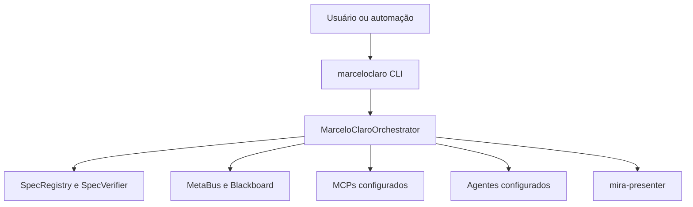
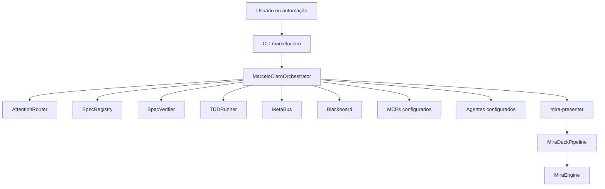

# Arquitetura do OpenCode Ecosystem Core

Este documento descreve a organização técnica observável no checkout. Não é um
relatório de desempenho, cobertura ou validação externa. Para ressalvas sobre
alegações históricas, consulte [CORRIGENDUM.md](CORRIGENDUM.md).

> Hashes, testes e diagnósticos são controles internos de artefatos e
> configurações específicas; não constituem certificação externa de segurança,
> qualidade ou adequação para um domínio de uso.

## Configuração estrutural

Em **2026-09-26**, o diagnóstico local listava **20 checks**. A configuração
`opencode.json` declarava **7 MCPs** e **215 agentes**. As fontes autoritativas
para uma nova conferência são o comando `python3 -m marceloclaro.cli doctor` e
as chaves `mcp` e `agent` de `opencode.json`:

```bash
python3 -m marceloclaro.cli doctor
python3 -c "import json; c=json.load(open('opencode.json', encoding='utf-8')); print({'mcps': len(c.get('mcp', {})), 'agentes': len(c.get('agent', {}))})"
```

<!-- core-state:start -->
**310 agentes** · **16 MCPs** · **33 comandos** · **22 checks**

Inventário derivado de [opencode.json](opencode.json) e do [diagnóstico estrutural](marceloclaro/doctor.py). Contagens de configuração e checks não comprovam disponibilidade, autenticação, inferência ou validação externa.

Para conferir estes blocos, execute na raiz `.venv/bin/python scripts/reconcile_operational_docs.py --check`; para sincronizá-los, execute o mesmo comando sem `--check`.
<!-- core-state:end -->

A configuração inclui `ecosystem-network` e `polymath-labs-mcp`.
A contagem de 2026-09-26 acima é um registro histórico.

Specs, ciclos, testes e cobertura mudam com o checkout. Consulte,
respectivamente, `specs/`, `evolution/cycles.json`, `tests/` e a configuração
de CI em vez de tratar números de documentos antigos como estado atual.

## Mapa completo atual e fluxogramas — R879

A [página navegável da arquitetura](docs/architecture_map.html) reúne a visão
operacional, o grafo completo de dependências e um inventário pesquisável de
arquivos e símbolos. Funciona offline, sem CDN. O
[guia minucioso](docs/ARQUITETURA_COMPLETA_CORE_R879.md) explica os 13 fluxos e
suas fontes; [JSON](docs/architecture/architecture-inventory.json),
[DOT](docs/architecture/dependencies.dot) e
[SVG completo](docs/architecture/dependencies.svg) permitem reprodução e exportação.

O snapshot `6380cfaff4aac0dd940d42011826bb21126e5635` inclui o Core consolidado
até R869: primário compartilhado, transporte real de prompts CLI, workflows,
recebimento e custódia RED/GREEN, análise REA direta e por agente, isolamento e
cancelamento, memória/grafos, raciocínio restrito, diagnósticos e publicação.
O inventário registra 677 módulos Python próprios em 45 pacotes, 6.432 símbolos,
1.051 declarações de importação internas que formam 935 pares de módulos,
oito superfícies TypeScript/JavaScript/Lean e 9.672 arquivos classificados.
Módulos isolados são incluídos. Templates, testes, evidências históricas,
artefatos de domínio e vendor possuem categorias próprias.

Essas contagens descrevem fontes daquele commit; não comprovam execução,
qualidade, cobertura funcional ou validação externa. Conexões dinâmicas,
imports externos e integrações opcionais são explicitamente delimitados.
O [mapa R433–R438](docs/MAPA_ARQUITETURA_R433_R438.md) permanece histórico.

## Visão das camadas



## Diagrama operacional atual

O diagrama abaixo resume o runtime observável sem tentar listar todos os
arquivos, classes auxiliares ou serviços opcionais do ecossistema.



| Camada | Responsabilidade | Referências principais |
|---|---|---|
| Entrada | CLI interativo e comandos diretos. | `marceloclaro/cli.py`, `MANUAL.md` |
| Orquestração | Coordenação de tarefas e roteamento. | `marceloclaro/orchestrator.py` |
| SDD/TDD | Registro de specs, critérios e evidência por teste. | `sdd/spec_engine.py`, `specs/`, `tests/` |
| Memória | Eventos, tarefas e reflexões compartilhadas. | `mci/` |
| Integrações | Servidores MCP e definição de agentes. | `opencode.json`, `integrations/` |
| Apresentação | Geração de deck a partir de pasta de produção. | `illustrations/mira_deck.py` |
| Integridade | Cálculo local de raiz de arquivos selecionados. | `benchmarks/merkle_integrity_guard.py` |

## Servidores MCP Interoperáveis

As entradas abaixo são derivadas das chaves `mcp` de `opencode.json`:

<!-- core-mcp:start -->
1. `antigravity-bridge`;
2. `artigo-academico-mcp`;
3. `arxiv-mcp`;
4. `colibri-mcp`;
5. `ecosystem-network`;
6. `fetch`;
7. `filesystem`;
8. `latexmk-mcp`;
9. `litert-lm`;
10. `metacognitive-interconnect`;
11. `polymath-labs-mcp`;
12. `pypi-search`;
13. `rea`;
14. `scanners-mcp`;
15. `sequential-thinking`;
16. `web-deploy-mcp`;
<!-- core-mcp:end -->

O MCP `ecosystem-network` conecta o `MarceloClaroOrchestrator`, o roteamento
Transformer inspirado em atenção e a memória MetaBus/Blackboard aos executores
de análise e leitura Claude, Antigravity e Codex disponíveis no ambiente. A
coordenação tem limites de passos e tempo, não executa hooks importados e
exige a conclusão para reportar sucesso. O identificador `chatgpt` não controla
o aplicativo ChatGPT; o uso da CLI Codex requer selecionar `codex`
explicitamente. Disponibilidade e autenticação são verificações locais.

Na R644, `ecosystem_workflow` executa um DAG validado de até oito nós sobre
`AutonomousCoordinator`, sob um orçamento global de passos e prazo por
invocação. A execução é sequencial para preservar o Blackboard compartilhado.
`WorkflowStore` publica checkpoints atômicos e aplica exclusão entre processos
por ID; retomada confere a definição e conserva os nós concluídos. Resultado
incerto de execução interrompida exige repetição explícita. A saúde dos CLIs
usa metadados sanitizados em SQLite e pausa automática de 120 segundos.
`ecosystem_workflow_status` consulta o registro sem repetir execuções.

A presença dessas entradas de configuração não implica disponibilidade de toda
dependência externa em cada máquina. O `doctor` expõe a situação encontrada
localmente nos checks do inventário estrutural acima.

## Agentes e orquestração

O arquivo `opencode.json` é a fonte da contagem corrente de agentes configurados
para a integração OpenCode, reproduzida no inventário acima. O Blackboard pode apresentar registros em momentos
diferentes do processo de inicialização; por isso, não se deve misturar uma
contagem de runtime com a contagem declarada no arquivo de configuração.

O fluxo básico é:

1. uma tarefa chega pelo CLI ou por integração;
2. o orquestrador recupera contexto e publica ou encaminha a tarefa;
3. um agente produz um resultado e o estado é registrado;
4. a entrega é avaliada contra os critérios disponíveis para aquela tarefa.

Esse fluxo descreve mecanismos de software, não mérito externo do resultado.

## Domínios multiárea observáveis

| Área | Principais referências observáveis |
|---|---|
| Pipeline acadêmico agentivo | `agentic_science_v2/orchestrator.py`, `deep_research.py`, `review_agent.py`, `revision_agent.py`, `paper_composer.py` |
| Prova, formalização e raciocínio | `integrations/deepmind/formal_verifier.py`, `alphaproof_engine.py`, `aletheia_scaffold.py`, `deep_think_engine.py`, `autoformalizer.py`, `geometry_engine.py`, `lean4_verifier.py`, `egraph_rewriter.py`, `erdos_hirzebruch_solver.py` |
| Jurídico | `legal/integration.py`, `specializations.py`, `knowledge_base.py`, `precedents.py`, `datajud_client.py`, `benchmarks.py` |
| Clínico | `integrations/medical/clinical_game_theory.py`, `clinical_verifier.py`, `evidence_grounding.py`, `clinical_orchestrator_bridge.py` |
| Scientific RAG | `rag/scientific.py`, `rag/evolved.py`, `rag/enhanced_search_rag.py` |
| Universidade Sintética | `synthetic_university/core.py`, `combinatorial_engine.py`, `evolutionary_memory.py`, `mcp_server.py`, `api_gateway.py` |
| Runtime local | `integrations/litert_lm.py`, `litert_lm_provider.py`, `litert_lm_supervisor.py`, `integrations/colibri_provider.py` |
| Integridade e quality gates | `installer/`, `benchmarks/merkle_integrity_guard.py`, `scripts/quality_report.py`, `benchmarks/scientific_reasoning/` |

## SDD e TDD

Uma spec formal pode declarar objetivo, critérios de aceitação, invariantes e
arquivo de teste. O `SpecVerifier` avalia a evidência estruturada disponível
para esses critérios. A ausência de evidência deve permanecer identificável,
em vez de ser apresentada como êxito.

O ciclo de desenvolvimento recomendado é:

1. definir ou ler a spec aplicável;
2. escrever o teste dirigido;
3. implementar a menor mudança que atende ao contrato;
4. executar os testes relevantes;
5. registrar limitações e resultados observados.

O resultado de um teste é restrito ao ambiente, versão e dados utilizados na
execução. Não transforme uma passagem local em certificação externa.

## MIRA e documentação em dupla leitura

O subsistema de apresentações inclui:

| Elemento | Papel |
|---|---|
| `MiraEngine` | Produz componentes visuais de apresentação. |
| `MiraDeckPipeline` | Executa os estágios `extract`, `plan`, `copywrite`, `build`, `animate` e `validate`. |
| `mira-presenter` | Agente usado na execução delegada da apresentação. |

`SPEC-935-R126` registra o agente delegável e `SPEC-935-R127` registra a
documentação em dupla leitura. A interface de uso é documentada no manual;
a arquitetura aponta os arquivos e as responsabilidades.

## Biblioteca técnica local e dados para fine-tuning (R657/R658)

`rag/book_library.py::LocalBookLibrary` extrai PDFs por página física e mantém
fontes, páginas, trechos e termos em SQLite local. Indexação explícita usa
transação; leitura verifica os hashes atuais e bloqueia fontes alteradas.
Os métodos `library_*` do `MarceloClaroOrchestrator` centralizam a interface.
`integrations/ecosystem_mcp.py` publica catálogo e páginas como resources,
busca como tool somente leitura e um prompt de revisão com referências.

`integrations/finetuning_data.py` valida pares, deduplica e conecta fontes
que compartilham conteúdo antes de dividir grupos inteiros entre conjuntos.
Seu gate de avaliação confere identidade do conjunto, protocolo e limiar de
melhora sobre números informados; não executa modelos. A CLI está em
`marceloclaro/library_cli.py`, com saída de dados limitada ao manifesto.

Os contratos, limites e provas locais estão em
[docs/BIBLIOTECA_AI_R657.md](docs/BIBLIOTECA_AI_R657.md).

## Integridade e procedência

### REA sob coordenação central (R808)

`integrations.rea_bridge.ReaBridge` conecta o runtime externo identificado ao
`MarceloClaroOrchestrator.rea_action`. CLI e MCP `ecosystem_rea` convergem
nesse método; resultado e proveniência alimentam observações MetaBus sem
promover confiança. O OpenCode registra também o servidor `rea`, lançado pelo
adaptador, e mantém o agente primário `marceloclaro`. Reversa Universal mantém
seu papel existente. Contratos e limites: [REA](docs/REA.md).

`MerkleIntegrityGuard` e os mecanismos SHA-256 permitem comparar os bytes de
artefatos definidos. Eles ajudam a detectar divergência do material conferido,
mas não são uma prova geral de comportamento, segurança ou correção.

A instalação deve começar por uma versão identificada, um commit Git completo
e uma soma SHA-256 publicada para o artefato que será conferido. O procedimento
reprodutível e as limitações por plataforma estão em
[installer/README.md](installer/README.md).


## Atualização de orquestração R894–R897

O [mapa dos novos percursos](docs/ORQUESTRACAO_AGENTES_PLUGINS_CI_R894_R897.md)
conecta o ciclo de vida de agentes ao mesmo primário, gerador, Blackboard e
MetaBus. Os perfis persistentes ficam no catálogo canônico. A compilação lê os
mesmos bytes validados e o registro mantém sua identidade e hash. Instruções de
plugins, conexão hospedada, grafo Python estático e CI local têm fronteiras e
recibos separados; nenhum deles promove automaticamente confiança científica.

O [parecer Wolfram](docs/AVALIACAO_WOLFRAM_CORE_R895.md) explica o encaixe no
contrato de plugins existente e as condições de uma futura engine local.
