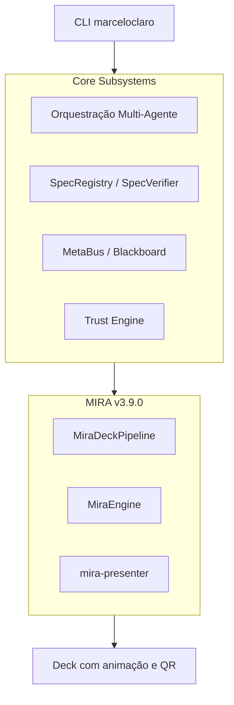
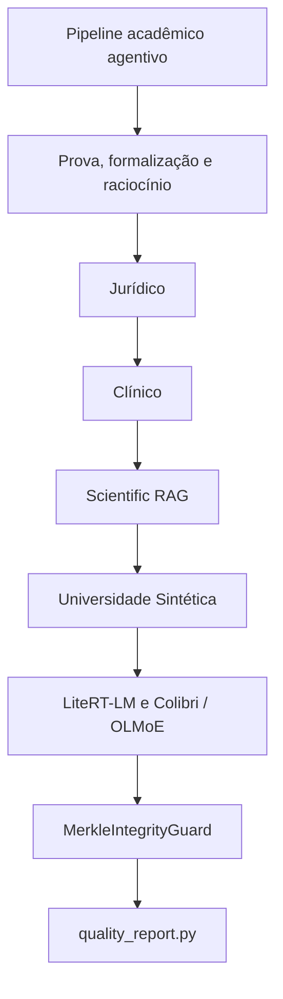
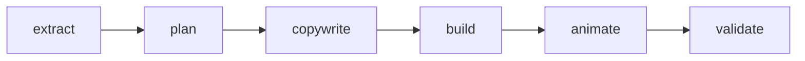
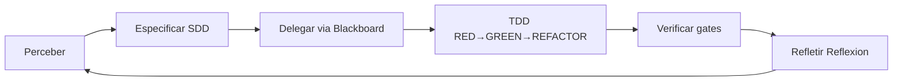
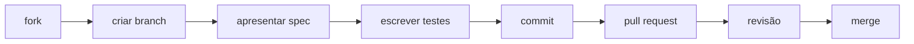

<div align="center">

<a href="https://github.com/MarceloClaro">
  
</a>

# 🧠 OpenCode Ecosystem Core

### Agentes, memória, engenharia reversa e pesquisa com contratos de evidência

Coordenação pelo primário **marceloclaro**, via Blackboard e MetaBus, com
especificações, gates de entrega e rastreabilidade local.

[Primeiros passos](#início-rápido-local) ·
[Arquitetura completa R879](#arquitetura-completa-e-fluxogramas-atuais) ·
[Assistente REA](#engenharia-reversa-local-rea) ·
[Prontidão e evidências](docs/PRONTIDAO_LOCAL_CORE_R868.md)

[](https://github.com/MarceloClaro/opencode-ecosystem-core)
[](LICENSE)
[](https://www.python.org/)
[](ARCHITECTURE.md)
[](opencode.json)

<!-- core-state:start -->
**255 agentes** · **16 MCPs** · **30 comandos** · **22 checks**

Inventário derivado de [opencode.json](opencode.json) e do [diagnóstico estrutural](marceloclaro/doctor.py). Contagens de configuração e checks não comprovam disponibilidade, autenticação, inferência ou validação externa.

Para conferir estes blocos, execute na raiz `.venv/bin/python scripts/reconcile_operational_docs.py --check`; para sincronizá-los, execute o mesmo comando sem `--check`.
<!-- core-state:end -->

A revisão publicada nesta etapa está na branch
[`codex/core-prontidao-rea`](https://github.com/MarceloClaro/opencode-ecosystem-core/tree/codex/core-prontidao-rea).
As contagens acima descrevem configuração; o estado de cada executor depende
do ambiente e da operação solicitada.

---

</div>

## 📑 Índice

- [Visão geral](#visão-geral)
- [Capacidades principais](#capacidades-principais)
- [Início rápido local](#início-rápido-local)
- [Instalação segura e procedência](#instalação-segura-e-procedência)
- [Uso básico](#uso-básico)
- [Engenharia reversa local REA](#engenharia-reversa-local-rea)
- [Memória no terminal e painel](#memória-no-terminal-e-painel)
- [Arquitetura completa e fluxogramas atuais](#arquitetura-completa-e-fluxogramas-atuais)
- [Arquitetura resumida](#arquitetura-resumida)
  - [Mapa da Arquitetura Completa (v3.9.0)](#mapa-da-arquitetura-completa-v390)
  - [Diagrama Operacional Atual](#diagrama-operacional-atual)
  - [Fluxos multiárea do checkout atual](#fluxos-multiárea-do-checkout-atual)
- [MIRA e apresentações](#apresentações-mira)
- [Limites de segurança e operação](#limites-de-segurança-e-operação)
- [Validação, contribuição e release](#validação-contribuição-e-release)
- [Documentação e licença](#documentação-e-licença)

---

## Visão geral

O **OpenCode Ecosystem Core** reúne interfaces CLI, OpenCode, MCP e Streamlit
para coordenação de agentes, consulta de memória, pesquisa e inspeção de
artefatos. O primário `marceloclaro` publica tarefas no **Blackboard (A2A)**,
compartilha contexto pelo **MetaBus** e aplica contratos de entrega **SDD/TDD**.
O roteamento usa componentes inspirados em atenção, com orçamento, prazo,
cancelamento e estado persistido dos executores.

As implementações recentes incluem o primário compartilhado entre as
superfícies MCP, o transporte de prompts pela entrada padrão dos CLIs,
workflows com checkpoints, custódia local RED/GREEN, visualização de memória,
raciocínio por gramáticas restritas e o assistente REA com recibos por hash.
O [guia de arquitetura R879](docs/ARQUITETURA_COMPLETA_CORE_R879.md) documenta
as relações, os caminhos de falha e as fronteiras externas.

Instalação, configuração, autenticação, inferência e análise aceita são estados
distintos. O [relatório de prontidão](docs/PRONTIDAO_LOCAL_CORE_R868.md) registra
os caminhos demonstrados: inspeção REA direta controlada e uma tarefa textual
coordenada pelo Codex. A análise REA autônoma conduzida pelo LLM local permanece
sem entrega aceita nas tentativas registradas. A revisão humana continua
necessária para conclusões científicas, editoriais e de domínio.

A biblioteca local, o Gemini Notebook e os plugins científicos têm seus próprios
contratos: [biblioteca R657](docs/BIBLIOTECA_AI_R657.md),
[Gemini Notebook](docs/GEMINI_NOTEBOOK_CORE.md) e
[integrações científicas](docs/INTEGRACOES_CIENTIFICAS_R667_R671.md).
O [navegador coordenado](docs/NAVEGADOR_REAL.md) utiliza ações explícitas e
origens permitidas; cliques e preenchimentos podem produzir efeitos no site.

Regra de entrega: especificar antes de implementar, executar os testes
registrados e conservar a evidência e os limites do resultado.

## Capacidades principais

| Área | Implementação e caminho de uso | Condição ou limite |
|---|---|---|
| Orquestração | `MarceloClaroOrchestrator`, Blackboard, MetaBus e `ecosystem-network` | CLI instalada não comprova autenticação ou execução |
| Workflows | DAG com dependências, checkpoints e retomada | Execução sequencial; repetição de etapas falhas é explícita |
| SDD/TDD | SpecRegistry, SpecVerifier, TDDRunner e histórico RED/GREEN autenticado | Critérios textuais e entrega de software possuem contratos distintos |
| REA | Inspeção direta, explicação por recibo, camadas e MCP local | Formato, engine, licença e isolamento precisam ser conferidos |
| Memória observável | Terminal animado e aba **Rede de memória** | Projeta registros existentes; não mostra a atenção interna do LLM |
| Conhecimento e RAG | Busca científica, recuperação, referências e EvidenceGraph | Cobertura lexical e grafo não comprovam qualidade da resposta |
| Raciocínio | Gramáticas restritas, SymPy, Z3 e integrações formais opcionais | Entrada recusada ou engine indisponível gera resultado tipado ou fallback |
| Pesquisa e ciência | Fábrica de pesquisa, pipeline acadêmico e análise reproduzível | Proveniência, reexecução e revisão externa são verificações distintas |
| Apresentações | MIRA, slides e artefatos visuais | Conformidade interna não avalia mérito científico |
| Domínios jurídico e clínico | Integrações e contratos específicos | Apoio computacional com revisão humana; sem validação geral de uso |
| Governança e evolução | TrustEngine, economia de tokens, federação e EvolutionRegistry | Registrar um ciclo não equivale a auditá-lo externamente |

---

## Início rápido local

Para obter a revisão publicada nesta etapa, selecione a branch explicitamente.
Python é necessário para o Core; a CI declara versões 3.10–3.14 e a verificação
local documentada utilizou Python 3.14. Modelos, CLIs e engines externos exigem
configuração própria.

```bash
git clone --branch codex/core-prontidao-rea https://github.com/MarceloClaro/opencode-ecosystem-core.git
cd opencode-ecosystem-core
python3 -m venv .venv
.venv/bin/python -m pip install -r requirements.txt

.venv/bin/python -m marceloclaro.cli doctor
.venv/bin/python -m marceloclaro.cli helpdesk
```

O `doctor` informa a sanidade estrutural e as dependências encontradas.
Avisos de componentes opcionais devem ser interpretados por operação;
inferência e autenticação requerem sondagem própria.

Para utilizar as ferramentas TypeScript do OpenCode, use **Node 22** e o lockfile:

```bash
cd .opencode
npm ci
npm run typecheck
cd ..
```

A configuração é compilada por
`.venv/bin/python -m integrations.opencode_cli`; confira sua reprodução com
`.venv/bin/python -m integrations.opencode_cli --check`.
Perfis locais, memória de execução e evidências de alvos são arquivos privados
e não são versionados; consulte [fontes reproduzíveis](docs/REPOSITORIO_REPRODUZIVEL.md).

Para uma release formal, siga os controles de versão imutável e procedência da
seção seguinte. O checkout de uma branch não constitui uma release com tag.

---

## Instalação segura e procedência

> Instalação **local e revisável** — nada é executado por pipe de rede. A
> procedência combina versão imutável, commit Git e SHA-256 conferível.

Os controles abaixo se aplicam a uma **release formal com tag e manifesto
publicado**. Obtenha de um manifesto de versão revisado, independente do canal
de download, os valores a seguir, sem rótulos móveis:

| Dado | Formato exigido |
|---|---|
| `ECOSYSTEM_VERSION` | Tag ou identificador de versão imutável (ex.: `vX.Y.Z`). |
| `ECOSYSTEM_REF` | Commit Git completo com 40 caracteres hexadecimais. |
| `ECOSYSTEM_SOURCE_SHA256` | SHA-256 com 64 caracteres hexadecimais do TAR de origem. |
| `ProvisionSha256` | SHA-256 publicado do `provision.sh` do Windows/WSL. |
| `CommonInstallerSha256` | SHA-256 publicado de `installer/common/install_clis.sh`. |

```bash
export ECOSYSTEM_VERSION='<versao-imutavel>'
export ECOSYSTEM_REF='<commit-git-completo-com-40-caracteres>'
export ECOSYSTEM_SOURCE_SHA256='<sha-256-publicado-com-64-caracteres>'

git clone https://github.com/MarceloClaro/opencode-ecosystem-core.git opencode-ecosystem-core
cd opencode-ecosystem-core
git checkout --detach "$ECOSYSTEM_REF"
test "$(git rev-parse HEAD)" = "$ECOSYSTEM_REF"
test "$(git describe --tags --exact-match HEAD)" = "$ECOSYSTEM_VERSION"

git archive --format=tar "$ECOSYSTEM_REF" -o ../opencode-ecosystem-source.tar
printf '%s  %s\n' "$ECOSYSTEM_SOURCE_SHA256" "../opencode-ecosystem-source.tar" > ../opencode-ecosystem-source.tar.sha256
sha256sum -c ../opencode-ecosystem-source.tar.sha256
```

No macOS (Homebrew), use a variante `shasum -a 256 -c
../opencode-ecosystem-source.tar.sha256`. Sempre confira a versão com
`git describe --tags --exact-match HEAD` antes de instalar.

Após instalar, use **sempre** o interpretador do venv recém-criado:

```bash
source ~/opencode-ecosystem-core/.venv/bin/activate
python3 -m marceloclaro.cli helpdesk   # ou .venv/bin/python -m marceloclaro.cli doctor
```

**WSL2** (Windows 10/11): siga [installer/windows/README.md](installer/windows/README.md).
Detalhes, requisitos e solução de problemas: [installer/README.md](installer/README.md).

---

## Uso básico

Execute os comandos na raiz, com o interpretador do ambiente do projeto.

| Comando | Finalidade |
|---|---|
| `.venv/bin/python -m marceloclaro.cli` | Menu interativo principal |
| `.venv/bin/python -m marceloclaro.cli doctor` | Diagnóstico estrutural |
| `.venv/bin/python -m marceloclaro.cli doctor --live` | Sondas explícitas de HTTP, CLIs e exemplos internos |
| `.venv/bin/python -m marceloclaro.cli network status` | Estado e última execução observada dos executores |
| `.venv/bin/python -m marceloclaro.cli helpdesk` | Ajuda guiada |
| `.venv/bin/python -m marceloclaro.cli pesquisa "tema"` | Pesquisa científica conforme provedores disponíveis |
| `.venv/bin/python -m marceloclaro.cli agent-register` | Registro dos agentes no Blackboard |
| `.venv/bin/python -m integrations.op_timing report` | Tempos locais por operação |
| `.venv/bin/python -m integrations.opencode_cli --check` | Consistência da configuração gerada |

Com o OpenCode CLI instalado e acessível, abra a raiz com `opencode`.
A configuração seleciona `marceloclaro` como primário e oferece comandos como
`/ecosystem`, `/rea` e `/biblioteca`. Instalação e modelo disponível devem ser
conferidos antes de iniciar uma conversa.

Tarefas coordenadas passam pelo primário. Informe uma especificação válida e
respeite o contrato da superfície utilizada. O
[guia de workflows](docs/WORKFLOWS_R644.md) explica orçamento, checkpoints e
retomada. Autenticação e saldo de Claude, Codex ou Antigravity dependem do
ambiente; o identificador `chatgpt` não controla o aplicativo ChatGPT.

Manual: [MANUAL.md](MANUAL.md) · Guia do agente: [CLAUDE.md](CLAUDE.md) ·
Primeiros passos: [quickstart.md](quickstart.md).

## Engenharia reversa local REA

O [assistente REA local](docs/ASSISTENTE_REA_LOCAL.md) permite inspecionar um
artefato e explicar achados estáticos com fontes, digests e limitações.
Configure o runtime e os engines indicados no guia antes de analisar um alvo.

```bash
.venv/bin/python -m marceloclaro.cli rea layers
.venv/bin/python -m marceloclaro.cli rea inspect CAMINHO --kind auto --format text
.venv/bin/python -m marceloclaro.cli rea explain RECIBO --format text
```

Substitua `CAMINHO` e `RECIBO` por arquivos locais. A operação direta `inspect`
aplica namespaces de rede e PID ao worker analítico em Linux/WSL e recusa a
execução quando o isolamento exigido está indisponível. A aplicação alvo não
é executada. Isso não constitui uma sandbox universal de arquivos.

Para configurar o perfil do agente, escolha um modelo já instalado e servido
no endpoint local. O exemplo abaixo exige `llama3.2:latest` disponível no Ollama:

```bash
.venv/bin/python -m marceloclaro.cli rea setup --model llama3.2:latest --model-endpoint http://127.0.0.1:11434/v1
.venv/bin/python -m marceloclaro.cli rea agent --check
.venv/bin/python -m marceloclaro.cli rea site --port 8767
```

`agent --check` verifica configuração; não executa inferência. O cliente possui
supervisão de processos e conserva a rede do host para acessar o modelo. Seu
isolamento é diferente do worker analítico. O fluxo por prompt exige ferramenta
concluída e recibo íntegro antes de publicar uma análise; texto livre não é achado.
O modo interativo é exploratório e seu encerramento não comprova análise aceita.

São **18 camadas declaradas**, com **11 percursos de inspeção pela ponte Core**
no snapshot documentado. `analyze_binary` utiliza Ghidra; IDA, Hopper, JEB e
outras superfícies dependem de runtimes, configuração e licenças próprias.
A ponte legada `rea layer` não herda automaticamente o isolamento de `inspect`.
Veja [camadas e contratos](docs/REA.md) e o
[fluxograma REA](docs/architecture/flows/05-rea-provedores.svg).

## Memória no terminal e painel

```bash
.venv/bin/python -m webapp.memory_network_visualizer
.venv/bin/python -m webapp.memory_network_visualizer --once --json
```

A animação projeta consultas, agentes, memória, contexto, evidências e respostas
registrados no MetaBus, Blackboard e grafos. Disponibilidade de um agente não
significa atividade; `--demo` identifica dados fictícios. O visualizador não
inicia inferência. Consulte [origem dos dados e limites](docs/REDE_MEMORIA_CORE.md).

Para a aba **Rede de memória** no Streamlit:

```bash
.venv/bin/python -m pip install -r requirements-webapp.txt
.venv/bin/python -m streamlit run webapp/app.py --server.address 127.0.0.1
```

---

## Arquitetura resumida

Esta seção dá uma **visão resumida** do ecossistema: primeiro um **snapshot
histórico** (para preservar a documentação legada) e depois o **diagrama
operacional atual** do runtime observável no checkout. O snapshot histórico é
exatamente isso — um snapshot documental, **não é um inventário do checkout**.

### Arquitetura completa e fluxogramas atuais

[](docs/ARQUITETURA_COMPLETA_CORE_R879.md)

A edição **R879** descreve o snapshot de implementação `6380cfa`:
**677 módulos Python próprios**, **935 pares de dependência**, **1.051
importações internas declaradas**, **6.432 símbolos**, **9.672 arquivos
classificados** e **13 fluxogramas com 78 âncoras de código**.

| Artefato | Uso |
|---|---|
| [Mapa navegável](docs/architecture_map.html) | Busca por módulo/símbolo, zoom, fontes e visão por fluxo; abre localmente sem CDN |
| [Guia minucioso](docs/ARQUITETURA_COMPLETA_CORE_R879.md) | Contratos, decisões, fronteiras e instruções de reprodução |
| [Grafo completo SVG](docs/architecture/dependencies.svg) | Todos os módulos incluídos e seus pares internos; imagem vetorial para ampliar |
| [Fonte DOT](docs/architecture/dependencies.dot) | Grafo editável por ferramentas Graphviz |
| [Inventário JSON](docs/architecture/architecture-inventory.json) | Arquivos classificados, hashes, símbolos e imports |
| [Catálogo dos fluxos](docs/architecture/flows.json) | Orquestração, workflows, SDD/TDD, REA, memória, RAG, raciocínio, diagnóstico, ciência e entrega |
| [Recibo R879](docs/architecture/verification-local-r879.json) | Renderização, testes e navegação observados naquela edição |
| [Revisão documental R880](docs/evidencias-readme-r880.json) | README atualizado e correção de nomenclatura MIRA na página do mapa |

As arestas AST são dependências declaradas, não rastreamento de execução.
Testes, templates, vendor, documentos e evidências históricas possuem categorias
próprias. A extração usa blobs Git e não executa o código inventariado.

Para abrir a página por HTTP local, opcionalmente:

```bash
.venv/bin/python -m http.server 8771 --bind 127.0.0.1 --directory docs
```

Acesse `http://127.0.0.1:8771/architecture_map.html`. A página também funciona
como arquivo local. Os [mapas R433–R438](docs/MAPA_ARQUITETURA_R433_R438.md)
permanecem como registro histórico.

### Mapa da Arquitetura Completa (v3.9.0)

> Snapshot histórico da arquitetura (v3.9.0), preservado como registro da
> evolução. É um **snapshot histórico / documental de uma época passada** e
> **não é um inventário do checkout** atual. A faixa documentada **R47–R127**
> registrou 85 ciclos de evolução (com o surgimento de `MiraDeckPipeline` e do
> agente `mira-presenter`).



### Diagrama Operacional Atual

> Diagrama do runtime observável no checkout atual. Concentra-se nos
> componentes estruturalmente auditados; não lista todos os arquivos, classes
> auxiliares ou serviços opcionais do ecossistema.

<!-- core-runtime-diagram:start -->

<!-- core-runtime-diagram:end -->

O MCP `ecosystem-network`, acrescentado na R640, conecta o orquestrador e seu
roteamento Transformer por atenção aos executores de análise e leitura Claude,
Antigravity e Codex disponíveis no ambiente, com registros no Blackboard e na
memória MetaBus. A coordenação limita passos e tempo e exige a conclusão para
reportar sucesso; instalação e autenticação devem ser conferidas localmente.
Transformer descreve roteamento multiagente inspirado em atenção. O
identificador `chatgpt` não controla o aplicativo ChatGPT; selecione `codex`
explicitamente para usar sua CLI.

A R644 acrescenta workflows com dependências, análise seguida de revisão por
outro especialista e checkpoints para retomada. A seleção automática consulta
a saúde persistida dos executores e pausa serviços que falharam recentemente.
Veja o [guia de execução em etapas](docs/WORKFLOWS_R644.md).

Da R711 à R746, o programa do pesquisador polímata curou 21 repositórios por
tipo de raciocínio (dedutivo, causal, bayesiano, síntese, autônomo, auditoria)
com pinagem viva, federação por classes de frescor e decisão humana nominal:
16 federados no escopo polímata em `workbench/rede_polimata` (fora do harness
R621), com painel em `workbench/polymath/DASHBOARD.md`, skill
`pesquisador-polimata-labs`, 3 agentes de catálogo e o MCP `polymath-labs-mcp`.
Nada federado atesta qualidade; todo federado exige supervisão.

### Mapa dinâmico regenerável

`marceloclaro/ecosystem_map.py` também gera um inventário de componentes. Os
arquivos `maps/ecosystem_map_2026-07-06.json` e
`MAPA_ECOSSISTEMA_COMPLETO_2026-07-06.md` são fotografias históricas de julho;
suas contagens não representam a edição R879. Para uma nova coleta, execute:

```bash
.venv/bin/python -c "from marceloclaro.ecosystem_map import save_ecosystem_map_artifacts; save_ecosystem_map_artifacts()"
```

Essa coleta possui escopo diferente do extrator Git/AST R879. Consulte o
manifesto de cada resultado antes de comparar suas contagens.

### Fluxos multiárea do checkout atual

| Área | Principais referências observáveis |
|---|---|
| Pipeline acadêmico agentivo | `agentic_science_v2/orchestrator.py`, `deep_research.py`, `review_agent.py`, `revision_agent.py`, `paper_composer.py` |
| Prova, formalização e raciocínio | `integrations/deepmind/formal_verifier.py`, `alphaproof_engine.py`, `aletheia_scaffold.py`, `deep_think_engine.py`, `autoformalizer.py`, `geometry_engine.py`, `lean4_verifier.py`, `egraph_rewriter.py`, `erdos_hirzebruch_solver.py` |
| Jurídico | `legal/integration.py`, `specializations.py`, `knowledge_base.py`, `precedents.py`, `datajud_client.py`, `benchmarks.py` |
| Clínico | `integrations/medical/clinical_game_theory.py`, `clinical_verifier.py`, `evidence_grounding.py`, `clinical_orchestrator_bridge.py` |
| Scientific RAG | `rag/scientific.py`, `rag/evolved.py`, `rag/enhanced_search_rag.py` |
| Universidade Sintética | `synthetic_university/core.py`, `combinatorial_engine.py`, `evolutionary_memory.py`, `mcp_server.py`, `api_gateway.py` |
| Runtime local | `integrations/litert_lm.py`, `litert_lm_provider.py`, `litert_lm_supervisor.py`, `integrations/colibri_provider.py` (LiteRT‑LM on‑device e Colibri / OLMoE) |
| Integridade e quality gates | `benchmarks/merkle_integrity_guard.py` (`MerkleIntegrityGuard`), `scripts/quality_report.py`, `installer/`, `benchmarks/scientific_reasoning/` |

Visão conceitual de áreas: as setas abaixo não comprovam um pipeline
sequencial executado entre esses domínios.



---

## Apresentações MIRA

> A documentação de ***MIRA*** é feita em **dupla leitura**: uma visão para o
> **leigo** (o que o subsistema entrega, em linguagem simples) e outra para o
> **PhD** (arquitetura e contratos técnicos). O subsistema é composto por
> `MiraDeckPipeline` (orquestra os estágios), `MiraEngine` (produz os artefatos
> visuais) e o agente delegável `mira-presenter` (SPEC-935-R126/R127).

**Visão leigo:** o MIRA transforma uma pasta com `manuscrito.md` em uma
apresentação navegável, com animações, QR codes e checagem dos terços.

**Visão PhD:** o pipeline é determinístico e auditável, com estágios explícitos
e um validador de conformidade do artefato final.

### Como funciona a apresentação MIRA

O processo percorre **6 estágios**:

1. **extract** — extrai estrutura e conteúdo do `manuscrito.md`;
2. **plan** — planeja a sequência de slides do deck;
3. **copywrite** — refina textos e mensagens visuais;
4. **build** — monta o deck em cards e seções navegáveis;
5. **animate** — gera as animações centrais de cada slide;
6. **validate** — valida conformidade e consistência final do deck.



A etapa final registra conformidade segundo regras internas; não avalia
externamente o mérito científico do manuscrito.

### Presentation On Storytelling — Act I — A Ilha de Agentes

O storytelling dos decks MIRA segue uma trilha de apresentação em atos. O
**Act I — A Ilha de Agentes** apresenta o ecossistema como um território
habitado por agentes especialistas que cooperam pelo Blackboard.

**Fluxograma Intuitivo:** um diagrama simples orienta o público leigo pelas
trocas entre orquestrador, agentes e memória metacognitiva, sem jargão.

**Arquitetura Técnica Multilateral:** para a plateia técnica, o mesmo fluxo é
desenhado com todas as camadas — entrada, orquestração, SDD/TDD, memória,
integrações e apresentação.

### Ciclo de Vida SDD / TDD

O ciclo de desenvolvimento é fechado (ver também a seção de validação):



- **SDD**: nenhuma entrega sem `specs/SPEC-*.md` com critérios de aceitação.
- **TDD**: testes primeiro (RED), implementação (GREEN), refatoração só com verde.
- **Gates**: `SpecVerifier` aplica o contrato; o primário integra confiança e economia conforme o resultado e a política.
- **Reflexion**: eventos e reflexões registrados no MetaBus sustentam a revisão dos resultados.
- **Evolução**: `EvolutionRegistry` conserva os ciclos; registro, hashes e auditoria externa são operações distintas.

---

## Limites de segurança e operação

- **Acesso padrão `open_science_only`**: fontes OpenAlex, Crossref, EuropePMC e arXiv; serviços externos opcionais e auditáveis.
- **Sem pipe de rede**: instalação local e verificável; credenciais nunca em recibos/sandboxes.
- **Segredos protegidos**: o `credential_guard.sh` valida o token **sem imprimi‑lo**; `~/.git-credentials` nunca é commitado.
- **Resolvedores restritos** (ex.: sci‑hub) desabilitados por omissão; exigem autorização humana e base legal.
- **Domínios sensíveis** (clínico, jurídico, científico): agentes são **apoio computacional**, não decisores; os resultados **não substituem revisão humana**.
- **Anti‑overclaim estrutural**: alegações vedadas e **sem validação externa** ("Qualis A1", "verificado") **não são admitidas**; histórico em [CORRIGENDUM.md](CORRIGENDUM.md).
- **Métricas internas** (score de evolução, média móvel do score, contagens do doctor) **não gate** de mérito externo; são instrumentos de gestão do repositório.
- **Não é certificação**: métricas internas e auto‑score são observadas **localmente**, **não constituem certificação externa** e não atestam mérito editorial, científico ou de segurança para terceiros.
- Conforme [SECURITY.md](SECURITY.md): use Security Advisories para vulnerabilidades.

---

## Validação, contribuição e release

### Validação observada

Os resultados abaixo são fotografias de **execução local**, com escopos
identificados. Eles não constituem **certificação externa** nem comprovam
execução de todas as integrações disponíveis na sua máquina.

| Registro | Resultado observado | Alcance |
|---|---|---|
| [Core R868/R869](docs/evidencias-r868/verificacao-final.json) | 7.204 casos físicos aprovados, 65 skips, zero falhas/erros | Suíte integral daquela revisão; 34 subtestes agregados separados das aprovações físicas |
| [Arquitetura R879](docs/architecture/verification-local-r879.json) | 58 testes na invocação final, 13 renders Mermaid e 78 âncoras conferidas | Gerador, página, documentação e verificação de segredos; não repete a suíte integral |
| [Orquestração real](docs/evidencias-r868/verificacao-final.json) | Codex retornou `15` para `8 + 7` em 9,303 s | Uma tarefa textual somente com leitura, sem alvo REA |
| [Inspeção REA direta](docs/evidencias-r868/analise-direta-controlada.json) | HTML controlado de 115 bytes, dois achados, alvo intocado | Caminho direto local; não comprova todos os formatos ou engines |

A análise REA autônoma pelo LLM local permanece sem entrega aceita nos registros.
O lint global possui pendências. A CI remota não foi executada nesses recibos;
o workflow principal atual acompanha push em `main`, `master` e `develop`,
além do seu evento de pull request. Um push na branch `codex/*` não prova CI verde.

**Histórico R448:** [VALIDATION_R448.md](VALIDATION_R448.md) conserva o gate
**SPEC-935-R448**, em Linux WSL2/Python 3.14.4: `doctor` **18/20 checks**,
**4.539 passed**, **67 skipped** e **quatro subtestes aprovados.** Esses números
pertencem ao baseline histórico. O git não transforma as fontes encontradas em
evidência já revisada.

Para uma nova conferência, use o ambiente do projeto e registre seu próprio
resultado. A suíte integral inclui integrações e componentes opcionais:

```bash
.venv/bin/python -m pip install -r requirements-dev.txt
.venv/bin/python -m pytest tests/ -q --tb=short --timeout=120
.venv/bin/python -m marceloclaro.cli doctor
```

A CI salva JUnit e o relatório reutiliza o XML, sem repetir a suíte:

```bash
.venv/bin/python scripts/quality_report.py --junit CAMINHO_DO_JUNIT
```

Quick e baterias somente com skips recebem `NOT_RUN`. Pontuação heurística,
contagem de módulos e cobertura de autodescoberta não medem mérito externo.

### Contribuindo

Veja [CONTRIBUTING.md](CONTRIBUTING.md) para o fluxo completo (spec → testes →
PR, com `git diff --check` e `pytest`). O fluxo visual é:



Recibo de release exigido: `git describe --tags --exact-match HEAD` +
checksums publicados (`sha256sum -c` / `shasum -a 256 -c`).

### Vulnerabilidades

Consulte [SECURITY.md](SECURITY.md): use o canal privado de **Security
Advisories** e **não abra issue pública** para vulnerabilidades.

---

## Documentação e licença

| Documento | Para quem | Descrição |
|---|---|---|
| [QUICKSTART.md](quickstart.md) | Iniciantes | Primeiros passos rápidos |
| [MANUAL.md](MANUAL.md) | Todos | Uso completo da CLI, linguagem simples |
| [ARCHITECTURE.md](ARCHITECTURE.md) | Desenvolvedores | Arquitetura técnica, camadas, fluxos |
| [Arquitetura R879](docs/ARQUITETURA_COMPLETA_CORE_R879.md) | Operadores e desenvolvedores | Mapa completo, dependências, fluxogramas e fronteiras |
| [Prontidão local](docs/PRONTIDAO_LOCAL_CORE_R868.md) | Operadores | Resultados executados e limitações por operação |
| [Assistente REA](docs/ASSISTENTE_REA_LOCAL.md) | Operadores | Setup, engines, inspeção, MCP e limites de isolamento |
| [Rede de memória](docs/REDE_MEMORIA_CORE.md) | Operadores | Terminal, painel e origem dos dados visualizados |
| [CLAUDE.md](CLAUDE.md) | Agentes | Manual de operação para agentes |
| [CONTRIBUTING.md](CONTRIBUTING.md) | Contribuidores | Como participar (spec → testes → PR) |
| [SECURITY.md](SECURITY.md) | Segurança | Vulnerabilidades e política |
| [CORRIGENDUM.md](CORRIGENDUM.md) | Histórico | Correções de alegações passadas |
| [CHANGELOG.md](CHANGELOG.md) | Mudanças | Versões anteriores |
| [VALIDATION_R448.md](VALIDATION_R448.md) | Auditoria | Recibo de validação local R448 |
| [LICENSE](LICENSE) | Legal | Licença MIT |
| [installer/README.md](installer/README.md) | Instalação | Procedimento Linux/macOS/WSL |
| [installer/windows/README.md](installer/windows/README.md) | Instalação | Procedimento Windows/WSL |

### Frentes de produção e conteúdo versionado

| Caminho | O que contém |
|---|---|
| [`livro-alfabetizacao/`](livro-alfabetizacao/) | Trilogia de alfabetização R200‑R211: volume1..5, VolumeProfissional, CadernoMotor, fontes escolares (licenças em `fontes/readme-fontes.md`), `dados_volumes.py`/`expandir_volume.py`/`rastreio_integrado.py` e `compilar.sh` |
| [`research/imo_study/`](research/imo_study/) | Estudo de raciocínio: benchmark pareado IMO 9×3, réplicas R500/R503/R504/R506, scripts e artigos em `artigo_abnt/`, `artigo_arxiv/`, `artigo_arxiv_pt/` (PDFs de build ignorados) |
| [`manuscrito_porescrito799_R522/`](manuscrito_porescrito799_R522/) | Pesquisa *IA generativa no Direito* (R522): manuscritos v20→v49 (docx/md), formulário de submissão, execução real (txt extraídos, JSONs OpenAlex, scripts) e pacote público de depósito OSF/Zenodo |
| [`pesquisa-artigo-qualis-a1/producao/ia-direito-educacao/`](pesquisa-artigo-qualis-a1/producao/ia-direito-educacao/) | Produção do artigo IA Direito & Educação: diagnóstico/gap (m0‑m1), protocolo de revisão (m2‑m3), manuscrito rascunho (m5) e auditoria de fontes (m7) |
| [`medicos/`](medicos/) | Plugin exportado Médico Virtual Supremo v0.4.0 (fonte da skill R‑205.v3): `plugin.json`, skill.md v3.0 "conselho‑longitudinal", referências e assets |
| [`banca_mestrado_educacao_campo.*`](banca_mestrado_educacao_campo.tex) | Banca simulada de mestrado em educação do campo (LaTeX + bib) e [`auditoria_referencias_tcc.md`](AUDITORIA_REFERENCIAS_TCC.md), auditoria de referências ABNT |
| [`landscape/`](landscape/) | Relatório e manifesto da paisagem "awesome‑llm‑apps" (curadoria SPEC R482/R521) |
| [`reversa_feynman/`](reversa_feynman/) | Gates de evidência, ledger, avaliação offline e calibração de router (método Feynman) |
| [`hermes_bridge/`](hermes_bridge/) | Bridge de memória e governança de skills: firewall de memória, contratos, trajetórias e adaptador de evidências |
| [`integrations/code_executor.py`](integrations/code_executor.py) | Execução de código para pipelines de agentes |
| [`integrations/free_model_catalog.py`](integrations/free_model_catalog.py) | Catálogo de modelos livres e provedores OpenCode |
| [`scripts/preprocess_docx.py`](scripts/preprocess_docx.py) | Normalização de docx → markdown (estrutura, cabeçalhos, tabelas) |

Links: [GitHub](https://github.com/MarceloClaro/opencode-ecosystem-core) ·
[HuggingFace Core](https://huggingface.co/datasets/marceloclaro/opencode-ecosystem-core) ·
[HuggingFace Research](https://huggingface.co/datasets/marceloclaro/opencode-research)

### Licença

Distribuído sob a [licença MIT](LICENSE).

### Integridade operacional

O diagnóstico estrutural R868 registrou 22 checks aprovados, com alcance
`installation_only`. Autenticação, inferência e execução de cada operação
exigem seus próprios recibos. Configuração, memória privada, evidências de
alvos e resultados locais completos ficam fora do Git conforme
[as regras de reprodução](docs/REPOSITORIO_REPRODUZIVEL.md).

A licença MIT do Core não atribui automaticamente licença a modelos,
ferramentas comerciais ou artefatos federados. Consulte a procedência de cada
componente. Métricas internas não implicam validação externa.

---

<div align="center">

### Feito com carinho por [Marcelo Claro Laranjeira](https://github.com/MarceloClaro)

[](https://github.com/MarceloClaro)
[](https://orcid.org/0000-0001-8996-2887)
[](https://huggingface.co/datasets/marceloclaro/opencode-ecosystem-core)
[](LICENSE)

**[⬆ voltar ao topo](#-opencode-ecosystem-core)**

</div>
