<div align="center">

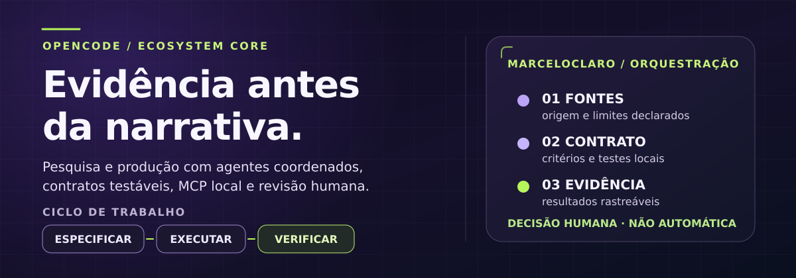

# OpenCode Ecosystem Core

**Pesquisa, agentes e evidência em um único core auditável.**

[](https://github.com/MarceloClaro/opencode-ecosystem-core)
[](LICENSE)
[](https://www.python.org/)
[](tests/)
<!-- core-badges:start -->
[](marceloclaro/doctor.py)
[](opencode.json)
[](agents/catalog)
<!-- core-badges:end -->
[](reports/r1054/README.md)

[Comece em 5 minutos](#início-rápido-local) ·
[Documentação](docs/README.md) ·
[Livro e arquivos no Git](#o-que-entra-no-git-e-o-que-fica-local) ·
[Pipeline científico](docs/SCIENTIFIC_RESEARCH_PIPELINE_R1054.md) ·
[Atlas animado](docs/architecture/ANIMATED.md) ·
[Evidência](reports/r1054/README.md) ·
[Manual](MANUAL.md) ·
[Arquitetura](ARCHITECTURE.md)

**Mapa rápido:** [Visão geral](#visão-geral) · [Pipeline](#pesquisador-científico-r1051-r1054) · [Capacidades](#capacidades-principais) · [GJQ](#gjq-r1099) · [Loop Engineering](#loop-engineering-r1100) · [Livro quântico](#livro-quantico-r1099) · [Livro e clone](#o-que-entra-no-git-e-o-que-fica-local) · [Arquitetura](#arquitetura-em-60-segundos) · [Quickstart](#início-rápido-local) · [Evidência](#trilha-de-evidências) · [Documentação](#documentação) · [Roadmap](#roadmap)

<sub>Social preview: <a href="docs/images/social-preview.png">1280×640</a> · Maintained by <a href="https://github.com/MarceloClaro">Marcelo Claro Laranjeira</a></sub>

</div>

<!-- core-state:start -->
**366 agentes** · **35 MCPs** · **35 comandos** · **22 checks**

Inventário derivado de [opencode.json](opencode.json) e do [diagnóstico estrutural](marceloclaro/doctor.py). Contagens de configuração e checks não comprovam disponibilidade, autenticação, inferência ou validação externa.

Para conferir estes blocos, execute na raiz `.venv/bin/python scripts/reconcile_operational_docs.py --check`; para sincronizá-los, execute o mesmo comando sem `--check`.
<!-- core-state:end -->

> **Regra de ouro:** nenhuma entrega sem spec, teste e evidência. Nenhum resultado vira verdade, aceite editorial ou publicação por votação, score, render ou opinião de modelo.

---

## Visão geral

O **OpenCode Ecosystem Core** é um monorepo de orquestração, pesquisa e produção
de artefatos com uma regra incomum: **a evidência vem antes da narrativa**. Ele
conecta agentes, memória metacognitiva, busca científica, texto integral,
meta-análise, engenharia reversa, vídeo e MCP sob contratos SDD/TDD, gates de
entrega e recibos com hash.

O primário **marceloclaro** publica tarefas no **Blackboard (A2A)**, compartilha
contexto no **MetaBus** e aplica o ciclo

```text
Perceber → Especificar → Delegar → Executar → Verificar → Refletir
```

com orçamento, prazo, cancelamento e estado persistido. A pergunta central do
projeto não é “quantos agentes existem?”, mas **“o que foi executado, com qual
fonte, qual hash e qual limite?”**.

### O que este core faz

- **Pesquisa científica ponta a ponta** — tema, contrato de recuperação, busca,
  triagem, texto integral, integridade, meta-análise, risco de viés, GRADE,
  manuscrito e pacote de submissão.
- **Orquestração governada** — perfis de agente configurados, Blackboard, MetaBus,
  Trust Engine, EvolutionRegistry e gates de evidência.
- **Engenharia reversa local (REA)** — inspeção controlada, camadas de provedores
  e recibos por hash.
- **Vídeo e dublagem** — editor multifaixa, FFmpeg, Remotion, XTTS/Edge TTS,
  ASR, legendas, câmera por frames, mapa narrativo e QC técnico (piloto R1055).
- **MCP e ferramentas locais** — servidores configurados, federação, probes e
  smoke tests delimitados.
- **Pesquisa quântica e GJQ** — MCPs para E01–E18, pesquisa livre e simulação
  local; Bell/CHSH com task ID, counts auditados e limites declarados.
- **Loop Engineering** — projeto e auditoria de loops com trigger, parada
  verificável, maker-checker, estado, orçamento e gates humanos.
- **Book Studio e Molambudos** — fontes, testes, capas selecionadas e provas
  documentadas; os miolos compilados e pacotes de mídia não acompanham o clone.

## Por que este projeto é diferente

| Pilar | Prática concreta |
|---|---|
| **Contrato antes do código** | Toda funcionalidade nasce de uma spec com critérios de aceitação; o histórico RED/GREEN é preservado. |
| **Evidência antes da narrativa** | Manifestos, hashes, recibos e artefatos rastreáveis; um teste não vira “verdade científica”. |
| **Humano no loop** | Triagem, texto integral, GRADE, aceite editorial e publicação exigem decisão humana explícita. |
| **Anti-overclaim** | Nenhum voto, score, payoff, render ou modelo promove um claim a verdade. |
| **Falha explícita** | Busca indisponível vira `blocked`; ausência de dado vira lacuna; ausência de backend vira `blocked`, não simulação. |

## Escolha sua trilha

| Você quer… | Comece por… | Primeiro comando |
|---|---|---|
| Pesquisar um tema e chegar a um artigo | [Pipeline R1051–R1054](docs/SCIENTIFIC_RESEARCH_PIPELINE_R1054.md) | `research project --theme ... --dry-run` |
| Pesquisar ou executar na GJQ | [GJQ R1099](#gjq-r1099) | `gjq_runtime_status` |
| Projetar ou auditar um loop | [Loop Engineering R1100](#loop-engineering-r1100) | `python3 -m loops.loop_engineering ...` |
| Ler ou recompilar o livro quântico | [Livro Do Bit ao Todo](#livro-quantico-r1099) | `./educacao_quantica_bohm/livro_pixel/build_pdf.sh` |
| Auditar evidência e claims | [R1054](reports/r1054/README.md), [gate metacognitivo](mci/metacognitive_gate.py) | `research benchmark-meta ...` |
| Construir ou registrar agentes | [AGENTS.md](AGENTS.md), [catálogo](agents/catalog) | `agentes list` |
| Diagramar, editar e ilustrar um livro | [Book Studio](reports/r1078/README.md), [R1082](reports/r1082/README.md) | `python3 -m marceloclaro.bookstudio status` |
| Editar vídeo, dublar e legendar | [Editor universal](docs/EDITOR_VIDEO_UNIVERSAL_R1042.md) | `video_editor --help` |
| Fazer engenharia reversa local | [REA](docs/REA.md) | `rea status` |
| Entender a arquitetura completa | [ARCHITECTURE.md](ARCHITECTURE.md), [mapa R916](docs/ARQUITETURA_COMPLETA_CORE_R916.md) | leitura guiada |
| Contribuir com segurança | [Instalador](installer/README.md), [CLAUDE.md](CLAUDE.md) | `./install.sh --check` |

## Pesquisador científico R1051-R1054


<sub>GIF 1000×520 · 8 s · 15 fps · gerado por <a href="scripts/generate_readme_gif.py"><code>scripts/generate_readme_gif.py</code></a>. Versão estática: <a href="docs/images/research-pipeline-r1054.svg">SVG</a>.</sub>

Quatro ciclos transformaram comandos isolados em um fluxo **file-first** com
estados, hashes e validação humana:

| Ciclo | Entrega | Estado |
|---|---|---|
| **R1051** | tema → contrato de recuperação → busca → deduplicação → triagem assistida → evidência literal → gate → auditoria → manuscrito IMRaD | ✅ |
| **R1052** | texto integral com página/parágrafo, aprovação humana, leitura de `review.screen`, retratações/correções no Crossref, `refresh` sem refazer busca | ✅ |
| **R1053** | meta-análise fixa/aleatória, Q/I²/tau², intervalo de predição, risco de viés, GRADE, LaTeX/DOCX/PDF, checklist e declarações | ✅ |
| **R1054** | extração automática como `automated_draft`, RoB/GRADE assistidos, perfil PLOS ONE, submissão fail-closed, gate de publicação e validação BCG | ✅ |

### Validação real com meta-análise publicada

O módulo quantitativo foi comparado ao dataset público **BCG** (13 ensaios;
Colditz et al. 1994), usando REML contra uma reanálise pública REML:

| Métrica | Core | Referência | Diferença |
|---|---|---|---|
| k | 13 | 13 | 0 |
| OR | **0,474649896** | 0,474649913 | 1,7e-8 |
| tau² | **0,337772471** | 0,337772045 | 4,3e-7 |
| Q | **163,164915** | 163,164915 | 1,1e-13 |
| I² padrão | **92,6455%** | 92,6455% | 0 |
| I² publicado | 92,6455% | 92,0727% | 0,5728 p.p. |

O I² publicado na fonte não é exatamente `(Q-df)/Q`; a discrepância está
registrada, não escondida. Evidência:
[`reports/r1054/real-meta-benchmark.json`](reports/r1054/real-meta-benchmark.json).

### Comandos que resumem o fluxo

```bash
# 1. Planejar sem rede
.venv/bin/python -m marceloclaro.scientific_lab research project \
  --theme "saúde mental em estudantes universitários" \
  --out projects/demo-r1054 --dry-run

# 2. Validar o módulo quantitativo contra o dataset BCG
.venv/bin/python -m marceloclaro.scientific_lab research benchmark-meta \
  --data reports/r1054/bcg.csv \
  --reference reports/r1054/reference.json

# 3. Gerar pacote de submissão com perfil PLOS ONE
.venv/bin/python -m marceloclaro.scientific_lab research submission \
  --out projects/demo-r1054 --journal-profile plos-one

# 4. Conferir o gate de publicação (não publica)
.venv/bin/python -m marceloclaro.scientific_lab research publication-gate \
  --out projects/demo-r1054
```

> **O que “completo” significa aqui:** o fluxo vai do tema ao pacote de
> submissão. Ele **não** declara aceite, publicação ou validação externa sem
> artefato institucional verificável.

## Capacidades principais

| Área | Estado | O que existe | Limite honesto |
|---|---|---|---|
| Orquestração | ✅ implementado/testado | `MarceloClaroOrchestrator`, Blackboard, MetaBus, workflows DAG, cancelamento | CLI instalada não comprova autenticação ou execução |
| Agentes | 🟡 perfis configurados (inventário acima) | catálogo, registro, especificação, trust e evolução | registro/atribuição ≠ inferência concluída |
| Pesquisa científica | ✅ R1051–R1054 | busca, texto integral, triagem humana, integridade, meta-análise, manuscrito, submissão | extração/RoB/GRADE assistivos; revisão humana obrigatória |
| SDD/TDD | ✅ | SpecRegistry, SpecVerifier, TDDRunner, RED/GREEN | critério textual ≠ verdade científica |
| REA | 🟡 com limites | inspeção local, camadas de provedores, recibos | formato, engine, licença e isolamento precisam ser conferidos |
| Vídeo e dublagem | ✅ R1046–R1055 | multifaixa, TTS, ASR, legendas, mapa e câmera; piloto 16:9/9:16 nativo | render/QC técnico ≠ aprovação estética, naturalidade ou rigor científico |
| MCP | 🟡 servidores configurados (inventário acima) | federação, probes, smoke, recibos | configuração ≠ disponibilidade no momento de uso |
| Quântica e GJQ | 🟡 com limites | MCPs `gjq-experiments`, `gjq-runtime` e `quantum-sim-core`; agente e skills; Bell/CHSH no FAS-GPU | simulador; nenhum hardware executado; chave não versionada |
| Loop Engineering | ✅ implementado/testado | skill, agente, auditor L0–L3 e harness | checklist não prova funcionamento; não executa loop nem auto-merge |
| Livro quântico | ✅ build/testes | 3502 páginas, 3000 laudas, PDF versionado e build reproduzível | peer review, ISBN/DOI e tradução pendentes |
| Governança | ✅ | gate metacognitivo, TrustEngine, slashing, EvolutionRegistry | `externally_supported` não é verdade absoluta |
| Publicação | 🧭 gate | validação externa, aceite, autorização | nenhum upload/publicação automática |
| Book Studio | 🟡 R1078–R1082 | KDP, tokens, licença, auditoria EPUB, capas e 6 pranchas de prova | arte final, 2× 300 DPI, CMYK/PDF-X e prova física pendentes |

**Legenda:** ✅ implementado e testado; 🟡 implementado com limites; 🧪 experimental; 📋 apenas especificado.

<a id="gjq-r1099"></a>
## Pesquisa quântica e GJQ (R1099)

A trilha quântica conecta a plataforma GJQ/CETC-ICQ ao Core por quatro MCPs,
21 agentes GJQ e duas skills. O objetivo é tornar explícito o que foi simulado,
o que foi medido, qual task ID sustenta cada número e qual limite permanece.

| Componente | Entrega | Gate |
|---|---|---|
| MCP `gjq-experiments` | 7 ferramentas para E01–E18 pelo script canônico | `confirm=True` e JSON simulado antes do hardware |
| MCP `gjq-runtime` | 13 ferramentas para backends, drift, sampling, estimativa e tarefas | `confirm=True`; hardware só com `allow_hardware=True`; 200 qubits/100.000 shots/20 submissões |
| MCP `quantum-sim-core` | 4 ferramentas para OpenQASM local | 12 qubits/10.000 shots; sem rede, arquivos ou código arbitrário |
| MCP `gjq-backend-research` | 12 ferramentas somente leitura para catálogo, perfil, seleção, plano, proveniência e templates | sem chave e sem rede; não submete |
| Agentes | `gjq-quantum-research`, `gjq-experiment-runner` e 19 `gjq-backend-*` | proveniência, custo, gate e limites |
| Skills | `gjq-pesquisa-quantica`, `gjq-experimentos-quanticos` | fluxo e segurança |

Resultados registrados em 2026-11-08 no backend `FAS-GPU` (simulador):

| Experimento | Resultado | Leitura |
|---|---|---|
| Bell state | 1024 shots; `00`=507, `11`=517; auditoria ok | proporção 50/50 dentro da flutuação |
| CHSH | `S=2,871094 ± 0,043506` | `S>2`; ~1 SE de `2√2=2,828427`; não excede Tsirelson |

O livro também registra o CHSH no `Guoji08` (hardware), com `S=2,383`, em
campanha anterior; a comparação com o simulador está no apêndice. O `Guoji08`
não foi executado nesta rodada. A UI de 2026-11-09 mostra
`Guoji No.8 (simulate)`; o gate R1104 o trata como emulação de hardware e
preserva a leitura histórica com a data e a calibração da época.

O catálogo R1104/R1105 lista **19 recursos** (6 hardware/emulação, 4 CPU,
4 GPU, 1 MPS e 4 NPU), com 19 agentes `gjq-backend-*` e o MCP
`gjq-backend-research`. Cada perfil traz melhor uso, o que evitar e
experimentos recomendados. `gjq_backend_drift` compara o registro com a lista
viva; nomes de API não verificados não são inventados: `gjq_list_backends`
confirma o nome antes da submissão.

Task IDs, counts e hashes QASM estão em `docs/gjq-runtime/*.json`; a conta
completa está no [Apêndice GJQ](educacao_quantica_bohm/livro_pixel/GJQ_RESULTADOS.md).
A chave `GJQ_API_KEY` nunca é versionada. Nenhum hardware foi executado nesta
série; execução real exige chave, conta e autorização de custo.

Docs: [GJQ R1099](docs/GJQ_PESQUISA_QUANTICA_R1099.md) ·
[backends R1104](docs/GJQ_BACKENDS_R1104.md) ·
[auditoria de MCPs](docs/AUDITORIA_MCPS_QUANTICOS_R1099.md) ·
[catálogo de repositórios](docs/REPOSITORIOS_QUANTICOS.md).

<a id="loop-engineering-r1100"></a>
## Loop Engineering (R1100)

O Core passou a ter uma camada de projeto e auditoria de loops: a skill
`loop-engineering`, o agente `loop-engineering-architect`, o auditor
`loops/loop_engineering.py` e o harness. Ela não executa loops, não instala
CLI npm e não habilita auto-merge.

```bash
python3 -m loops.loop_engineering specs/loops/harness-reasoning-97.md
```

O auditor pontua 10 dimensões e classifica L0–L3. Gates críticos: stop/hard
cap, verificação independente, maker-checker, estado durável e safety.

| Caso | Score | Nível calculado | Nível permitido |
|---|---:|---|---|
| Spec completa (teste) | 10,0 | L3 | L3 |
| Spec com maker=checker, sem stop/estado e auto-merge (teste) | 5,0 | L1 | L1 |
| `harness-reasoning-97.md` | 7,25 | L2 | L1 (0 dias de L1) |

L3 exige **7 dias de L1 observado**; L2 exige 1 dia. O resultado sempre declara
`human_review_required=true` e `scientifically_validated=false`. O checklist
não prova que o loop funciona; ele mostra o que falta documentar.

Docs: [Loop Engineering R1100](docs/LOOP_ENGINEERING_R1100.md) ·
[spec](specs/SPEC-935-R1100-loop-engineering.md) ·
[harness](harnesses/loop-engineering/HARNESS.md).

## Book Studio e Molambudos (R1078–R1082)

O Book Studio saiu de scripts isolados para um pacote com contratos, cálculos de
capa KDP, design tokens, gate de licença, manifesto de release e auditoria de
EPUB. O Molambudos ganhou uma direção de arte Piranesi/Pencz e um caderno de
provas **local**, sem aprovação para impressão ou distribuição.

| Ciclo | Entrega | Estado |
|---|---|---|
| **R1078** | pacote `marceloclaro/bookstudio/`, KDP, tokens, licença, release e EPUB | ✅ 13 testes |
| **R1079** | preflight dos artefatos: 422 pp, 160×230 mm, 15 fontes, 20 imagens ≥300 DPI, TAC 11,7% | ✅/parcial |
| **R1080** | perfil `romance-psicologico-molambudos`, 16 estilos, PT-BR/EN/ZH, ética | ✅ 6 testes |
| **R1081** | direção Piranesi/Pencz, 6 tipos de prancha, provas determinísticas | ✅ 5 testes |
| **R1082** | capa preta/ouro 422/436 pp, 6 pranchas de prova, caderno local de 8 pp e preflight | ✅ testes locais; uso gráfico pendente |
| **R1083** | fontes literárias e capas selecionadas passam a ser rastreadas; binários extensos permanecem locais | 🟡 política revista em R1084 |

**Limites:** a capa selecionada tem 300 DPI, mas ainda não tem CMYK/PDF-X,
prova física ou confirmação KDP; as 6 pranchas estão a 316–345 DPI no tamanho
final de 86 mm e **não** a 2× 300 DPI (158–173 DPI). OpenAI está sem créditos e
Gemini com cota zero para imagem; nenhuma arte nova foi gerada. O perfil local
está configurado, mas a inferência não foi comprovada. Detalhes:
[R1082](reports/r1082/README.md), [R1081](reports/r1081/illustration_style/README.md),
[R1080](reports/r1080/README.md) e [R1078](reports/r1078/README.md).

### Edições e capas: não trocar uma variante pela outra

| Variante | Paginação observada | Estado da capa |
|---|---:|---|
| Edição canônica `Molambudos_VictoriaRegia` | **435 pp** | a capa rastreada com nome `436p_canonica` é **provisória**: confirmar a paginação final e recalcular a lombada antes de usá-la; não assumir que 435 = 436 para a gráfica |
| Edição digital/sensorial R1076 | **421 pp** | não é substituta da canônica nem da print-safe |
| Variante print-safe R1077 | **422 pp** | capa preta/ouro `422p_print` selecionada, sem CMYK/PDF-X e sem prova física |

As **6 pranchas de prova** alcançam 300 DPI efetivos a 86 mm, mas não a 2×;
três artes ainda exibem arquitetura europeia e precisam de adaptação brasileira
e revisão humana. A inferência do perfil local não foi comprovada. A obra não
foi enviada à KDP nem publicada por esta rodada.

### O que entra no Git e o que fica local

| No clone deste repositório | Só na máquina ou em storage autorizado |
|---|---|
| Código, specs, testes, documentação e fontes literárias permitidas pela `.gitignore` | Memória privada, ambientes, caches, intermediários de compilação e repositórios externos |
| [README do Molambudos](literatura/molambudos/README.md), fontes `.tex/.md`, manifestos e [capas selecionadas](literatura/molambudos/capas/molambudos_final/manifesto.json) (PDFs e PNGs de capa especificados) | PDFs de **miolo**, EPUBs, áudio, vídeo, ZIPs e o caderno de prova em PDF; seus manifestos não os recriam automaticamente |
| [Pranchas e preflight rastreados](reports/r1082/plate_proof/plates_manifest.json) | Parte da arte original fora da seleção Git, arte nova a 2× e prova gráfica física |

### Livro quântico: PDF versionado

O PDF de **3502 páginas** e **3000 laudas** está versionado em
`educacao_quantica_bohm/livro_pixel/LIVRO_3000_LAUDAS.pdf` (19.987.690 bytes).
O HTML e as fontes também estão no Git; o `.venv-pdf` é local e recriado por
`build_pdf.sh`. O build usa `pyphen==0.16.0` com dicionário `pt_BR` para
hifenizar o corpo. Ver [BUILD_PDF.md](educacao_quantica_bohm/livro_pixel/BUILD_PDF.md).

Esta é uma política **deny-by-default para novos arquivos em `literatura/`**:
fontes/documentos escolhidos entram, segredos e artefatos de build ficam de
fora. O `.gitignore` não faz varredura de segredos e não remove objetos já
publicados em commits anteriores. Antes de `git add`, revise o índice e os
direitos de cada arquivo. Para binários grandes, avalie **Git LFS** ou storage
de release com autorização e recibos; nenhum push ou upload é realizado por
esta documentação. Veja a [política reproduzível](docs/REPOSITORIO_REPRODUZIVEL.md)
e a [spec R1084](specs/SPEC-935-R1084-git-policy-readme-reconciliation.md).

```bash
git ls-files literatura/molambudos/capas/molambudos_final/
git ls-files literatura/molambudos/Molambudos_Print_R1077/
python3 scripts/reconcile_operational_docs.py --check
python3 -m marceloclaro.cli doctor
```

Os testes do Book Studio que dependem de PDFs excluídos podem ser ignorados
(`skip`) num clone sem os artefatos; testes coletados não são testes aprovados.

<a id="livro-quantico-r1099"></a>
## Livro Do Bit ao Todo (R1099)

O livro **3000 Laudas de Física Quântica: do bit ao todo** está em
`educacao_quantica_bohm/livro_pixel/` com:

- **3000 laudas**, **100 fichas** e **400 notas de cálculo**;
- **repetição** de 21.031 para 20.346 parágrafos; **482.840 palavras** no total (a expansão aumentou o volume e manteve a repetição sob o limite de 22.000);
- **apêndice de aprofundamento** com densidade, canais, algoritmos e QEC;
- **3502 páginas** no PDF final;
- **3000 códigos únicos** de lauda;
- **PDF versionado** em `LIVRO_3000_LAUDAS.pdf` (19.987.690 bytes);
- apêndice GJQ com Bell, CHSH, task IDs e contas;
- corpo justificado e hifenizado em pt-BR; notas e legendas à esquerda.
- **artigo de revisão e cenários**: `educacao_quantica_bohm/artigo_educacao_quantica/ARTIGO.pdf` (21 páginas, 29 referências verificadas);

Build reproduzível:

```bash
./educacao_quantica_bohm/livro_pixel/build_pdf.sh
```

O script cria `.venv-pdf` com `pyphen==0.16.0` (dicionário `pt_BR`) e chama
`build_pixel_fast.py`. O `.venv-pdf` é local; o PDF e o HTML são versionados.
Ver [BUILD_PDF.md](educacao_quantica_bohm/livro_pixel/BUILD_PDF.md) e
[Apêndice GJQ](educacao_quantica_bohm/livro_pixel/GJQ_RESULTADOS.md).

**Edição de curso (R1103):** 12 módulos, 60 conceitos, 600 laudas, 12 figuras
e **626 páginas** em papel claro; [PDF](educacao_quantica_bohm/livro_pixel/EDICAO_CURSO_600.pdf)
(3.167.486 bytes) e [EPUB](educacao_quantica_bohm/livro_pixel/EDICAO_CURSO_600.epub)
(1.576.391 bytes). Build: `python3 educacao_quantica_bohm/livro_pixel/build_curso.py`.
A edição não inclui o gabarito nem as 100 fichas completas; traz as
[notas ao professor](educacao_quantica_bohm/livro_pixel/NOTAS_PROFESSOR.md) e o
[apêndice de aprofundamento](educacao_quantica_bohm/livro_pixel/APROFUNDAMENTO_QUANTICO.md).

**Audiolivro piloto (R1103):** 12 capítulos + abertura, **12:50** no total, voz
sintética `pt-BR-FranciscaNeural` (Edge TTS) e **sem clonagem**. Arquivos em
[`AUDIOLIVRO_CURSO/`](educacao_quantica_bohm/livro_pixel/AUDIOLIVRO_CURSO/README.md),
com [manifesto](educacao_quantica_bohm/livro_pixel/AUDIOLIVRO_CURSO/manifest.json)
de durações, SHA-256 e origem. É uma **seleção de leitura** de 12 módulos, não a
narração integral das 600 laudas. Verifique os termos do serviço de voz antes de
redistribuir o áudio em outro contexto.

**Piloto de edição enxuta (R1102):** 12 módulos, 60 laudas, 12 figuras e
**76 páginas** em papel claro; [PDF](educacao_quantica_bohm/livro_pixel/EDICAO_ENXUTA_PILOTO.pdf)
e [EPUB](educacao_quantica_bohm/livro_pixel/EDICAO_ENXUTA_PILOTO.epub).
Build: `python3 educacao_quantica_bohm/livro_pixel/build_enxuta.py`. É um
recorte de 60 laudas, não a edição de curso nem a obra de referência.

**Limites:** o PDF é um artefato de build; não houve peer review, ISBN/DOI,
tradução inglesa ou estudo de eficácia. 59 testes do livro passam no escopo
local; isso não é validação externa.

## Arquitetura em 60 segundos

[**Ver todos os mapas e fluxos em GIF**](docs/architecture/ANIMATED.md) ·
[Fontes, hashes e reprodução](reports/r1057/README.md).
As páginas usam **SVG como visual primário** e mantêm a fonte Mermaid em um
bloco de auditoria. Os GIFs pulsam na ordem topológica do desenho; não simulam
uma execução comprovada do Core. PNG/SVG sem movimento acompanham cada GIF,
inclusive os 22 fluxos do catálogo.

<!-- svg-presentation:diagram-e19b5e3314e41476 -->

<sub>[GIF](docs/architecture/animated/diagram-e19b5e3314e41476.gif) · [PNG](docs/architecture/animated/diagram-e19b5e3314e41476.png) · [Fonte Mermaid](docs/architecture/animated/diagram-e19b5e3314e41476.mmd)</sub>

<details>
<summary>Fonte Mermaid (auditoria)</summary>

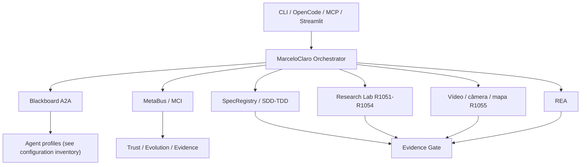

</details>

<details>
<summary><strong>Ver o mapa completo da arquitetura (SVG)</strong></summary>

<br>


</details>

A arquitetura completa, os caminhos de falha e os 22 fluxogramas estão em
[ARCHITECTURE.md](ARCHITECTURE.md) e no
[guia R916](docs/ARQUITETURA_COMPLETA_CORE_R916.md). O mapa acima é uma
projeção; uma aresta não é execução.

## Vídeo didático R1055 — qubit

O piloto **“O que é um qubit?”** tem sete cenas, voz sintética PT-BR Francisca
(sem clonagem), mapa Natural Earth e câmera sincronizada às batidas do roteiro.
As versões horizontal e vertical nativa têm 109,73 s, 3292 frames a 30 fps e
passaram no QC técnico registrado: −14,49 LUFS e −4,42 dBTP.

| Versão local | Resolução | Arquivo em `pilots/r1055-qubit/out/` |
|---|---|---|
| Horizontal | 1920×1080 | `r1055-qubit-16x9.mp4` |
| Vertical nativa | 1080×1920 | `r1055-qubit-9x16.mp4` |

**Os MP4 não estão no Git** e não foram publicados. Código e documentação estão
no commit `c800112d`. [Roteiro](pilots/r1055-qubit/SCRIPT.md),
[referências e créditos](pilots/r1055-qubit/REFERENCES.md),
[câmera e pipeline](docs/CINEMATIC_REMOTION_R1055.md) e
[recibos/QC/hashes](reports/r1055/README.md) permitem conferir o escopo.
ASR, pitch e QC não substituem revisão humana da voz, da física e da edição.

## Vídeo R1058 — plano de ação Airam Veras

> Pronúncia institucional: **“Véras”**; a grafia na tela permanece “Veras”.

O vídeo **“Plano de ação SPAECE 2026 — 5º A e B”** apresenta, em 7min38s, o
diagnóstico agregado, as habilidades prioritárias, o cronograma de intervenções
das professoras, exemplos de Língua Portuguesa e Matemática, o porquê de cada
questão, as metas e o monitoramento da Escola de Cidadania Airam Veras,
Crateús/CE. Inclui a logo da escola, mapa animado Ceará → Crateús → Maratoan
com ponto pulsante e narração sintética PT-BR sem clonagem.

Arquivo local: `pilots/r1058-airam-veras/out/airam-plano-acao.mp4` (1440×810,
30 fps, 13.749 frames). **Não está no Git e não foi publicado.**
[Piloto](pilots/r1058-airam-veras/README.md) ·
[roteiro e porquês](pilots/r1058-airam-veras/SCRIPT.md) ·
[referências e mapa](pilots/r1058-airam-veras/REFERENCES.md) ·
[QC e limites](reports/r1058/README.md). Dados agregados; sem nomes ou ranking
de estudantes. Linha de base de 11/08/2026, não resultado de novembro.

## Início rápido local

```bash
# 1. Clonar
git clone https://github.com/MarceloClaro/opencode-ecosystem-core.git
cd opencode-ecosystem-core

# 2. Diagnosticar sem alterar nada
./install.sh --check

# 3. Instalar dependências seguras (npm/pip/uv/venv)
./install.sh --apply --yes

# 4. Conferir a saúde estrutural
.venv/bin/python -m marceloclaro.cli doctor
```

Neste checkout foram observados **21/22 checks estruturais**, com **1 aviso**
de runtime Colibri ausente; rode o `doctor` novamente na sua instalação. Uma
passagem local não prova autenticação, inferência ou validação externa.

Primeiro projeto de pesquisa, sem rede:

```bash
.venv/bin/python -m marceloclaro.scientific_lab research project \
  --theme "saúde mental em estudantes universitários" \
  --out projects/demo-r1054 \
  --dry-run
```

## Trilha de evidências

| Nível | Significado | Exemplo |
|---|---|---|
| **L0 — implementado** | código e contrato existem | módulos `scientific_lab/*` |
| **L1 — testado** | testes herméticos passam em escopo definido | registro histórico: 410 passed, 1 skipped na regressão R1033–R1054; não é a suíte inteira |
| **L2 — renderizado** | vídeo/PDF/DOCX gerados com recibo | R1047, pacote R1053 |
| **L3 — benchmarkado** | replicação numérica em dados públicos | BCG REML, R1054 |
| **L4 — validação externa** | artefato independente verificado | gate R1054; **não emitido** |
| **L5 — aceite/publicação** | decisão do periódico | **não emitido** |

Essa escada é o antídoto contra o overclaim: **um nível não promove o outro**.
Um render não é aprovação estética; um teste não é verdade científica; um gate
não é aceite editorial.

## Documentação

| Documento | Para quê |
|---|---|
| [README](README.md) | esta visão geral |
| [MANUAL.md](MANUAL.md) | comandos, exemplos e estados |
| [ARCHITECTURE.md](ARCHITECTURE.md) | arquitetura técnica e fluxos |
| [docs/README.md](docs/README.md) | índice documental por trilha |
| [Pipeline R1054](docs/SCIENTIFIC_RESEARCH_PIPELINE_R1054.md) | pesquisador científico ponta a ponta |
| [Spec R1054](specs/SPEC-1054-automacao-assistida-validacao-real.md) | contrato e critérios de aceitação |
| [Relatório R1054](reports/r1054/README.md) | benchmark BCG e limites |
| [Piloto R1055](pilots/r1055-qubit/README.md) | vídeo de qubit, fontes, código e limites |
| [Molambudos](literatura/molambudos/README.md) | edições, fontes, capas e limites do clone |
| [Política Git R1084](specs/SPEC-935-R1084-git-policy-readme-reconciliation.md) | allowlist, testes e divergência de paginação |
| [GJQ R1099](docs/GJQ_PESQUISA_QUANTICA_R1099.md) | MCPs, backends, auditoria e resultados Bell/CHSH |
| [Backends GJQ R1104](docs/GJQ_BACKENDS_R1104.md) | 19 recursos, MCP somente leitura e 19 agentes especialistas |
| [Auditoria de MCPs R1099](docs/AUDITORIA_MCPS_QUANTICOS_R1099.md) | hashes, licenças e bloqueios dos MCPs de terceiro |
| [Loop Engineering R1100](docs/LOOP_ENGINEERING_R1100.md) | skill, agente, auditor L0–L3 e limites |
| [Reavaliação comparativa R1101](docs/REAVALIACAO_COMPARATIVA_R1101.md) | matriz de cobertura, forças/limites e nota 8,6/10 |
| [Spec R1100](specs/SPEC-935-R1100-loop-engineering.md) | contrato do Loop Engineering |
| [Livro quântico — build](educacao_quantica_bohm/livro_pixel/BUILD_PDF.md) | PDF versionado, `.venv-pdf` e hifenização |
| [Apêndice GJQ do livro](educacao_quantica_bohm/livro_pixel/GJQ_RESULTADOS.md) | Bell, CHSH, task IDs e contas |
| [Aprofundamento quântico](educacao_quantica_bohm/livro_pixel/APROFUNDAMENTO_QUANTICO.md) | estados, canais, algoritmos, QEC e VQC |
| [Notas ao professor](educacao_quantica_bohm/livro_pixel/NOTAS_PROFESSOR.md) | orientação consolidada por parte |
| [Edição de curso — PDF](educacao_quantica_bohm/livro_pixel/EDICAO_CURSO_600.pdf) | 12 módulos, 600 laudas, 626 páginas; papel claro |
| [Edição de curso — EPUB](educacao_quantica_bohm/livro_pixel/EDICAO_CURSO_600.epub) | versão reflowable da edição de curso |
| [Audiolivro do curso](educacao_quantica_bohm/livro_pixel/AUDIOLIVRO_CURSO/README.md) | 12 capítulos + abertura; 12:50; voz sintética sem clonagem |
| [Manifesto do audiolivro](educacao_quantica_bohm/livro_pixel/AUDIOLIVRO_CURSO/manifest.json) | durações, hashes e origem das faixas |
| [Edição enxuta — piloto](educacao_quantica_bohm/livro_pixel/EDICAO_ENXUTA_PILOTO.pdf) | 12 módulos, 60 laudas, 76 páginas; PDF claro |
| [Edição enxuta — EPUB](educacao_quantica_bohm/livro_pixel/EDICAO_ENXUTA_PILOTO.epub) | versão reflowable do piloto |
| [Vídeo R1058](pilots/r1058-airam-veras/README.md) | plano de ação Airam Veras, mapa, cronograma e exemplos |
| [Atlas animado R1056](docs/architecture/ANIMATED.md) | GIF/PNG/SVG e Mermaid de todos os diagramas do escopo |
| [Reprodução R1056](reports/r1056/README.md) | exportador local, cobertura, testes e hashes |
| [AGENTS.md](AGENTS.md) | criação e registro de agentes |
| [CLAUDE.md](CLAUDE.md) | operação no Claude Code |
| [Instalador](installer/README.md) | instalação segura e procedência |
| [PROGRESS.md](PROGRESS.md) | estado, ciclos e checkpoints |
| [CORRIGENDUM.md](CORRIGENDUM.md) | alegações históricas corrigidas |
| [CITATION.cff](CITATION.cff) | citação do software |
| [scripts/generate_readme_gif.py](scripts/generate_readme_gif.py) | gera o GIF do pipeline |

## Roadmap

| Ciclo | Estado | Foco |
|---|---|---|
| R1051 | ✅ | tema → protocolo → busca → evidência → auditoria → manuscrito |
| R1052 | ✅ | texto integral, triagem humana, integridade, `refresh` |
| R1053 | ✅ | meta-análise, GRADE, LaTeX/DOCX/PDF, submissão |
| R1054 | ✅ | extração assistida, PLOS ONE, gate de publicação, benchmark BCG |
| R1055 | ✅ técnico; revisão humana pendente | vídeo didático de qubit, câmera, mapa e versões 16:9/9:16 |
| R1056 | ✅ documental; não valida runtime | atlas animado, fontes preservadas, manifesto e testes |
| R1078–R1084 | 🟡 estúdio editorial; publicação bloqueada | Book Studio, fontes e capas versionadas; revisão de lombada, CMYK/PDF-X e prova física pendentes |
| R1099 | ✅ build/testes locais | livro quântico 3504 pp, GJQ MCPs, 20 revisores e PDF versionado |
| R1100 | ✅ | Loop Engineering: skill, agente, auditor L0–L3 e harness |
| Próximos ciclos | 🧭 | backend real de submissão, perfis brasileiros, UI, tabelas e validação externa assistida |

O roadmap é uma direção, não uma promessa de data. Cada ciclo só é marcado
✅ quando tem spec, testes e evidência versionada.

## Por que dar uma estrela

Se este projeto economiza seu tempo, uma estrela ajuda outros pesquisadores e
engenheiros a encontrarem um core que **não confunde automação com autoridade**:

- ⭐ **Star** se você quer um exemplo sério de SDD/TDD aplicado a agentes,
  ciência e mídia.
- 👁️ **Watch** para acompanhar os ciclos R1051 → R1054 e o próximo.
- 🐛 **Issue** com um caso de uso, uma fonte ou um limite que precisa ser
  testado.
- 🔬 **Contribute** com um teste, uma spec ou uma correção — especialmente se
  ela reduzir uma alegação.

[](https://github.com/MarceloClaro/opencode-ecosystem-core)

## Como contribuir

| Contribuição | Caminho |
|---|---|
| Abrir um caso de uso ou uma lacuna | [Issue](https://github.com/MarceloClaro/opencode-ecosystem-core/issues) com fonte, comando e resultado observado |
| Adicionar uma spec ou um teste | [specs/](specs/), [tests/](tests/), [AGENTS.md](AGENTS.md) |
| Corrigir uma alegação | [CORRIGENDUM.md](CORRIGENDUM.md), [docs/README.md](docs/README.md) |
| Adicionar um perfil de periódico | [journal_profiles.py](scientific_lab/journal_profiles.py), [Spec R1054](specs/SPEC-1054-automacao-assistida-validacao-real.md) |
| Melhorar a documentação | [docs/README.md](docs/README.md), [MANUAL.md](MANUAL.md) |

Regras: não envie dados sensíveis, credenciais ou fontes privadas; não declare
aceite/publicação sem artefato; prefira uma correção que **reduza** uma alegação.

## O que este projeto não é

- Não é AGI, consciência ou um “cientista autônomo”.
- Não é paridade com Premiere, DaVinci, Zotero, Rayyan ou RevMan.
- Não substitui revisão humana, bibliotecário, estatístico ou comitê de ética.
- Não transforma teste, render, score ou voto em verdade/aceite/publicação.
- Não publica, submete ou emite aceite sem backend, credencial e artefato
  institucional verificável.
- Não usa dados clínicos, sensíveis ou proprietários sem gate específico.

## Licença e citação

MIT — ver [LICENSE](LICENSE). O código de terceiros mantém suas próprias
licenças; nenhum código restrito é relicenciado por este repositório.

```bibtex
@software{opencode_ecosystem_core_2026,
  author  = {Laranjeira, Marcelo Claro},
  title   = {OpenCode Ecosystem Core},
  year    = {2026},
  url     = {https://github.com/MarceloClaro/opencode-ecosystem-core},
  note    = {Evidence-first orchestration, scientific research and media pipeline}
}
```

---

## 🧭 Deep dive

As seções abaixo preservam o detalhamento técnico histórico: editor de vídeo,
dublagem, evolução do piloto R1026, matriz detalhada, conselho científico,
scanners, arquitetura completa e os 22 fluxogramas. Elas são leitura de
engenharia, não resumo executivo. O topo desta página é a porta de entrada; o
restante é o laboratório.

### Editor de vídeo universal, dublagem e animação (R1035–R1046)

O núcleo `integrations.video_editor` trata vídeo como **projeto e timeline**:
fontes com hash, fps racional, clipes frame-exatos, faixas de vídeo/áudio/legenda,
plano auditável e render separado. FFmpeg é o backend padrão; Remotion é o
backend de composição React/Remotion, com `license_ack` e `render_approved`
obrigatórios; outros motores entram por plugin (`register_backend`).

**Operações implementadas:** `trim`, `concat`, `scale`, `pad`, `crop`,
`extract_audio`, `replace_audio`, `mix_audio`, `subtitles` (burn/soft),
`multitrack`, `transition`, `color_grade`, `remotion` e `probe`. A R1046
adicionou composição multifaixa (posição, tamanho, opacidade, raio de canto,
áudio explícito e lacunas), transições `xfade`/`acrossfade`, cor SDR paramétrica
com `eq`/`colorbalance`, conformidade explícita de fps e preset x264. **Ainda
não implementadas:** UI NLE, keyframes animáveis, multicam, tracking, nodes,
LUT/ACES/HDR, composição 3D, legendas animadas nativas, lip sync e normalização
automática de VFR. Isso **não é paridade** com Premiere/DaVinci; a pesquisa de
projetos como MLT, libopenshot e OpenTimelineIO está registrada em
`reports/r1046/github-research.json`.

**MCPs locais:** `editor-local` expõe `editor_open`, `editor_list_projects`,
`editor_plan`, `editor_render` e `editor_status`; `dubbing-local` expõe o lote de
dublagem. Render real exige arquivo de aprovação do operador; dry-run é livre.
Caminhos são confinados à raiz configurada; não há shell arbitrário.

**Dublagem (P0006 e lote):** o pipeline separa ASR, diarização, tradução, TTS,
stems, mix e legenda. O piloto P0006 permanece **reprovado para montagem**:
gate antigo aceitava similaridade baixa e tolerância de 0,35 s; a reauditoria
R1041 encontrou 14 divergências lexicais e 4 overruns. O lote tem 107 partes e
1.943 unidades preparadas, 106 partes com evidência OCR (1.997 frames) e 107
partes diarizadas; **nenhuma** foi dublada/montada como entrega final.

**Dublagem R1026 (R1047):** o piloto ganhou uma versão de 20 s com voz
sintética clonada por XTTS em CPU (`speed 1.0`), roteiro PT-BR mais explicativo,
slide traduzido, SRT/ASS e **sem cartão**. O ASR large-v3 reconheceu o roteiro
com **WER lexical de 2,17%**; loudness final **−16,10 LUFS**, true peak
**−2,16 dBTP**. A nova locução foi re-sincronizada com Wav2Lip em CPU; revisão
visual humana, naturalidade e direitos continuam pendentes.
Ver [evidência R1047](reports/r1047/QUANTUM-DUB-EVIDENCE.md).

### Evolução dos vídeos R1026 (R1026–R1047)


| Etapa | Transformação | Evidência |
|---|---|---|
| 1. Original | vídeo Qiskit em inglês, 1920×1080, 29,97 fps, slide original, sem cartão | `source.mp4` |
| 2. Slide + dublagem anterior | slide em PT-BR, legenda e voz XTTS anterior; sem cartão | `pilot-16x9-lipsync-pt.mp4` |
| 3. Teste R1046 | composição multifaixa com cartão PiP, raio de canto e áudio explícito; teste de editor, não entrega final | `r1046-editor-preview/quantum-multitrack-v3-preview.mp4` |
| 4. R1047 estático | novo roteiro em 4 blocos, XTTS `speed 1.0`, slide PT, SRT/ASS, **sem cartão** e lip sync refeito | `r1047-dub/out/quantum-ptbr-r1047.mp4` — `93f074a3…9f3ed5` |
| 5. Slide escuro dinâmico | cenário escuro, título “Do acesso ao limite”, três atos e motion Remotion; apresentadora em quadro inteiro | `r1047-dub/out/quantum-ptbr-r1047-dynamic-slide-dark.mp4` — `ba30b840…d23223` |
| 6. Palco com cartão | cenário totalmente novo, título, roadmap, conteúdo à esquerda e apresentadora em cartão à direita | `r1047-dub/out/quantum-ptbr-r1047-card-scene.mp4` — `7765afc0…7bbef581` |

As imagens são contatos de frames e registram a **transformação técnica**, não
um benchmark de qualidade. O áudio R1047 tem **2,17% de WER lexical** no ASR
large-v3, **−16,10 LUFS** e true peak **−2,16 dBTP**. O cartão do estágio 6 usa
um vídeo de lip sync anterior à nova locução; a boca pode não corresponder
exatamente às palavras novas. Os MP4/WAV ficam em
`pilots/r1026-quantum/r1047-dub/out/` e são ignorados pelo Git; scripts,
composições e recibos permitem reproduzir o fluxo.

### Matriz detalhada de mídia e ciência

| Capacidade | Estado observado | Limite honesto |
|---|---|---|
| Ingestão de mídia | probe, hash, fps racional, frames, áudio, timeline JSON | codecs/containers variam; VFR é recusado nas operações avançadas |
| Edição | corte frame-exato, concatenação, escala, crop, pad, áudio e legendas | não é UI NLE; sem keyframes, multicam ou tracking |
| Composição | multifaixa, overlays, opacidade, raio de canto, transições e cor SDR | sem LUT/ACES/HDR, nodes, 3D ou composição multi-faixa completa de vídeo |
| Voz e dublagem | XTTS local por referência, ASR large-v3, mix e loudness | revisão humana de naturalidade, emoção e tradução continua necessária |
| Slide e motion | Remotion 4.0.540, springs, cascata, borda cônica, grão, vinheta e crossfade | Remotion License; motion não prova retenção ou estética |
| Legendas | SRT e ASS, burn-in ou faixa soft | timing e leitura exigem revisão; ASR não é escuta |
| QC técnico | frames decodificados, fps, duração, loudness, true peak, silêncio, pretos e contato | não aprova conteúdo, voz, lip sync ou tradução |
| Pesquisa acadêmica | pipeline ABNT, revisão de fontes, bibliografia, provas e conselho de 13 | não substitui bibliotecário, estatístico ou revisão por pares |
| Pesquisador ponta a ponta (R1051–R1054) | tema → contrato → busca → triagem humana → texto integral → integridade → meta-análise/GRADE → manuscrito → submissão → gate de publicação | extração/RoB/GRADE são assistivos; submissão e aceite exigem backend/artefatos humanos |
| Ciência | 8 protocolos K-Dense, catálogo de 177 skills, 9 adaptações originais e laboratório com budget | 177 skills não são 177 validações; nada é executado sem gate |
| Programação | SDD/TDD, suíte pytest com escopo variável, agentes, skills e macro-rede observável | coleta ≠ aprovação; grafo é projeção read-only, aresta não é execução |
| Governança | gate metacognitivo, citações literais, contradições e validação externa | `externally_supported` não é verdade absoluta; voto/nota/payoff não decide |
| Publicação | nenhum upload ou agendamento nesta rodada | exige direitos, credenciais e autorização explícita |

**O que ele não é:** não é AGI, não tem paridade com Premiere/DaVinci, não
substitui revisão humana e não transforma teste técnico em aprovação científica
ou editorial.

### Palco completo com cartão da apresentadora (R1047)


O cenário original foi substituído por um **palco escuro em 1920×1080**, com
título **“Do acesso ao limite”**, trilha Acesso → Mudança → Limite, conteúdo
didático à esquerda e a apresentadora em um **cartão** à direita. O cartão tem
borda cônica animada, leve paralaxe e rótulo “APRESENTADORA • VOZ SINTÉTICA”.
O fundo usa gradientes, grade, grão e vinheta; as transições têm spring,
cascata de chips e crossfade com blur.

| Item | Valor |
|---|---|
| Composição | `editor-workspace/remotion-smoke/src/r1047-slide/R1047Stage.tsx` |
| Palco renderizado | `editor-workspace/remotion-smoke/r1047-stage-v2.mp4` |
| Vídeo final | `pilots/r1026-quantum/r1047-dub/out/quantum-ptbr-r1047-card-scene.mp4` |
| SHA-256 | `7765afc04f2ee5354296d341c313a2f7c997fb1b5b03921c9a5538637bbef581` |
| Formato | 1920×1080, 30 fps, 600 frames, 20,00 s, AAC 48 kHz |
| Loudness | **−16,10 LUFS**; true peak **−2,16 dBTP** |
| QC | frames, fps, loudness, silêncio e pretos: **pass** |

O cartão usa `presenter-middle-card.mp4`, cujo lip sync é anterior à nova
locução; a boca pode não corresponder exatamente às palavras novas. O slide
estático e as versões dinâmicas anteriores permanecem como fallback. Evidência:
[R1050](reports/r1050/CARD-STAGE.md).

**Efeitos pesquisados e aplicados:** springs calibrados, cascata de chips, borda
cônica, paralaxe/tilt, grão determinístico, vinheta, crossfade com blur,
tipografia cinética e contador. Referências: documentação Remotion
(`motion-blur`, `noise`, `transitions`), `IskakovDamir/apple-motion`,
`lifeprompt-team/remotion-scenes` e `vshukla7/remotion-captions-themes`. Nenhum
código foi copiado.

```text
source.mp4 → ASR/roteiro → XTTS (referência 6 s) → palco Remotion + cartão
           → FFmpeg (áudio + legendas) → ASR large-v3 + loudness → manifesto
```

**Pesquisa de skills Claude (R1048):** foram triados **20 repositórios** no
GitHub nas frentes de vídeo/efeitos, pesquisa acadêmica, raciocínio científico
e programação avançada. Prioridades: `obra/superpowers` (MIT, método TDD),
`chgagne/claude-skills-research` (MIT, revisão de fontes/provas),
`K-Dense-AI/scientific-agent-skills` (MIT, seleção científica),
`iart-ai/motion-skills` e `win4r/video-director` (MIT, motion/QA) e
`wshobson/agents` (MIT, catálogo de engenharia). Nenhum foi instalado; os
bloqueios por licença e o protocolo de adoção estão em
[`reports/r1048-claude-skills-github/`](reports/r1048-claude-skills-github/README.md).

**Adoção seletiva de skills (R1049):** nove skills locais foram criadas a partir
da triagem R1048: `superpowers-sdd-tdd`, `rigor-academico-chgagne`,
`kdense-ciencia-seletiva` (8 protocolos + catálogo de 177) e `kdense-adaptacoes-originais` (9 adaptações), `motion-design-seletivo` (5),
`video-director-qa`, `video-shotcraft-selecao` (10 receitas),
`agentes-engenharia-selecao` (10 papéis) e `laboratorio-pesquisa-isolado`.
Nenhum código de terceiro foi copiado ou executado; instruções permissivas foram espelhadas com atribuição e as restritas receberam adaptações originais. Fontes e commits estão em
`reports/r1049/sources.json`. Ver [evidência R1049](reports/r1049/README.md).

**Macro-rede e gate metacognitivo (R1050):** `mci/macro_network.py` projeta
**584 nós e 776 arestas** no snapshot local conferido em 06/11/2026 — orquestrador, 337 agentes, 54 skills, 177
skills K-Dense, 11 categorias e 4 gates. O inventário de configuração atual
tem **347 agentes** e **64 skills**; o grafo precisa ser regenerado para
refletir os novos perfis. `mci/metacognitive_gate.py` impede que
confiança, voto, nota ou payoff virem verdade; o conselho ganhou
`validate_claims` com evidência literal, falseabilidade, mecanismo e
contradições. Ver [evidência R1050](reports/r1050/README.md) e
[macro-rede](reports/r1050/macro-network.json).

**Pesquisador ponta a ponta (R1051–R1054):** `research project` recebe um tema
e produz um pacote file-first com intake, contrato de recuperação, protocolo,
busca, deduplicação, triagem, evidências literais, gate metacognitivo, análise
descritiva, auditoria, manuscrito IMRaD e checklist de validação humana. O
manifesto registra hashes e estados; nada é publicado e nenhuma credencial é
usada. A pergunta pode ser explícita ou provisória, sempre marcada para
confirmação.

O R1052 acrescenta texto integral local com citação por página/parágrafo,
aprovação humana explícita, leitura das decisões de `review.screen`, verificação
de retratações/correções no Crossref, download opcional apenas por rota aberta
e `research refresh` sem refazer a busca. Claims de texto integral só ficam
`verified` com `source_file` e aprovação humana; os demais permanecem
`candidate`. O benchmark real de 3 fontes recuperou 9 registros, deduplicou 1 e
verificou 3 integridades, sem retratação. Ver
[`docs/SCIENTIFIC_RESEARCH_PIPELINE_R1052.md`](docs/SCIENTIFIC_RESEARCH_PIPELINE_R1052.md)
e [`reports/r1052/README.md`](reports/r1052/README.md).

O R1053 acrescenta meta-análise fixa/aleatória com Q, I², tau² e intervalo de
predição, risco de viés e GRADE human-gated, sem extrair efeitos de PDFs. Também
gera pacote de submissão em Markdown/LaTeX/DOCX, `.bib`, template ABNT genérico,
checklist e declarações `pending_human`. Com `pandoc`, `latexmk` e `pdflatex`
presentes, o teste de integração também gerou PDF. O exemplo sintético tem 3 estudos,
efeito combinado 0,400, I² 93,75% e GRADE `low`; nenhum dado real de
meta-análise foi usado. Ver
[`docs/SCIENTIFIC_RESEARCH_PIPELINE_R1053.md`](docs/SCIENTIFIC_RESEARCH_PIPELINE_R1053.md)
e [`reports/r1053/README.md`](reports/r1053/README.md).

O R1054 acrescenta extração automática de efeitos como `automated_draft`,
sugestões automáticas de risco de viés/GRADE com `authoritative=false`, perfil
real do PLOS ONE, submissão fail-closed com backend explícito, gate de validação
externa/aceite e validação numérica BCG contra referência REML pública. O
benchmark BCG replicou OR 0,47465, tau² 0,33777 e Q 163,1649; o I² publicado
difere 0,5728 p.p. da fórmula e a discrepância está registrada. Nenhuma
submissão, aceite ou publicação real foi executada. Ver
[`docs/SCIENTIFIC_RESEARCH_PIPELINE_R1054.md`](docs/SCIENTIFIC_RESEARCH_PIPELINE_R1054.md)
e [`reports/r1054/README.md`](reports/r1054/README.md).

**ASR e tradução:** o `faster-whisper-small` produziu texto turco sem sentido
em parte do corpus; `large-v3` foi baixado e concluiu o lote das 107 partes (1.854 segmentos, 7.773 palavras), ainda sem revisão nativa.
Traduzir ASR ruim gera fluência sobre erro — o TTS em lote não foi iniciado.
O gate exige fonte revisada, locutor/referência e duração estrita.

**Remotion:** CLI 4.0.540 instalado em `editor-workspace/remotion-smoke`;
`remotion compositions` listou `Smoke` (50 frames, 25 fps, 1280×720). Isso prova
bundle/navegador, **não** render ou qualidade visual. Render exige
`REMOTION_RENDER_APPROVED=1`; a licença Remotion não é OSI.

**Instalação one-click:** `./install.sh --check` inventaria bibliotecas e CLIs;
`./install.sh --apply --yes` instala apenas npm/pip/uv/venv. `sudo`, `apt` e
scripts oficiais com `curl` e `bash` são impressos para revisão, nunca executados
automaticamente. Ver [instalador](installer/ONECLICK.md), [pipeline de
dublagem](docs/DUBBING_PIPELINE_R1041_R1045.md), [editor universal](docs/EDITOR_VIDEO_UNIVERSAL_R1042.md),
[evidência real R1026](reports/r1046/QUANTUM-REAL-EVIDENCE.md)
e [catálogo de ferramentas](docs/VIDEO_EDITOR_TOOLCHAIN_R1043.md).

**Limites:** o catálogo de 46 ferramentas/modelos não instala nem executa nada;
licença é triagem, não parecer jurídico. Diarização é hipótese, não identidade.
Nenhuma publicação foi feita; upload exige direito de distribuição e credenciais
OAuth, documentados em `reports/r1045/UPLOAD-BLOCKERS.md`.

### Conselho científico, autoria e sandbox (R985–R1001)

- **Conselho de 13 cientistas** (`scientific_lab/council.py`): busca, revisão,
  análise, validação e auditoria sob MarceloClaro, combinando Feynman
  (mecanismo/observações/inferências), método científico (hipótese/refutação) e
  teoria dos jogos (minimax regret para priorizar investigação, sem transferir
  regras clínicas). Parecer `partial` é entrega válida; `blocked` interrompe; 13
  votos não produzem verdade nem validação externa.
- **Autor/Editor de alto rigor** (`academic/author_editor.py`): estrutura IMRaD
  expandida, perfil de estilo anti-plágio (características estruturais, nunca
  trechos verbatim) e registro de raciocínios (axiomático, aristotélico,
  cartesiano, peirceano, popperiano, teoria dos jogos, bayesiano, causal,
  dialético e difuso).
- **Evolução calibrada dos scanners** (`scanners/scientific_evolution.py`):
  compara candidatos em corpus dev/holdout separados; recomenda sem autopromover.
- **Piloto OpenShell** (`integrations/openshell_pilot.py`): sandbox real com
  isolamento validado (Landlock + egress negado) e captura de pacotes
  (telemetria opt-out e ausência de SYN de egress).
- **Executor Gemini portátil** (`integrations/gemini_client/`): chama a API
  Gemini com `GEMINI_API_KEY`, sem OAuth/keyring, executável dentro do sandbox.

CLI: `python3 -m marceloclaro.scientific_lab council|author-editor|scanner-evolve|openshell ...`.
Ver [procedimento de reprodução](docs/PROCEDIMENTO_OPENSHELL_GEMINI_CONSELHO.md)
e [conselho e scanners](docs/CONSELHO_CIENTIFICO_E_SCANNERS_R989_R990.md).

### Scanners e diagnóstico multidimensional

O diagnóstico (`/diagnose` e a ferramenta MCP `super_rigor_audit`) combina
scanners de dimensões distintas sobre o mesmo corpus. Cada scanner é uma
**triagem heurística**; nenhum atribui qualidade científica, validade clínica ou
aceite editorial.

| Scanner | Função |
|---|---|
| **Noológico** | Cobertura epistemológica — dimensões do conhecimento presentes/ausentes |
| **Teleológico** | Lacunas entre metas do ecossistema e capacidades reais dos agentes |
| **Evolutivo** | Roadmap evolutivo — rotas de melhoria e trajetórias M1–M5 |
| **Potencialidade** | Capacidades latentes, gaps de inovação e DNA do ecossistema |
| **Impacto social** | SROI, Teoria da Mudança, ODS e B-Impact Score |
| **Impacto jurídico** | Prontidão jurídica e ganho metacognitivo (SPEC-924) |
| **Científico** | Triagem lexical PT/EN de falsificabilidade, metodologia e falácias |
| **Literário (8 visões)** | Narrativa, personagem, estilo, símbolos, teoria, leitor, ética e inovação |
| **Pesquisa literária (4)** | Bibliografia, corpus comparativo, teoria e rigor internacional |
| **Engenharia reversa** | Código legado → conhecimento e contratos extraídos |
| **Ruído e compressão** | Redundância (SPS/NRR) e densidade (CR/CPS) do corpus |
| **Evolução calibrada (R990)** | Compara candidatos em corpus dev/holdout separados |

**Vantagens:**

1. **Multidimensional** — um único comando cobre cinco ou mais dimensões do
   ecossistema, sem depender de um heurístico único.
2. **Rastreável** — o scanner científico expõe offsets do texto normalizado,
   contexto (afirmado/negado/citado/título) e hash da entrada; audita-se o
   achado, não apenas o score.
3. **Anti-overclaim** — toda saída declara `score_kind`, `scientific_quality_assessed=false`
   e limitações; uma nota lexical alta não vira Qualis nem aceite.
4. **Calibração honesta** — a evolução (R990) só recomenda um candidato com
   ganho em desenvolvimento **e** sem regressão de falsos positivos/negativos no
   holdout; nunca autopromove nem aceita código arbitrário.

Uso: `python3 -m scanners.cli diagnose CAMINHO` ou `scanner-evolve --corpus-json`.
Ver [scanners](scanners/cli.py), [triagem científica](scanners/scientific_reasoning_scanner.py)
e [evolução](scanners/scientific_evolution.py).

### Inovações e paralelo com ferramentas similares

As frentes R985–R1001 acrescentam diferenciais de **desenho** ao Core. A
comparação abaixo é de princípios de arquitetura, **não um benchmark de
superioridade**: cada ferramenta é adequada a contextos próprios, e nenhuma
pontuação interna substitui validação externa ou revisão humana.

**O que o Core acrescenta:**

1. **Conselho de 13 cientistas com evidência fail-closed** — cada parecer valida
   citação literal contra a fonte e exige mecanismo, observações e inferências
   separadas (Feynman); voto, nota ou payoff não produzem verdade.
2. **Anti-plágio por construção** — o perfil de estilo extrai *características*
   (registro, hedging, conectivos, densidade de citação, razão tipo-token),
   nunca trechos verbatim.
3. **Raciocínio registrado e mapeado** — axiomático, aristotélico, cartesiano,
   peirceano, popperiano, teoria dos jogos, bayesiano, causal, dialético e
   difuso, ancorados nos motores de `reasoning/`.
4. **Sandbox real validado** — OpenShell com isolamento observado (Landlock +
   egress negado) e captura de pacotes (telemetria opt-out, zero SYN de egress).
5. **Executor portátil** — `gemini-client` chama a API Gemini com chave de API,
   sem OAuth/keyring, executável dentro do sandbox.
6. **Anti-overclaim** — separação explícita entre instalação, execução observada
   e validação externa em toda saída.

**Paralelo com similares:**

| Ferramenta similar | Abordagem | Diferencial observado do Core | Limite honesto |
|---|---|---|---|
| Antigravity CLI (`agy`) | Agente com OAuth de conta | Executor por chave de API, sem keyring | Cota gratuita esgota (HTTP 429) |
| CrewAI / AutoGen | Orquestração multi-agente genérica | Conselho com evidência e citação literal | Não é benchmark de qualidade |
| ASReview | Triagem ativa p/ revisão sistemática | Conselho completo (busca→auditoria) + Feynman + teoria dos jogos | Revisão humana obrigatória |
| Deep Research (OpenAI/Gemini) | Pesquisa de agente único | 13 papéis auditáveis com contratos SDD/TDD | Proveniência ≠ validação externa |
| LangGraph | Grafos de agentes | Blackboard A2A + MetaBus + EvolutionRegistry | Atenção inspirada, não treinada |

Os recibos de execução real (host e sandbox) estão em `docs/evidence/`; o
procedimento de reprodução em
[OpenShell/Gemini](docs/PROCEDIMENTO_OPENSHELL_GEMINI_CONSELHO.md).

---

## Início rápido detalhado

Para obter a revisão publicada nesta etapa, selecione a branch explicitamente.
Python é necessário para o Core; a CI declara versões 3.10–3.14 e a verificação
local documentada utilizou Python 3.14. Modelos, CLIs e engines externos exigem
configuração própria.

```bash
git clone --branch codex/core-prontidao-rea https://github.com/MarceloClaro/opencode-ecosystem-core.git
cd opencode-ecosystem-core
python3 -m venv .venv
.venv/bin/python -m pip install -r requirements.txt

.venv/bin/python -m marceloclaro.cli doctor
.venv/bin/python -m marceloclaro.cli helpdesk
```

O `doctor` informa a sanidade estrutural e as dependências encontradas.
Avisos de componentes opcionais devem ser interpretados por operação;
inferência e autenticação requerem sondagem própria.

Para utilizar as ferramentas TypeScript do OpenCode, use **Node 22** e o lockfile:

```bash
cd .opencode
npm ci
npm run typecheck
cd ..
```

A configuração é compilada por
`.venv/bin/python -m integrations.opencode_cli`; confira sua reprodução com
`.venv/bin/python -m integrations.opencode_cli --check`.
Perfis locais, memória de execução e evidências de alvos são arquivos privados
e não são versionados; consulte [fontes reproduzíveis](docs/REPOSITORIO_REPRODUZIVEL.md).

Para uma release formal, siga os controles de versão imutável e procedência da
seção seguinte. O checkout de uma branch não constitui uma release com tag.

---

## Instalação segura e procedência

> Instalação **local e revisável** — nada é executado por pipe de rede. A
> procedência combina versão imutável, commit Git e SHA-256 conferível.

Os controles abaixo se aplicam a uma **release formal com tag e manifesto
publicado**. Obtenha de um manifesto de versão revisado, independente do canal
de download, os valores a seguir, sem rótulos móveis:

| Dado | Formato exigido |
|---|---|
| `ECOSYSTEM_VERSION` | Tag ou identificador de versão imutável (ex.: `vX.Y.Z`). |
| `ECOSYSTEM_REF` | Commit Git completo com 40 caracteres hexadecimais. |
| `ECOSYSTEM_SOURCE_SHA256` | SHA-256 com 64 caracteres hexadecimais do TAR de origem. |
| `ProvisionSha256` | SHA-256 publicado do `provision.sh` do Windows/WSL. |
| `CommonInstallerSha256` | SHA-256 publicado de `installer/common/install_clis.sh`. |

```bash
export ECOSYSTEM_VERSION='<versao-imutavel>'
export ECOSYSTEM_REF='<commit-git-completo-com-40-caracteres>'
export ECOSYSTEM_SOURCE_SHA256='<sha-256-publicado-com-64-caracteres>'

git clone https://github.com/MarceloClaro/opencode-ecosystem-core.git opencode-ecosystem-core
cd opencode-ecosystem-core
git checkout --detach "$ECOSYSTEM_REF"
test "$(git rev-parse HEAD)" = "$ECOSYSTEM_REF"
test "$(git describe --tags --exact-match HEAD)" = "$ECOSYSTEM_VERSION"

git archive --format=tar "$ECOSYSTEM_REF" -o ../opencode-ecosystem-source.tar
printf '%s  %s\n' "$ECOSYSTEM_SOURCE_SHA256" "../opencode-ecosystem-source.tar" > ../opencode-ecosystem-source.tar.sha256
sha256sum -c ../opencode-ecosystem-source.tar.sha256
```

No macOS (Homebrew), use a variante `shasum -a 256 -c
../opencode-ecosystem-source.tar.sha256`. Sempre confira a versão com
`git describe --tags --exact-match HEAD` antes de instalar.

Após instalar, use **sempre** o interpretador do venv recém-criado:

```bash
source ~/opencode-ecosystem-core/.venv/bin/activate
python3 -m marceloclaro.cli helpdesk   # ou .venv/bin/python -m marceloclaro.cli doctor
```

**WSL2** (Windows 10/11): siga [installer/windows/README.md](installer/windows/README.md).
Detalhes, requisitos e solução de problemas: [installer/README.md](installer/README.md).

---

## Uso básico

Execute os comandos na raiz, com o interpretador do ambiente do projeto.

| Comando | Finalidade |
|---|---|
| `.venv/bin/python -m marceloclaro.cli` | Menu interativo principal |
| `.venv/bin/python -m marceloclaro.cli doctor` | Diagnóstico estrutural |
| `.venv/bin/python -m marceloclaro.cli doctor --live` | Sondas explícitas de HTTP, CLIs e exemplos internos |
| `.venv/bin/python -m marceloclaro.cli network status` | Estado e última execução observada dos executores |
| `.venv/bin/python -m marceloclaro.cli helpdesk` | Ajuda guiada |
| `.venv/bin/python -m marceloclaro.cli pesquisa "tema"` | Pesquisa científica conforme provedores disponíveis |
| `.venv/bin/python -m marceloclaro.cli agent-register` | Registro dos agentes no Blackboard |
| `.venv/bin/python -m integrations.op_timing report` | Tempos locais por operação |
| `.venv/bin/python -m integrations.opencode_cli --check` | Consistência da configuração gerada |

Com o OpenCode CLI instalado e acessível, abra a raiz com `opencode`.
A configuração seleciona `marceloclaro` como primário e oferece comandos como
`/ecosystem`, `/rea` e `/biblioteca`. Instalação e modelo disponível devem ser
conferidos antes de iniciar uma conversa.

Tarefas coordenadas passam pelo primário. Informe uma especificação válida e
respeite o contrato da superfície utilizada. O
[guia de workflows](docs/WORKFLOWS_R644.md) explica orçamento, checkpoints e
retomada. Autenticação e saldo de Claude, Codex ou Antigravity dependem do
ambiente; o identificador `chatgpt` não controla o aplicativo ChatGPT.

Manual: [MANUAL.md](MANUAL.md) · Guia do agente: [CLAUDE.md](CLAUDE.md) ·
Primeiros passos: [quickstart.md](quickstart.md).

## Engenharia reversa local REA

O [assistente REA local](docs/ASSISTENTE_REA_LOCAL.md) permite inspecionar um
artefato e explicar achados estáticos com fontes, digests e limitações.
Configure o runtime e os engines indicados no guia antes de analisar um alvo.

```bash
.venv/bin/python -m marceloclaro.cli rea layers
.venv/bin/python -m marceloclaro.cli rea inspect CAMINHO --kind auto --format text
.venv/bin/python -m marceloclaro.cli rea explain RECIBO --format text
```

Substitua `CAMINHO` e `RECIBO` por arquivos locais. A operação direta `inspect`
aplica namespaces de rede e PID ao worker analítico em Linux/WSL e recusa a
execução quando o isolamento exigido está indisponível. A aplicação alvo não
é executada. Isso não constitui uma sandbox universal de arquivos.

Para configurar o perfil do agente, escolha um modelo já instalado e servido
no endpoint local. O exemplo abaixo exige `llama3.2:latest` disponível no Ollama:

```bash
.venv/bin/python -m marceloclaro.cli rea setup --model llama3.2:latest --model-endpoint http://127.0.0.1:11434/v1
.venv/bin/python -m marceloclaro.cli rea agent --check
.venv/bin/python -m marceloclaro.cli rea site --port 8767
```

`agent --check` verifica configuração; não executa inferência. O cliente possui
supervisão de processos e conserva a rede do host para acessar o modelo. Seu
isolamento é diferente do worker analítico. O fluxo por prompt exige ferramenta
concluída e recibo íntegro antes de publicar uma análise; texto livre não é achado.
O modo interativo é exploratório e seu encerramento não comprova análise aceita.

São **18 camadas declaradas**, com **11 percursos de inspeção pela ponte Core**
no snapshot documentado. `analyze_binary` utiliza Ghidra; IDA, Hopper, JEB e
outras superfícies dependem de runtimes, configuração e licenças próprias.
A ponte legada `rea layer` não herda automaticamente o isolamento de `inspect`.
Veja [camadas e contratos](docs/REA.md) e o
[fluxograma REA](docs/architecture/flows/05-rea-provedores.svg).

## Memória no terminal e painel

```bash
.venv/bin/python -m webapp.memory_network_visualizer
.venv/bin/python -m webapp.memory_network_visualizer --once --json
```

A animação projeta consultas, agentes, memória, contexto, evidências e respostas
registrados no MetaBus, Blackboard e grafos. Disponibilidade de um agente não
significa atividade; `--demo` identifica dados fictícios. O visualizador não
inicia inferência. Consulte [origem dos dados e limites](docs/REDE_MEMORIA_CORE.md).

Para a aba **Rede de memória** no Streamlit:

```bash
.venv/bin/python -m pip install -r requirements-webapp.txt
.venv/bin/python -m streamlit run webapp/app.py --server.address 127.0.0.1
```

---

## Arquitetura resumida

Esta seção dá uma **visão resumida** do ecossistema: primeiro um **snapshot
histórico** (para preservar a documentação legada) e depois o **diagrama
operacional atual** do runtime observável no checkout. O snapshot histórico é
exatamente isso — um snapshot documental, **não é um inventário do checkout**.

### Ciclo metacognitivo integrado

A R886 conecta a memória de resultados à próxima delegação do primário:
recuperação contextual → análise crítica local → Blackboard → executor →
gate SDD/TDD → reflexão contextual → memória. Resultado, erro observado,
próxima ação e referências declaradas permanecem vinculados à tarefa.
Os escores dos motores são heurísticos e não promovem confiança automaticamente.

O [guia do ciclo](docs/METACOGNICA_INTEGRADA_R886.md) explica os contratos,
o tratamento de replay e degradação e o limite entre contexto e expressão formal.
A [avaliação dos cinco repositórios](docs/AVALIACAO_REPOS_METACOGNICA_R886.md)
prioriza Knowl como candidato de memória e Laya como auxílio consultivo;
Awesome LLM Apps, OpenShell e Feynman têm papéis próprios. Esses runtimes
externos não foram instalados ou executados nesta etapa.

As [verificações locais R886](docs/verification-local-r886.json) delimitam o
escopo executado. Para codificação eficiente, o [piloto R887](specs/SPEC-935-R887-code-intelligence-local.md)
usa um único provedor, context-link, subordinado ao primário e à memória canônica.
O [guia de contexto local](docs/CONTEXTO_CODIGO_LOCAL_R887.md) descreve instalação,
consulta, isolamento e limites. O smoke nativo encontrou falhas em relações de
chamadas Python: três consultas de grafo ficam bloqueadas; busca, código e
estrutura permanecem no piloto. Não há ganho de tokens comprovado.
A [avaliação comparativa](docs/AVALIACAO_CODE_INTELLIGENCE_R887.md) registra a
seleção e a [curadoria complementar](docs/CURADORIA_CODIFICACAO_EFICIENTE.md)
contextualiza as alternativas.

A revisão R888 dos [nove repositórios — grupo A](docs/AVALIACAO_REPOS_R888_A.md)
e [grupo B](docs/AVALIACAO_REPOS_R888_B.md) utiliza fontes fixadas e inspeções
REA compatíveis. A [decisão de adaptação](docs/DECISOES_ADAPTACAO_REPOS_R888.md) corrige o benchmark
IMO existente e seu consumidor DeepThink para separar execução, gabarito,
heurística e verificação formal, sem instalar nove runtimes paralelos.

O [aceite integral R889](docs/INDEXACAO_INTEGRAL_R889.md) adiciona auditoria
de arquivos, hashes e relações do banco, com retomada limitada de candidatos
privados. Um processo que termina sem erro continua insuficiente para aceitar
um índice parcial. A recuperação preserva o corpus e os limites de isolamento. A execução local
[R889](docs/verification-local-r889.json) concluiu as 763 fontes selecionadas;
isso não mede cobertura funcional de todo o ecossistema.

A [curadoria dos quinze projetos R890](docs/DECISOES_ADAPTACAO_REPOS_R890.md)
avalia química, materiais acadêmicos, voz, dispositivos, visão e ferramentas MCP.
A adaptação executada corrige a suíte Bell/GHZ/superposição existente: simulação
clássica declarada, métricas amostrais próprias, orçamento validado e proveniência
no MetaBus, sem elevar confiança nem apresentar circuitos fixos como resposta
à consulta. Os [recibos R890](docs/verification-local-r890.json) distinguem os
testes locais das propostas de integração e dos runtimes externos não ativados.

O [aceite científico local R891–R893](docs/ACEITE_CIENTIFICO_LOCAL_R891.md)
conecta artigos e experimentos ao mesmo primário, CLI e MCP: verifica pacotes,
hashes e reexecução por código confiável, propaga falhas sem conclusão fictícia
e preserva a busca Whoosh entre processos. O perfil de regressões é enumerado,
com orçamento e recibos; aceite computacional não equivale a revisão humana,
mérito científico ou escalabilidade multi-host.

## Arquitetura completa e fluxogramas atuais

### Atlas atual R916 — origem e legenda

O [atlas navegável](docs/architecture_map.html) e o
[guia minucioso R916](docs/ARQUITETURA_COMPLETA_CORE_R916.md) usam a mesma coleta
de fontes: produção rastreada e `opencode.json` lidos do diretório de trabalho,
com base Git `b7f5683f84609a5e957a56af4ca090c905f5ab80`. Arquivos removidos são omitidos; arquivos privados,
ignorados e não rastreados não são lidos. A identidade das fontes está em
`worktree_sha256`, com manifesto, exclusões e alterações no JSON.

O índice das demais categorias conserva metadados do commit-base e identifica
`content_source=git_base`; não é leitura atual de documentos ou dados de domínio.
Essa separação evita incorporar recursivamente o atlas gerado à sua própria
identidade. Fontes locais modificadas não recebem permalink do commit-base.

[](docs/ARQUITETURA_COMPLETA_CORE_R916.md)

| Artefato atual | Uso |
|---|---|
| [Página offline](docs/architecture_map.html) | Busca por módulo/símbolo, filtros, zoom e todos os fluxos |
| [Guia minucioso](docs/ARQUITETURA_COMPLETA_CORE_R916.md) | Camadas, decisões, limites e reprodução |
| [Inventário JSON](docs/architecture/architecture-inventory.json) | Fontes, hashes, símbolos, imports e origem |
| [Dependências SVG](docs/architecture/dependencies.svg) | Todos os módulos e pares internos do inventário |
| [Fonte DOT](docs/architecture/dependencies.dot) | Grafo vetorial editável por Graphviz |
| [Mermaid integral — raw 2,4 MB](https://raw.githubusercontent.com/MarceloClaro/opencode-ecosystem-core/main/docs/architecture/dependencies.mmd) | Mesmos módulos e pares, com metadados e legenda |
| [SVG Mermaid](docs/architecture/dependencies-mermaid.svg) | Renderização local do Mermaid completo |
| [Correspondência](docs/architecture/mermaid-correspondence.json) | IDs, hashes e declarações por par |
| [Catálogo de fluxos](docs/architecture/flows.json) | Fontes curadas, âncoras e limitações de cada percurso |
| [Modelos e custo por tarefa](docs/architecture/MODELOS_E_ECONOMIA_DE_TOKENS_R916.md) | Candidatos, tarifas públicas, cotas e avaliação sem trocar padrão silenciosamente |
| [Quantização local no GitHub](docs/architecture/QUANTIZACAO_LOCAL_GITHUB_R916.md) | Repositórios, commits/licenças, fluxo GGUF/Ollama e limites do host; sem instalação |
| [Verificação R916](docs/verification-documentation-r916.json) | Testes, renders, links e limites observados nesta revisão |

Seta no grafo estrutural significa **importador → dependência Python declarada**.
Seta em fluxograma segue seu rótulo de controle, dados ou composição; nenhuma
delas comprova que o percurso foi executado. Módulos isolados não são omitidos.
Os fluxos novos documentam plugins, NotebookLM, autenticações, metacognição,
lifecycle, CI local, contexto de código, seleção econômica de modelos e
tratamento local de janela de contexto/erros Ollama.

Para servir a página em loopback:

```bash
.venv/bin/python -m http.server 8771 --bind 127.0.0.1 --directory docs
```

Abra `http://127.0.0.1:8771/architecture_map.html`. A página também funciona
como arquivo local, sem CDN. O guia explica a geração e os comandos `--check`.
R879, R900, R911 e o [mapa R433–R438](docs/MAPA_ARQUITETURA_R433_R438.md)
permanecem como retratos históricos, com fontes e contagens próprias.

### Mapa da Arquitetura Completa (v3.9.0)

> Snapshot histórico da arquitetura (v3.9.0), preservado como registro da
> evolução. É um **snapshot histórico / documental de uma época passada** e
> **não é um inventário do checkout** atual. A faixa documentada **R47–R127**
> registrou 85 ciclos de evolução (com o surgimento de `MiraDeckPipeline` e do
> agente `mira-presenter`).

<!-- svg-presentation:diagram-c2a59e1bc061653c -->

<sub>[GIF](docs/architecture/animated/diagram-c2a59e1bc061653c.gif) · [PNG](docs/architecture/animated/diagram-c2a59e1bc061653c.png) · [Fonte Mermaid](docs/architecture/animated/diagram-c2a59e1bc061653c.mmd)</sub>

<details>
<summary>Fonte Mermaid (auditoria)</summary>

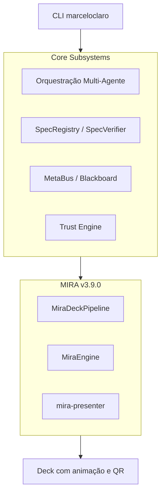

</details>

### Diagrama Operacional Atual

> Diagrama do runtime observável no checkout atual. Concentra-se nos
> componentes estruturalmente auditados; não lista todos os arquivos, classes
> auxiliares ou serviços opcionais do ecossistema.

<!-- core-runtime-diagram:start -->

<!-- core-runtime-diagram:end -->

O MCP `ecosystem-network`, acrescentado na R640, conecta o orquestrador e seu
roteamento Transformer por atenção aos executores de análise e leitura Claude,
Antigravity e Codex disponíveis no ambiente, com registros no Blackboard e na
memória MetaBus. A coordenação limita passos e tempo e exige a conclusão para
reportar sucesso; instalação e autenticação devem ser conferidas localmente.
Transformer descreve roteamento multiagente inspirado em atenção. O
identificador `chatgpt` não controla o aplicativo ChatGPT; selecione `codex`
explicitamente para usar sua CLI.

A R644 acrescenta workflows com dependências, análise seguida de revisão por
outro especialista e checkpoints para retomada. A seleção automática consulta
a saúde persistida dos executores e pausa serviços que falharam recentemente.
Veja o [guia de execução em etapas](docs/WORKFLOWS_R644.md).

Da R711 à R746, o programa do pesquisador polímata curou 21 repositórios por
tipo de raciocínio (dedutivo, causal, bayesiano, síntese, autônomo, auditoria)
com pinagem viva, federação por classes de frescor e decisão humana nominal:
16 federados no escopo polímata em `workbench/rede_polimata` (fora do harness
R621), com painel em `workbench/polymath/DASHBOARD.md`, skill
`pesquisador-polimata-labs`, 3 agentes de catálogo e o MCP `polymath-labs-mcp`.
Nada federado atesta qualidade; todo federado exige supervisão.

### Mapa dinâmico regenerável

`marceloclaro/ecosystem_map.py` também gera um inventário de componentes. Os
arquivos `maps/ecosystem_map_2026-07-06.json` e
`MAPA_ECOSSISTEMA_COMPLETO_2026-07-06.md` são fotografias históricas de julho;
suas contagens não representam a edição R879. Para uma nova coleta, execute:

```bash
.venv/bin/python -c "from marceloclaro.ecosystem_map import save_ecosystem_map_artifacts; save_ecosystem_map_artifacts()"
```

Essa coleta possui escopo diferente do extrator Git/AST R879. Consulte o
manifesto de cada resultado antes de comparar suas contagens.

### Fluxos multiárea do checkout atual

| Área | Principais referências observáveis |
|---|---|
| Pipeline acadêmico agentivo | `agentic_science_v2/orchestrator.py`, `deep_research.py`, `review_agent.py`, `revision_agent.py`, `paper_composer.py` |
| Prova, formalização e raciocínio | `integrations/deepmind/formal_verifier.py`, `alphaproof_engine.py`, `aletheia_scaffold.py`, `deep_think_engine.py`, `autoformalizer.py`, `geometry_engine.py`, `lean4_verifier.py`, `egraph_rewriter.py`, `erdos_hirzebruch_solver.py` |
| Jurídico | `legal/integration.py`, `specializations.py`, `knowledge_base.py`, `precedents.py`, `datajud_client.py`, `benchmarks.py` |
| Clínico | `integrations/medical/clinical_game_theory.py`, `clinical_verifier.py`, `evidence_grounding.py`, `clinical_orchestrator_bridge.py` |
| Scientific RAG | `rag/scientific.py`, `rag/evolved.py`, `rag/enhanced_search_rag.py` |
| Universidade Sintética | `synthetic_university/core.py`, `combinatorial_engine.py`, `evolutionary_memory.py`, `mcp_server.py`, `api_gateway.py` |
| Runtime local | `integrations/litert_lm.py`, `litert_lm_provider.py`, `litert_lm_supervisor.py`, `integrations/colibri_provider.py` (LiteRT‑LM on‑device e Colibri / OLMoE) |
| Integridade e quality gates | `benchmarks/merkle_integrity_guard.py` (`MerkleIntegrityGuard`), `scripts/quality_report.py`, `installer/`, `benchmarks/scientific_reasoning/` |

Visão conceitual de áreas: as setas abaixo não comprovam um pipeline
sequencial executado entre esses domínios.

<!-- svg-presentation:diagram-9d889efcf6907944 -->

<sub>[GIF](docs/architecture/animated/diagram-9d889efcf6907944.gif) · [PNG](docs/architecture/animated/diagram-9d889efcf6907944.png) · [Fonte Mermaid](docs/architecture/animated/diagram-9d889efcf6907944.mmd)</sub>

<details>
<summary>Fonte Mermaid (auditoria)</summary>

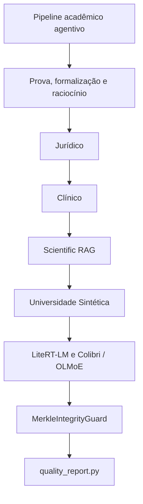

</details>

---

## Apresentações MIRA

> A documentação de ***MIRA*** é feita em **dupla leitura**: uma visão para o
> **leigo** (o que o subsistema entrega, em linguagem simples) e outra para o
> **PhD** (arquitetura e contratos técnicos). O subsistema é composto por
> `MiraDeckPipeline` (orquestra os estágios), `MiraEngine` (produz os artefatos
> visuais) e o agente delegável `mira-presenter` (SPEC-935-R126/R127).

**Visão leigo:** o MIRA transforma uma pasta com `manuscrito.md` em uma
apresentação navegável, com animações, QR codes e checagem dos terços.

**Visão PhD:** o pipeline é determinístico e auditável, com estágios explícitos
e um validador de conformidade do artefato final.

### Como funciona a apresentação MIRA

O processo percorre **6 estágios**:

1. **extract** — extrai estrutura e conteúdo do `manuscrito.md`;
2. **plan** — planeja a sequência de slides do deck;
3. **copywrite** — refina textos e mensagens visuais;
4. **build** — monta o deck em cards e seções navegáveis;
5. **animate** — gera as animações centrais de cada slide;
6. **validate** — valida conformidade e consistência final do deck.

<!-- svg-presentation:diagram-0fc0fb3f7256d5ba -->


<sub>[GIF](docs/architecture/animated/diagram-0fc0fb3f7256d5ba.gif) · [PNG](docs/architecture/animated/diagram-0fc0fb3f7256d5ba.png) · [Fonte Mermaid](docs/architecture/animated/diagram-0fc0fb3f7256d5ba.mmd)</sub>

<details>
<summary>Fonte Mermaid (auditoria)</summary>

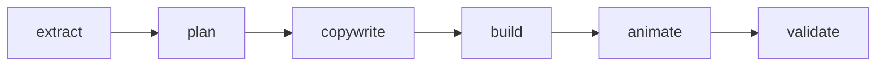

</details>

A etapa final registra conformidade segundo regras internas; não avalia
externamente o mérito científico do manuscrito.

### Presentation On Storytelling — Act I — A Ilha de Agentes

O storytelling dos decks MIRA segue uma trilha de apresentação em atos. O
**Act I — A Ilha de Agentes** apresenta o ecossistema como um território
habitado por agentes especialistas que cooperam pelo Blackboard.

**Fluxograma Intuitivo:** um diagrama simples orienta o público leigo pelas
trocas entre orquestrador, agentes e memória metacognitiva, sem jargão.

**Arquitetura Técnica Multilateral:** para a plateia técnica, o mesmo fluxo é
desenhado com todas as camadas — entrada, orquestração, SDD/TDD, memória,
integrações e apresentação.

### Ciclo de Vida SDD / TDD

O ciclo de desenvolvimento é fechado (ver também a seção de validação):

<!-- svg-presentation:diagram-ae341a88b5319133 -->

<sub>[GIF](docs/architecture/animated/diagram-ae341a88b5319133.gif) · [PNG](docs/architecture/animated/diagram-ae341a88b5319133.png) · [Fonte Mermaid](docs/architecture/animated/diagram-ae341a88b5319133.mmd)</sub>

<details>
<summary>Fonte Mermaid (auditoria)</summary>

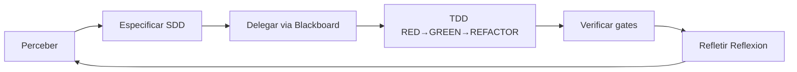

</details>

- **SDD**: nenhuma entrega sem `specs/SPEC-*.md` com critérios de aceitação.
- **TDD**: testes primeiro (RED), implementação (GREEN), refatoração só com verde.
- **Gates**: `SpecVerifier` aplica o contrato; o primário integra confiança e economia conforme o resultado e a política.
- **Reflexion**: eventos e reflexões registrados no MetaBus sustentam a revisão dos resultados.
- **Evolução**: `EvolutionRegistry` conserva os ciclos; registro, hashes e auditoria externa são operações distintas.

---

<!-- core-flowcharts:start -->
## Fluxogramas operacionais completos

Os fluxogramas abaixo são cópias integrais das mesmas fontes usadas no
[mapa navegável](docs/architecture_map.html). A ordem, as descrições, as fontes
e as limitações seguem o [catálogo de fluxos](docs/architecture/flows.json).
A edição e a origem das fontes estão declaradas no catálogo e no inventário.
Fontes rastreadas do checkout atual; base Git `3ab19a87181d43893af733fa53f08d035f4a7ab4`. Hashes e linhas foram recalculados no R1057; a apresentação é SVG e a fonte Mermaid fica em auditoria.
Estes desenhos não representam uma nova execução de todos os componentes.

### Legenda e critérios de leitura

| Elemento | Como interpretar |
|---|---|
| Retângulo | Componente, etapa, dado ou artefato indicado pelo rótulo. |
| Losango | Decisão ou condição; siga o texto de cada saída. |
| Grupo delimitado | Subsistema ou fronteira de responsabilidade. Não implica isolamento de rede. |
| Seta contínua | Direção de controle, dado ou composição conforme o título e o rótulo; não implica chamada direta entre todas as caixas. |
| Seta pontilhada | Caminho condicional, dependência opcional ou relação explicativa; leia o rótulo e os limites do fluxo. |
| Cores | Auxílio visual de agrupamento; nomes e rótulos conservam a informação sem depender da cor. |
| Fonte de código | Âncora de arquivo, símbolo e linha no retrato documentado; não é recibo de execução. |

Instalação, disponibilidade, autenticação, inferência concluída, entrega aceita
e validação externa são estados distintos. Evidências de uma operação local
valem apenas para seu escopo. Referências a agentes ou ferramentas opcionais
não garantem saldo, licença, credenciais, isolamento ou funcionamento atual.

No grafo estrutural integral, a seta tem significado mais restrito:
**módulo importador → dependência Python declarada**. Consulte a
[fonte Mermaid integral](docs/architecture/dependencies.mmd), o
[SVG equivalente](docs/architecture/dependencies-mermaid.svg) e o
[guia da legenda e reprodução](docs/architecture/MERMAID_INTEGRAL.md).

### 01. Panorama completo por camadas

Interfaces, primário, execução, governança, conhecimento e fronteiras externas.


[Abrir SVG](docs/architecture/flows/01-panorama.svg) · [Fonte Mermaid](docs/architecture/flows/01-panorama.mmd) · [GIF animado](docs/architecture/animated/diagram-a131171c4c7e9553.gif)

<details>
<summary>Fonte Mermaid (auditoria)</summary>

```mermaid
flowchart TB
  U["Operador / solicitação / alvo local"]
  subgraph interfaces["Interfaces e contratos de entrada"]
    CLI["marceloclaro.cli / rea_cli / science_cli"]
    OC["OpenCode: configuração compilada e comandos"]
    MCP["ecosystem-network: MCP stdio"]
    UI["Streamlit: consulta / evidência / memória"]
    SITE["Site local REA: instruções e exemplos"]
  end
  subgraph primary["Coordenação primária e memória compartilhada"]
    MC["MarceloClaroOrchestrator"]
    CAT["Registro idempotente: agentes e catálogo"]
    BB["Blackboard / AgentCard / task.cfp"]
    BUS["MetaBus: eventos e memória metacognitiva"]
    ATT["AttentionRouter: capacidade / semântica / confiança / carga"]
    TRANS["TransformerPipeline + GradingHead: revisão limitada"]
    TASK["TaskRuntime: DAG / lease / orçamento / recuperação"]
    AUTO["AutonomousCoordinator"]
    WF["WorkflowCoordinator + WorkflowStore"]
  end
  subgraph execution["Execução e integrações condicionais"]
    HAR["HarnessRuntime: CLI / stdin / prazo / cancelamento"]
    EXT["Codex / Claude / Antigravity: autenticação e saldo próprios"]
    FED["Federação: artefatos / políticas / integridade / licença"]
    REA["ReaBridge + registro rea_layers"]
    LOCAL["LocalReaAssistant: worker isolado e recibo"]
    BROW["Navegador coordenado / cenários / snapshots"]
    MODEL["Provedores locais opcionais: Ollama / runai / LiteRT"]
  end
  subgraph assurance["Especificação, governança e evidência"]
    SPEC["SpecRegistry / Specification / critérios"]
    HIST["TDDHistory: RED e GREEN autenticados"]
    RUN["TDDRunner: teste e contrato por critério"]
    GATE["SpecVerifier / report_completion: aceite ou recusa"]
    TRUST["Trust Engine / confidence ledger / behavioral gate"]
    ECON["TokenEconomy: staking / release / slash / fee"]
    DIAG["Doctor + DiagnosticPipeline: medições locais"]
    EVO["EvolutionRegistry: ledger / encadeamento / auditoria"]
    CI["pytest / JUnit / quality_report / CI"]
  end
  subgraph knowledge["Conhecimento, raciocínio e pesquisa"]
    RAG["UnifiedSearchRAG: busca / recuperação / abstenção"]
    EG["EvidenceGraph MCI: claims / evidências / replicações"]
    SCI["EvidenceGraph científico: entidades / relações / fontes"]
    REASON["Motores: AST restrita / SMT / simbólico / heurísticas"]
    RESEARCH["Pesquisa: proveniência / execução reprodutível / revisão"]
    PUB["Composer / manuscrito / LaTeX / DOCX / material didático"]
    VIS["Rede de memória: terminal e Streamlit observacionais"]
  end
  U --> CLI
  U --> OC
  U --> MCP
  U --> UI
  U --> SITE
  CLI --> MC
  OC --> MCP
  MCP --> MC
  UI --> MC
  MC --> CAT
  CAT --> BB
  MC --> BUS
  MC --> ATT
  MC --> TRANS
  MC --> TASK
  MCP --> AUTO
  AUTO --> MC
  MCP --> WF
  WF --> AUTO
  AUTO --> HAR
  HAR --> EXT
  AUTO --> FED
  MC --> REA
  MC --> LOCAL
  MC --> BROW
  OC -.->|configuração opcional| MODEL
  MC --> SPEC
  SPEC --> HIST
  SPEC --> RUN
  HIST --> GATE
  RUN --> GATE
  MC --> GATE
  GATE --> BB
  GATE --> TRUST
  GATE --> ECON
  GATE --> BUS
  MC --> DIAG
  MC --> EVO
  CI --> RUN
  MC --> RAG
  MC --> REASON
  MC --> RESEARCH
  RESEARCH --> EG
  RESEARCH --> SCI
  RESEARCH --> PUB
  RAG -.->|resultados de recuperação| SCI
  BUS --> VIS
  EG --> VIS
  SCI --> VIS
  BB --> VIS
  VIS --> UI
  SITE -.->|orienta operação; não executa análise| LOCAL
  MCP2["Plugins locais REA / MiroFish / Lean 4"] --> MC
  MC --> LIFE["Lifecycle: validar perfil antes de atribuir"]
  LIFE --> CAT
  MC --> LOOP["MetacognitiveLoop: preparar e observar outcomes"]
  LOOP --> BUS
  MC --> NLM["NotebookLM: política por efeito e sessão privada"]
  NLM --> GOOGLE["Serviço Google externo; não offline"]
  MC --> CIL["CI local: perfil scientific enumerado"]
  CIL --> CI
  MC --> CODE["Contexto de código: busca e grafo Python estático"]
  CODE --> RAG
```

</details>

**Fontes de código:**

- [marceloclaro/orchestrator.py:82](marceloclaro/orchestrator.py#L82) — `MarceloClaroOrchestrator`.
- [integrations/ecosystem_mcp.py:364](integrations/ecosystem_mcp.py#L364) — `get_coordinator`.
- [integrations/opencode_cli.py:551](integrations/opencode_cli.py#L551) — `build_config`.

**Limitações:**

- Relações de composição curadas; a existência do componente não comprova sua execução.

### 02. Orquestração primária e execução CLI

Primário compartilhado, especificação textual, roteamento, Blackboard, executor e aceite autoritativo.


[Abrir SVG](docs/architecture/flows/02-orquestracao.svg) · [Fonte Mermaid](docs/architecture/flows/02-orquestracao.mmd) · [GIF animado](docs/architecture/animated/diagram-fca207c4f2853c70.gif)

<details>
<summary>Fonte Mermaid (auditoria)</summary>

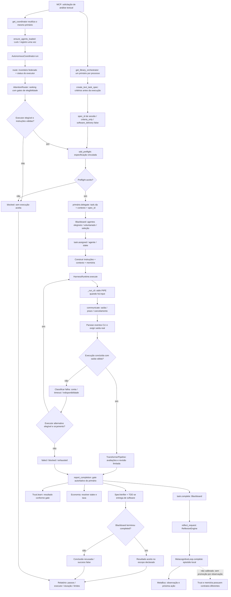

</details>

**Fontes de código:**

- [integrations/ecosystem_mcp.py:33](integrations/ecosystem_mcp.py#L33) — `get_library_orchestrator`.
- [integrations/ecosystem_mcp.py:364](integrations/ecosystem_mcp.py#L364) — `get_coordinator`.
- [marceloclaro/orchestrator.py:348](marceloclaro/orchestrator.py#L348) — `MarceloClaroOrchestrator.create_text_task_spec`.
- [marceloclaro/autonomous.py:33](marceloclaro/autonomous.py#L33) — `AutonomousCoordinator`.
- [integrations/harness_runtime.py:273](integrations/harness_runtime.py#L273) — `HarnessRuntime._run_cli`.
- [marceloclaro/orchestrator.py:904](marceloclaro/orchestrator.py#L904) — `MarceloClaroOrchestrator.report_completion`.

**Limitações:**

- Criteria_only não entrega software.
- Ranking e instalação não comprovam autenticação, saldo ou inferência.

### 03. Workflow DAG e retomada

Definição normalizada, checkpoint durável, orçamento global e repetição explícita de falhas.


[Abrir SVG](docs/architecture/flows/03-workflow-dag.svg) · [Fonte Mermaid](docs/architecture/flows/03-workflow-dag.mmd) · [GIF animado](docs/architecture/animated/diagram-b05977d545b7de24.gif)

<details>
<summary>Fonte Mermaid (auditoria)</summary>

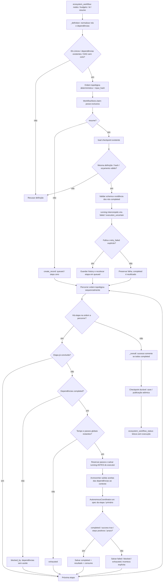

</details>

**Fontes de código:**

- [marceloclaro/workflow.py:42](marceloclaro/workflow.py#L42) — `WorkflowCoordinator`.
- [marceloclaro/workflow.py:84](marceloclaro/workflow.py#L84) — `WorkflowCoordinator._definition`.
- [marceloclaro/workflow.py:237](marceloclaro/workflow.py#L237) — `WorkflowCoordinator._resume`.
- [marceloclaro/workflow_store.py:17](marceloclaro/workflow_store.py#L17) — `WorkflowStore`.

**Limitações:**

- A execução das etapas é sequencial, apesar das dependências em DAG.
- Etapa interrompida tem resultado incerto; retry_failed precisa ser explícito.

### 04. SDD e histórico RED–GREEN

Especificação, contratos por critério, execução pytest real e recibos autenticados no escopo local.


[Abrir SVG](docs/architecture/flows/04-sdd-tdd.svg) · [Fonte Mermaid](docs/architecture/flows/04-sdd-tdd.mmd) · [GIF animado](docs/architecture/animated/diagram-f30ae99066baffe7.gif)

<details>
<summary>Fonte Mermaid (auditoria)</summary>

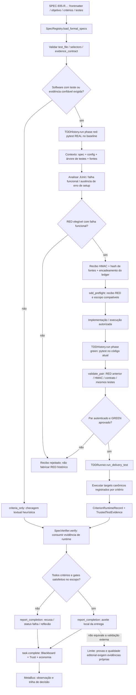

</details>

**Fontes de código:**

- [sdd/spec_engine.py:70](sdd/spec_engine.py#L70) — `Specification`.
- [sdd/spec_engine.py:1308](sdd/spec_engine.py#L1308) — `SpecVerifier`.
- [sdd/tdd_history.py:114](sdd/tdd_history.py#L114) — `TDDHistory`.
- [sdd/tdd_history.py:569](sdd/tdd_history.py#L569) — `TDDHistory.validate_pair`.
- [sdd/tdd_runner.py:46](sdd/tdd_runner.py#L46) — `TDDRunner`.
- [marceloclaro/orchestrator.py:363](marceloclaro/orchestrator.py#L363) — `MarceloClaroOrchestrator.sdd_preflight`.

**Limitações:**

- Recibo retrospectivo não pode substituir RED que não foi executado.
- Aceite local não certifica qualidade editorial nem validação externa.

### 05. REA e camadas de provedores

Registro informativo das 18 camadas, sondas estruturais e percursos efetivamente implementados: analyze JavaScript, analyze_binary Ghidra e layer com inspeção definida.


[Abrir SVG](docs/architecture/flows/05-rea-provedores.svg) · [Fonte Mermaid](docs/architecture/flows/05-rea-provedores.mmd) · [GIF animado](docs/architecture/animated/diagram-5f149863d07e3240.gif)

<details>
<summary>Fonte Mermaid (auditoria)</summary>

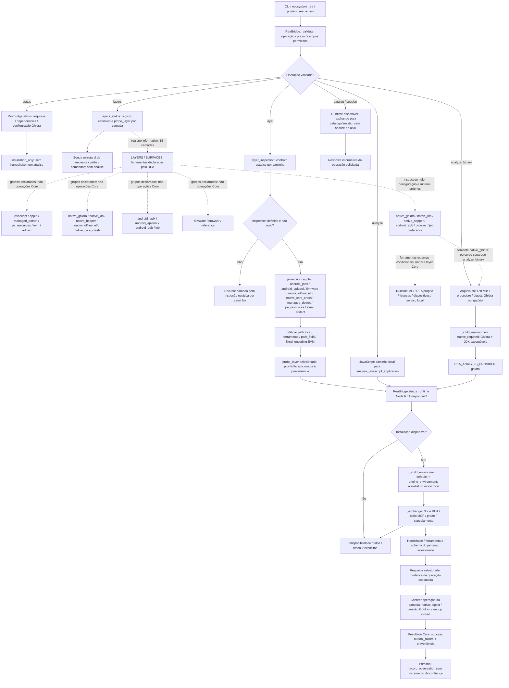

</details>

**Fontes de código:**

- [integrations/rea_layers.py:445](integrations/rea_layers.py#L445) — `layers_status`.
- [integrations/rea_layers.py:422](integrations/rea_layers.py#L422) — `probe_layer`.
- [integrations/rea_layers.py:465](integrations/rea_layers.py#L465) — `engine_environment`.
- [integrations/rea_bridge.py:40](integrations/rea_bridge.py#L40) — `ReaBridge`.
- [marceloclaro/orchestrator.py:2526](marceloclaro/orchestrator.py#L2526) — `MarceloClaroOrchestrator.rea_action`.
- [marceloclaro/rea_cli.py:7](marceloclaro/rea_cli.py#L7) — `run_rea_cli`.
- [integrations/rea_bridge.py:174](integrations/rea_bridge.py#L174) — `ReaBridge._validate`.
- [integrations/rea_bridge.py:108](integrations/rea_bridge.py#L108) — `ReaBridge.status`.
- [integrations/rea_bridge.py:50](integrations/rea_bridge.py#L50) — `ReaBridge._child_environment`.
- [integrations/rea_bridge.py:479](integrations/rea_bridge.py#L479) — `ReaBridge.action`.
- [integrations/rea_layers.py:305](integrations/rea_layers.py#L305) — `layer_inspection`.

**Limitações:**

- O registro declara 18 camadas; layer Core recusa inspection nulo.
- analyze_binary exige Ghidra; não alterna automaticamente para IDA/Hopper.
- IDA, Hopper, adb, browser, JEB e reference possuem runtimes/configuração próprios e não oferecem layer nesta ponte.
- Status e sondas de camada não abrem alvo nem iniciam análise.
- Ferramentas comerciais, dispositivos e engines exigem configuração e licenças próprias.

### 06. REA local direto e evidência

Inspeção estática com rede/PID privados, digest antes/depois, recibo por hash e explicação derivada.


[Abrir SVG](docs/architecture/flows/06-rea-local.svg) · [Fonte Mermaid](docs/architecture/flows/06-rea-local.mmd) · [GIF animado](docs/architecture/animated/diagram-f64391e6f070fd4a.gif)

<details>
<summary>Fonte Mermaid (auditoria)</summary>

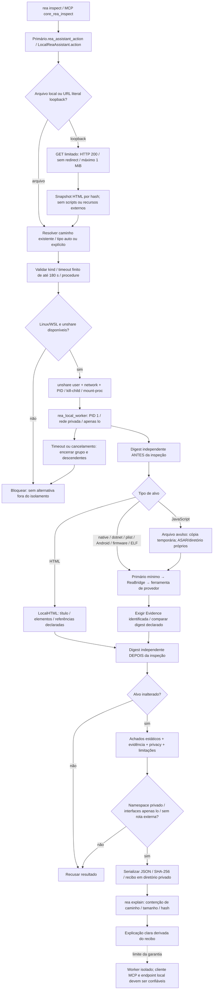

</details>

**Fontes de código:**

- [integrations/rea_assistant.py:625](integrations/rea_assistant.py#L625) — `LocalReaAssistant`.
- [integrations/rea_assistant.py:42](integrations/rea_assistant.py#L42) — `run_isolated_worker`.
- [integrations/rea_assistant.py:603](integrations/rea_assistant.py#L603) — `_snapshot_loopback`.
- [integrations/rea_local_worker.py:40](integrations/rea_local_worker.py#L40) — `main`.
- [integrations/rea_assistant.py:164](integrations/rea_assistant.py#L164) — `explain_report`.

**Limitações:**

- Garantia de rede privada cobre o worker e seus descendentes.
- Aplicação alvo não é executada no percurso estático; .NET pode fornecer apenas metadados.
- Snapshot loopback não executa scripts nem busca recursos externos.

### 07. REA com agente local e gate de recibos

Setup próprio, configuração efetiva, quatro ferramentas, timeout e validação do resultado do cliente.


[Abrir SVG](docs/architecture/flows/07-rea-agente.svg) · [Fonte Mermaid](docs/architecture/flows/07-rea-agente.mmd) · [GIF animado](docs/architecture/animated/diagram-9695787734dbc84f.gif)

<details>
<summary>Fonte Mermaid (auditoria)</summary>

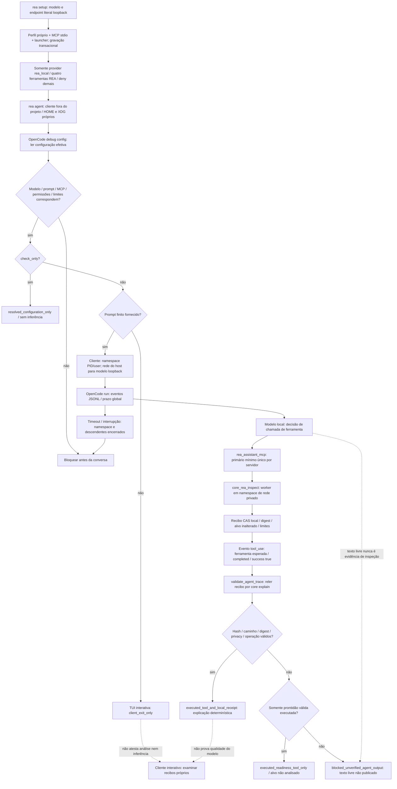

</details>

**Fontes de código:**

- [integrations/rea_assistant.py:280](integrations/rea_assistant.py#L280) — `setup_local_agent`.
- [integrations/rea_assistant.py:447](integrations/rea_assistant.py#L447) — `launch_local_agent`.
- [integrations/rea_assistant.py:353](integrations/rea_assistant.py#L353) — `_run_agent_client`.
- [integrations/rea_assistant.py:544](integrations/rea_assistant.py#L544) — `validate_agent_trace`.
- [integrations/rea_assistant_mcp.py:17](integrations/rea_assistant_mcp.py#L17) — `create_mcp_server`.

**Limitações:**

- Cliente OpenCode preserva a rede host para o endpoint loopback; não tem a garantia de rede privada do worker.
- Status, configuração ou saída TUI não comprovam análise autônoma do alvo.
- Análise REA autônoma pelo LLM local não foi comprovada nos recibos de prontidão R868/R869.

### 08. Conhecimento, RAG e grafos de evidência

Recuperação de fontes, abstenção, referências e dois modelos de grafo com responsabilidades distintas.


[Abrir SVG](docs/architecture/flows/08-conhecimento-rag.svg) · [Fonte Mermaid](docs/architecture/flows/08-conhecimento-rag.mmd) · [GIF animado](docs/architecture/animated/diagram-b6d478484fbf90e1.gif)

<details>
<summary>Fonte Mermaid (auditoria)</summary>

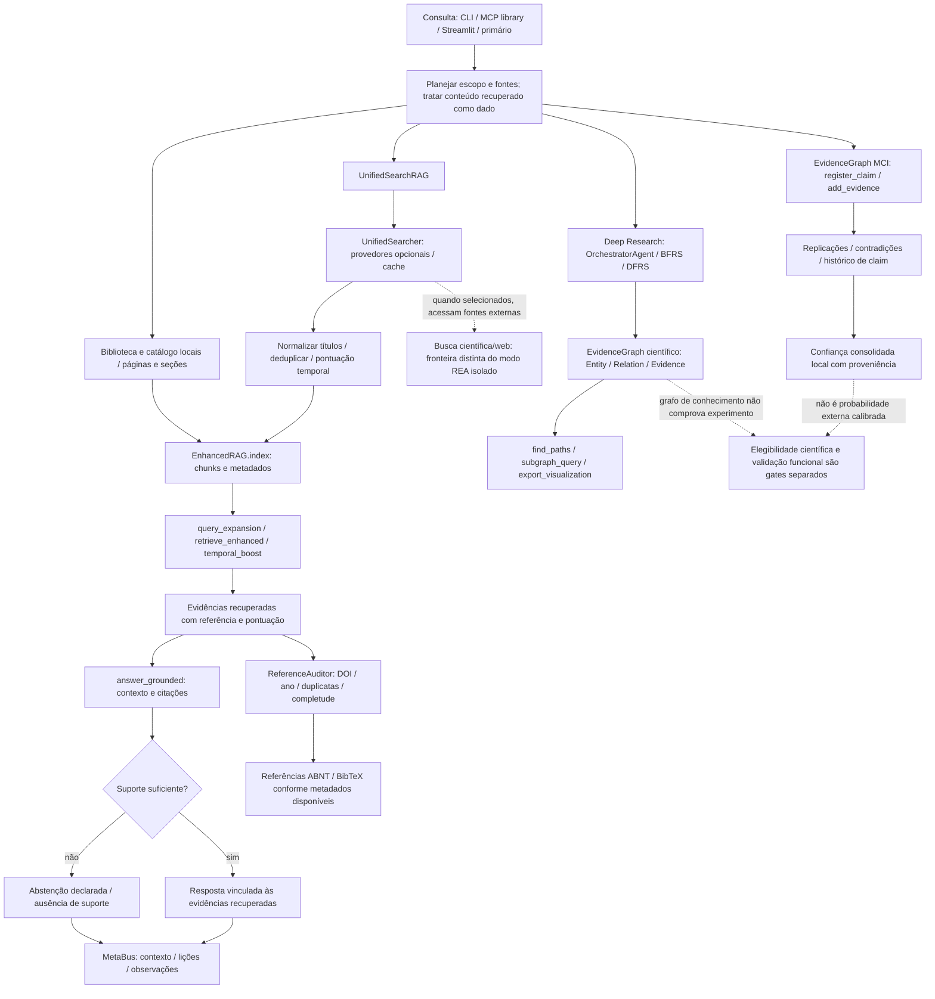

</details>

**Fontes de código:**

- [rag/enhanced_search_rag.py:761](rag/enhanced_search_rag.py#L761) — `UnifiedSearchRAG`.
- [rag/enhanced_search_rag.py:312](rag/enhanced_search_rag.py#L312) — `EnhancedRAG`.
- [rag/enhanced_search_rag.py:602](rag/enhanced_search_rag.py#L602) — `ReferenceAuditor`.
- [mci/evidence_graph.py:22](mci/evidence_graph.py#L22) — `EvidenceGraph`.
- [agentic_science_v2/evidence_graph.py:128](agentic_science_v2/evidence_graph.py#L128) — `EvidenceGraph`.
- [agentic_science_v2/deep_research.py:468](agentic_science_v2/deep_research.py#L468) — `OrchestratorAgent`.

**Limitações:**

- Busca externa depende dos provedores escolhidos; não integra a garantia local do REA.
- Grafo de conhecimento e evidência recuperada não comprovam experimento ou probabilidade calibrada.

### 09. Rede de memória observável

Eventos reais, memória persistida, claims, cartões e visualização em terminal/Streamlit.


[Abrir SVG](docs/architecture/flows/09-memoria-observavel.svg) · [Fonte Mermaid](docs/architecture/flows/09-memoria-observavel.mmd) · [GIF animado](docs/architecture/animated/diagram-d8277393ea44679f.gif)

<details>
<summary>Fonte Mermaid (auditoria)</summary>

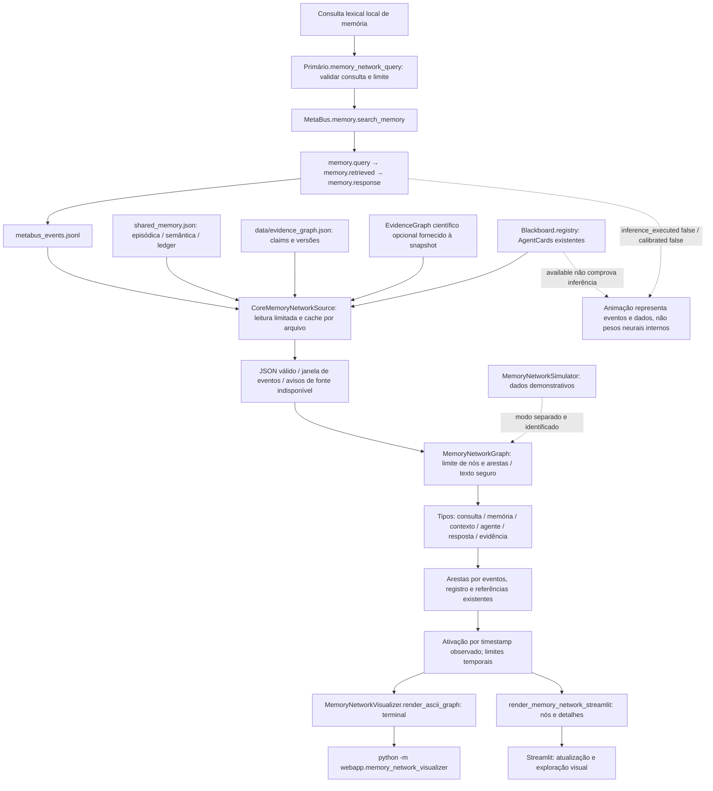

</details>

**Fontes de código:**

- [marceloclaro/orchestrator.py:380](marceloclaro/orchestrator.py#L380) — `MarceloClaroOrchestrator.memory_network_query`.
- [mci/metabus.py:61](mci/metabus.py#L61) — `MetacognitiveMemory`.
- [webapp/memory_network_visualizer.py:161](webapp/memory_network_visualizer.py#L161) — `CoreMemoryNetworkSource`.
- [webapp/memory_network_visualizer.py:365](webapp/memory_network_visualizer.py#L365) — `MemoryNetworkVisualizer`.
- [webapp/memory_network_streamlit.py:17](webapp/memory_network_streamlit.py#L17) — `render_memory_network_streamlit`.

**Limitações:**

- A animação representa eventos e relações observadas, não ativações internas de uma rede neural.
- Simulação e registro de agente disponível são distintos de inferência executada.

### 10. Raciocínio restrito e fallbacks

AST permitida, tradução SMT integral, cálculo simbólico da entrada e falha sem conclusão inventada.


[Abrir SVG](docs/architecture/flows/10-raciocinio.svg) · [Fonte Mermaid](docs/architecture/flows/10-raciocinio.mmd) · [GIF animado](docs/architecture/animated/diagram-a52c85b1012c269c.gif)

<details>
<summary>Fonte Mermaid (auditoria)</summary>

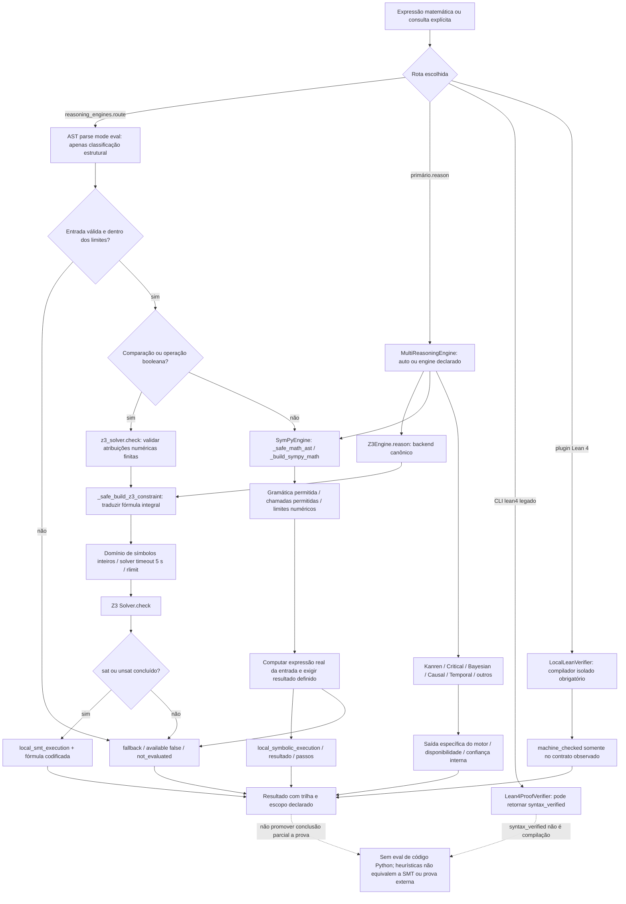

</details>

**Fontes de código:**

- [reasoning/reasoning_engines.py:7](reasoning/reasoning_engines.py#L7) — `route`.
- [reasoning/z3_solver.py:41](reasoning/z3_solver.py#L41) — `check`.
- [reasoning/engines.py:83](reasoning/engines.py#L83) — `_safe_build_z3_constraint`.
- [reasoning/engines.py:337](reasoning/engines.py#L337) — `_safe_math_ast`.
- [reasoning/engines.py:493](reasoning/engines.py#L493) — `SymPyEngine`.
- [reasoning/engines.py:1435](reasoning/engines.py#L1435) — `MultiReasoningEngine`.

**Limitações:**

- SAT/UNSAT exige conclusão do backend; erro ou indisponibilidade retorna fallback.
- Motores heurísticos e confidence interna não equivalem a prova SMT ou validação externa.

### 11. Diagnóstico, confiança, federação e evolução

Autodescoberta e corpus retido, categorias canônicas, remediação, políticas e ledger de evolução.


[Abrir SVG](docs/architecture/flows/11-diagnostico-governanca.svg) · [Fonte Mermaid](docs/architecture/flows/11-diagnostico-governanca.mmd) · [GIF animado](docs/architecture/animated/diagram-b1191de7207d8158.gif)

<details>
<summary>Fonte Mermaid (auditoria)</summary>

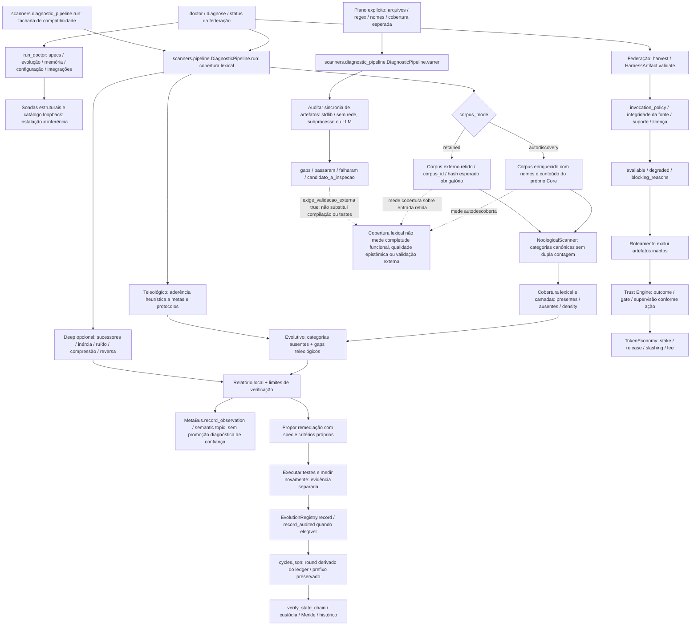

</details>

**Fontes de código:**

- [marceloclaro/doctor.py:928](marceloclaro/doctor.py#L928) — `run_doctor`.
- [scanners/pipeline.py:96](scanners/pipeline.py#L96) — `DiagnosticPipeline`.
- [scanners/noological_scanner.py:495](scanners/noological_scanner.py#L495) — `NoologicalScanner`.
- [integrations/harness_federation/artifact.py:406](integrations/harness_federation/artifact.py#L406) — `HarnessArtifact`.
- [trust/trust_engine.py:540](trust/trust_engine.py#L540) — `TrustEngine`.
- [economy/token_economy.py:184](economy/token_economy.py#L184) — `TokenEconomy`.
- [evolution/cycles.py:101](evolution/cycles.py#L101) — `EvolutionRegistry`.
- [scanners/diagnostic_pipeline.py:46](scanners/diagnostic_pipeline.py#L46) — `DiagnosticPipeline.varrer`.
- [scanners/diagnostic_pipeline.py:142](scanners/diagnostic_pipeline.py#L142) — `run`.

**Limitações:**

- Cobertura lexical não mede cobertura funcional ou completude epistêmica.
- Confiança e licença declarada são sinais e políticas locais, não certificações externas.
- scanners.diagnostic_pipeline.varrer é auditoria hermética de sincronia; run desse módulo é fachada do diagnóstico lexical.

### 12. Ciência, proveniência e publicação

Execução científica e descoberta com gates, revisão interna, composição e entrega editorial humana.


[Abrir SVG](docs/architecture/flows/12-ciencia-publicacao.svg) · [Fonte Mermaid](docs/architecture/flows/12-ciencia-publicacao.mmd) · [GIF animado](docs/architecture/animated/diagram-829bfb0c2728f8e8.gif)

<details>
<summary>Fonte Mermaid (auditoria)</summary>

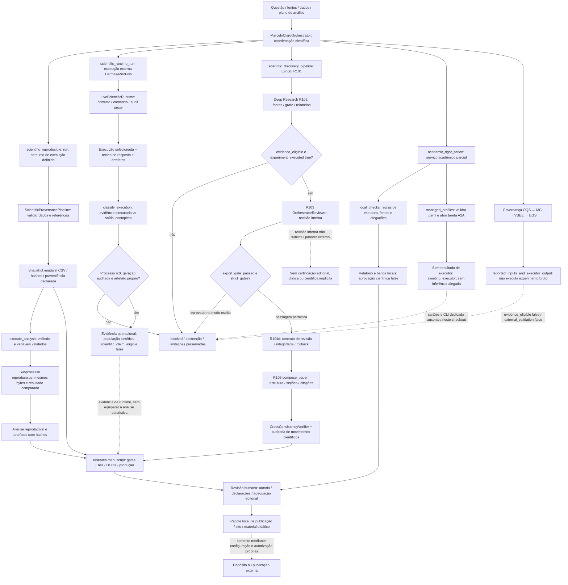

</details>

**Fontes de código:**

- [marceloclaro/orchestrator.py:2184](marceloclaro/orchestrator.py#L2184) — `MarceloClaroOrchestrator.scientific_reproducible_run`.
- [marceloclaro/orchestrator.py:2720](marceloclaro/orchestrator.py#L2720) — `MarceloClaroOrchestrator.scientific_discovery_pipeline`.
- [integrations/live_scientific_runtime.py:189](integrations/live_scientific_runtime.py#L189) — `LiveScientificRuntime`.
- [research/provenance_pipeline.py:260](research/provenance_pipeline.py#L260) — `ScientificProvenancePipeline`.
- [agentic_science_v2/paper_composer.py:496](agentic_science_v2/paper_composer.py#L496) — `OrchestratorComposer`.
- [mci/pipeline/scientific_governance_pipeline.py:15](mci/pipeline/scientific_governance_pipeline.py#L15) — `run_scientific_governance_pipeline`.
- [marceloclaro/orchestrator.py:2283](marceloclaro/orchestrator.py#L2283) — `MarceloClaroOrchestrator.scientific_runtime_run`.
- [research/statistical_methods.py:84](research/statistical_methods.py#L84) — `execute_analysis`.
- [academic/adversarial_research/service.py:47](academic/adversarial_research/service.py#L47) — `AdversarialResearchService`.
- [academic/adversarial_research/board.py:11](academic/adversarial_research/board.py#L11) — `review_research`.
- [academic/adversarial_research/banca.py:7](academic/adversarial_research/banca.py#L7) — `BancaSessionStore`.
- [marceloclaro/orchestrator.py:2248](marceloclaro/orchestrator.py#L2248) — `MarceloClaroOrchestrator.academic_rigor_action`.

**Limitações:**

- Deep Research sem evidência elegível bloqueia a descoberta estrita.
- Governança de entradas reportadas não executa experimento sobre dados brutos.
- Composição e revisão internas não constituem parecer editorial ou validação clínica.
- Rigor acadêmico parcial: perfis e CLI dedicada removidos; local_checks não é inferência dos especialistas.
- Spec ausente bloqueia G0; banca_rate chama método ausente.
- O preflight acadêmico não tem chamador no pipeline amostrado.

### 13. Validação e entrega

Suíte/JUnit, contagens físicas, exportação limpa, manifesto, commit e resultado remoto independente.


[Abrir SVG](docs/architecture/flows/13-validacao-entrega.svg) · [Fonte Mermaid](docs/architecture/flows/13-validacao-entrega.mmd) · [GIF animado](docs/architecture/animated/diagram-29a96da731327441.gif)

<details>
<summary>Fonte Mermaid (auditoria)</summary>

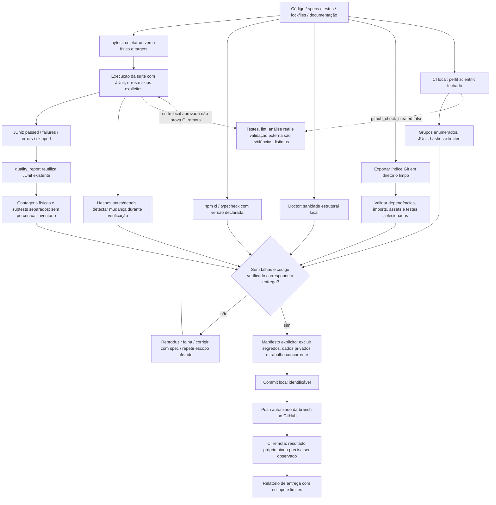

</details>

**Fontes de código:**

- [scripts/quality_report.py:65](scripts/quality_report.py#L65) — `load_junit_results`.
- [scripts/quality_report.py:211](scripts/quality_report.py#L211) — `generate_report`.
- [sdd/tdd_runner.py:554](sdd/tdd_runner.py#L554) — `run_pytest`.
- [marceloclaro/doctor.py:928](marceloclaro/doctor.py#L928) — `run_doctor`.

**Limitações:**

- Suíte local, lint e CI remota são verificações distintas.
- Diagrama representa o procedimento de entrega; resultado remoto deve ser observado separadamente.

### 14. Plugins locais, Lean 4 e MiroFish

Pacotes privados reutilizam o mesmo primário; status e execução possuem contratos distintos.


[Abrir SVG](docs/architecture/flows/14-plugins-locais.svg) · [Fonte Mermaid](docs/architecture/flows/14-plugins-locais.mmd) · [GIF animado](docs/architecture/animated/diagram-83a0417e20f0d613.gif)

<details>
<summary>Fonte Mermaid (auditoria)</summary>

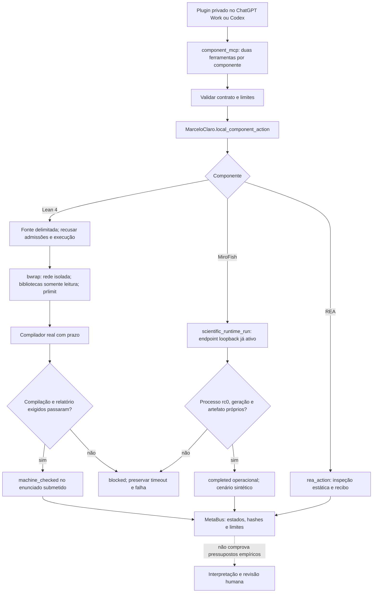

</details>

**Fontes de código:**

- [integrations/component_mcp.py:11](integrations/component_mcp.py#L11) — `create_server`.
- [integrations/component_actions.py:30](integrations/component_actions.py#L30) — `dispatch_component`.
- [integrations/local_lean.py:11](integrations/local_lean.py#L11) — `LocalLeanVerifier`.
- [marceloclaro/orchestrator.py:2273](marceloclaro/orchestrator.py#L2273) — `MarceloClaroOrchestrator.local_component_action`.

**Limitações:**

- MiroFish exige endpoint local previamente disponível; instalação não comprova inferência.
- No checkout amostrado, LocalLeanVerifier relata axiomas somente do primeiro teorema e limita AS a 4 GiB.
- O caminho CLI lean4 legado pode produzir syntax_verified; ele não equivale à compilação do plugin.
- Conteúdo devolvido ao aplicativo de chat pode ser processado fora da máquina.

### 15. NotebookLM coordenado e política R915

CLI, MCP, catálogo e skill compartilham validação, política de efeitos e recibos pelo MarceloClaro.


[Abrir SVG](docs/architecture/flows/15-notebooklm.svg) · [Fonte Mermaid](docs/architecture/flows/15-notebooklm.mmd) · [GIF animado](docs/architecture/animated/diagram-d6956b6d79e1eb30.gif)

<details>
<summary>Fonte Mermaid (auditoria)</summary>

```mermaid
flowchart TB
  INPUT["/gemini-notebook ou ferramenta MCP central"] --> MC["MarceloClaro.gemini_notebook_action"]
  MC --> VALID["Validar campos, limites e ausência de credenciais"]
  VALID --> OP{"Operação"}
  OP -->|status| STATUS["Versão e binários; login não verificado"]
  OP -->|catalog| CAT["Descobrir schemas MCP e árvore CLI com hash"]
  OP -->|skill| SKILL["Fonte e licença; preservar edições locais"]
  OP -->|mcp ou cli| EFFECT["Classificar efeito e suboperações"]
  EFFECT --> AUTH{"Autenticação privada?"}
  AUTH -->|sim| PRIVATE["Bloquear; login no terminal do operador"]
  AUTH -->|não| DRY{"dry_run?"}
  DRY -->|sim| PREP["prepared; nenhuma operação remota"]
  DRY -->|não| ALLOW{"Leitura ou efeito concreto autorizado?"}
  ALLOW -->|não| BLOCK["blocked; preservar motivo"]
  ALLOW -->|sim| LIVE["Schema atual; broker de sessão privada"]
  LIVE --> GOOGLE["NotebookLM na infraestrutura Google"]
  GOOGLE --> RESULT["completed / pending / partial / failed"]
  RESULT --> ART["Downloads: raiz permitida, arquivo novo e SHA"]
  ART --> OBS["MetaBus: estados e hashes; sem confiança promovida"]
  CAT -.->|descobrir não autoriza ferramenta nova| BLOCK
```

</details>

**Fontes de código:**

- [integrations/gemini_notebook.py:83](integrations/gemini_notebook.py#L83) — `GeminiNotebookService`.
- [integrations/gemini_notebook_catalog.py:79](integrations/gemini_notebook_catalog.py#L79) — `classify_mcp_operation`.
- [integrations/gemini_notebook_session.py:50](integrations/gemini_notebook_session.py#L50) — `_configuration`.
- [marceloclaro/orchestrator.py:2408](marceloclaro/orchestrator.py#L2408) — `MarceloClaroOrchestrator.gemini_notebook_action`.

**Limitações:**

- Conector comunitário: não é API oficial de conta pessoal do Google.
- A sonda R915 observou 0.15.6, 53 ferramentas, 165 callbacks e 234 notebooks; trata-se de execução datada.
- alias, chat_save_to_note, profile e report continuam bloqueadas pela política MCP do Core.
- Jobs voláteis permanecem vinculados à sessão original; nova sessão não comprova continuidade.

### 16. Autenticações de ChatGPT, Gemini e NotebookLM

Três clientes e sessões independentes; resposta observada e login são evidências diferentes.


[Abrir SVG](docs/architecture/flows/16-autenticacoes.svg) · [Fonte Mermaid](docs/architecture/flows/16-autenticacoes.mmd) · [GIF animado](docs/architecture/animated/diagram-052725f98ca383e6.gif)

<details>
<summary>Fonte Mermaid (auditoria)</summary>

```mermaid
flowchart TB
  OP["Operador no terminal"] --> CHOICE{"Serviço"}
  CHOICE -->|ChatGPT no OpenCode| OC["opencode auth login provider openai"]
  OC --> OAUTH["Autorizar no navegador OpenAI; sessão privada"]
  OAUTH --> MODEL["Selecionar modelo em /models"]
  CHOICE -->|Gemini Chat no terminal| GEM["Gemini CLI: Sign in with Google"]
  GEM --> TEST["Enviar solicitação curta"]
  MODEL --> TEST
  TEST --> RESPONSE{"Resposta concluída?"}
  RESPONSE -->|não| BLOCK["Preservar falha, limite ou indisponibilidade"]
  RESPONSE -->|sim| ACCESS["Acesso observado naquele momento"]
  CHOICE -->|Notebooks e fontes| NLM["nlm login --wsl; conta Google"]
  NLM --> CHECK["nlm login --check"]
  CHECK --> CORE["Core: política por efeito em /gemini-notebook"]
  CORE --> GOOGLE["Serviço Google; notebooks e fontes"]
  OAUTH -.->|não importa histórico web| LIMIT["Sessões e cotas próprias"]
  GEM -.->|independente do NotebookLM| LIMIT
```

</details>

**Fontes de código:**

- [integrations/gemini_cli.py:69](integrations/gemini_cli.py#L69) — `gemini_run`.
- [integrations/gemini_notebook.py:41](integrations/gemini_notebook.py#L41) — `validate_notebook_config`.
- [integrations/opencode_cli.py:551](integrations/opencode_cli.py#L551) — `build_config`.

**Limitações:**

- Nenhuma conversa web é automaticamente importada.
- Login Gemini CLI não configura um provider Google no OpenCode.
- Tarifas de API, créditos e franquia de assinatura não são intercambiáveis.

### 17. Ciclo metacognitivo e memória de outcomes

Recuperação de lições antes da tarefa e observação posterior, sem transformar heurística em validação externa.


[Abrir SVG](docs/architecture/flows/17-metacognicao.svg) · [Fonte Mermaid](docs/architecture/flows/17-metacognicao.mmd) · [GIF animado](docs/architecture/animated/diagram-456a5348c47deb90.gif)

<details>
<summary>Fonte Mermaid (auditoria)</summary>

```mermaid
flowchart TB
  TASK["Solicitação ao MarceloClaro"] --> PREP["MetacognitiveLoop.prepare"]
  PREP --> SEARCH["Recuperar lições; deduplicar e excluir substituídos"]
  SEARCH --> BRIEF["Briefing: referências e limites locais"]
  BRIEF --> A2A["delegate: contexto da tarefa Blackboard"]
  A2A --> EXEC["Executor realiza o trabalho"]
  EXEC --> GATE["report_completion: contrato e histórico quando aplicável"]
  GATE --> BB["task.complete e atualização da tarefa"]
  BB --> REF["ReflexionEngine: solicitação de reflexão"]
  REF --> COMPLETE["MetacognitiveLoop.complete"]
  COMPLETE --> EPISODE["Outcome, erro observado e próxima ação"]
  EPISODE --> RECORD["record_observation: calibrated false"]
  RECORD --> SEARCH
  GATE --> TRUST["Trust.learn e economia conforme outcome"]
  REASON["primário.reason"] --> PREP
  REASON --> ENGINE["Motor solicitado e resultado tipado"]
  ENGINE --> OBS["observe_reasoning"]
  OBS --> RECORD
  RECORD -.->|confidence_promoted false nesta observação| LIMIT["Não comprova verdade, causalidade ou revisão humana"]
```

</details>

**Fontes de código:**

- [mci/metacognitive_loop.py:23](mci/metacognitive_loop.py#L23) — `MetacognitiveLoop`.
- [marceloclaro/orchestrator.py:456](marceloclaro/orchestrator.py#L456) — `MarceloClaroOrchestrator.delegate`.
- [marceloclaro/orchestrator.py:904](marceloclaro/orchestrator.py#L904) — `MarceloClaroOrchestrator.report_completion`.
- [mci/reflexion.py:19](mci/reflexion.py#L19) — `ReflexionEngine`.

**Limitações:**

- Observações locais não são calibração probabilística nem revisão científica.
- Trust.learn, resolução econômica e observações de memória são efeitos diferentes.
- Memória recuperada é dado contextual, não uma nova autorização ou instrução.

### 18. Lifecycle permanente de agentes e subagentes

Definição validada, contrato, permissões e correlação da tarefa antes da execução efetiva.


[Abrir SVG](docs/architecture/flows/18-lifecycle.svg) · [Fonte Mermaid](docs/architecture/flows/18-lifecycle.mmd) · [GIF animado](docs/architecture/animated/diagram-09169c4fd46e8766.gif)

<details>
<summary>Fonte Mermaid (auditoria)</summary>

```mermaid
flowchart TB
  INPUT["CLI agentes ou ecosystem_agent_profile"] --> MC["MarceloClaro.agent_profile_action"]
  MC --> CHECK["Capacidades, origem, spec/teste, saída e permissões"]
  CHECK --> VALID{"Definição gerenciada válida?"}
  VALID -->|não| LEGACY["Recusar criação ou preservar baseline histórico"]
  VALID -->|sim| HASH["Conferir SHA antes do registro"]
  HASH --> BUSY{"Definição em uso conflita?"}
  BUSY -->|sim| BLOCK["blocked; preservar trabalho em andamento"]
  BUSY -->|não| REG["Registrar cartão no Blackboard"]
  REG --> ACTION{"Criar ou ativar?"}
  ACTION -->|criar| CONFIG["Compilar configuração do OpenCode"]
  ACTION -->|ativar| DELEGATE["delegate: capacidade exclusiva e contexto"]
  DELEGATE --> ID["Correlacionar task_id, perfil e executor externo"]
  ID --> WAIT["pending_executor até execução real"]
  WAIT --> WORK["Trabalho e evidência observados"]
  WORK --> GATE["Contrato e conclusão pelo primário"]
  CONFIG --> MEM["MetaBus: observações e limites"]
  GATE --> MEM
```

</details>

**Fontes de código:**

- [agents/lifecycle.py:244](agents/lifecycle.py#L244) — `AgentLifecycleService`.
- [agents/lifecycle.py:163](agents/lifecycle.py#L163) — `validate_managed_card`.
- [marceloclaro/orchestrator.py:241](marceloclaro/orchestrator.py#L241) — `MarceloClaroOrchestrator.agent_profile_action`.

**Limitações:**

- Registro e atribuição não comprovam inferência ou conclusão.
- Definições históricas conservam baseline; alterações exigem migração explícita.
- Ferramentas externas de subagentes não são interceptadas automaticamente pelo Core.

### 19. CI local e validação delimitada

Alternativa local ao bloqueio da CI remota, com seleção fechada e recibos próprios.


[Abrir SVG](docs/architecture/flows/19-ci-local.svg) · [Fonte Mermaid](docs/architecture/flows/19-ci-local.mmd) · [GIF animado](docs/architecture/animated/diagram-4dda0aecf20b2d9d.gif)

<details>
<summary>Fonte Mermaid (auditoria)</summary>

```mermaid
flowchart TB
  INPUT["ci-local ou ecosystem_local_ci"] --> MC["MarceloClaro.local_ci_action"]
  MC --> OP{"start / status / runs / cancel"}
  OP -->|start| PROFILE["Somente perfil scientific enumerado"]
  PROFILE --> LOCK["Lock de escritor único; identidade das fontes"]
  LOCK --> RUN["Supervisor: grupos, prazo e memória delimitados"]
  RUN --> JUNIT["JUnit, seleção, execução e hashes"]
  JUNIT --> VERIFY{"Fontes estáveis e todos os grupos exigidos concluídos?"}
  VERIFY -->|não| BLOCK["blocked ou cancelled; preservar erro"]
  VERIFY -->|sim| PASS["passed no escopo selecionado"]
  OP -->|status ou runs| READ["Ler recibos e conferir compatibilidade"]
  OP -->|cancel| CANCEL["Cancelar e limpar processos observados"]
  READ --> RESULT["Estado observado e limitações"]
  CANCEL --> RESULT
  PASS --> RESULT
  BLOCK --> RESULT
  RESULT --> META["Observação no MetaBus"]
  RESULT -.->|github_check_created false| REMOTE["CI remota exige execução e evidência próprias"]
```

</details>

**Fontes de código:**

- [integrations/local_ci.py:139](integrations/local_ci.py#L139) — `LocalCIService`.
- [scripts/validate_scientific_profile.py:534](scripts/validate_scientific_profile.py#L534) — `main`.
- [marceloclaro/orchestrator.py:334](marceloclaro/orchestrator.py#L334) — `MarceloClaroOrchestrator.local_ci_action`.

**Limitações:**

- O perfil fechado não executa comandos, URLs ou testes arbitrários fornecidos pelo chamador.
- Aprovação local não cria check GitHub nem comprova suíte global.
- Conservar resultados anteriores como históricos quando as fontes mudarem.

### 20. Seleção econômica de modelos e contexto

Política recomendada para comparar custo por tarefa aceita; não é um roteador automático novo.


[Abrir SVG](docs/architecture/flows/20-economia-modelos.svg) · [Fonte Mermaid](docs/architecture/flows/20-economia-modelos.mmd) · [GIF animado](docs/architecture/animated/diagram-5e4fa5583c5976f3.gif)

<details>
<summary>Fonte Mermaid (auditoria)</summary>

```mermaid
flowchart TB
  TASK["Tarefa ao MarceloClaro"] --> CONTEXT["Recuperar fontes e trechos relevantes"]
  CONTEXT --> TYPE{"Complexidade, risco e dados permitidos"}
  TYPE -->|baixo risco, tarefa delimitada| ECONOMIC["API candidates: gpt-6-luna / gemini-3.5-flash-lite"]
  TYPE -->|código ou análise em várias etapas| BALANCED["gemini-3.8-flash / modelo equilibrado"]
  TYPE -->|alto risco, crítica ou falha persistente| STRONG["Escalonar com aprovação explícita"]
  CONFIG["opencode.json: padrão ollama-local/llama3.2 permanece"] -.->|sem troca silenciosa| TASK
  ROUTER["ModelRouter: tipo, autenticação e preferências"] --> CANDIDATE["Validar ID no catálogo e provider selecionado"]
  ECONOMIC --> CANDIDATE
  BALANCED --> CANDIDATE
  STRONG --> CANDIDATE
  CANDIDATE --> AVAILABLE{"Endpoint/modelo disponível e permitido?"}
  AVAILABLE -->|não| BLOCK["Explicitar bloqueio/quota; não mudar provider automaticamente"]
  AVAILABLE -->|sim| QUALITY{"Mesmo critério de qualidade atendido?"}
  QUALITY -->|não| REVIEW["Rever contexto ou escalar dentro do orçamento"]
  REVIEW --> STRONG
  QUALITY -->|sim| MEASURE["Guardar tokens, cache, latência, retries e aceite"]
  MEASURE --> COST["API paga, assinatura e franquia em contas separadas"]
  COST --> COMPARE["Custo/tarefa aceita; comparar amostras pareadas"]
  BLOCK -.->|HTTP 429/Retry-After: respeitar pausa, limite e operador| CONTROL["Sem retry infinito; sem fallback oculto"]
  COMPARE --> CONTROL
```

</details>

**Fontes de código:**

- [integrations/model_router.py:448](integrations/model_router.py#L448) — `ModelRouter.route`.
- [integrations/model_router.py:591](integrations/model_router.py#L591) — `ModelRouter.route_free`.
- [integrations/free_model_catalog.py:115](integrations/free_model_catalog.py#L115) — `best_free_model`.
- [integrations/opencode_cli.py:551](integrations/opencode_cli.py#L551) — `build_config`.

**Limitações:**

- Este é um fluxo de decisão operacional recomendado, não uma implementação automática adicional.
- Modelos anunciados no catálogo não comprovam acesso por assinatura ou inferência.
- Preços de API não estimam a franquia de assinatura. Medir tokens e qualidade nas mesmas tarefas.

### 21. Contexto de código e consultas de grafo

Busca e estrutura local reduzem leituras desnecessárias; ganhos precisam de medição comparável.


[Abrir SVG](docs/architecture/flows/21-contexto-codigo.svg) · [Fonte Mermaid](docs/architecture/flows/21-contexto-codigo.mmd) · [GIF animado](docs/architecture/animated/diagram-61c4c013d6202872.gif)

<details>
<summary>Fonte Mermaid (auditoria)</summary>

```mermaid
flowchart TB
  INPUT["Pedido de contexto pelo MarceloClaro"] --> KIND{"Busca, símbolo ou grafo?"}
  KIND --> INDEX["Índice local com manifesto e hashes"]
  INDEX --> FRESH{"Índice corresponde às fontes?"}
  FRESH -->|não| BLOCK["blocked ou reindexação explícita"]
  FRESH -->|sim| QUERY["Consulta delimitada e trechos relevantes"]
  KIND --> PY["python_graph: imports e relações estáticas Python"]
  PY --> LIMIT["Não confundir relação lexical com execução"]
  KIND --> NATIVE{"Operação nativa conhecida como falha?"}
  NATIVE -->|sim| BLOCK
  NATIVE -->|não| POLICY["Conferir contrato, limites e backend disponível"]
  POLICY --> QUERY
  QUERY --> CONTEXT["Contexto compacto com fonte e localizador"]
  LIMIT --> CONTEXT
  CONTEXT --> MODEL["Modelo selecionado com orçamento"]
  MODEL --> MEASURE["Medir tokens, chamadas e qualidade da tarefa aceita"]
```

</details>

**Fontes de código:**

- [integrations/code_context.py:75](integrations/code_context.py#L75) — `CodeContextProvider`.
- [integrations/code_context.py:219](integrations/code_context.py#L219) — `CodeContextProvider._source_files`.
- [integrations/code_context.py:647](integrations/code_context.py#L647) — `CodeContextProvider._python_graph`.

**Limitações:**

- Grafo estático não comprova caminho executado ou ausência de bugs.
- Três operações nativas conhecidas como incorretas continuam bloqueadas; python_graph tem contrato próprio.
- Não foi medida nesta revisão uma porcentagem de redução de tokens.

### 22. Contexto, erros e telemetria de Ollama local

Num_ctx ativo via Ollama /api/show, preflight aproximado, erros tipados e uso explícito; sem truncamento, retry ou fallback automático.


[Abrir SVG](docs/architecture/flows/22-ollama-contexto-erros.svg) · [Fonte Mermaid](docs/architecture/flows/22-ollama-contexto-erros.mmd) · [GIF animado](docs/architecture/animated/diagram-9e5a1f7dd8a923ea.gif)

<details>
<summary>Fonte Mermaid (auditoria)</summary>

```mermaid
flowchart TB
  INPUT["Tarefa explícita ao SDK local"] --> MODEL["Modelo/provider escolhido pelo operador"]
  MODEL --> WINDOW{"Janela de contexto conhecida?"}
  WINDOW -->|sim| PREFLIGHT["Estimar mensagens + ferramentas + margem"]
  WINDOW -->|não| SEND
  PREFLIGHT --> FIT{"Entrada + saída reservada cabe?"}
  FIT -->|não| BLOCK["context_budget_exceeded; não enviar POST"]
  FIT -->|sim| SEND["POST ao endpoint selecionado"]
  SEND --> RESPONSE{"Resposta do provider"}
  RESPONSE -->|contexto excedido| CONTEXT["Código e remediação; sem truncar conteúdo"]
  RESPONSE -->|429/quota| QUOTA["Preservar Retry-After; sem retry/fallback automático"]
  RESPONSE -->|401/403/404/5xx/timeout| ERROR["Erro tipado; provider/modelo identificados"]
  RESPONSE -->|2xx| USAGE["Uso informado pelo provider ou estimativa marcada"]
  USAGE --> QUALITY["Analisar qualidade/aceite fora do contador de tokens"]
  BLOCK --> RECEIPT["query_id, fonte de contexto e limite"]
  CONTEXT --> RECEIPT
  QUOTA --> RECEIPT
  ERROR --> RECEIPT
  QUALITY --> RECEIPT
  RECEIPT -.->|sem custo por assinatura inferido| LIMIT["SDK local não altera o modelo padrão do OpenCode"]
```

</details>

**Fontes de código:**

- [integrations/opencode_agent_sdk.py:108](integrations/opencode_agent_sdk.py#L108) — `build_options`.
- [integrations/opencode_agent_sdk.py:232](integrations/opencode_agent_sdk.py#L232) — `_http_json_detailed`.
- [integrations/opencode_agent_sdk.py:300](integrations/opencode_agent_sdk.py#L300) — `_probe_ollama_context`.
- [integrations/opencode_agent_sdk.py:487](integrations/opencode_agent_sdk.py#L487) — `_query_loop`.
- [integrations/opencode_cli.py:551](integrations/opencode_cli.py#L551) — `build_config`.

**Limitações:**

- Estimativa de UTF-8/3 bytes por token é heurística, não tokenizador do modelo.
- Janelas do catálogo são declaradas; o Modelfile e o runtime ativo podem divergir.
- Uso estimado não é cobrança nem substitui o campo usage do provider.
- Respostas do modelo local não são validadas por qualidade científica apenas por serem locais.

Para atualizar esta seção, execute na raiz
`python3 scripts/sync_readme_flowcharts.py`. Para conferir sem escrever, use
`python3 scripts/sync_readme_flowcharts.py --check`.

<!-- core-flowcharts:end -->

## Limites de segurança e operação

- **Acesso padrão `open_science_only`**: fontes OpenAlex, Crossref, EuropePMC e arXiv; serviços externos opcionais e auditáveis.
- **Sem pipe de rede**: instalação local e verificável; credenciais nunca em recibos/sandboxes.
- **Segredos protegidos**: o `credential_guard.sh` valida o token **sem imprimi‑lo**; `~/.git-credentials` nunca é commitado.
- **Resolvedores restritos** (ex.: sci‑hub) desabilitados por omissão; exigem autorização humana e base legal.
- **Domínios sensíveis** (clínico, jurídico, científico): agentes são **apoio computacional**, não decisores; os resultados **não substituem revisão humana**.
- **Anti‑overclaim estrutural**: alegações vedadas e **sem validação externa** ("Qualis A1", "verificado") **não são admitidas**; histórico em [CORRIGENDUM.md](CORRIGENDUM.md).
- **Métricas internas** (score de evolução, média móvel do score, contagens do doctor) **não gate** de mérito externo; são instrumentos de gestão do repositório.
- **Não é certificação**: métricas internas e auto‑score são observadas **localmente**, **não constituem certificação externa** e não atestam mérito editorial, científico ou de segurança para terceiros.
- Conforme [SECURITY.md](SECURITY.md): use Security Advisories para vulnerabilidades.

---

## Validação, contribuição e release

### Validações registradas e seus escopos

Os resultados abaixo são fotografias de **execução local**, com escopos
identificados. Eles não constituem **certificação externa** nem comprovam
execução de todas as integrações disponíveis na sua máquina.

| Registro | Resultado observado | Alcance |
|---|---|---|
| [Core R868/R869](docs/evidencias-r868/verificacao-final.json) | 7.204 casos físicos aprovados, 65 skips, zero falhas/erros | Suíte integral daquela revisão; 34 subtestes agregados separados das aprovações físicas |
| [Arquitetura R879](docs/architecture/verification-local-r879.json) | 58 testes na invocação final, 13 renders Mermaid e 78 âncoras conferidas | Gerador, página, documentação e verificação de segredos; não repete a suíte integral |
| [Orquestração real](docs/evidencias-r868/verificacao-final.json) | Codex retornou `15` para `8 + 7` em 9,303 s | Uma tarefa textual somente com leitura, sem alvo REA |
| [Inspeção REA direta](docs/evidencias-r868/analise-direta-controlada.json) | HTML controlado de 115 bytes, dois achados, alvo intocado | Caminho direto local; não comprova todos os formatos ou engines |
| [Loop Engineering R1100](docs/LOOP_ENGINEERING_R1100.md) | 8 testes R1100; 43 na integração R1100/R1099/R917/R920 | Checklist e integração local; não prova funcionamento de loop |
| [Livro quântico R1099](educacao_quantica_bohm/livro_pixel/BUILD_PDF.md) | 59 testes do livro; PDF 3504 pp; 3000 códigos | Build local; não é peer review |
| [GJQ R1099](docs/GJQ_PESQUISA_QUANTICA_R1099.md) | 4 testes `gjq-runtime` + 5 `quantum-sim-core`; Bell/CHSH no FAS-GPU | Simulador; nenhum hardware executado |

A análise REA autônoma pelo LLM local permanece sem entrega aceita nos registros.
O lint global possui pendências. A CI remota não foi executada nesses recibos;
o workflow principal atual acompanha push em `main`, `master` e `develop`,
além do seu evento de pull request. Um push na branch `codex/*` não prova CI verde.

**Histórico R448:** [VALIDATION_R448.md](VALIDATION_R448.md) conserva o gate
**SPEC-935-R448**, em Linux WSL2/Python 3.14.4: `doctor` **18/20 checks**,
**4.539 passed**, **67 skipped** e **quatro subtestes aprovados.** Esses números
pertencem ao baseline histórico. O git não transforma as fontes encontradas em
evidência já revisada.

Para uma nova conferência, use o ambiente do projeto e registre seu próprio
resultado. A suíte integral inclui integrações e componentes opcionais:

```bash
.venv/bin/python -m pip install -r requirements-dev.txt
.venv/bin/python -m pytest tests/ -q --tb=short --timeout=120
.venv/bin/python -m marceloclaro.cli doctor
```

A CI salva JUnit e o relatório reutiliza o XML, sem repetir a suíte:

```bash
.venv/bin/python scripts/quality_report.py --junit CAMINHO_DO_JUNIT
```

Quick e baterias somente com skips recebem `NOT_RUN`. Pontuação heurística,
contagem de módulos e cobertura de autodescoberta não medem mérito externo.

### Contribuindo

Veja [CONTRIBUTING.md](CONTRIBUTING.md) para o fluxo completo (spec → testes →
PR, com `git diff --check` e `pytest`). O fluxo visual é:

<!-- svg-presentation:diagram-f7dff79343b1ad37 -->


<sub>[GIF](docs/architecture/animated/diagram-f7dff79343b1ad37.gif) · [PNG](docs/architecture/animated/diagram-f7dff79343b1ad37.png) · [Fonte Mermaid](docs/architecture/animated/diagram-f7dff79343b1ad37.mmd)</sub>

<details>
<summary>Fonte Mermaid (auditoria)</summary>

```mermaid
flowchart LR
    fork[fork] --> branch[criar branch]
    branch --> spec[apresentar spec]
    spec --> test[escrever testes]
    test --> commit[commit]
    commit --> pr[pull request]
    pr --> review[revisão]
    review --> merge[merge]
```

</details>

Recibo de release exigido: `git describe --tags --exact-match HEAD` +
checksums publicados (`sha256sum -c` / `shasum -a 256 -c`).

### Vulnerabilidades

Consulte [SECURITY.md](SECURITY.md): use o canal privado de **Security
Advisories** e **não abra issue pública** para vulnerabilidades.

---

## Documentação e licença

| Documento | Para quem | Descrição |
|---|---|---|
| [QUICKSTART.md](quickstart.md) | Iniciantes | Primeiros passos rápidos |
| [MANUAL.md](MANUAL.md) | Todos | Uso completo da CLI, linguagem simples |
| [ARCHITECTURE.md](ARCHITECTURE.md) | Desenvolvedores | Arquitetura técnica, camadas, fluxos |
| [Arquitetura R916](docs/ARQUITETURA_COMPLETA_CORE_R916.md) | Operadores e desenvolvedores | Mapa completo, dependências, fluxogramas e fronteiras |
| [Prontidão local](docs/PRONTIDAO_LOCAL_CORE_R868.md) | Operadores | Resultados executados e limitações por operação |
| [Assistente REA](docs/ASSISTENTE_REA_LOCAL.md) | Operadores | Setup, engines, inspeção, MCP e limites de isolamento |
| [Rede de memória](docs/REDE_MEMORIA_CORE.md) | Operadores | Terminal, painel e origem dos dados visualizados |
| [CLAUDE.md](CLAUDE.md) | Agentes | Manual de operação para agentes |
| [CONTRIBUTING.md](CONTRIBUTING.md) | Contribuidores | Como participar (spec → testes → PR) |
| [SECURITY.md](SECURITY.md) | Segurança | Vulnerabilidades e política |
| [CORRIGENDUM.md](CORRIGENDUM.md) | Histórico | Correções de alegações passadas |
| [CHANGELOG.md](CHANGELOG.md) | Mudanças | Versões anteriores |
| [VALIDATION_R448.md](VALIDATION_R448.md) | Auditoria | Recibo de validação local R448 |
| [LICENSE](LICENSE) | Legal | Licença MIT |
| [installer/README.md](installer/README.md) | Instalação | Procedimento Linux/macOS/WSL |
| [installer/windows/README.md](installer/windows/README.md) | Instalação | Procedimento Windows/WSL |

### Frentes de produção e conteúdo versionado

| Caminho | O que contém |
|---|---|
| [`livro-alfabetizacao/`](livro-alfabetizacao/) | Trilogia de alfabetização R200‑R211: volume1..5, VolumeProfissional, CadernoMotor, fontes escolares (licenças em `fontes/readme-fontes.md`), `dados_volumes.py`/`expandir_volume.py`/`rastreio_integrado.py` e `compilar.sh` |
| [`research/imo_study/`](research/imo_study/) | Estudo de raciocínio: benchmark pareado IMO 9×3, réplicas R500/R503/R504/R506, scripts e artigos em `artigo_abnt/`, `artigo_arxiv/`, `artigo_arxiv_pt/` (PDFs de build ignorados) |
| [`manuscrito_porescrito799_R522/`](manuscrito_porescrito799_R522/) | Pesquisa *IA generativa no Direito* (R522): manuscritos v20→v49 (docx/md), formulário de submissão, execução real (txt extraídos, JSONs OpenAlex, scripts) e pacote público de depósito OSF/Zenodo |
| [`pesquisa-artigo-qualis-a1/producao/ia-direito-educacao/`](pesquisa-artigo-qualis-a1/producao/ia-direito-educacao/) | Produção do artigo IA Direito & Educação: diagnóstico/gap (m0‑m1), protocolo de revisão (m2‑m3), manuscrito rascunho (m5) e auditoria de fontes (m7) |
| [`medicos/`](medicos/) | Plugin exportado Médico Virtual Supremo v0.4.0 (fonte da skill R‑205.v3): `plugin.json`, skill.md v3.0 "conselho‑longitudinal", referências e assets |
| [`banca_mestrado_educacao_campo.*`](banca_mestrado_educacao_campo.tex) | Banca simulada de mestrado em educação do campo (LaTeX + bib) e [`auditoria_referencias_tcc.md`](AUDITORIA_REFERENCIAS_TCC.md), auditoria de referências ABNT |
| [`landscape/`](landscape/) | Relatório e manifesto da paisagem "awesome‑llm‑apps" (curadoria SPEC R482/R521) |
| [`reversa_feynman/`](reversa_feynman/) | Gates de evidência, ledger, avaliação offline e calibração de router (método Feynman) |
| [`hermes_bridge/`](hermes_bridge/) | Bridge de memória e governança de skills: firewall de memória, contratos, trajetórias e adaptador de evidências |
| [`integrations/code_executor.py`](integrations/code_executor.py) | Execução de código para pipelines de agentes |
| [`integrations/free_model_catalog.py`](integrations/free_model_catalog.py) | Catálogo de modelos livres e provedores OpenCode |
| [`scripts/preprocess_docx.py`](scripts/preprocess_docx.py) | Normalização de docx → markdown (estrutura, cabeçalhos, tabelas) |
| [`literatura/molambudos/README.md`](literatura/molambudos/README.md) | Fontes e estado das variantes; PDFs de miolo e EPUBs permanecem locais |

Links: [GitHub](https://github.com/MarceloClaro/opencode-ecosystem-core) ·
[HuggingFace Core](https://huggingface.co/datasets/marceloclaro/opencode-ecosystem-core) ·
[HuggingFace Research](https://huggingface.co/datasets/marceloclaro/opencode-research)

### Licença

Distribuído sob a [licença MIT](LICENSE).

### Livro Core: leitura, prática e consulta

O [livro em LaTeX](livro-core/main.tex) acompanha um mesmo caso de estudo do prefácio à reprodução: problema, ambiente, arquitetura, coordenação, memória, aceite, raciocínio e pesquisa. Mapas mentais, diagramas e fluxogramas explicam mecanismos e limites; o catálogo extenso fica nos apêndices. As ampliações didáticas R903–R906 foram conservadas e revisadas.

A [revisão editorial R901/R907](docs/REVISAO_LIVRO_R907.md) e o [manifesto de verificação local](docs/verification-book-r907.json) separam inventário, teste, compilação e amostragem visual. Para gerar o PDF na pasta `livro-core`, atualize os geradores e o inventário e execute `latexmk -pdf -interaction=nonstopmode -halt-on-error main.tex`. Os testes de estrutura e o PDF compilado não medem eficácia pedagógica nem substituem revisão externa.

O [atlas R911](docs/ARQUITETURAS_LIVRO_R911.md) acrescenta 54 pranchas locais para 18 temas (mapa mental, estrutura e fluxo), um mapa mental geral, um diagrama das instâncias, um fluxo de uso e uma matriz entre camadas. O [SVG integral ampliável](docs/architecture-r911/dependencies.svg) e o [Mermaid correspondente — raw 2,3 MB](https://raw.githubusercontent.com/MarceloClaro/opencode-ecosystem-core/main/docs/architecture-r911/dependencies.mmd) preservam os 693 módulos Python e 965 pares de importação do snapshot indicado, inclusive isolados. São relações estáticas e percursos documentados, sem alegação de execução universal.

A [verificação formal R908](docs/VERIFICACAO_FORMAL_LIVRO_R908.md), ampliada na [revisão R910](docs/DEDUCOES_LOCAIS_LIVRO_R910.md), liga as deduções dos capítulos a enunciados, hipóteses, lemas e dependências lógicas aceitos pelo Lean 4.34.1, com Mathlib fixada. A [matriz de fórmulas](docs/book-math-map-r908.json) distingue 28 famílias matemáticas/modelos de uma família observacional. O [recibo da execução](docs/verification-book-lean-r908.json) identifica as declarações, fontes e controles negativos; as provas não certificam dados experimentais, runtime Python nem segurança IEEE-754. O [manifesto editorial R910](docs/verification-book-r910.json) registra a edição e os gates físicos.

O [prefácio ampliado R909](docs/PREFACIO_ASSINATURA_COGNITIVA_R909.md) discute autoria e escolhas de projeto nos planos técnico, social, filosófico, psicológico, pedagógico e clínico. Dez fontes com [DOIs conferidos](docs/preface-sources-r909.json) sustentam os argumentos e seus limites; “assinatura cognitiva” é uma interpretação situada, sem atribuição de personalidade, diagnóstico ou prova universal.

### Integridade operacional

O diagnóstico estrutural R868 registrou 22 checks aprovados, com alcance
`installation_only`. No checkout atual (2026-11-08), o `doctor` registra
**21/22 checks** e **1 aviso** de runtime Colibri ausente. Autenticação,
inferência e execução de cada operação exigem seus próprios recibos. Configuração, memória privada, evidências de
alvos e resultados locais completos ficam fora do Git conforme
[as regras de reprodução](docs/REPOSITORIO_REPRODUZIVEL.md).

A política de Git para `literatura/` admite fontes e capas escolhidas, mas
não substitui a conferência de sigilo e direitos nem inclui os binários do
livro em um clone. Ver [estado dos artefatos](#o-que-entra-no-git-e-o-que-fica-local).

A licença MIT do Core não atribui automaticamente licença a modelos,
ferramentas comerciais ou artefatos federados. Consulte a procedência de cada
componente. Métricas internas não implicam validação externa.

---

<div align="center">

### Feito com carinho por [Marcelo Claro Laranjeira](https://github.com/MarceloClaro)

[](https://github.com/MarceloClaro)
[](https://orcid.org/0000-0001-8996-2887)
[](https://huggingface.co/datasets/marceloclaro/opencode-ecosystem-core)
[](LICENSE)

**[⬆ voltar ao topo](#-opencode-ecosystem-core)**

</div>
