<div align="center">

<a href="https://github.com/MarceloClaro">
  
</a>

# 🧠 OpenCode Ecosystem Core

### Agentes, memória, engenharia reversa e pesquisa com contratos de evidência

Coordenação pelo primário **marceloclaro**, via Blackboard e MetaBus, com
especificações, gates de entrega e rastreabilidade local.

[Primeiros passos](#início-rápido-local) ·
[Arquitetura completa R916](#arquitetura-completa-e-fluxogramas-atuais) ·
[Assistente REA](#engenharia-reversa-local-rea) ·
[Prontidão e evidências](docs/PRONTIDAO_LOCAL_CORE_R868.md) ·
[MiroFish acadêmico e plugins](docs/MIROFISH_ACADEMICO_E_PLUGINS_R920.md) ·
[ITS-FINE no Core e auditoria REA](docs/ITSFINE_CORE_R923.md)

[Correções ITS-FINE: instalador fixo, motores e validações R924–R926](docs/ITSFINE_CORRECOES_R924.md)

[AI Edge Quantizer: ensaio CPU R928](docs/AI_EDGE_QUANTIZER_R928.md) ·
[Gallery, OpenManus e LQC: análise de compatibilidade](docs/REPOS_COMPLEMENTARES_GALLERY_OPENMANUS_LQC.md)

[](https://github.com/MarceloClaro/opencode-ecosystem-core)
[](LICENSE)
[](https://www.python.org/)
[](ARCHITECTURE.md)
[](opencode.json)

<!-- core-state:start -->
**329 agentes** · **25 MCPs** · **35 comandos** · **22 checks**

Inventário derivado de [opencode.json](opencode.json) e do [diagnóstico estrutural](marceloclaro/doctor.py). Contagens de configuração e checks não comprovam disponibilidade, autenticação, inferência ou validação externa.

Para conferir estes blocos, execute na raiz `.venv/bin/python scripts/reconcile_operational_docs.py --check`; para sincronizá-los, execute o mesmo comando sem `--check`.
<!-- core-state:end -->

A revisão publicada nesta etapa está na branch
[`codex/core-prontidao-rea`](https://github.com/MarceloClaro/opencode-ecosystem-core/tree/codex/core-prontidao-rea).
As contagens acima descrevem configuração; o estado de cada executor depende
do ambiente e da operação solicitada.

---

</div>

## 📑 Índice

- [Visão geral](#visão-geral)
- [Agentes, plugins e verificação local](#agentes-plugins-e-verificação-local)
- [Capacidades principais](#capacidades-principais)
- [Início rápido local](#início-rápido-local)
- [Instalação segura e procedência](#instalação-segura-e-procedência)
- [Uso básico](#uso-básico)
- [Engenharia reversa local REA](#engenharia-reversa-local-rea)
- [Memória no terminal e painel](#memória-no-terminal-e-painel)
- [Ciclo metacognitivo integrado](#ciclo-metacognitivo-integrado)
- [Arquitetura completa e fluxogramas atuais](#arquitetura-completa-e-fluxogramas-atuais)
- [Arquitetura resumida](#arquitetura-resumida)
  - [Mapa da Arquitetura Completa (v3.9.0)](#mapa-da-arquitetura-completa-v390)
  - [Diagrama Operacional Atual](#diagrama-operacional-atual)
  - [Fluxos multiárea do checkout atual](#fluxos-multiárea-do-checkout-atual)
- [MIRA e apresentações](#apresentações-mira)
- [Todos os fluxogramas com legenda](#fluxogramas-operacionais-completos)
- [Limites de segurança e operação](#limites-de-segurança-e-operação)
- [Validação, contribuição e release](#validação-contribuição-e-release)
- [Documentação e licença](#documentação-e-licença)

---

## Estado atual e orientação de leitura

Revisão documental **R1050, 03/11/2026**, baseada no checkout local. As frentes
**R985–R1001** (conselho de 13 cientistas, autor/editor de alto rigor, scanner
evolutivo, piloto OpenShell e executor Gemini) e **R1035–R1050** (editor de
vídeo universal, dublagem, diarização, Remotion, catálogo de ferramentas,
multifaixa, transições, cor, voz clonada, lip sync, skills seletivas e
macro-rede metacognitiva) foram incorporadas depois — veja
[Capacidades principais](#capacidades-principais). Comece pelo
[manual](MANUAL.md), pelo [índice documental](docs/README.md), pelo
[estado atual R1045](docs/ESTADO_ATUAL_CORE_R1045.md) e pelo
[pipeline de dublagem](docs/DUBBING_PIPELINE_R1041_R1045.md). Os **333
agentes, 29 MCPs e 35 comandos** acima são configuração (recontagem local);
não representam 333 inferências executadas.

**Perfil MCP federado (R1015):** seis servidores têm recibos recentes de
`probe` + `smoke` ligados à versão, ao comando e aos hashes locais.
`mcp-everything` (demonstração) e `executeautomation-playwright` (alternativo)
continuam instalados, mas fora do config padrão; podem ser reativados com
`federacao probe --ids N`, `federacao smoke --ids N` e
`federacao activate --ids N`, seguidos de regeneração, **desde que o smoke
real passe**. Recibos expiram em
24 h; o [diagnóstico da federação](federation/activation.md) não substitui
teste de disponibilidade no momento de uso. A R1015 também retificou recibos
R1014 que confundiam `isError: true` com sucesso.

O NotebookLM foi atualizado para **0.15.6**: a sonda R915 observou autenticação
válida, 234 notebooks e catálogo de 53 ferramentas/165 callbacks. Sua fachada
mantém política por efeito, com quatro ferramentas novas ainda bloqueadas.
Use o [guia NotebookLM](docs/GEMINI_NOTEBOOK_CORE.md).

As conexões [ChatGPT, Gemini e NotebookLM](docs/AUTENTICACAO_CHATGPT_NOTEBOOKLM.md)
usam logins independentes. Os [plugins locais](docs/PLUGINS_LOCAIS_CORE.md)
reutilizam MarceloClaro para REA, MiroFish e Lean 4. Há limites atuais diferentes
dos recibos históricos; a fachada acadêmica voltou a existir, mas o conjunto
R914 permanece parcial, com perfis e outras superfícies removidos neste checkout.
O [guia de modelos e tokens](docs/MODELOS_E_CUSTO_DE_TOKENS.md)
compara candidatos e mede chamadas sintéticas, sem prometer economia em produção.

## Visão geral

O **OpenCode Ecosystem Core** reúne interfaces CLI, OpenCode, MCP e Streamlit
para coordenação de agentes, consulta de memória, pesquisa e inspeção de
artefatos. O primário `marceloclaro` publica tarefas no **Blackboard (A2A)**,
compartilha contexto pelo **MetaBus** e aplica contratos de entrega **SDD/TDD**.
O roteamento usa componentes inspirados em atenção, com orçamento, prazo,
cancelamento e estado persistido dos executores.

As implementações recentes incluem o primário compartilhado entre as
superfícies MCP, o transporte de prompts pela entrada padrão dos CLIs,
workflows com checkpoints, custódia local RED/GREEN, visualização de memória,
raciocínio por gramáticas restritas e o assistente REA com recibos por hash.
O [guia de arquitetura atual](docs/ARQUITETURA_COMPLETA_CORE_R916.md) documenta
as relações, os caminhos de falha e as fronteiras externas.

Instalação, configuração, autenticação, inferência e análise aceita são estados
distintos. O [relatório de prontidão](docs/PRONTIDAO_LOCAL_CORE_R868.md) registra
os caminhos demonstrados: inspeção REA direta controlada e uma tarefa textual
coordenada pelo Codex. A análise REA autônoma conduzida pelo LLM local permanece
sem entrega aceita nas tentativas registradas. A revisão humana continua
necessária para conclusões científicas, editoriais e de domínio.

A biblioteca local, o Gemini Notebook e os plugins científicos têm seus próprios
contratos: [biblioteca R657](docs/BIBLIOTECA_AI_R657.md),
[Gemini Notebook](docs/GEMINI_NOTEBOOK_CORE.md) e
[integrações científicas](docs/INTEGRACOES_CIENTIFICAS_R667_R671.md).
O [navegador coordenado](docs/NAVEGADOR_REAL.md) utiliza ações explícitas e
origens permitidas; cliques e preenchimentos podem produzir efeitos no site.

Regra de entrega: especificar antes de implementar, executar os testes
registrados e conservar a evidência e os limites do resultado.

## Agentes, plugins e verificação local

A atualização [R894–R897](docs/ORQUESTRACAO_AGENTES_PLUGINS_CI_R894_R897.md)
incorpora **35 perfis de trabalho desta tarefa e 20 perfis de plugins** ao catálogo
orquestrado por MarceloClaro. Novos perfis passam por definição, política,
especificação, testes e hash antes do registro. Ativação preparada e execução
concluída continuam sendo estados distintos.

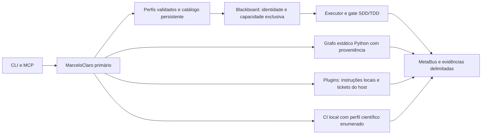

Os comandos `agentes` e `ci-local` possuem entradas CLI e MCP. O backend
`python_graph` fornece três consultas estáticas para Python; as operações
nativas de grafo conhecidas como incorretas continuam bloqueadas. A CI local
executa sem depender da cobrança GitHub, preserva recibos e não cria checks
remotos. Consulte o guia para escopo, limites e comandos completos.

[WolframResearch pode contribuir](docs/AVALIACAO_WOLFRAM_CORE_R895.md) com
AgentTools, cliente Python e notebooks. Uma
[amostra hospedada real](docs/verification-wolfram-host-r895.json) calculou soma,
integral e fatoração pelo contrato existente. Runtime/licença locais requerem
verificação própria. O [ZIP REA fornecido](docs/AVALIACAO_ZIP_REA_PTBR.md) foi
avaliado como referência didática e não substituiu o Core.

## Capacidades principais

| Área | Implementação e caminho de uso | Condição ou limite |
|---|---|---|
| Orquestração | `MarceloClaroOrchestrator`, Blackboard, MetaBus e `ecosystem-network` | CLI instalada não comprova autenticação ou execução |
| Workflows | DAG com dependências, checkpoints e retomada | Execução sequencial; repetição de etapas falhas é explícita |
| SDD/TDD | SpecRegistry, SpecVerifier, TDDRunner e histórico RED/GREEN autenticado | Critérios textuais e entrega de software possuem contratos distintos |
| REA | Inspeção direta, explicação por recibo, camadas e MCP local | Formato, engine, licença e isolamento precisam ser conferidos |
| Memória observável | Terminal animado e aba **Rede de memória** | Projeta registros existentes; não mostra a atenção interna do LLM |
| Conhecimento e RAG | Busca científica, recuperação, referências e EvidenceGraph | Cobertura lexical e grafo não comprovam qualidade da resposta |
| Raciocínio | Gramáticas restritas, SymPy, Z3 e integrações formais opcionais | Entrada recusada ou engine indisponível gera resultado tipado ou fallback |
| Pesquisa e ciência | Fábrica de pesquisa, pipeline acadêmico e análise reproduzível | Proveniência, reexecução e revisão externa são verificações distintas |
| Apresentações | MIRA, slides e artefatos visuais | Conformidade interna não avalia mérito científico |
| Domínios jurídico e clínico | Integrações e contratos específicos | Apoio computacional com revisão humana; sem validação geral de uso |
| Governança e evolução | TrustEngine, economia de tokens, federação e EvolutionRegistry | Registrar um ciclo não equivale a auditá-lo externamente |
| Vídeo e dublagem | `video_editor`, multifaixa/transições/cor R1046, diarização Nemotron, XTTS e Remotion | Capacidade implementada ≠ mídia aprovada; ver limites abaixo |

### Editor de vídeo universal, dublagem e animação (R1035–R1046)

O núcleo `integrations.video_editor` trata vídeo como **projeto e timeline**:
fontes com hash, fps racional, clipes frame-exatos, faixas de vídeo/áudio/legenda,
plano auditável e render separado. FFmpeg é o backend padrão; Remotion é o
backend de composição React/Remotion, com `license_ack` e `render_approved`
obrigatórios; outros motores entram por plugin (`register_backend`).

**Operações implementadas:** `trim`, `concat`, `scale`, `pad`, `crop`,
`extract_audio`, `replace_audio`, `mix_audio`, `subtitles` (burn/soft),
`multitrack`, `transition`, `color_grade`, `remotion` e `probe`. A R1046
adicionou composição multifaixa (posição, tamanho, opacidade, raio de canto,
áudio explícito e lacunas), transições `xfade`/`acrossfade`, cor SDR paramétrica
com `eq`/`colorbalance`, conformidade explícita de fps e preset x264. **Ainda
não implementadas:** UI NLE, keyframes animáveis, multicam, tracking, nodes,
LUT/ACES/HDR, composição 3D, legendas animadas nativas, lip sync e normalização
automática de VFR. Isso **não é paridade** com Premiere/DaVinci; a pesquisa de
projetos como MLT, libopenshot e OpenTimelineIO está registrada em
`reports/r1046/github-research.json`.

**MCPs locais:** `editor-local` expõe `editor_open`, `editor_list_projects`,
`editor_plan`, `editor_render` e `editor_status`; `dubbing-local` expõe o lote de
dublagem. Render real exige arquivo de aprovação do operador; dry-run é livre.
Caminhos são confinados à raiz configurada; não há shell arbitrário.

**Dublagem (P0006 e lote):** o pipeline separa ASR, diarização, tradução, TTS,
stems, mix e legenda. O piloto P0006 permanece **reprovado para montagem**:
gate antigo aceitava similaridade baixa e tolerância de 0,35 s; a reauditoria
R1041 encontrou 14 divergências lexicais e 4 overruns. O lote tem 107 partes e
1.943 unidades preparadas, 106 partes com evidência OCR (1.997 frames) e 107
partes diarizadas; **nenhuma** foi dublada/montada como entrega final.

**Dublagem R1026 (R1047):** o piloto ganhou uma versão de 20 s com voz
sintética clonada por XTTS em CPU (`speed 1.0`), roteiro PT-BR mais explicativo,
slide traduzido, SRT/ASS e **sem cartão**. O ASR large-v3 reconheceu o roteiro
com **WER lexical de 2,17%**; loudness final **−16,10 LUFS**, true peak
**−2,16 dBTP**. A nova locução foi re-sincronizada com Wav2Lip em CPU; revisão
visual humana, naturalidade e direitos continuam pendentes.
Ver [evidência R1047](reports/r1047/QUANTUM-DUB-EVIDENCE.md).

### Evolução dos vídeos R1026 (R1026–R1047)

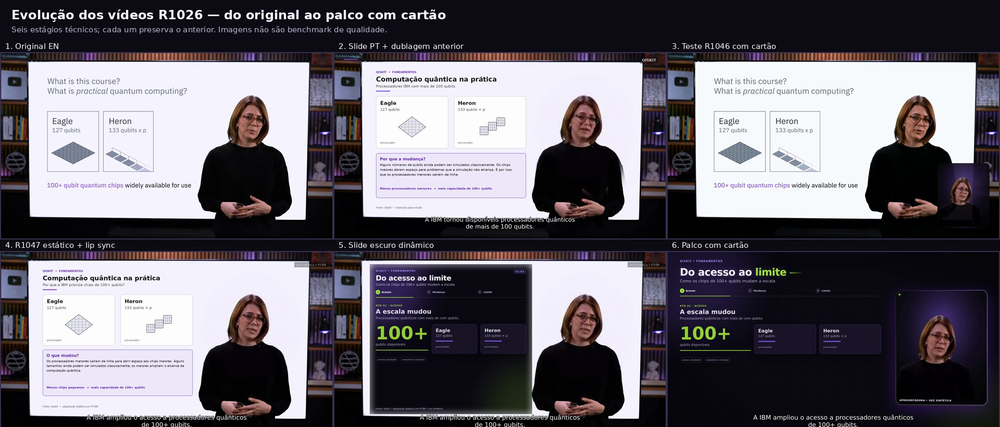

| Etapa | Transformação | Evidência |
|---|---|---|
| 1. Original | vídeo Qiskit em inglês, 1920×1080, 29,97 fps, slide original, sem cartão | `source.mp4` |
| 2. Slide + dublagem anterior | slide em PT-BR, legenda e voz XTTS anterior; sem cartão | `pilot-16x9-lipsync-pt.mp4` |
| 3. Teste R1046 | composição multifaixa com cartão PiP, raio de canto e áudio explícito; teste de editor, não entrega final | `r1046-editor-preview/quantum-multitrack-v3-preview.mp4` |
| 4. R1047 estático | novo roteiro em 4 blocos, XTTS `speed 1.0`, slide PT, SRT/ASS, **sem cartão** e lip sync refeito | `r1047-dub/out/quantum-ptbr-r1047.mp4` — `93f074a3…9f3ed5` |
| 5. Slide escuro dinâmico | cenário escuro, título “Do acesso ao limite”, três atos e motion Remotion; apresentadora em quadro inteiro | `r1047-dub/out/quantum-ptbr-r1047-dynamic-slide-dark.mp4` — `ba30b840…d23223` |
| 6. Palco com cartão | cenário totalmente novo, título, roadmap, conteúdo à esquerda e apresentadora em cartão à direita | `r1047-dub/out/quantum-ptbr-r1047-card-scene.mp4` — `7765afc0…7bbef581` |

As imagens são contatos de frames e registram a **transformação técnica**, não
um benchmark de qualidade. O áudio R1047 tem **2,17% de WER lexical** no ASR
large-v3, **−16,10 LUFS** e true peak **−2,16 dBTP**. O cartão do estágio 6 usa
um vídeo de lip sync anterior à nova locução; a boca pode não corresponder
exatamente às palavras novas. Os MP4/WAV ficam em
`pilots/r1026-quantum/r1047-dub/out/` e são ignorados pelo Git; scripts,
composições e recibos permitem reproduzir o fluxo.

### O que o Core pode fazer

| Capacidade | Estado observado | Limite honesto |
|---|---|---|
| Ingestão de mídia | probe, hash, fps racional, frames, áudio, timeline JSON | codecs/containers variam; VFR é recusado nas operações avançadas |
| Edição | corte frame-exato, concatenação, escala, crop, pad, áudio e legendas | não é UI NLE; sem keyframes, multicam ou tracking |
| Composição | multifaixa, overlays, opacidade, raio de canto, transições e cor SDR | sem LUT/ACES/HDR, nodes, 3D ou composição multi-faixa completa de vídeo |
| Voz e dublagem | XTTS local por referência, ASR large-v3, mix e loudness | revisão humana de naturalidade, emoção e tradução continua necessária |
| Slide e motion | Remotion 4.0.540, springs, cascata, borda cônica, grão, vinheta e crossfade | Remotion License; motion não prova retenção ou estética |
| Legendas | SRT e ASS, burn-in ou faixa soft | timing e leitura exigem revisão; ASR não é escuta |
| QC técnico | frames decodificados, fps, duração, loudness, true peak, silêncio, pretos e contato | não aprova conteúdo, voz, lip sync ou tradução |
| Pesquisa acadêmica | pipeline ABNT, revisão de fontes, bibliografia, provas e conselho de 13 | não substitui bibliotecário, estatístico ou revisão por pares |
| Ciência | 8 protocolos K-Dense, catálogo de 177 skills, 9 adaptações originais e laboratório com budget | 177 skills não são 177 validações; nada é executado sem gate |
| Programação | SDD/TDD, 347 testes, agentes, skills e Macro-rede de 576 nós/768 arestas | grafo é projeção read-only; aresta não é execução |
| Governança | gate metacognitivo, citações literais, contradições e validação externa | `externally_supported` não é verdade absoluta; voto/nota/payoff não decide |
| Publicação | nenhum upload ou agendamento nesta rodada | exige direitos, credenciais e autorização explícita |

**O que ele não é:** não é AGI, não tem paridade com Premiere/DaVinci, não
substitui revisão humana e não transforma teste técnico em aprovação científica
ou editorial.

### Palco completo com cartão da apresentadora (R1047)

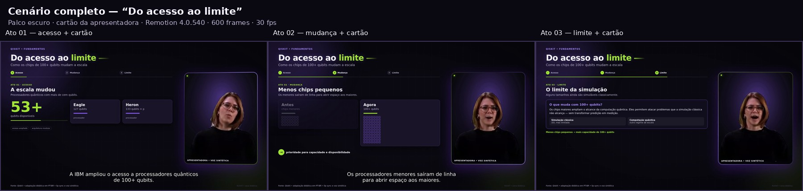

O cenário original foi substituído por um **palco escuro em 1920×1080**, com
título **“Do acesso ao limite”**, trilha Acesso → Mudança → Limite, conteúdo
didático à esquerda e a apresentadora em um **cartão** à direita. O cartão tem
borda cônica animada, leve paralaxe e rótulo “APRESENTADORA • VOZ SINTÉTICA”.
O fundo usa gradientes, grade, grão e vinheta; as transições têm spring,
cascata de chips e crossfade com blur.

| Item | Valor |
|---|---|
| Composição | `editor-workspace/remotion-smoke/src/r1047-slide/R1047Stage.tsx` |
| Palco renderizado | `editor-workspace/remotion-smoke/r1047-stage-v2.mp4` |
| Vídeo final | `pilots/r1026-quantum/r1047-dub/out/quantum-ptbr-r1047-card-scene.mp4` |
| SHA-256 | `7765afc04f2ee5354296d341c313a2f7c997fb1b5b03921c9a5538637bbef581` |
| Formato | 1920×1080, 30 fps, 600 frames, 20,00 s, AAC 48 kHz |
| Loudness | **−16,10 LUFS**; true peak **−2,16 dBTP** |
| QC | frames, fps, loudness, silêncio e pretos: **pass** |

O cartão usa `presenter-middle-card.mp4`, cujo lip sync é anterior à nova
locução; a boca pode não corresponder exatamente às palavras novas. O slide
estático e as versões dinâmicas anteriores permanecem como fallback. Evidência:
[R1050](reports/r1050/CARD-STAGE.md).

**Efeitos pesquisados e aplicados:** springs calibrados, cascata de chips, borda
cônica, paralaxe/tilt, grão determinístico, vinheta, crossfade com blur,
tipografia cinética e contador. Referências: documentação Remotion
(`motion-blur`, `noise`, `transitions`), `IskakovDamir/apple-motion`,
`lifeprompt-team/remotion-scenes` e `vshukla7/remotion-captions-themes`. Nenhum
código foi copiado.

```text
source.mp4 → ASR/roteiro → XTTS (referência 6 s) → palco Remotion + cartão
           → FFmpeg (áudio + legendas) → ASR large-v3 + loudness → manifesto
```

**Pesquisa de skills Claude (R1048):** foram triados **20 repositórios** no
GitHub nas frentes de vídeo/efeitos, pesquisa acadêmica, raciocínio científico
e programação avançada. Prioridades: `obra/superpowers` (MIT, método TDD),
`chgagne/claude-skills-research` (MIT, revisão de fontes/provas),
`K-Dense-AI/scientific-agent-skills` (MIT, seleção científica),
`iart-ai/motion-skills` e `win4r/video-director` (MIT, motion/QA) e
`wshobson/agents` (MIT, catálogo de engenharia). Nenhum foi instalado; os
bloqueios por licença e o protocolo de adoção estão em
[`reports/r1048-claude-skills-github/`](reports/r1048-claude-skills-github/README.md).

**Adoção seletiva de skills (R1049):** nove skills locais foram criadas a partir
da triagem R1048: `superpowers-sdd-tdd`, `rigor-academico-chgagne`,
`kdense-ciencia-seletiva` (8 protocolos + catálogo de 177) e `kdense-adaptacoes-originais` (9 adaptações), `motion-design-seletivo` (5),
`video-director-qa`, `video-shotcraft-selecao` (10 receitas),
`agentes-engenharia-selecao` (10 papéis) e `laboratorio-pesquisa-isolado`.
Nenhum código de terceiro foi copiado ou executado; instruções permissivas foram espelhadas com atribuição e as restritas receberam adaptações originais. Fontes e commits estão em
`reports/r1049/sources.json`. Ver [evidência R1049](reports/r1049/README.md).

**Macro-rede e gate metacognitivo (R1050):** `mci/macro_network.py` projeta
**576 nós e 768 arestas** read-only — orquestrador, 333 agentes, 50 skills, 177
skills K-Dense, 11 categorias e 4 gates. `mci/metacognitive_gate.py` impede que
confiança, voto, nota ou payoff virem verdade; o conselho ganhou
`validate_claims` com evidência literal, falseabilidade, mecanismo e
contradições. Ver [evidência R1050](reports/r1050/README.md) e
[macro-rede](reports/r1050/macro-network.json).

**ASR e tradução:** o `faster-whisper-small` produziu texto turco sem sentido
em parte do corpus; `large-v3` foi baixado e concluiu o lote das 107 partes (1.854 segmentos, 7.773 palavras), ainda sem revisão nativa.
Traduzir ASR ruim gera fluência sobre erro — o TTS em lote não foi iniciado.
O gate exige fonte revisada, locutor/referência e duração estrita.

**Remotion:** CLI 4.0.540 instalado em `editor-workspace/remotion-smoke`;
`remotion compositions` listou `Smoke` (50 frames, 25 fps, 1280×720). Isso prova
bundle/navegador, **não** render ou qualidade visual. Render exige
`REMOTION_RENDER_APPROVED=1`; a licença Remotion não é OSI.

**Instalação one-click:** `./install.sh --check` inventaria bibliotecas e CLIs;
`./install.sh --apply --yes` instala apenas npm/pip/uv/venv. `sudo`, `apt` e
scripts oficiais `curl | bash` são impressos para revisão, nunca executados
automaticamente. Ver [instalador](installer/ONECLICK.md), [pipeline de
dublagem](docs/DUBBING_PIPELINE_R1041_R1045.md), [editor universal](docs/EDITOR_VIDEO_UNIVERSAL_R1042.md),
[evidência real R1026](reports/r1046/QUANTUM-REAL-EVIDENCE.md)
e [catálogo de ferramentas](docs/VIDEO_EDITOR_TOOLCHAIN_R1043.md).

**Limites:** o catálogo de 46 ferramentas/modelos não instala nem executa nada;
licença é triagem, não parecer jurídico. Diarização é hipótese, não identidade.
Nenhuma publicação foi feita; upload exige direito de distribuição e credenciais
OAuth, documentados em `reports/r1045/UPLOAD-BLOCKERS.md`.

### Conselho científico, autoria e sandbox (R985–R1001)

- **Conselho de 13 cientistas** (`scientific_lab/council.py`): busca, revisão,
  análise, validação e auditoria sob MarceloClaro, combinando Feynman
  (mecanismo/observações/inferências), método científico (hipótese/refutação) e
  teoria dos jogos (minimax regret para priorizar investigação, sem transferir
  regras clínicas). Parecer `partial` é entrega válida; `blocked` interrompe; 13
  votos não produzem verdade nem validação externa.
- **Autor/Editor de alto rigor** (`academic/author_editor.py`): estrutura IMRaD
  expandida, perfil de estilo anti-plágio (características estruturais, nunca
  trechos verbatim) e registro de raciocínios (axiomático, aristotélico,
  cartesiano, peirceano, popperiano, teoria dos jogos, bayesiano, causal,
  dialético e difuso).
- **Evolução calibrada dos scanners** (`scanners/scientific_evolution.py`):
  compara candidatos em corpus dev/holdout separados; recomenda sem autopromover.
- **Piloto OpenShell** (`integrations/openshell_pilot.py`): sandbox real com
  isolamento validado (Landlock + egress negado) e captura de pacotes
  (telemetria opt-out e ausência de SYN de egress).
- **Executor Gemini portátil** (`integrations/gemini_client/`): chama a API
  Gemini com `GEMINI_API_KEY`, sem OAuth/keyring, executável dentro do sandbox.

CLI: `python3 -m marceloclaro.scientific_lab council|author-editor|scanner-evolve|openshell ...`.
Ver [procedimento de reprodução](docs/PROCEDIMENTO_OPENSHELL_GEMINI_CONSELHO.md)
e [conselho e scanners](docs/CONSELHO_CIENTIFICO_E_SCANNERS_R989_R990.md).

### Scanners e diagnóstico multidimensional

O diagnóstico (`/diagnose` e a ferramenta MCP `super_rigor_audit`) combina
scanners de dimensões distintas sobre o mesmo corpus. Cada scanner é uma
**triagem heurística**; nenhum atribui qualidade científica, validade clínica ou
aceite editorial.

| Scanner | Função |
|---|---|
| **Noológico** | Cobertura epistemológica — dimensões do conhecimento presentes/ausentes |
| **Teleológico** | Lacunas entre metas do ecossistema e capacidades reais dos agentes |
| **Evolutivo** | Roadmap evolutivo — rotas de melhoria e trajetórias M1–M5 |
| **Potencialidade** | Capacidades latentes, gaps de inovação e DNA do ecossistema |
| **Impacto social** | SROI, Teoria da Mudança, ODS e B-Impact Score |
| **Impacto jurídico** | Prontidão jurídica e ganho metacognitivo (SPEC-924) |
| **Científico** | Triagem lexical PT/EN de falsificabilidade, metodologia e falácias |
| **Literário (8 visões)** | Narrativa, personagem, estilo, símbolos, teoria, leitor, ética e inovação |
| **Pesquisa literária (4)** | Bibliografia, corpus comparativo, teoria e rigor internacional |
| **Engenharia reversa** | Código legado → conhecimento e contratos extraídos |
| **Ruído e compressão** | Redundância (SPS/NRR) e densidade (CR/CPS) do corpus |
| **Evolução calibrada (R990)** | Compara candidatos em corpus dev/holdout separados |

**Vantagens:**

1. **Multidimensional** — um único comando cobre cinco ou mais dimensões do
   ecossistema, sem depender de um heurístico único.
2. **Rastreável** — o scanner científico expõe offsets do texto normalizado,
   contexto (afirmado/negado/citado/título) e hash da entrada; audita-se o
   achado, não apenas o score.
3. **Anti-overclaim** — toda saída declara `score_kind`, `scientific_quality_assessed=false`
   e limitações; uma nota lexical alta não vira Qualis nem aceite.
4. **Calibração honesta** — a evolução (R990) só recomenda um candidato com
   ganho em desenvolvimento **e** sem regressão de falsos positivos/negativos no
   holdout; nunca autopromove nem aceita código arbitrário.

Uso: `python3 -m scanners.cli diagnose CAMINHO` ou `scanner-evolve --corpus-json`.
Ver [scanners](scanners/cli.py), [triagem científica](scanners/scientific_reasoning_scanner.py)
e [evolução](scanners/scientific_evolution.py).

### Inovações e paralelo com ferramentas similares

As frentes R985–R1001 acrescentam diferenciais de **desenho** ao Core. A
comparação abaixo é de princípios de arquitetura, **não um benchmark de
superioridade**: cada ferramenta é adequada a contextos próprios, e nenhuma
pontuação interna substitui validação externa ou revisão humana.

**O que o Core acrescenta:**

1. **Conselho de 13 cientistas com evidência fail-closed** — cada parecer valida
   citação literal contra a fonte e exige mecanismo, observações e inferências
   separadas (Feynman); voto, nota ou payoff não produzem verdade.
2. **Anti-plágio por construção** — o perfil de estilo extrai *características*
   (registro, hedging, conectivos, densidade de citação, razão tipo-token),
   nunca trechos verbatim.
3. **Raciocínio registrado e mapeado** — axiomático, aristotélico, cartesiano,
   peirceano, popperiano, teoria dos jogos, bayesiano, causal, dialético e
   difuso, ancorados nos motores de `reasoning/`.
4. **Sandbox real validado** — OpenShell com isolamento observado (Landlock +
   egress negado) e captura de pacotes (telemetria opt-out, zero SYN de egress).
5. **Executor portátil** — `gemini-client` chama a API Gemini com chave de API,
   sem OAuth/keyring, executável dentro do sandbox.
6. **Anti-overclaim** — separação explícita entre instalação, execução observada
   e validação externa em toda saída.

**Paralelo com similares:**

| Ferramenta similar | Abordagem | Diferencial observado do Core | Limite honesto |
|---|---|---|---|
| Antigravity CLI (`agy`) | Agente com OAuth de conta | Executor por chave de API, sem keyring | Cota gratuita esgota (HTTP 429) |
| CrewAI / AutoGen | Orquestração multi-agente genérica | Conselho com evidência e citação literal | Não é benchmark de qualidade |
| ASReview | Triagem ativa p/ revisão sistemática | Conselho completo (busca→auditoria) + Feynman + teoria dos jogos | Revisão humana obrigatória |
| Deep Research (OpenAI/Gemini) | Pesquisa de agente único | 13 papéis auditáveis com contratos SDD/TDD | Proveniência ≠ validação externa |
| LangGraph | Grafos de agentes | Blackboard A2A + MetaBus + EvolutionRegistry | Atenção inspirada, não treinada |

Os recibos de execução real (host e sandbox) estão em `docs/evidence/`; o
procedimento de reprodução em
[OpenShell/Gemini](docs/PROCEDIMENTO_OPENSHELL_GEMINI_CONSELHO.md).

---

## Início rápido local

Para obter a revisão publicada nesta etapa, selecione a branch explicitamente.
Python é necessário para o Core; a CI declara versões 3.10–3.14 e a verificação
local documentada utilizou Python 3.14. Modelos, CLIs e engines externos exigem
configuração própria.

```bash
git clone --branch codex/core-prontidao-rea https://github.com/MarceloClaro/opencode-ecosystem-core.git
cd opencode-ecosystem-core
python3 -m venv .venv
.venv/bin/python -m pip install -r requirements.txt

.venv/bin/python -m marceloclaro.cli doctor
.venv/bin/python -m marceloclaro.cli helpdesk
```

O `doctor` informa a sanidade estrutural e as dependências encontradas.
Avisos de componentes opcionais devem ser interpretados por operação;
inferência e autenticação requerem sondagem própria.

Para utilizar as ferramentas TypeScript do OpenCode, use **Node 22** e o lockfile:

```bash
cd .opencode
npm ci
npm run typecheck
cd ..
```

A configuração é compilada por
`.venv/bin/python -m integrations.opencode_cli`; confira sua reprodução com
`.venv/bin/python -m integrations.opencode_cli --check`.
Perfis locais, memória de execução e evidências de alvos são arquivos privados
e não são versionados; consulte [fontes reproduzíveis](docs/REPOSITORIO_REPRODUZIVEL.md).

Para uma release formal, siga os controles de versão imutável e procedência da
seção seguinte. O checkout de uma branch não constitui uma release com tag.

---

## Instalação segura e procedência

> Instalação **local e revisável** — nada é executado por pipe de rede. A
> procedência combina versão imutável, commit Git e SHA-256 conferível.

Os controles abaixo se aplicam a uma **release formal com tag e manifesto
publicado**. Obtenha de um manifesto de versão revisado, independente do canal
de download, os valores a seguir, sem rótulos móveis:

| Dado | Formato exigido |
|---|---|
| `ECOSYSTEM_VERSION` | Tag ou identificador de versão imutável (ex.: `vX.Y.Z`). |
| `ECOSYSTEM_REF` | Commit Git completo com 40 caracteres hexadecimais. |
| `ECOSYSTEM_SOURCE_SHA256` | SHA-256 com 64 caracteres hexadecimais do TAR de origem. |
| `ProvisionSha256` | SHA-256 publicado do `provision.sh` do Windows/WSL. |
| `CommonInstallerSha256` | SHA-256 publicado de `installer/common/install_clis.sh`. |

```bash
export ECOSYSTEM_VERSION='<versao-imutavel>'
export ECOSYSTEM_REF='<commit-git-completo-com-40-caracteres>'
export ECOSYSTEM_SOURCE_SHA256='<sha-256-publicado-com-64-caracteres>'

git clone https://github.com/MarceloClaro/opencode-ecosystem-core.git opencode-ecosystem-core
cd opencode-ecosystem-core
git checkout --detach "$ECOSYSTEM_REF"
test "$(git rev-parse HEAD)" = "$ECOSYSTEM_REF"
test "$(git describe --tags --exact-match HEAD)" = "$ECOSYSTEM_VERSION"

git archive --format=tar "$ECOSYSTEM_REF" -o ../opencode-ecosystem-source.tar
printf '%s  %s\n' "$ECOSYSTEM_SOURCE_SHA256" "../opencode-ecosystem-source.tar" > ../opencode-ecosystem-source.tar.sha256
sha256sum -c ../opencode-ecosystem-source.tar.sha256
```

No macOS (Homebrew), use a variante `shasum -a 256 -c
../opencode-ecosystem-source.tar.sha256`. Sempre confira a versão com
`git describe --tags --exact-match HEAD` antes de instalar.

Após instalar, use **sempre** o interpretador do venv recém-criado:

```bash
source ~/opencode-ecosystem-core/.venv/bin/activate
python3 -m marceloclaro.cli helpdesk   # ou .venv/bin/python -m marceloclaro.cli doctor
```

**WSL2** (Windows 10/11): siga [installer/windows/README.md](installer/windows/README.md).
Detalhes, requisitos e solução de problemas: [installer/README.md](installer/README.md).

---

## Uso básico

Execute os comandos na raiz, com o interpretador do ambiente do projeto.

| Comando | Finalidade |
|---|---|
| `.venv/bin/python -m marceloclaro.cli` | Menu interativo principal |
| `.venv/bin/python -m marceloclaro.cli doctor` | Diagnóstico estrutural |
| `.venv/bin/python -m marceloclaro.cli doctor --live` | Sondas explícitas de HTTP, CLIs e exemplos internos |
| `.venv/bin/python -m marceloclaro.cli network status` | Estado e última execução observada dos executores |
| `.venv/bin/python -m marceloclaro.cli helpdesk` | Ajuda guiada |
| `.venv/bin/python -m marceloclaro.cli pesquisa "tema"` | Pesquisa científica conforme provedores disponíveis |
| `.venv/bin/python -m marceloclaro.cli agent-register` | Registro dos agentes no Blackboard |
| `.venv/bin/python -m integrations.op_timing report` | Tempos locais por operação |
| `.venv/bin/python -m integrations.opencode_cli --check` | Consistência da configuração gerada |

Com o OpenCode CLI instalado e acessível, abra a raiz com `opencode`.
A configuração seleciona `marceloclaro` como primário e oferece comandos como
`/ecosystem`, `/rea` e `/biblioteca`. Instalação e modelo disponível devem ser
conferidos antes de iniciar uma conversa.

Tarefas coordenadas passam pelo primário. Informe uma especificação válida e
respeite o contrato da superfície utilizada. O
[guia de workflows](docs/WORKFLOWS_R644.md) explica orçamento, checkpoints e
retomada. Autenticação e saldo de Claude, Codex ou Antigravity dependem do
ambiente; o identificador `chatgpt` não controla o aplicativo ChatGPT.

Manual: [MANUAL.md](MANUAL.md) · Guia do agente: [CLAUDE.md](CLAUDE.md) ·
Primeiros passos: [quickstart.md](quickstart.md).

## Engenharia reversa local REA

O [assistente REA local](docs/ASSISTENTE_REA_LOCAL.md) permite inspecionar um
artefato e explicar achados estáticos com fontes, digests e limitações.
Configure o runtime e os engines indicados no guia antes de analisar um alvo.

```bash
.venv/bin/python -m marceloclaro.cli rea layers
.venv/bin/python -m marceloclaro.cli rea inspect CAMINHO --kind auto --format text
.venv/bin/python -m marceloclaro.cli rea explain RECIBO --format text
```

Substitua `CAMINHO` e `RECIBO` por arquivos locais. A operação direta `inspect`
aplica namespaces de rede e PID ao worker analítico em Linux/WSL e recusa a
execução quando o isolamento exigido está indisponível. A aplicação alvo não
é executada. Isso não constitui uma sandbox universal de arquivos.

Para configurar o perfil do agente, escolha um modelo já instalado e servido
no endpoint local. O exemplo abaixo exige `llama3.2:latest` disponível no Ollama:

```bash
.venv/bin/python -m marceloclaro.cli rea setup --model llama3.2:latest --model-endpoint http://127.0.0.1:11434/v1
.venv/bin/python -m marceloclaro.cli rea agent --check
.venv/bin/python -m marceloclaro.cli rea site --port 8767
```

`agent --check` verifica configuração; não executa inferência. O cliente possui
supervisão de processos e conserva a rede do host para acessar o modelo. Seu
isolamento é diferente do worker analítico. O fluxo por prompt exige ferramenta
concluída e recibo íntegro antes de publicar uma análise; texto livre não é achado.
O modo interativo é exploratório e seu encerramento não comprova análise aceita.

São **18 camadas declaradas**, com **11 percursos de inspeção pela ponte Core**
no snapshot documentado. `analyze_binary` utiliza Ghidra; IDA, Hopper, JEB e
outras superfícies dependem de runtimes, configuração e licenças próprias.
A ponte legada `rea layer` não herda automaticamente o isolamento de `inspect`.
Veja [camadas e contratos](docs/REA.md) e o
[fluxograma REA](docs/architecture/flows/05-rea-provedores.svg).

## Memória no terminal e painel

```bash
.venv/bin/python -m webapp.memory_network_visualizer
.venv/bin/python -m webapp.memory_network_visualizer --once --json
```

A animação projeta consultas, agentes, memória, contexto, evidências e respostas
registrados no MetaBus, Blackboard e grafos. Disponibilidade de um agente não
significa atividade; `--demo` identifica dados fictícios. O visualizador não
inicia inferência. Consulte [origem dos dados e limites](docs/REDE_MEMORIA_CORE.md).

Para a aba **Rede de memória** no Streamlit:

```bash
.venv/bin/python -m pip install -r requirements-webapp.txt
.venv/bin/python -m streamlit run webapp/app.py --server.address 127.0.0.1
```

---

## Arquitetura resumida

Esta seção dá uma **visão resumida** do ecossistema: primeiro um **snapshot
histórico** (para preservar a documentação legada) e depois o **diagrama
operacional atual** do runtime observável no checkout. O snapshot histórico é
exatamente isso — um snapshot documental, **não é um inventário do checkout**.

### Ciclo metacognitivo integrado

A R886 conecta a memória de resultados à próxima delegação do primário:
recuperação contextual → análise crítica local → Blackboard → executor →
gate SDD/TDD → reflexão contextual → memória. Resultado, erro observado,
próxima ação e referências declaradas permanecem vinculados à tarefa.
Os escores dos motores são heurísticos e não promovem confiança automaticamente.

O [guia do ciclo](docs/METACOGNICA_INTEGRADA_R886.md) explica os contratos,
o tratamento de replay e degradação e o limite entre contexto e expressão formal.
A [avaliação dos cinco repositórios](docs/AVALIACAO_REPOS_METACOGNICA_R886.md)
prioriza Knowl como candidato de memória e Laya como auxílio consultivo;
Awesome LLM Apps, OpenShell e Feynman têm papéis próprios. Esses runtimes
externos não foram instalados ou executados nesta etapa.

As [verificações locais R886](docs/verification-local-r886.json) delimitam o
escopo executado. Para codificação eficiente, o [piloto R887](specs/SPEC-935-R887-code-intelligence-local.md)
usa um único provedor, context-link, subordinado ao primário e à memória canônica.
O [guia de contexto local](docs/CONTEXTO_CODIGO_LOCAL_R887.md) descreve instalação,
consulta, isolamento e limites. O smoke nativo encontrou falhas em relações de
chamadas Python: três consultas de grafo ficam bloqueadas; busca, código e
estrutura permanecem no piloto. Não há ganho de tokens comprovado.
A [avaliação comparativa](docs/AVALIACAO_CODE_INTELLIGENCE_R887.md) registra a
seleção e a [curadoria complementar](docs/CURADORIA_CODIFICACAO_EFICIENTE.md)
contextualiza as alternativas.

A revisão R888 dos [nove repositórios — grupo A](docs/AVALIACAO_REPOS_R888_A.md)
e [grupo B](docs/AVALIACAO_REPOS_R888_B.md) utiliza fontes fixadas e inspeções
REA compatíveis. A [decisão de adaptação](docs/DECISOES_ADAPTACAO_REPOS_R888.md) corrige o benchmark
IMO existente e seu consumidor DeepThink para separar execução, gabarito,
heurística e verificação formal, sem instalar nove runtimes paralelos.

O [aceite integral R889](docs/INDEXACAO_INTEGRAL_R889.md) adiciona auditoria
de arquivos, hashes e relações do banco, com retomada limitada de candidatos
privados. Um processo que termina sem erro continua insuficiente para aceitar
um índice parcial. A recuperação preserva o corpus e os limites de isolamento. A execução local
[R889](docs/verification-local-r889.json) concluiu as 763 fontes selecionadas;
isso não mede cobertura funcional de todo o ecossistema.

A [curadoria dos quinze projetos R890](docs/DECISOES_ADAPTACAO_REPOS_R890.md)
avalia química, materiais acadêmicos, voz, dispositivos, visão e ferramentas MCP.
A adaptação executada corrige a suíte Bell/GHZ/superposição existente: simulação
clássica declarada, métricas amostrais próprias, orçamento validado e proveniência
no MetaBus, sem elevar confiança nem apresentar circuitos fixos como resposta
à consulta. Os [recibos R890](docs/verification-local-r890.json) distinguem os
testes locais das propostas de integração e dos runtimes externos não ativados.

O [aceite científico local R891–R893](docs/ACEITE_CIENTIFICO_LOCAL_R891.md)
conecta artigos e experimentos ao mesmo primário, CLI e MCP: verifica pacotes,
hashes e reexecução por código confiável, propaga falhas sem conclusão fictícia
e preserva a busca Whoosh entre processos. O perfil de regressões é enumerado,
com orçamento e recibos; aceite computacional não equivale a revisão humana,
mérito científico ou escalabilidade multi-host.

## Arquitetura completa e fluxogramas atuais

### Atlas atual R916 — origem e legenda

O [atlas navegável](docs/architecture_map.html) e o
[guia minucioso R916](docs/ARQUITETURA_COMPLETA_CORE_R916.md) usam a mesma coleta
de fontes: produção rastreada e `opencode.json` lidos do diretório de trabalho,
com base Git `d02817ca460ee6411761a8a3f0b82d17dafd2740`. Arquivos removidos são omitidos; arquivos privados,
ignorados e não rastreados não são lidos. A identidade das fontes está em
`worktree_sha256`, com manifesto, exclusões e alterações no JSON.

O índice das demais categorias conserva metadados do commit-base e identifica
`content_source=git_base`; não é leitura atual de documentos ou dados de domínio.
Essa separação evita incorporar recursivamente o atlas gerado à sua própria
identidade. Fontes locais modificadas não recebem permalink do commit-base.

[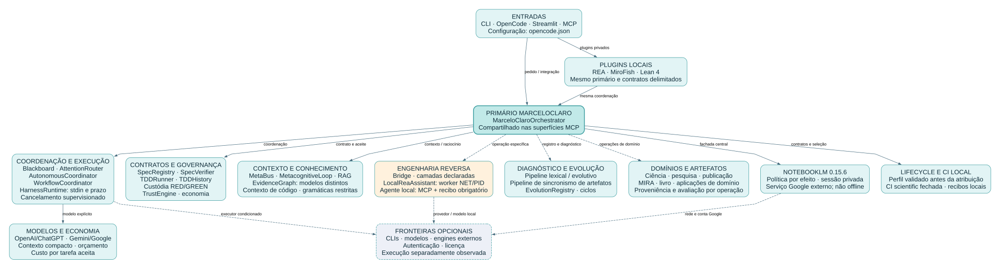](docs/ARQUITETURA_COMPLETA_CORE_R916.md)

| Artefato atual | Uso |
|---|---|
| [Página offline](docs/architecture_map.html) | Busca por módulo/símbolo, filtros, zoom e todos os fluxos |
| [Guia minucioso](docs/ARQUITETURA_COMPLETA_CORE_R916.md) | Camadas, decisões, limites e reprodução |
| [Inventário JSON](docs/architecture/architecture-inventory.json) | Fontes, hashes, símbolos, imports e origem |
| [Dependências SVG](docs/architecture/dependencies.svg) | Todos os módulos e pares internos do inventário |
| [Fonte DOT](docs/architecture/dependencies.dot) | Grafo vetorial editável por Graphviz |
| [Mermaid integral](docs/architecture/dependencies.mmd) | Mesmos módulos e pares, com metadados e legenda |
| [SVG Mermaid](docs/architecture/dependencies-mermaid.svg) | Renderização local do Mermaid completo |
| [Correspondência](docs/architecture/mermaid-correspondence.json) | IDs, hashes e declarações por par |
| [Catálogo de fluxos](docs/architecture/flows.json) | Fontes curadas, âncoras e limitações de cada percurso |
| [Modelos e custo por tarefa](docs/architecture/MODELOS_E_ECONOMIA_DE_TOKENS_R916.md) | Candidatos, tarifas públicas, cotas e avaliação sem trocar padrão silenciosamente |
| [Quantização local no GitHub](docs/architecture/QUANTIZACAO_LOCAL_GITHUB_R916.md) | Repositórios, commits/licenças, fluxo GGUF/Ollama e limites do host; sem instalação |
| [Verificação R916](docs/verification-documentation-r916.json) | Testes, renders, links e limites observados nesta revisão |

Seta no grafo estrutural significa **importador → dependência Python declarada**.
Seta em fluxograma segue seu rótulo de controle, dados ou composição; nenhuma
delas comprova que o percurso foi executado. Módulos isolados não são omitidos.
Os fluxos novos documentam plugins, NotebookLM, autenticações, metacognição,
lifecycle, CI local, contexto de código, seleção econômica de modelos e
tratamento local de janela de contexto/erros Ollama.

Para servir a página em loopback:

```bash
.venv/bin/python -m http.server 8771 --bind 127.0.0.1 --directory docs
```

Abra `http://127.0.0.1:8771/architecture_map.html`. A página também funciona
como arquivo local, sem CDN. O guia explica a geração e os comandos `--check`.
R879, R900, R911 e o [mapa R433–R438](docs/MAPA_ARQUITETURA_R433_R438.md)
permanecem como retratos históricos, com fontes e contagens próprias.

### Mapa da Arquitetura Completa (v3.9.0)

> Snapshot histórico da arquitetura (v3.9.0), preservado como registro da
> evolução. É um **snapshot histórico / documental de uma época passada** e
> **não é um inventário do checkout** atual. A faixa documentada **R47–R127**
> registrou 85 ciclos de evolução (com o surgimento de `MiraDeckPipeline` e do
> agente `mira-presenter`).

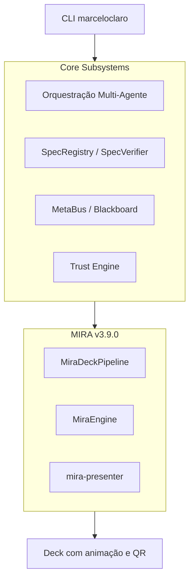

### Diagrama Operacional Atual

> Diagrama do runtime observável no checkout atual. Concentra-se nos
> componentes estruturalmente auditados; não lista todos os arquivos, classes
> auxiliares ou serviços opcionais do ecossistema.

<!-- core-runtime-diagram:start -->
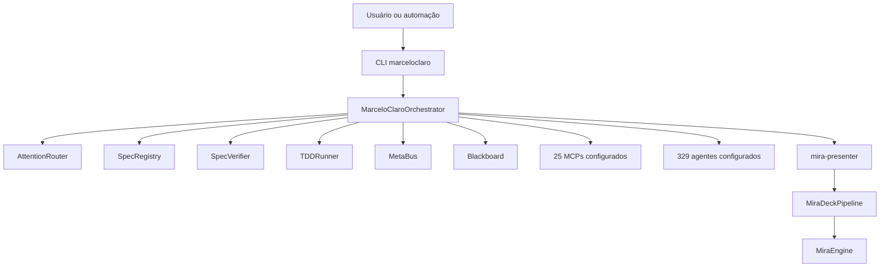
<!-- core-runtime-diagram:end -->

O MCP `ecosystem-network`, acrescentado na R640, conecta o orquestrador e seu
roteamento Transformer por atenção aos executores de análise e leitura Claude,
Antigravity e Codex disponíveis no ambiente, com registros no Blackboard e na
memória MetaBus. A coordenação limita passos e tempo e exige a conclusão para
reportar sucesso; instalação e autenticação devem ser conferidas localmente.
Transformer descreve roteamento multiagente inspirado em atenção. O
identificador `chatgpt` não controla o aplicativo ChatGPT; selecione `codex`
explicitamente para usar sua CLI.

A R644 acrescenta workflows com dependências, análise seguida de revisão por
outro especialista e checkpoints para retomada. A seleção automática consulta
a saúde persistida dos executores e pausa serviços que falharam recentemente.
Veja o [guia de execução em etapas](docs/WORKFLOWS_R644.md).

Da R711 à R746, o programa do pesquisador polímata curou 21 repositórios por
tipo de raciocínio (dedutivo, causal, bayesiano, síntese, autônomo, auditoria)
com pinagem viva, federação por classes de frescor e decisão humana nominal:
16 federados no escopo polímata em `workbench/rede_polimata` (fora do harness
R621), com painel em `workbench/polymath/DASHBOARD.md`, skill
`pesquisador-polimata-labs`, 3 agentes de catálogo e o MCP `polymath-labs-mcp`.
Nada federado atesta qualidade; todo federado exige supervisão.

### Mapa dinâmico regenerável

`marceloclaro/ecosystem_map.py` também gera um inventário de componentes. Os
arquivos `maps/ecosystem_map_2026-07-06.json` e
`MAPA_ECOSSISTEMA_COMPLETO_2026-07-06.md` são fotografias históricas de julho;
suas contagens não representam a edição R879. Para uma nova coleta, execute:

```bash
.venv/bin/python -c "from marceloclaro.ecosystem_map import save_ecosystem_map_artifacts; save_ecosystem_map_artifacts()"
```

Essa coleta possui escopo diferente do extrator Git/AST R879. Consulte o
manifesto de cada resultado antes de comparar suas contagens.

### Fluxos multiárea do checkout atual

| Área | Principais referências observáveis |
|---|---|
| Pipeline acadêmico agentivo | `agentic_science_v2/orchestrator.py`, `deep_research.py`, `review_agent.py`, `revision_agent.py`, `paper_composer.py` |
| Prova, formalização e raciocínio | `integrations/deepmind/formal_verifier.py`, `alphaproof_engine.py`, `aletheia_scaffold.py`, `deep_think_engine.py`, `autoformalizer.py`, `geometry_engine.py`, `lean4_verifier.py`, `egraph_rewriter.py`, `erdos_hirzebruch_solver.py` |
| Jurídico | `legal/integration.py`, `specializations.py`, `knowledge_base.py`, `precedents.py`, `datajud_client.py`, `benchmarks.py` |
| Clínico | `integrations/medical/clinical_game_theory.py`, `clinical_verifier.py`, `evidence_grounding.py`, `clinical_orchestrator_bridge.py` |
| Scientific RAG | `rag/scientific.py`, `rag/evolved.py`, `rag/enhanced_search_rag.py` |
| Universidade Sintética | `synthetic_university/core.py`, `combinatorial_engine.py`, `evolutionary_memory.py`, `mcp_server.py`, `api_gateway.py` |
| Runtime local | `integrations/litert_lm.py`, `litert_lm_provider.py`, `litert_lm_supervisor.py`, `integrations/colibri_provider.py` (LiteRT‑LM on‑device e Colibri / OLMoE) |
| Integridade e quality gates | `benchmarks/merkle_integrity_guard.py` (`MerkleIntegrityGuard`), `scripts/quality_report.py`, `installer/`, `benchmarks/scientific_reasoning/` |

Visão conceitual de áreas: as setas abaixo não comprovam um pipeline
sequencial executado entre esses domínios.

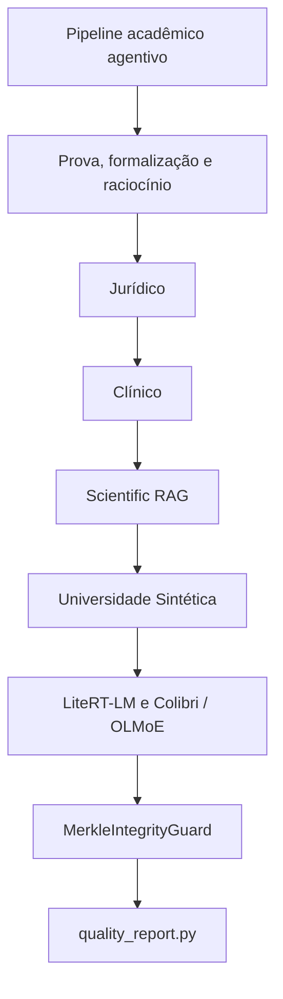

---

## Apresentações MIRA

> A documentação de ***MIRA*** é feita em **dupla leitura**: uma visão para o
> **leigo** (o que o subsistema entrega, em linguagem simples) e outra para o
> **PhD** (arquitetura e contratos técnicos). O subsistema é composto por
> `MiraDeckPipeline` (orquestra os estágios), `MiraEngine` (produz os artefatos
> visuais) e o agente delegável `mira-presenter` (SPEC-935-R126/R127).

**Visão leigo:** o MIRA transforma uma pasta com `manuscrito.md` em uma
apresentação navegável, com animações, QR codes e checagem dos terços.

**Visão PhD:** o pipeline é determinístico e auditável, com estágios explícitos
e um validador de conformidade do artefato final.

### Como funciona a apresentação MIRA

O processo percorre **6 estágios**:

1. **extract** — extrai estrutura e conteúdo do `manuscrito.md`;
2. **plan** — planeja a sequência de slides do deck;
3. **copywrite** — refina textos e mensagens visuais;
4. **build** — monta o deck em cards e seções navegáveis;
5. **animate** — gera as animações centrais de cada slide;
6. **validate** — valida conformidade e consistência final do deck.

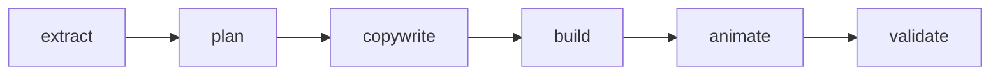

A etapa final registra conformidade segundo regras internas; não avalia
externamente o mérito científico do manuscrito.

### Presentation On Storytelling — Act I — A Ilha de Agentes

O storytelling dos decks MIRA segue uma trilha de apresentação em atos. O
**Act I — A Ilha de Agentes** apresenta o ecossistema como um território
habitado por agentes especialistas que cooperam pelo Blackboard.

**Fluxograma Intuitivo:** um diagrama simples orienta o público leigo pelas
trocas entre orquestrador, agentes e memória metacognitiva, sem jargão.

**Arquitetura Técnica Multilateral:** para a plateia técnica, o mesmo fluxo é
desenhado com todas as camadas — entrada, orquestração, SDD/TDD, memória,
integrações e apresentação.

### Ciclo de Vida SDD / TDD

O ciclo de desenvolvimento é fechado (ver também a seção de validação):

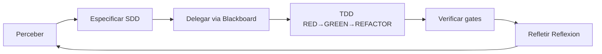

- **SDD**: nenhuma entrega sem `specs/SPEC-*.md` com critérios de aceitação.
- **TDD**: testes primeiro (RED), implementação (GREEN), refatoração só com verde.
- **Gates**: `SpecVerifier` aplica o contrato; o primário integra confiança e economia conforme o resultado e a política.
- **Reflexion**: eventos e reflexões registrados no MetaBus sustentam a revisão dos resultados.
- **Evolução**: `EvolutionRegistry` conserva os ciclos; registro, hashes e auditoria externa são operações distintas.

---

<!-- core-flowcharts:start -->
## Fluxogramas operacionais completos

Os fluxogramas abaixo são cópias integrais das mesmas fontes usadas no
[mapa navegável](docs/architecture_map.html). A ordem, as descrições, as fontes
e as limitações seguem o [catálogo de fluxos](docs/architecture/flows.json).
A edição e a origem das fontes estão declaradas no catálogo e no inventário.
Fontes do checkout atual; base Git `b7f5683f84609a5e957a56af4ca090c905f5ab80`; identidade worktree `1a170ef08b78071c65b55ee5cc0bb4821d77622b8326d018835dbf4a27d6ec7a`. 32 arquivos rastreados modificados e 52 removidos foram contabilizados; fontes não rastreadas não entram.
Estes desenhos não representam uma nova execução de todos os componentes.

### Legenda e critérios de leitura

| Elemento | Como interpretar |
|---|---|
| Retângulo | Componente, etapa, dado ou artefato indicado pelo rótulo. |
| Losango | Decisão ou condição; siga o texto de cada saída. |
| Grupo delimitado | Subsistema ou fronteira de responsabilidade. Não implica isolamento de rede. |
| Seta contínua | Direção de controle, dado ou composição conforme o título e o rótulo; não implica chamada direta entre todas as caixas. |
| Seta pontilhada | Caminho condicional, dependência opcional ou relação explicativa; leia o rótulo e os limites do fluxo. |
| Cores | Auxílio visual de agrupamento; nomes e rótulos conservam a informação sem depender da cor. |
| Fonte de código | Âncora de arquivo, símbolo e linha no retrato documentado; não é recibo de execução. |

Instalação, disponibilidade, autenticação, inferência concluída, entrega aceita
e validação externa são estados distintos. Evidências de uma operação local
valem apenas para seu escopo. Referências a agentes ou ferramentas opcionais
não garantem saldo, licença, credenciais, isolamento ou funcionamento atual.

No grafo estrutural integral, a seta tem significado mais restrito:
**módulo importador → dependência Python declarada**. Consulte a
[fonte Mermaid integral](docs/architecture/dependencies.mmd), o
[SVG equivalente](docs/architecture/dependencies-mermaid.svg) e o
[guia da legenda e reprodução](docs/architecture/MERMAID_INTEGRAL.md).

### 01. Panorama completo por camadas

Interfaces, primário, execução, governança, conhecimento e fronteiras externas.

```mermaid
flowchart TB
  U["Operador / solicitação / alvo local"]
  subgraph interfaces["Interfaces e contratos de entrada"]
    CLI["marceloclaro.cli / rea_cli / science_cli"]
    OC["OpenCode: configuração compilada e comandos"]
    MCP["ecosystem-network: MCP stdio"]
    UI["Streamlit: consulta / evidência / memória"]
    SITE["Site local REA: instruções e exemplos"]
  end
  subgraph primary["Coordenação primária e memória compartilhada"]
    MC["MarceloClaroOrchestrator"]
    CAT["Registro idempotente: agentes e catálogo"]
    BB["Blackboard / AgentCard / task.cfp"]
    BUS["MetaBus: eventos e memória metacognitiva"]
    ATT["AttentionRouter: capacidade / semântica / confiança / carga"]
    TRANS["TransformerPipeline + GradingHead: revisão limitada"]
    TASK["TaskRuntime: DAG / lease / orçamento / recuperação"]
    AUTO["AutonomousCoordinator"]
    WF["WorkflowCoordinator + WorkflowStore"]
  end
  subgraph execution["Execução e integrações condicionais"]
    HAR["HarnessRuntime: CLI / stdin / prazo / cancelamento"]
    EXT["Codex / Claude / Antigravity: autenticação e saldo próprios"]
    FED["Federação: artefatos / políticas / integridade / licença"]
    REA["ReaBridge + registro rea_layers"]
    LOCAL["LocalReaAssistant: worker isolado e recibo"]
    BROW["Navegador coordenado / cenários / snapshots"]
    MODEL["Provedores locais opcionais: Ollama / runai / LiteRT"]
  end
  subgraph assurance["Especificação, governança e evidência"]
    SPEC["SpecRegistry / Specification / critérios"]
    HIST["TDDHistory: RED e GREEN autenticados"]
    RUN["TDDRunner: teste e contrato por critério"]
    GATE["SpecVerifier / report_completion: aceite ou recusa"]
    TRUST["Trust Engine / confidence ledger / behavioral gate"]
    ECON["TokenEconomy: staking / release / slash / fee"]
    DIAG["Doctor + DiagnosticPipeline: medições locais"]
    EVO["EvolutionRegistry: ledger / encadeamento / auditoria"]
    CI["pytest / JUnit / quality_report / CI"]
  end
  subgraph knowledge["Conhecimento, raciocínio e pesquisa"]
    RAG["UnifiedSearchRAG: busca / recuperação / abstenção"]
    EG["EvidenceGraph MCI: claims / evidências / replicações"]
    SCI["EvidenceGraph científico: entidades / relações / fontes"]
    REASON["Motores: AST restrita / SMT / simbólico / heurísticas"]
    RESEARCH["Pesquisa: proveniência / execução reprodutível / revisão"]
    PUB["Composer / manuscrito / LaTeX / DOCX / material didático"]
    VIS["Rede de memória: terminal e Streamlit observacionais"]
  end
  U --> CLI
  U --> OC
  U --> MCP
  U --> UI
  U --> SITE
  CLI --> MC
  OC --> MCP
  MCP --> MC
  UI --> MC
  MC --> CAT
  CAT --> BB
  MC --> BUS
  MC --> ATT
  MC --> TRANS
  MC --> TASK
  MCP --> AUTO
  AUTO --> MC
  MCP --> WF
  WF --> AUTO
  AUTO --> HAR
  HAR --> EXT
  AUTO --> FED
  MC --> REA
  MC --> LOCAL
  MC --> BROW
  OC -.->|configuração opcional| MODEL
  MC --> SPEC
  SPEC --> HIST
  SPEC --> RUN
  HIST --> GATE
  RUN --> GATE
  MC --> GATE
  GATE --> BB
  GATE --> TRUST
  GATE --> ECON
  GATE --> BUS
  MC --> DIAG
  MC --> EVO
  CI --> RUN
  MC --> RAG
  MC --> REASON
  MC --> RESEARCH
  RESEARCH --> EG
  RESEARCH --> SCI
  RESEARCH --> PUB
  RAG -.->|resultados de recuperação| SCI
  BUS --> VIS
  EG --> VIS
  SCI --> VIS
  BB --> VIS
  VIS --> UI
  SITE -.->|orienta operação; não executa análise| LOCAL
  MCP2["Plugins locais REA / MiroFish / Lean 4"] --> MC
  MC --> LIFE["Lifecycle: validar perfil antes de atribuir"]
  LIFE --> CAT
  MC --> LOOP["MetacognitiveLoop: preparar e observar outcomes"]
  LOOP --> BUS
  MC --> NLM["NotebookLM: política por efeito e sessão privada"]
  NLM --> GOOGLE["Serviço Google externo; não offline"]
  MC --> CIL["CI local: perfil scientific enumerado"]
  CIL --> CI
  MC --> CODE["Contexto de código: busca e grafo Python estático"]
  CODE --> RAG
```

[Fonte Mermaid](docs/architecture/flows/01-panorama.mmd) · [Abrir SVG](docs/architecture/flows/01-panorama.svg)

**Fontes de código:**

- `marceloclaro/orchestrator.py:82` (fonte local modificada; não é permalink da base) — `MarceloClaroOrchestrator`.
- `integrations/ecosystem_mcp.py:364` (fonte local modificada; não é permalink da base) — `get_coordinator`.
- `integrations/opencode_cli.py:551` (fonte local modificada; não é permalink da base) — `build_config`.

**Limitações:**

- Relações de composição curadas; a existência do componente não comprova sua execução.

### 02. Orquestração primária e execução CLI

Primário compartilhado, especificação textual, roteamento, Blackboard, executor e aceite autoritativo.

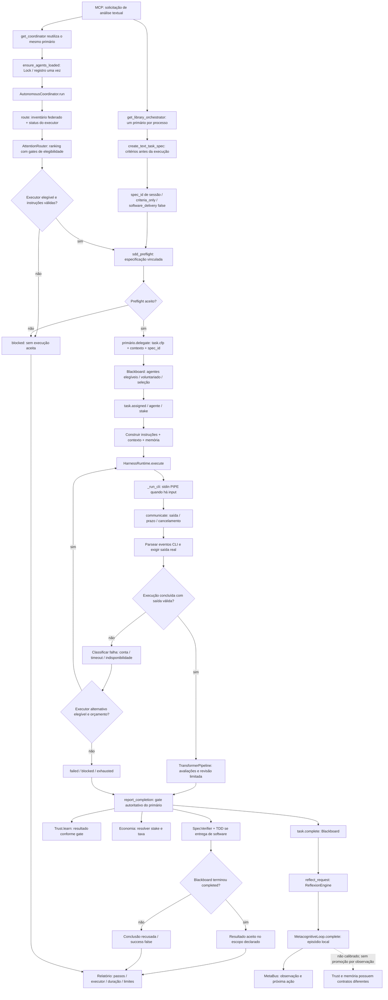

[Fonte Mermaid](docs/architecture/flows/02-orquestracao.mmd) · [Abrir SVG](docs/architecture/flows/02-orquestracao.svg)

**Fontes de código:**

- `integrations/ecosystem_mcp.py:33` (fonte local modificada; não é permalink da base) — `get_library_orchestrator`.
- `integrations/ecosystem_mcp.py:364` (fonte local modificada; não é permalink da base) — `get_coordinator`.
- `marceloclaro/orchestrator.py:348` (fonte local modificada; não é permalink da base) — `MarceloClaroOrchestrator.create_text_task_spec`.
- [marceloclaro/autonomous.py:33](https://github.com/MarceloClaro/opencode-ecosystem-core/blob/b7f5683f84609a5e957a56af4ca090c905f5ab80/marceloclaro/autonomous.py#L33) — `AutonomousCoordinator`.
- `integrations/harness_runtime.py:273` (fonte local modificada; não é permalink da base) — `HarnessRuntime._run_cli`.
- `marceloclaro/orchestrator.py:874` (fonte local modificada; não é permalink da base) — `MarceloClaroOrchestrator.report_completion`.

**Limitações:**

- Criteria_only não entrega software.
- Ranking e instalação não comprovam autenticação, saldo ou inferência.

### 03. Workflow DAG e retomada

Definição normalizada, checkpoint durável, orçamento global e repetição explícita de falhas.

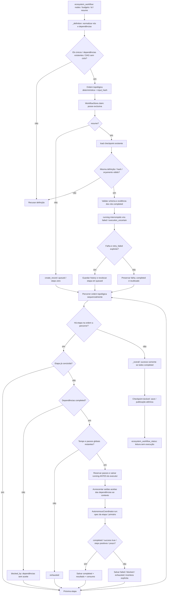

[Fonte Mermaid](docs/architecture/flows/03-workflow-dag.mmd) · [Abrir SVG](docs/architecture/flows/03-workflow-dag.svg)

**Fontes de código:**

- [marceloclaro/workflow.py:42](https://github.com/MarceloClaro/opencode-ecosystem-core/blob/b7f5683f84609a5e957a56af4ca090c905f5ab80/marceloclaro/workflow.py#L42) — `WorkflowCoordinator`.
- [marceloclaro/workflow.py:84](https://github.com/MarceloClaro/opencode-ecosystem-core/blob/b7f5683f84609a5e957a56af4ca090c905f5ab80/marceloclaro/workflow.py#L84) — `WorkflowCoordinator._definition`.
- [marceloclaro/workflow.py:237](https://github.com/MarceloClaro/opencode-ecosystem-core/blob/b7f5683f84609a5e957a56af4ca090c905f5ab80/marceloclaro/workflow.py#L237) — `WorkflowCoordinator._resume`.
- [marceloclaro/workflow_store.py:17](https://github.com/MarceloClaro/opencode-ecosystem-core/blob/b7f5683f84609a5e957a56af4ca090c905f5ab80/marceloclaro/workflow_store.py#L17) — `WorkflowStore`.

**Limitações:**

- A execução das etapas é sequencial, apesar das dependências em DAG.
- Etapa interrompida tem resultado incerto; retry_failed precisa ser explícito.

### 04. SDD e histórico RED–GREEN

Especificação, contratos por critério, execução pytest real e recibos autenticados no escopo local.

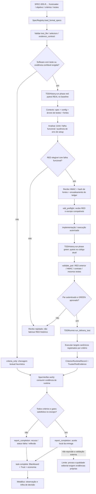

[Fonte Mermaid](docs/architecture/flows/04-sdd-tdd.mmd) · [Abrir SVG](docs/architecture/flows/04-sdd-tdd.svg)

**Fontes de código:**

- [sdd/spec_engine.py:70](https://github.com/MarceloClaro/opencode-ecosystem-core/blob/b7f5683f84609a5e957a56af4ca090c905f5ab80/sdd/spec_engine.py#L70) — `Specification`.
- [sdd/spec_engine.py:1308](https://github.com/MarceloClaro/opencode-ecosystem-core/blob/b7f5683f84609a5e957a56af4ca090c905f5ab80/sdd/spec_engine.py#L1308) — `SpecVerifier`.
- `sdd/tdd_history.py:114` (fonte local modificada; não é permalink da base) — `TDDHistory`.
- `sdd/tdd_history.py:569` (fonte local modificada; não é permalink da base) — `TDDHistory.validate_pair`.
- [sdd/tdd_runner.py:46](https://github.com/MarceloClaro/opencode-ecosystem-core/blob/b7f5683f84609a5e957a56af4ca090c905f5ab80/sdd/tdd_runner.py#L46) — `TDDRunner`.
- `marceloclaro/orchestrator.py:363` (fonte local modificada; não é permalink da base) — `MarceloClaroOrchestrator.sdd_preflight`.

**Limitações:**

- Recibo retrospectivo não pode substituir RED que não foi executado.
- Aceite local não certifica qualidade editorial nem validação externa.

### 05. REA e camadas de provedores

Registro informativo das 18 camadas, sondas estruturais e percursos efetivamente implementados: analyze JavaScript, analyze_binary Ghidra e layer com inspeção definida.

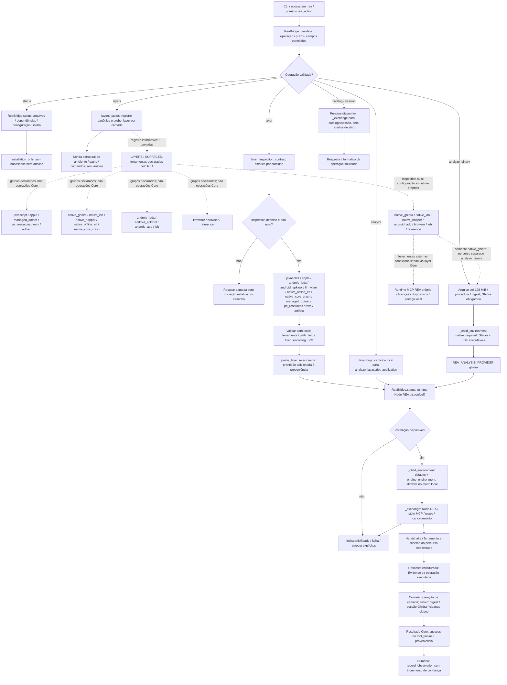

[Fonte Mermaid](docs/architecture/flows/05-rea-provedores.mmd) · [Abrir SVG](docs/architecture/flows/05-rea-provedores.svg)

**Fontes de código:**

- [integrations/rea_layers.py:445](https://github.com/MarceloClaro/opencode-ecosystem-core/blob/b7f5683f84609a5e957a56af4ca090c905f5ab80/integrations/rea_layers.py#L445) — `layers_status`.
- [integrations/rea_layers.py:422](https://github.com/MarceloClaro/opencode-ecosystem-core/blob/b7f5683f84609a5e957a56af4ca090c905f5ab80/integrations/rea_layers.py#L422) — `probe_layer`.
- [integrations/rea_layers.py:465](https://github.com/MarceloClaro/opencode-ecosystem-core/blob/b7f5683f84609a5e957a56af4ca090c905f5ab80/integrations/rea_layers.py#L465) — `engine_environment`.
- [integrations/rea_bridge.py:40](https://github.com/MarceloClaro/opencode-ecosystem-core/blob/b7f5683f84609a5e957a56af4ca090c905f5ab80/integrations/rea_bridge.py#L40) — `ReaBridge`.
- `marceloclaro/orchestrator.py:2496` (fonte local modificada; não é permalink da base) — `MarceloClaroOrchestrator.rea_action`.
- [marceloclaro/rea_cli.py:7](https://github.com/MarceloClaro/opencode-ecosystem-core/blob/b7f5683f84609a5e957a56af4ca090c905f5ab80/marceloclaro/rea_cli.py#L7) — `run_rea_cli`.
- [integrations/rea_bridge.py:174](https://github.com/MarceloClaro/opencode-ecosystem-core/blob/b7f5683f84609a5e957a56af4ca090c905f5ab80/integrations/rea_bridge.py#L174) — `ReaBridge._validate`.
- [integrations/rea_bridge.py:108](https://github.com/MarceloClaro/opencode-ecosystem-core/blob/b7f5683f84609a5e957a56af4ca090c905f5ab80/integrations/rea_bridge.py#L108) — `ReaBridge.status`.
- [integrations/rea_bridge.py:50](https://github.com/MarceloClaro/opencode-ecosystem-core/blob/b7f5683f84609a5e957a56af4ca090c905f5ab80/integrations/rea_bridge.py#L50) — `ReaBridge._child_environment`.
- [integrations/rea_bridge.py:479](https://github.com/MarceloClaro/opencode-ecosystem-core/blob/b7f5683f84609a5e957a56af4ca090c905f5ab80/integrations/rea_bridge.py#L479) — `ReaBridge.action`.
- [integrations/rea_layers.py:305](https://github.com/MarceloClaro/opencode-ecosystem-core/blob/b7f5683f84609a5e957a56af4ca090c905f5ab80/integrations/rea_layers.py#L305) — `layer_inspection`.

**Limitações:**

- O registro declara 18 camadas; layer Core recusa inspection nulo.
- analyze_binary exige Ghidra; não alterna automaticamente para IDA/Hopper.
- IDA, Hopper, adb, browser, JEB e reference possuem runtimes/configuração próprios e não oferecem layer nesta ponte.
- Status e sondas de camada não abrem alvo nem iniciam análise.
- Ferramentas comerciais, dispositivos e engines exigem configuração e licenças próprias.

### 06. REA local direto e evidência

Inspeção estática com rede/PID privados, digest antes/depois, recibo por hash e explicação derivada.

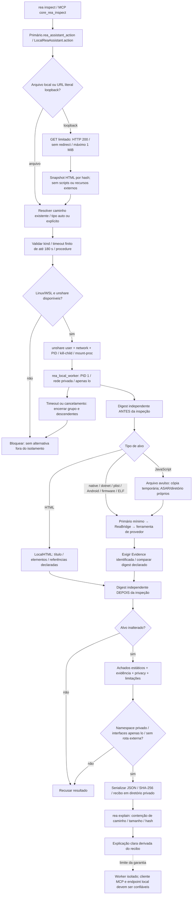

[Fonte Mermaid](docs/architecture/flows/06-rea-local.mmd) · [Abrir SVG](docs/architecture/flows/06-rea-local.svg)

**Fontes de código:**

- [integrations/rea_assistant.py:625](https://github.com/MarceloClaro/opencode-ecosystem-core/blob/b7f5683f84609a5e957a56af4ca090c905f5ab80/integrations/rea_assistant.py#L625) — `LocalReaAssistant`.
- [integrations/rea_assistant.py:42](https://github.com/MarceloClaro/opencode-ecosystem-core/blob/b7f5683f84609a5e957a56af4ca090c905f5ab80/integrations/rea_assistant.py#L42) — `run_isolated_worker`.
- [integrations/rea_assistant.py:603](https://github.com/MarceloClaro/opencode-ecosystem-core/blob/b7f5683f84609a5e957a56af4ca090c905f5ab80/integrations/rea_assistant.py#L603) — `_snapshot_loopback`.
- [integrations/rea_local_worker.py:40](https://github.com/MarceloClaro/opencode-ecosystem-core/blob/b7f5683f84609a5e957a56af4ca090c905f5ab80/integrations/rea_local_worker.py#L40) — `main`.
- [integrations/rea_assistant.py:164](https://github.com/MarceloClaro/opencode-ecosystem-core/blob/b7f5683f84609a5e957a56af4ca090c905f5ab80/integrations/rea_assistant.py#L164) — `explain_report`.

**Limitações:**

- Garantia de rede privada cobre o worker e seus descendentes.
- Aplicação alvo não é executada no percurso estático; .NET pode fornecer apenas metadados.
- Snapshot loopback não executa scripts nem busca recursos externos.

### 07. REA com agente local e gate de recibos

Setup próprio, configuração efetiva, quatro ferramentas, timeout e validação do resultado do cliente.

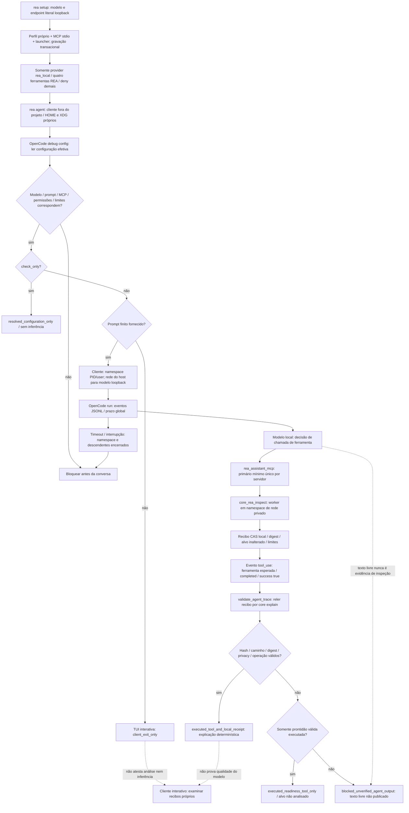

[Fonte Mermaid](docs/architecture/flows/07-rea-agente.mmd) · [Abrir SVG](docs/architecture/flows/07-rea-agente.svg)

**Fontes de código:**

- [integrations/rea_assistant.py:280](https://github.com/MarceloClaro/opencode-ecosystem-core/blob/b7f5683f84609a5e957a56af4ca090c905f5ab80/integrations/rea_assistant.py#L280) — `setup_local_agent`.
- [integrations/rea_assistant.py:447](https://github.com/MarceloClaro/opencode-ecosystem-core/blob/b7f5683f84609a5e957a56af4ca090c905f5ab80/integrations/rea_assistant.py#L447) — `launch_local_agent`.
- [integrations/rea_assistant.py:353](https://github.com/MarceloClaro/opencode-ecosystem-core/blob/b7f5683f84609a5e957a56af4ca090c905f5ab80/integrations/rea_assistant.py#L353) — `_run_agent_client`.
- [integrations/rea_assistant.py:544](https://github.com/MarceloClaro/opencode-ecosystem-core/blob/b7f5683f84609a5e957a56af4ca090c905f5ab80/integrations/rea_assistant.py#L544) — `validate_agent_trace`.
- [integrations/rea_assistant_mcp.py:17](https://github.com/MarceloClaro/opencode-ecosystem-core/blob/b7f5683f84609a5e957a56af4ca090c905f5ab80/integrations/rea_assistant_mcp.py#L17) — `create_mcp_server`.

**Limitações:**

- Cliente OpenCode preserva a rede host para o endpoint loopback; não tem a garantia de rede privada do worker.
- Status, configuração ou saída TUI não comprovam análise autônoma do alvo.
- Análise REA autônoma pelo LLM local não foi comprovada nos recibos de prontidão R868/R869.

### 08. Conhecimento, RAG e grafos de evidência

Recuperação de fontes, abstenção, referências e dois modelos de grafo com responsabilidades distintas.

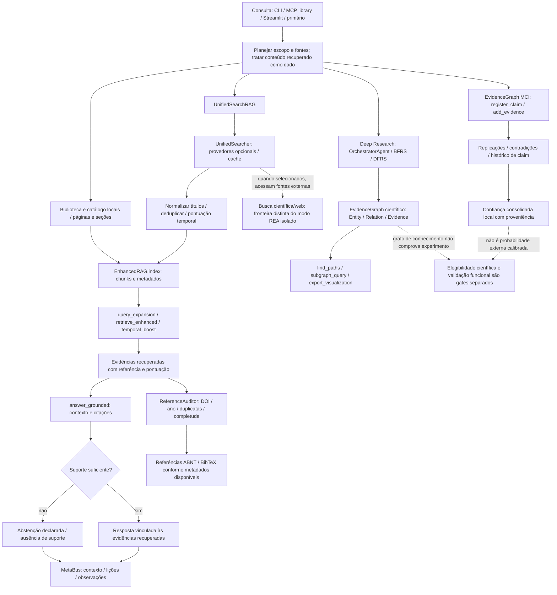

[Fonte Mermaid](docs/architecture/flows/08-conhecimento-rag.mmd) · [Abrir SVG](docs/architecture/flows/08-conhecimento-rag.svg)

**Fontes de código:**

- [rag/enhanced_search_rag.py:761](https://github.com/MarceloClaro/opencode-ecosystem-core/blob/b7f5683f84609a5e957a56af4ca090c905f5ab80/rag/enhanced_search_rag.py#L761) — `UnifiedSearchRAG`.
- [rag/enhanced_search_rag.py:312](https://github.com/MarceloClaro/opencode-ecosystem-core/blob/b7f5683f84609a5e957a56af4ca090c905f5ab80/rag/enhanced_search_rag.py#L312) — `EnhancedRAG`.
- [rag/enhanced_search_rag.py:602](https://github.com/MarceloClaro/opencode-ecosystem-core/blob/b7f5683f84609a5e957a56af4ca090c905f5ab80/rag/enhanced_search_rag.py#L602) — `ReferenceAuditor`.
- [mci/evidence_graph.py:22](https://github.com/MarceloClaro/opencode-ecosystem-core/blob/b7f5683f84609a5e957a56af4ca090c905f5ab80/mci/evidence_graph.py#L22) — `EvidenceGraph`.
- [agentic_science_v2/evidence_graph.py:128](https://github.com/MarceloClaro/opencode-ecosystem-core/blob/b7f5683f84609a5e957a56af4ca090c905f5ab80/agentic_science_v2/evidence_graph.py#L128) — `EvidenceGraph`.
- [agentic_science_v2/deep_research.py:468](https://github.com/MarceloClaro/opencode-ecosystem-core/blob/b7f5683f84609a5e957a56af4ca090c905f5ab80/agentic_science_v2/deep_research.py#L468) — `OrchestratorAgent`.

**Limitações:**

- Busca externa depende dos provedores escolhidos; não integra a garantia local do REA.
- Grafo de conhecimento e evidência recuperada não comprovam experimento ou probabilidade calibrada.

### 09. Rede de memória observável

Eventos reais, memória persistida, claims, cartões e visualização em terminal/Streamlit.

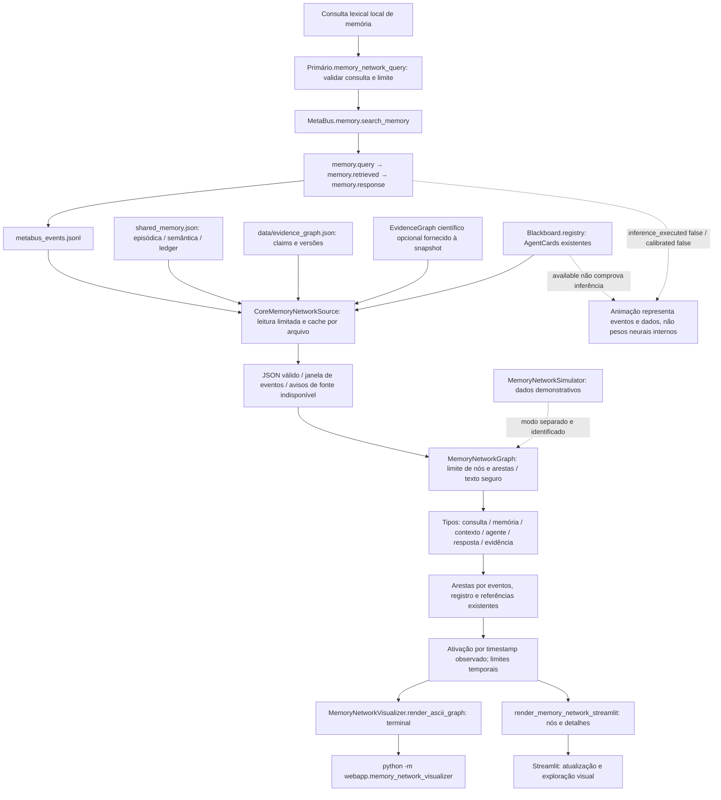

[Fonte Mermaid](docs/architecture/flows/09-memoria-observavel.mmd) · [Abrir SVG](docs/architecture/flows/09-memoria-observavel.svg)

**Fontes de código:**

- `marceloclaro/orchestrator.py:380` (fonte local modificada; não é permalink da base) — `MarceloClaroOrchestrator.memory_network_query`.
- [mci/metabus.py:61](https://github.com/MarceloClaro/opencode-ecosystem-core/blob/b7f5683f84609a5e957a56af4ca090c905f5ab80/mci/metabus.py#L61) — `MetacognitiveMemory`.
- [webapp/memory_network_visualizer.py:161](https://github.com/MarceloClaro/opencode-ecosystem-core/blob/b7f5683f84609a5e957a56af4ca090c905f5ab80/webapp/memory_network_visualizer.py#L161) — `CoreMemoryNetworkSource`.
- [webapp/memory_network_visualizer.py:365](https://github.com/MarceloClaro/opencode-ecosystem-core/blob/b7f5683f84609a5e957a56af4ca090c905f5ab80/webapp/memory_network_visualizer.py#L365) — `MemoryNetworkVisualizer`.
- [webapp/memory_network_streamlit.py:17](https://github.com/MarceloClaro/opencode-ecosystem-core/blob/b7f5683f84609a5e957a56af4ca090c905f5ab80/webapp/memory_network_streamlit.py#L17) — `render_memory_network_streamlit`.

**Limitações:**

- A animação representa eventos e relações observadas, não ativações internas de uma rede neural.
- Simulação e registro de agente disponível são distintos de inferência executada.

### 10. Raciocínio restrito e fallbacks

AST permitida, tradução SMT integral, cálculo simbólico da entrada e falha sem conclusão inventada.

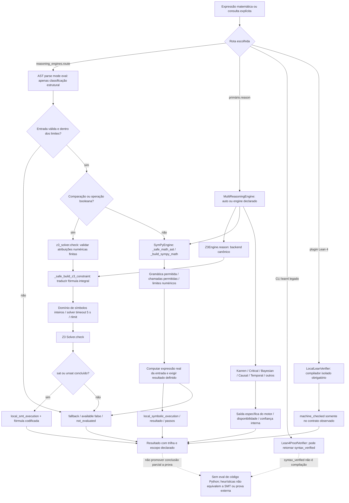

[Fonte Mermaid](docs/architecture/flows/10-raciocinio.mmd) · [Abrir SVG](docs/architecture/flows/10-raciocinio.svg)

**Fontes de código:**

- [reasoning/reasoning_engines.py:7](https://github.com/MarceloClaro/opencode-ecosystem-core/blob/b7f5683f84609a5e957a56af4ca090c905f5ab80/reasoning/reasoning_engines.py#L7) — `route`.
- [reasoning/z3_solver.py:41](https://github.com/MarceloClaro/opencode-ecosystem-core/blob/b7f5683f84609a5e957a56af4ca090c905f5ab80/reasoning/z3_solver.py#L41) — `check`.
- [reasoning/engines.py:83](https://github.com/MarceloClaro/opencode-ecosystem-core/blob/b7f5683f84609a5e957a56af4ca090c905f5ab80/reasoning/engines.py#L83) — `_safe_build_z3_constraint`.
- [reasoning/engines.py:337](https://github.com/MarceloClaro/opencode-ecosystem-core/blob/b7f5683f84609a5e957a56af4ca090c905f5ab80/reasoning/engines.py#L337) — `_safe_math_ast`.
- [reasoning/engines.py:493](https://github.com/MarceloClaro/opencode-ecosystem-core/blob/b7f5683f84609a5e957a56af4ca090c905f5ab80/reasoning/engines.py#L493) — `SymPyEngine`.
- [reasoning/engines.py:1435](https://github.com/MarceloClaro/opencode-ecosystem-core/blob/b7f5683f84609a5e957a56af4ca090c905f5ab80/reasoning/engines.py#L1435) — `MultiReasoningEngine`.

**Limitações:**

- SAT/UNSAT exige conclusão do backend; erro ou indisponibilidade retorna fallback.
- Motores heurísticos e confidence interna não equivalem a prova SMT ou validação externa.

### 11. Diagnóstico, confiança, federação e evolução

Autodescoberta e corpus retido, categorias canônicas, remediação, políticas e ledger de evolução.

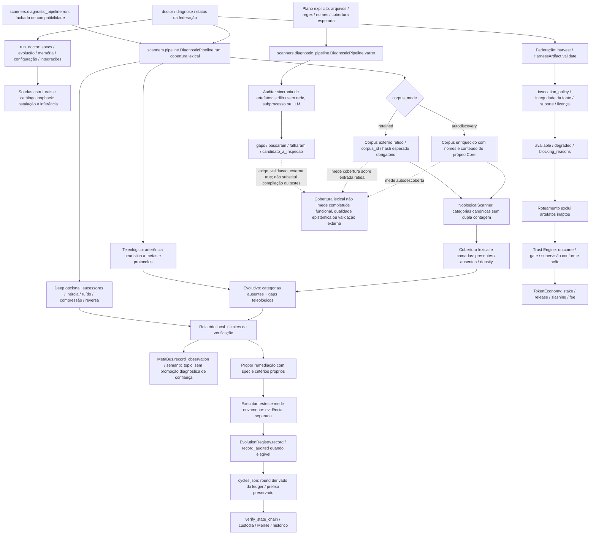

[Fonte Mermaid](docs/architecture/flows/11-diagnostico-governanca.mmd) · [Abrir SVG](docs/architecture/flows/11-diagnostico-governanca.svg)

**Fontes de código:**

- `marceloclaro/doctor.py:928` (fonte local modificada; não é permalink da base) — `run_doctor`.
- [scanners/pipeline.py:96](https://github.com/MarceloClaro/opencode-ecosystem-core/blob/b7f5683f84609a5e957a56af4ca090c905f5ab80/scanners/pipeline.py#L96) — `DiagnosticPipeline`.
- [scanners/noological_scanner.py:495](https://github.com/MarceloClaro/opencode-ecosystem-core/blob/b7f5683f84609a5e957a56af4ca090c905f5ab80/scanners/noological_scanner.py#L495) — `NoologicalScanner`.
- [integrations/harness_federation/artifact.py:406](https://github.com/MarceloClaro/opencode-ecosystem-core/blob/b7f5683f84609a5e957a56af4ca090c905f5ab80/integrations/harness_federation/artifact.py#L406) — `HarnessArtifact`.
- [trust/trust_engine.py:540](https://github.com/MarceloClaro/opencode-ecosystem-core/blob/b7f5683f84609a5e957a56af4ca090c905f5ab80/trust/trust_engine.py#L540) — `TrustEngine`.
- [economy/token_economy.py:184](https://github.com/MarceloClaro/opencode-ecosystem-core/blob/b7f5683f84609a5e957a56af4ca090c905f5ab80/economy/token_economy.py#L184) — `TokenEconomy`.
- `evolution/cycles.py:101` (fonte local modificada; não é permalink da base) — `EvolutionRegistry`.
- [scanners/diagnostic_pipeline.py:46](https://github.com/MarceloClaro/opencode-ecosystem-core/blob/b7f5683f84609a5e957a56af4ca090c905f5ab80/scanners/diagnostic_pipeline.py#L46) — `DiagnosticPipeline.varrer`.
- [scanners/diagnostic_pipeline.py:142](https://github.com/MarceloClaro/opencode-ecosystem-core/blob/b7f5683f84609a5e957a56af4ca090c905f5ab80/scanners/diagnostic_pipeline.py#L142) — `run`.

**Limitações:**

- Cobertura lexical não mede cobertura funcional ou completude epistêmica.
- Confiança e licença declarada são sinais e políticas locais, não certificações externas.
- scanners.diagnostic_pipeline.varrer é auditoria hermética de sincronia; run desse módulo é fachada do diagnóstico lexical.

### 12. Ciência, proveniência e publicação

Execução científica e descoberta com gates, revisão interna, composição e entrega editorial humana.

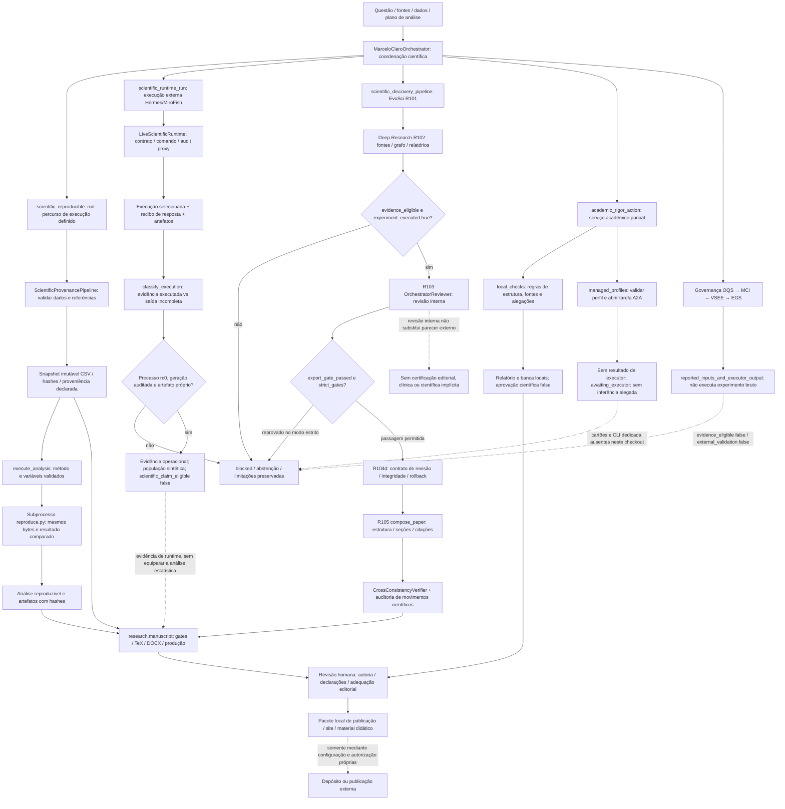

[Fonte Mermaid](docs/architecture/flows/12-ciencia-publicacao.mmd) · [Abrir SVG](docs/architecture/flows/12-ciencia-publicacao.svg)

**Fontes de código:**

- `marceloclaro/orchestrator.py:2154` (fonte local modificada; não é permalink da base) — `MarceloClaroOrchestrator.scientific_reproducible_run`.
- `marceloclaro/orchestrator.py:2690` (fonte local modificada; não é permalink da base) — `MarceloClaroOrchestrator.scientific_discovery_pipeline`.
- `integrations/live_scientific_runtime.py:189` (fonte local modificada; não é permalink da base) — `LiveScientificRuntime`.
- [research/provenance_pipeline.py:260](https://github.com/MarceloClaro/opencode-ecosystem-core/blob/b7f5683f84609a5e957a56af4ca090c905f5ab80/research/provenance_pipeline.py#L260) — `ScientificProvenancePipeline`.
- [agentic_science_v2/paper_composer.py:496](https://github.com/MarceloClaro/opencode-ecosystem-core/blob/b7f5683f84609a5e957a56af4ca090c905f5ab80/agentic_science_v2/paper_composer.py#L496) — `OrchestratorComposer`.
- [mci/pipeline/scientific_governance_pipeline.py:15](https://github.com/MarceloClaro/opencode-ecosystem-core/blob/b7f5683f84609a5e957a56af4ca090c905f5ab80/mci/pipeline/scientific_governance_pipeline.py#L15) — `run_scientific_governance_pipeline`.
- `marceloclaro/orchestrator.py:2253` (fonte local modificada; não é permalink da base) — `MarceloClaroOrchestrator.scientific_runtime_run`.
- [research/statistical_methods.py:84](https://github.com/MarceloClaro/opencode-ecosystem-core/blob/b7f5683f84609a5e957a56af4ca090c905f5ab80/research/statistical_methods.py#L84) — `execute_analysis`.
- `academic/adversarial_research/service.py:47` (fonte local modificada; não é permalink da base) — `AdversarialResearchService`.
- `academic/adversarial_research/board.py:11` (fonte local modificada; não é permalink da base) — `review_research`.
- `academic/adversarial_research/banca.py:7` (fonte local modificada; não é permalink da base) — `BancaSessionStore`.
- `marceloclaro/orchestrator.py:2218` (fonte local modificada; não é permalink da base) — `MarceloClaroOrchestrator.academic_rigor_action`.

**Limitações:**

- Deep Research sem evidência elegível bloqueia a descoberta estrita.
- Governança de entradas reportadas não executa experimento sobre dados brutos.
- Composição e revisão internas não constituem parecer editorial ou validação clínica.
- Rigor acadêmico parcial: perfis e CLI dedicada removidos; local_checks não é inferência dos especialistas.
- Spec ausente bloqueia G0; banca_rate chama método ausente.
- O preflight acadêmico não tem chamador no pipeline amostrado.

### 13. Validação e entrega

Suíte/JUnit, contagens físicas, exportação limpa, manifesto, commit e resultado remoto independente.

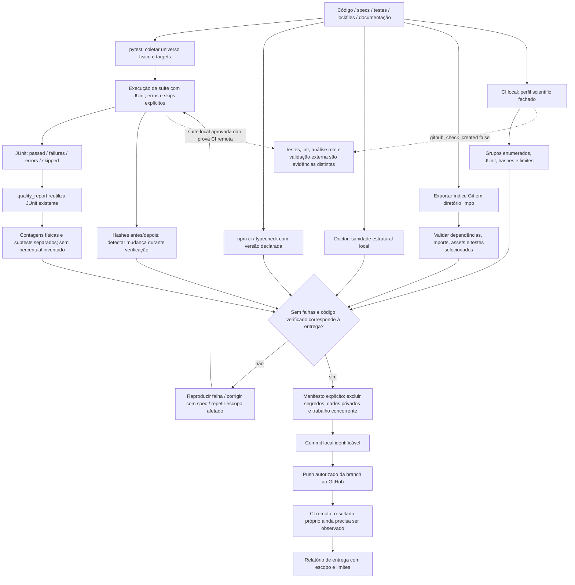

[Fonte Mermaid](docs/architecture/flows/13-validacao-entrega.mmd) · [Abrir SVG](docs/architecture/flows/13-validacao-entrega.svg)

**Fontes de código:**

- [scripts/quality_report.py:65](https://github.com/MarceloClaro/opencode-ecosystem-core/blob/b7f5683f84609a5e957a56af4ca090c905f5ab80/scripts/quality_report.py#L65) — `load_junit_results`.
- [scripts/quality_report.py:211](https://github.com/MarceloClaro/opencode-ecosystem-core/blob/b7f5683f84609a5e957a56af4ca090c905f5ab80/scripts/quality_report.py#L211) — `generate_report`.
- [sdd/tdd_runner.py:554](https://github.com/MarceloClaro/opencode-ecosystem-core/blob/b7f5683f84609a5e957a56af4ca090c905f5ab80/sdd/tdd_runner.py#L554) — `run_pytest`.
- `marceloclaro/doctor.py:928` (fonte local modificada; não é permalink da base) — `run_doctor`.

**Limitações:**

- Suíte local, lint e CI remota são verificações distintas.
- Diagrama representa o procedimento de entrega; resultado remoto deve ser observado separadamente.

### 14. Plugins locais, Lean 4 e MiroFish

Pacotes privados reutilizam o mesmo primário; status e execução possuem contratos distintos.

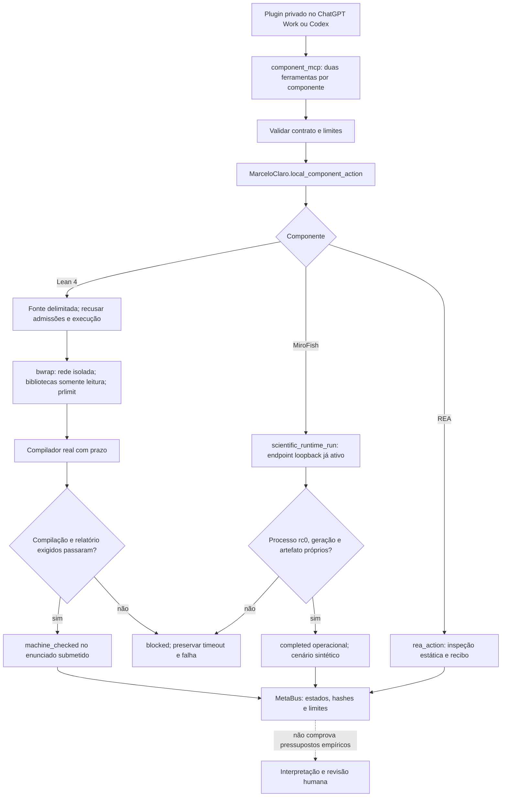

[Fonte Mermaid](docs/architecture/flows/14-plugins-locais.mmd) · [Abrir SVG](docs/architecture/flows/14-plugins-locais.svg)

**Fontes de código:**

- [integrations/component_mcp.py:11](https://github.com/MarceloClaro/opencode-ecosystem-core/blob/b7f5683f84609a5e957a56af4ca090c905f5ab80/integrations/component_mcp.py#L11) — `create_server`.
- `integrations/component_actions.py:30` (fonte local modificada; não é permalink da base) — `dispatch_component`.
- `integrations/local_lean.py:11` (fonte local modificada; não é permalink da base) — `LocalLeanVerifier`.
- `marceloclaro/orchestrator.py:2243` (fonte local modificada; não é permalink da base) — `MarceloClaroOrchestrator.local_component_action`.

**Limitações:**

- MiroFish exige endpoint local previamente disponível; instalação não comprova inferência.
- No checkout amostrado, LocalLeanVerifier relata axiomas somente do primeiro teorema e limita AS a 4 GiB.
- O caminho CLI lean4 legado pode produzir syntax_verified; ele não equivale à compilação do plugin.
- Conteúdo devolvido ao aplicativo de chat pode ser processado fora da máquina.

### 15. NotebookLM coordenado e política R915

CLI, MCP, catálogo e skill compartilham validação, política de efeitos e recibos pelo MarceloClaro.

```mermaid
flowchart TB
  INPUT["/gemini-notebook ou ferramenta MCP central"] --> MC["MarceloClaro.gemini_notebook_action"]
  MC --> VALID["Validar campos, limites e ausência de credenciais"]
  VALID --> OP{"Operação"}
  OP -->|status| STATUS["Versão e binários; login não verificado"]
  OP -->|catalog| CAT["Descobrir schemas MCP e árvore CLI com hash"]
  OP -->|skill| SKILL["Fonte e licença; preservar edições locais"]
  OP -->|mcp ou cli| EFFECT["Classificar efeito e suboperações"]
  EFFECT --> AUTH{"Autenticação privada?"}
  AUTH -->|sim| PRIVATE["Bloquear; login no terminal do operador"]
  AUTH -->|não| DRY{"dry_run?"}
  DRY -->|sim| PREP["prepared; nenhuma operação remota"]
  DRY -->|não| ALLOW{"Leitura ou efeito concreto autorizado?"}
  ALLOW -->|não| BLOCK["blocked; preservar motivo"]
  ALLOW -->|sim| LIVE["Schema atual; broker de sessão privada"]
  LIVE --> GOOGLE["NotebookLM na infraestrutura Google"]
  GOOGLE --> RESULT["completed / pending / partial / failed"]
  RESULT --> ART["Downloads: raiz permitida, arquivo novo e SHA"]
  ART --> OBS["MetaBus: estados e hashes; sem confiança promovida"]
  CAT -.->|descobrir não autoriza ferramenta nova| BLOCK
```

[Fonte Mermaid](docs/architecture/flows/15-notebooklm.mmd) · [Abrir SVG](docs/architecture/flows/15-notebooklm.svg)

**Fontes de código:**

- [integrations/gemini_notebook.py:83](https://github.com/MarceloClaro/opencode-ecosystem-core/blob/b7f5683f84609a5e957a56af4ca090c905f5ab80/integrations/gemini_notebook.py#L83) — `GeminiNotebookService`.
- [integrations/gemini_notebook_catalog.py:79](https://github.com/MarceloClaro/opencode-ecosystem-core/blob/b7f5683f84609a5e957a56af4ca090c905f5ab80/integrations/gemini_notebook_catalog.py#L79) — `classify_mcp_operation`.
- [integrations/gemini_notebook_session.py:50](https://github.com/MarceloClaro/opencode-ecosystem-core/blob/b7f5683f84609a5e957a56af4ca090c905f5ab80/integrations/gemini_notebook_session.py#L50) — `_configuration`.
- `marceloclaro/orchestrator.py:2378` (fonte local modificada; não é permalink da base) — `MarceloClaroOrchestrator.gemini_notebook_action`.

**Limitações:**

- Conector comunitário: não é API oficial de conta pessoal do Google.
- A sonda R915 observou 0.15.6, 53 ferramentas, 165 callbacks e 234 notebooks; trata-se de execução datada.
- alias, chat_save_to_note, profile e report continuam bloqueadas pela política MCP do Core.
- Jobs voláteis permanecem vinculados à sessão original; nova sessão não comprova continuidade.

### 16. Autenticações de ChatGPT, Gemini e NotebookLM

Três clientes e sessões independentes; resposta observada e login são evidências diferentes.

```mermaid
flowchart TB
  OP["Operador no terminal"] --> CHOICE{"Serviço"}
  CHOICE -->|ChatGPT no OpenCode| OC["opencode auth login provider openai"]
  OC --> OAUTH["Autorizar no navegador OpenAI; sessão privada"]
  OAUTH --> MODEL["Selecionar modelo em /models"]
  CHOICE -->|Gemini Chat no terminal| GEM["Gemini CLI: Sign in with Google"]
  GEM --> TEST["Enviar solicitação curta"]
  MODEL --> TEST
  TEST --> RESPONSE{"Resposta concluída?"}
  RESPONSE -->|não| BLOCK["Preservar falha, limite ou indisponibilidade"]
  RESPONSE -->|sim| ACCESS["Acesso observado naquele momento"]
  CHOICE -->|Notebooks e fontes| NLM["nlm login --wsl; conta Google"]
  NLM --> CHECK["nlm login --check"]
  CHECK --> CORE["Core: política por efeito em /gemini-notebook"]
  CORE --> GOOGLE["Serviço Google; notebooks e fontes"]
  OAUTH -.->|não importa histórico web| LIMIT["Sessões e cotas próprias"]
  GEM -.->|independente do NotebookLM| LIMIT
```

[Fonte Mermaid](docs/architecture/flows/16-autenticacoes.mmd) · [Abrir SVG](docs/architecture/flows/16-autenticacoes.svg)

**Fontes de código:**

- [integrations/gemini_cli.py:69](https://github.com/MarceloClaro/opencode-ecosystem-core/blob/b7f5683f84609a5e957a56af4ca090c905f5ab80/integrations/gemini_cli.py#L69) — `gemini_run`.
- [integrations/gemini_notebook.py:41](https://github.com/MarceloClaro/opencode-ecosystem-core/blob/b7f5683f84609a5e957a56af4ca090c905f5ab80/integrations/gemini_notebook.py#L41) — `validate_notebook_config`.
- `integrations/opencode_cli.py:551` (fonte local modificada; não é permalink da base) — `build_config`.

**Limitações:**

- Nenhuma conversa web é automaticamente importada.
- Login Gemini CLI não configura um provider Google no OpenCode.
- Tarifas de API, créditos e franquia de assinatura não são intercambiáveis.

### 17. Ciclo metacognitivo e memória de outcomes

Recuperação de lições antes da tarefa e observação posterior, sem transformar heurística em validação externa.

```mermaid
flowchart TB
  TASK["Solicitação ao MarceloClaro"] --> PREP["MetacognitiveLoop.prepare"]
  PREP --> SEARCH["Recuperar lições; deduplicar e excluir substituídos"]
  SEARCH --> BRIEF["Briefing: referências e limites locais"]
  BRIEF --> A2A["delegate: contexto da tarefa Blackboard"]
  A2A --> EXEC["Executor realiza o trabalho"]
  EXEC --> GATE["report_completion: contrato e histórico quando aplicável"]
  GATE --> BB["task.complete e atualização da tarefa"]
  BB --> REF["ReflexionEngine: solicitação de reflexão"]
  REF --> COMPLETE["MetacognitiveLoop.complete"]
  COMPLETE --> EPISODE["Outcome, erro observado e próxima ação"]
  EPISODE --> RECORD["record_observation: calibrated false"]
  RECORD --> SEARCH
  GATE --> TRUST["Trust.learn e economia conforme outcome"]
  REASON["primário.reason"] --> PREP
  REASON --> ENGINE["Motor solicitado e resultado tipado"]
  ENGINE --> OBS["observe_reasoning"]
  OBS --> RECORD
  RECORD -.->|confidence_promoted false nesta observação| LIMIT["Não comprova verdade, causalidade ou revisão humana"]
```

[Fonte Mermaid](docs/architecture/flows/17-metacognicao.mmd) · [Abrir SVG](docs/architecture/flows/17-metacognicao.svg)

**Fontes de código:**

- [mci/metacognitive_loop.py:23](https://github.com/MarceloClaro/opencode-ecosystem-core/blob/b7f5683f84609a5e957a56af4ca090c905f5ab80/mci/metacognitive_loop.py#L23) — `MetacognitiveLoop`.
- `marceloclaro/orchestrator.py:426` (fonte local modificada; não é permalink da base) — `MarceloClaroOrchestrator.delegate`.
- `marceloclaro/orchestrator.py:874` (fonte local modificada; não é permalink da base) — `MarceloClaroOrchestrator.report_completion`.
- [mci/reflexion.py:19](https://github.com/MarceloClaro/opencode-ecosystem-core/blob/b7f5683f84609a5e957a56af4ca090c905f5ab80/mci/reflexion.py#L19) — `ReflexionEngine`.

**Limitações:**

- Observações locais não são calibração probabilística nem revisão científica.
- Trust.learn, resolução econômica e observações de memória são efeitos diferentes.
- Memória recuperada é dado contextual, não uma nova autorização ou instrução.

### 18. Lifecycle permanente de agentes e subagentes

Definição validada, contrato, permissões e correlação da tarefa antes da execução efetiva.

```mermaid
flowchart TB
  INPUT["CLI agentes ou ecosystem_agent_profile"] --> MC["MarceloClaro.agent_profile_action"]
  MC --> CHECK["Capacidades, origem, spec/teste, saída e permissões"]
  CHECK --> VALID{"Definição gerenciada válida?"}
  VALID -->|não| LEGACY["Recusar criação ou preservar baseline histórico"]
  VALID -->|sim| HASH["Conferir SHA antes do registro"]
  HASH --> BUSY{"Definição em uso conflita?"}
  BUSY -->|sim| BLOCK["blocked; preservar trabalho em andamento"]
  BUSY -->|não| REG["Registrar cartão no Blackboard"]
  REG --> ACTION{"Criar ou ativar?"}
  ACTION -->|criar| CONFIG["Compilar configuração do OpenCode"]
  ACTION -->|ativar| DELEGATE["delegate: capacidade exclusiva e contexto"]
  DELEGATE --> ID["Correlacionar task_id, perfil e executor externo"]
  ID --> WAIT["pending_executor até execução real"]
  WAIT --> WORK["Trabalho e evidência observados"]
  WORK --> GATE["Contrato e conclusão pelo primário"]
  CONFIG --> MEM["MetaBus: observações e limites"]
  GATE --> MEM
```

[Fonte Mermaid](docs/architecture/flows/18-lifecycle.mmd) · [Abrir SVG](docs/architecture/flows/18-lifecycle.svg)

**Fontes de código:**

- `agents/lifecycle.py:244` (fonte local modificada; não é permalink da base) — `AgentLifecycleService`.
- `agents/lifecycle.py:163` (fonte local modificada; não é permalink da base) — `validate_managed_card`.
- `marceloclaro/orchestrator.py:241` (fonte local modificada; não é permalink da base) — `MarceloClaroOrchestrator.agent_profile_action`.

**Limitações:**

- Registro e atribuição não comprovam inferência ou conclusão.
- Definições históricas conservam baseline; alterações exigem migração explícita.
- Ferramentas externas de subagentes não são interceptadas automaticamente pelo Core.

### 19. CI local e validação delimitada

Alternativa local ao bloqueio da CI remota, com seleção fechada e recibos próprios.

```mermaid
flowchart TB
  INPUT["ci-local ou ecosystem_local_ci"] --> MC["MarceloClaro.local_ci_action"]
  MC --> OP{"start / status / runs / cancel"}
  OP -->|start| PROFILE["Somente perfil scientific enumerado"]
  PROFILE --> LOCK["Lock de escritor único; identidade das fontes"]
  LOCK --> RUN["Supervisor: grupos, prazo e memória delimitados"]
  RUN --> JUNIT["JUnit, seleção, execução e hashes"]
  JUNIT --> VERIFY{"Fontes estáveis e todos os grupos exigidos concluídos?"}
  VERIFY -->|não| BLOCK["blocked ou cancelled; preservar erro"]
  VERIFY -->|sim| PASS["passed no escopo selecionado"]
  OP -->|status ou runs| READ["Ler recibos e conferir compatibilidade"]
  OP -->|cancel| CANCEL["Cancelar e limpar processos observados"]
  READ --> RESULT["Estado observado e limitações"]
  CANCEL --> RESULT
  PASS --> RESULT
  BLOCK --> RESULT
  RESULT --> META["Observação no MetaBus"]
  RESULT -.->|github_check_created false| REMOTE["CI remota exige execução e evidência próprias"]
```

[Fonte Mermaid](docs/architecture/flows/19-ci-local.mmd) · [Abrir SVG](docs/architecture/flows/19-ci-local.svg)

**Fontes de código:**

- [integrations/local_ci.py:139](https://github.com/MarceloClaro/opencode-ecosystem-core/blob/b7f5683f84609a5e957a56af4ca090c905f5ab80/integrations/local_ci.py#L139) — `LocalCIService`.
- [scripts/validate_scientific_profile.py:534](https://github.com/MarceloClaro/opencode-ecosystem-core/blob/b7f5683f84609a5e957a56af4ca090c905f5ab80/scripts/validate_scientific_profile.py#L534) — `main`.
- `marceloclaro/orchestrator.py:334` (fonte local modificada; não é permalink da base) — `MarceloClaroOrchestrator.local_ci_action`.

**Limitações:**

- O perfil fechado não executa comandos, URLs ou testes arbitrários fornecidos pelo chamador.
- Aprovação local não cria check GitHub nem comprova suíte global.
- Conservar resultados anteriores como históricos quando as fontes mudarem.

### 20. Seleção econômica de modelos e contexto

Política recomendada para comparar custo por tarefa aceita; não é um roteador automático novo.

```mermaid
flowchart TB
  TASK["Tarefa ao MarceloClaro"] --> CONTEXT["Recuperar fontes e trechos relevantes"]
  CONTEXT --> TYPE{"Complexidade, risco e dados permitidos"}
  TYPE -->|baixo risco, tarefa delimitada| ECONOMIC["API candidates: gpt-6-luna / gemini-3.5-flash-lite"]
  TYPE -->|código ou análise em várias etapas| BALANCED["gemini-3.8-flash / modelo equilibrado"]
  TYPE -->|alto risco, crítica ou falha persistente| STRONG["Escalonar com aprovação explícita"]
  CONFIG["opencode.json: padrão ollama-local/llama3.2 permanece"] -.->|sem troca silenciosa| TASK
  ROUTER["ModelRouter: tipo, autenticação e preferências"] --> CANDIDATE["Validar ID no catálogo e provider selecionado"]
  ECONOMIC --> CANDIDATE
  BALANCED --> CANDIDATE
  STRONG --> CANDIDATE
  CANDIDATE --> AVAILABLE{"Endpoint/modelo disponível e permitido?"}
  AVAILABLE -->|não| BLOCK["Explicitar bloqueio/quota; não mudar provider automaticamente"]
  AVAILABLE -->|sim| QUALITY{"Mesmo critério de qualidade atendido?"}
  QUALITY -->|não| REVIEW["Rever contexto ou escalar dentro do orçamento"]
  REVIEW --> STRONG
  QUALITY -->|sim| MEASURE["Guardar tokens, cache, latência, retries e aceite"]
  MEASURE --> COST["API paga, assinatura e franquia em contas separadas"]
  COST --> COMPARE["Custo/tarefa aceita; comparar amostras pareadas"]
  BLOCK -.->|HTTP 429/Retry-After: respeitar pausa, limite e operador| CONTROL["Sem retry infinito; sem fallback oculto"]
  COMPARE --> CONTROL
```

[Fonte Mermaid](docs/architecture/flows/20-economia-modelos.mmd) · [Abrir SVG](docs/architecture/flows/20-economia-modelos.svg)

**Fontes de código:**

- [integrations/model_router.py:448](https://github.com/MarceloClaro/opencode-ecosystem-core/blob/b7f5683f84609a5e957a56af4ca090c905f5ab80/integrations/model_router.py#L448) — `ModelRouter.route`.
- [integrations/model_router.py:591](https://github.com/MarceloClaro/opencode-ecosystem-core/blob/b7f5683f84609a5e957a56af4ca090c905f5ab80/integrations/model_router.py#L591) — `ModelRouter.route_free`.
- [integrations/free_model_catalog.py:115](https://github.com/MarceloClaro/opencode-ecosystem-core/blob/b7f5683f84609a5e957a56af4ca090c905f5ab80/integrations/free_model_catalog.py#L115) — `best_free_model`.
- `integrations/opencode_cli.py:551` (fonte local modificada; não é permalink da base) — `build_config`.

**Limitações:**

- Este é um fluxo de decisão operacional recomendado, não uma implementação automática adicional.
- Modelos anunciados no catálogo não comprovam acesso por assinatura ou inferência.
- Preços de API não estimam a franquia de assinatura. Medir tokens e qualidade nas mesmas tarefas.

### 21. Contexto de código e consultas de grafo

Busca e estrutura local reduzem leituras desnecessárias; ganhos precisam de medição comparável.

```mermaid
flowchart TB
  INPUT["Pedido de contexto pelo MarceloClaro"] --> KIND{"Busca, símbolo ou grafo?"}
  KIND --> INDEX["Índice local com manifesto e hashes"]
  INDEX --> FRESH{"Índice corresponde às fontes?"}
  FRESH -->|não| BLOCK["blocked ou reindexação explícita"]
  FRESH -->|sim| QUERY["Consulta delimitada e trechos relevantes"]
  KIND --> PY["python_graph: imports e relações estáticas Python"]
  PY --> LIMIT["Não confundir relação lexical com execução"]
  KIND --> NATIVE{"Operação nativa conhecida como falha?"}
  NATIVE -->|sim| BLOCK
  NATIVE -->|não| POLICY["Conferir contrato, limites e backend disponível"]
  POLICY --> QUERY
  QUERY --> CONTEXT["Contexto compacto com fonte e localizador"]
  LIMIT --> CONTEXT
  CONTEXT --> MODEL["Modelo selecionado com orçamento"]
  MODEL --> MEASURE["Medir tokens, chamadas e qualidade da tarefa aceita"]
```

[Fonte Mermaid](docs/architecture/flows/21-contexto-codigo.mmd) · [Abrir SVG](docs/architecture/flows/21-contexto-codigo.svg)

**Fontes de código:**

- [integrations/code_context.py:75](https://github.com/MarceloClaro/opencode-ecosystem-core/blob/b7f5683f84609a5e957a56af4ca090c905f5ab80/integrations/code_context.py#L75) — `CodeContextProvider`.
- [integrations/code_context.py:219](https://github.com/MarceloClaro/opencode-ecosystem-core/blob/b7f5683f84609a5e957a56af4ca090c905f5ab80/integrations/code_context.py#L219) — `CodeContextProvider._source_files`.
- [integrations/code_context.py:647](https://github.com/MarceloClaro/opencode-ecosystem-core/blob/b7f5683f84609a5e957a56af4ca090c905f5ab80/integrations/code_context.py#L647) — `CodeContextProvider._python_graph`.

**Limitações:**

- Grafo estático não comprova caminho executado ou ausência de bugs.
- Três operações nativas conhecidas como incorretas continuam bloqueadas; python_graph tem contrato próprio.
- Não foi medida nesta revisão uma porcentagem de redução de tokens.

### 22. Contexto, erros e telemetria de Ollama local

Num_ctx ativo via Ollama /api/show, preflight aproximado, erros tipados e uso explícito; sem truncamento, retry ou fallback automático.

```mermaid
flowchart TB
  INPUT["Tarefa explícita ao SDK local"] --> MODEL["Modelo/provider escolhido pelo operador"]
  MODEL --> WINDOW{"Janela de contexto conhecida?"}
  WINDOW -->|sim| PREFLIGHT["Estimar mensagens + ferramentas + margem"]
  WINDOW -->|não| SEND
  PREFLIGHT --> FIT{"Entrada + saída reservada cabe?"}
  FIT -->|não| BLOCK["context_budget_exceeded; não enviar POST"]
  FIT -->|sim| SEND["POST ao endpoint selecionado"]
  SEND --> RESPONSE{"Resposta do provider"}
  RESPONSE -->|contexto excedido| CONTEXT["Código e remediação; sem truncar conteúdo"]
  RESPONSE -->|429/quota| QUOTA["Preservar Retry-After; sem retry/fallback automático"]
  RESPONSE -->|401/403/404/5xx/timeout| ERROR["Erro tipado; provider/modelo identificados"]
  RESPONSE -->|2xx| USAGE["Uso informado pelo provider ou estimativa marcada"]
  USAGE --> QUALITY["Analisar qualidade/aceite fora do contador de tokens"]
  BLOCK --> RECEIPT["query_id, fonte de contexto e limite"]
  CONTEXT --> RECEIPT
  QUOTA --> RECEIPT
  ERROR --> RECEIPT
  QUALITY --> RECEIPT
  RECEIPT -.->|sem custo por assinatura inferido| LIMIT["SDK local não altera o modelo padrão do OpenCode"]
```

[Fonte Mermaid](docs/architecture/flows/22-ollama-contexto-erros.mmd) · [Abrir SVG](docs/architecture/flows/22-ollama-contexto-erros.svg)

**Fontes de código:**

- `integrations/opencode_agent_sdk.py:108` (fonte local modificada; não é permalink da base) — `build_options`.
- `integrations/opencode_agent_sdk.py:232` (fonte local modificada; não é permalink da base) — `_http_json_detailed`.
- `integrations/opencode_agent_sdk.py:300` (fonte local modificada; não é permalink da base) — `_probe_ollama_context`.
- `integrations/opencode_agent_sdk.py:487` (fonte local modificada; não é permalink da base) — `_query_loop`.
- `integrations/opencode_cli.py:551` (fonte local modificada; não é permalink da base) — `build_config`.

**Limitações:**

- Estimativa de UTF-8/3 bytes por token é heurística, não tokenizador do modelo.
- Janelas do catálogo são declaradas; o Modelfile e o runtime ativo podem divergir.
- Uso estimado não é cobrança nem substitui o campo usage do provider.
- Respostas do modelo local não são validadas por qualidade científica apenas por serem locais.

Para atualizar esta seção, execute na raiz
`python3 scripts/sync_readme_flowcharts.py`. Para conferir sem escrever, use
`python3 scripts/sync_readme_flowcharts.py --check`.

<!-- core-flowcharts:end -->

## Limites de segurança e operação

- **Acesso padrão `open_science_only`**: fontes OpenAlex, Crossref, EuropePMC e arXiv; serviços externos opcionais e auditáveis.
- **Sem pipe de rede**: instalação local e verificável; credenciais nunca em recibos/sandboxes.
- **Segredos protegidos**: o `credential_guard.sh` valida o token **sem imprimi‑lo**; `~/.git-credentials` nunca é commitado.
- **Resolvedores restritos** (ex.: sci‑hub) desabilitados por omissão; exigem autorização humana e base legal.
- **Domínios sensíveis** (clínico, jurídico, científico): agentes são **apoio computacional**, não decisores; os resultados **não substituem revisão humana**.
- **Anti‑overclaim estrutural**: alegações vedadas e **sem validação externa** ("Qualis A1", "verificado") **não são admitidas**; histórico em [CORRIGENDUM.md](CORRIGENDUM.md).
- **Métricas internas** (score de evolução, média móvel do score, contagens do doctor) **não gate** de mérito externo; são instrumentos de gestão do repositório.
- **Não é certificação**: métricas internas e auto‑score são observadas **localmente**, **não constituem certificação externa** e não atestam mérito editorial, científico ou de segurança para terceiros.
- Conforme [SECURITY.md](SECURITY.md): use Security Advisories para vulnerabilidades.

---

## Validação, contribuição e release

### Validações registradas e seus escopos

Os resultados abaixo são fotografias de **execução local**, com escopos
identificados. Eles não constituem **certificação externa** nem comprovam
execução de todas as integrações disponíveis na sua máquina.

| Registro | Resultado observado | Alcance |
|---|---|---|
| [Core R868/R869](docs/evidencias-r868/verificacao-final.json) | 7.204 casos físicos aprovados, 65 skips, zero falhas/erros | Suíte integral daquela revisão; 34 subtestes agregados separados das aprovações físicas |
| [Arquitetura R879](docs/architecture/verification-local-r879.json) | 58 testes na invocação final, 13 renders Mermaid e 78 âncoras conferidas | Gerador, página, documentação e verificação de segredos; não repete a suíte integral |
| [Orquestração real](docs/evidencias-r868/verificacao-final.json) | Codex retornou `15` para `8 + 7` em 9,303 s | Uma tarefa textual somente com leitura, sem alvo REA |
| [Inspeção REA direta](docs/evidencias-r868/analise-direta-controlada.json) | HTML controlado de 115 bytes, dois achados, alvo intocado | Caminho direto local; não comprova todos os formatos ou engines |

A análise REA autônoma pelo LLM local permanece sem entrega aceita nos registros.
O lint global possui pendências. A CI remota não foi executada nesses recibos;
o workflow principal atual acompanha push em `main`, `master` e `develop`,
além do seu evento de pull request. Um push na branch `codex/*` não prova CI verde.

**Histórico R448:** [VALIDATION_R448.md](VALIDATION_R448.md) conserva o gate
**SPEC-935-R448**, em Linux WSL2/Python 3.14.4: `doctor` **18/20 checks**,
**4.539 passed**, **67 skipped** e **quatro subtestes aprovados.** Esses números
pertencem ao baseline histórico. O git não transforma as fontes encontradas em
evidência já revisada.

Para uma nova conferência, use o ambiente do projeto e registre seu próprio
resultado. A suíte integral inclui integrações e componentes opcionais:

```bash
.venv/bin/python -m pip install -r requirements-dev.txt
.venv/bin/python -m pytest tests/ -q --tb=short --timeout=120
.venv/bin/python -m marceloclaro.cli doctor
```

A CI salva JUnit e o relatório reutiliza o XML, sem repetir a suíte:

```bash
.venv/bin/python scripts/quality_report.py --junit CAMINHO_DO_JUNIT
```

Quick e baterias somente com skips recebem `NOT_RUN`. Pontuação heurística,
contagem de módulos e cobertura de autodescoberta não medem mérito externo.

### Contribuindo

Veja [CONTRIBUTING.md](CONTRIBUTING.md) para o fluxo completo (spec → testes →
PR, com `git diff --check` e `pytest`). O fluxo visual é:

```mermaid
flowchart LR
    fork[fork] --> branch[criar branch]
    branch --> spec[apresentar spec]
    spec --> test[escrever testes]
    test --> commit[commit]
    commit --> pr[pull request]
    pr --> review[revisão]
    review --> merge[merge]
```

Recibo de release exigido: `git describe --tags --exact-match HEAD` +
checksums publicados (`sha256sum -c` / `shasum -a 256 -c`).

### Vulnerabilidades

Consulte [SECURITY.md](SECURITY.md): use o canal privado de **Security
Advisories** e **não abra issue pública** para vulnerabilidades.

---

## Documentação e licença

| Documento | Para quem | Descrição |
|---|---|---|
| [QUICKSTART.md](quickstart.md) | Iniciantes | Primeiros passos rápidos |
| [MANUAL.md](MANUAL.md) | Todos | Uso completo da CLI, linguagem simples |
| [ARCHITECTURE.md](ARCHITECTURE.md) | Desenvolvedores | Arquitetura técnica, camadas, fluxos |
| [Arquitetura R916](docs/ARQUITETURA_COMPLETA_CORE_R916.md) | Operadores e desenvolvedores | Mapa completo, dependências, fluxogramas e fronteiras |
| [Prontidão local](docs/PRONTIDAO_LOCAL_CORE_R868.md) | Operadores | Resultados executados e limitações por operação |
| [Assistente REA](docs/ASSISTENTE_REA_LOCAL.md) | Operadores | Setup, engines, inspeção, MCP e limites de isolamento |
| [Rede de memória](docs/REDE_MEMORIA_CORE.md) | Operadores | Terminal, painel e origem dos dados visualizados |
| [CLAUDE.md](CLAUDE.md) | Agentes | Manual de operação para agentes |
| [CONTRIBUTING.md](CONTRIBUTING.md) | Contribuidores | Como participar (spec → testes → PR) |
| [SECURITY.md](SECURITY.md) | Segurança | Vulnerabilidades e política |
| [CORRIGENDUM.md](CORRIGENDUM.md) | Histórico | Correções de alegações passadas |
| [CHANGELOG.md](CHANGELOG.md) | Mudanças | Versões anteriores |
| [VALIDATION_R448.md](VALIDATION_R448.md) | Auditoria | Recibo de validação local R448 |
| [LICENSE](LICENSE) | Legal | Licença MIT |
| [installer/README.md](installer/README.md) | Instalação | Procedimento Linux/macOS/WSL |
| [installer/windows/README.md](installer/windows/README.md) | Instalação | Procedimento Windows/WSL |

### Frentes de produção e conteúdo versionado

| Caminho | O que contém |
|---|---|
| [`livro-alfabetizacao/`](livro-alfabetizacao/) | Trilogia de alfabetização R200‑R211: volume1..5, VolumeProfissional, CadernoMotor, fontes escolares (licenças em `fontes/readme-fontes.md`), `dados_volumes.py`/`expandir_volume.py`/`rastreio_integrado.py` e `compilar.sh` |
| [`research/imo_study/`](research/imo_study/) | Estudo de raciocínio: benchmark pareado IMO 9×3, réplicas R500/R503/R504/R506, scripts e artigos em `artigo_abnt/`, `artigo_arxiv/`, `artigo_arxiv_pt/` (PDFs de build ignorados) |
| [`manuscrito_porescrito799_R522/`](manuscrito_porescrito799_R522/) | Pesquisa *IA generativa no Direito* (R522): manuscritos v20→v49 (docx/md), formulário de submissão, execução real (txt extraídos, JSONs OpenAlex, scripts) e pacote público de depósito OSF/Zenodo |
| [`pesquisa-artigo-qualis-a1/producao/ia-direito-educacao/`](pesquisa-artigo-qualis-a1/producao/ia-direito-educacao/) | Produção do artigo IA Direito & Educação: diagnóstico/gap (m0‑m1), protocolo de revisão (m2‑m3), manuscrito rascunho (m5) e auditoria de fontes (m7) |
| [`medicos/`](medicos/) | Plugin exportado Médico Virtual Supremo v0.4.0 (fonte da skill R‑205.v3): `plugin.json`, skill.md v3.0 "conselho‑longitudinal", referências e assets |
| [`banca_mestrado_educacao_campo.*`](banca_mestrado_educacao_campo.tex) | Banca simulada de mestrado em educação do campo (LaTeX + bib) e [`auditoria_referencias_tcc.md`](AUDITORIA_REFERENCIAS_TCC.md), auditoria de referências ABNT |
| [`landscape/`](landscape/) | Relatório e manifesto da paisagem "awesome‑llm‑apps" (curadoria SPEC R482/R521) |
| [`reversa_feynman/`](reversa_feynman/) | Gates de evidência, ledger, avaliação offline e calibração de router (método Feynman) |
| [`hermes_bridge/`](hermes_bridge/) | Bridge de memória e governança de skills: firewall de memória, contratos, trajetórias e adaptador de evidências |
| [`integrations/code_executor.py`](integrations/code_executor.py) | Execução de código para pipelines de agentes |
| [`integrations/free_model_catalog.py`](integrations/free_model_catalog.py) | Catálogo de modelos livres e provedores OpenCode |
| [`scripts/preprocess_docx.py`](scripts/preprocess_docx.py) | Normalização de docx → markdown (estrutura, cabeçalhos, tabelas) |

Links: [GitHub](https://github.com/MarceloClaro/opencode-ecosystem-core) ·
[HuggingFace Core](https://huggingface.co/datasets/marceloclaro/opencode-ecosystem-core) ·
[HuggingFace Research](https://huggingface.co/datasets/marceloclaro/opencode-research)

### Licença

Distribuído sob a [licença MIT](LICENSE).

### Livro Core: leitura, prática e consulta

O [livro em LaTeX](livro-core/main.tex) acompanha um mesmo caso de estudo do prefácio à reprodução: problema, ambiente, arquitetura, coordenação, memória, aceite, raciocínio e pesquisa. Mapas mentais, diagramas e fluxogramas explicam mecanismos e limites; o catálogo extenso fica nos apêndices. As ampliações didáticas R903–R906 foram conservadas e revisadas.

A [revisão editorial R901/R907](docs/REVISAO_LIVRO_R907.md) e o [manifesto de verificação local](docs/verification-book-r907.json) separam inventário, teste, compilação e amostragem visual. Para gerar o PDF na pasta `livro-core`, atualize os geradores e o inventário e execute `latexmk -pdf -interaction=nonstopmode -halt-on-error main.tex`. Os testes de estrutura e o PDF compilado não medem eficácia pedagógica nem substituem revisão externa.

O [atlas R911](docs/ARQUITETURAS_LIVRO_R911.md) acrescenta 54 pranchas locais para 18 temas (mapa mental, estrutura e fluxo), um mapa mental geral, um diagrama das instâncias, um fluxo de uso e uma matriz entre camadas. O [SVG integral ampliável](docs/architecture-r911/dependencies.svg) e o [Mermaid correspondente](docs/architecture-r911/dependencies.mmd) preservam os 693 módulos Python e 965 pares de importação do snapshot indicado, inclusive isolados. São relações estáticas e percursos documentados, sem alegação de execução universal.

A [verificação formal R908](docs/VERIFICACAO_FORMAL_LIVRO_R908.md), ampliada na [revisão R910](docs/DEDUCOES_LOCAIS_LIVRO_R910.md), liga as deduções dos capítulos a enunciados, hipóteses, lemas e dependências lógicas aceitos pelo Lean 4.34.1, com Mathlib fixada. A [matriz de fórmulas](docs/book-math-map-r908.json) distingue 28 famílias matemáticas/modelos de uma família observacional. O [recibo da execução](docs/verification-book-lean-r908.json) identifica as declarações, fontes e controles negativos; as provas não certificam dados experimentais, runtime Python nem segurança IEEE-754. O [manifesto editorial R910](docs/verification-book-r910.json) registra a edição e os gates físicos.

O [prefácio ampliado R909](docs/PREFACIO_ASSINATURA_COGNITIVA_R909.md) discute autoria e escolhas de projeto nos planos técnico, social, filosófico, psicológico, pedagógico e clínico. Dez fontes com [DOIs conferidos](docs/preface-sources-r909.json) sustentam os argumentos e seus limites; “assinatura cognitiva” é uma interpretação situada, sem atribuição de personalidade, diagnóstico ou prova universal.

### Integridade operacional

O diagnóstico estrutural R868 registrou 22 checks aprovados, com alcance
`installation_only`. Autenticação, inferência e execução de cada operação
exigem seus próprios recibos. Configuração, memória privada, evidências de
alvos e resultados locais completos ficam fora do Git conforme
[as regras de reprodução](docs/REPOSITORIO_REPRODUZIVEL.md).

A licença MIT do Core não atribui automaticamente licença a modelos,
ferramentas comerciais ou artefatos federados. Consulte a procedência de cada
componente. Métricas internas não implicam validação externa.

---

<div align="center">

### Feito com carinho por [Marcelo Claro Laranjeira](https://github.com/MarceloClaro)

[](https://github.com/MarceloClaro)
[](https://orcid.org/0000-0001-8996-2887)
[](https://huggingface.co/datasets/marceloclaro/opencode-ecosystem-core)
[](LICENSE)

**[⬆ voltar ao topo](#-opencode-ecosystem-core)**

</div>
