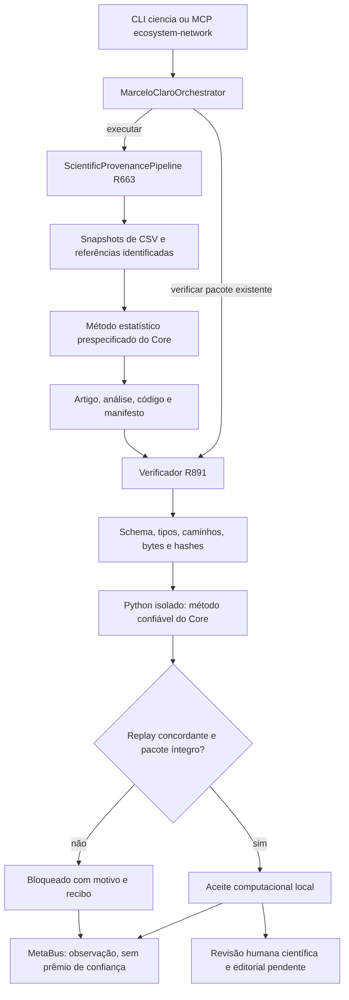

# Artigos e experimentos: aceite computacional local

Este percurso verifica uma análise específica e os artefatos que ela produziu.
Ele não certifica ausência de bugs, qualidade editorial, mérito científico,
autenticidade externa dos dados ou capacidade operacional de um cluster.

## O que foi integrado

O primário `MarceloClaroOrchestrator` mantém a coordenação. A execução R663 gera
CSV preservado, configuração, análise, código de reprodução, metadados de
referências, artigo Markdown e manifesto. Antes de devolver uma nova entrega
como concluída, o primário chama o mesmo verificador R891 disponível na CLI e
no MCP. Uma revalidação posterior pode conferir novamente o pacote entregue.



O pacote recebido nunca fornece o código a executar durante a verificação.
Mesmo que contenha `reproduce.py`, o verificador usa uma cópia privada do
método confiável do Core em Python `-I`, com prazo, memória e arquivos limitados.
Não consulta rede, instala pacotes ou transmite o CSV durante essa operação.
A aquisição de fontes públicas é uma etapa separada e identificada.

## Instalação do perfil

No checkout WSL, use o ambiente do projeto:

```bash
.venv/bin/python -m pip install -r requirements-scientific-profile.txt
.venv/bin/python -m pip check
```

O perfil fixa SciPy e psutil para Python 3.12 ou superior; a CI enumera Python
3.12 e 3.14. Uma verificação local não comprova antecipadamente o resultado de
uma execução futura da CI. O pin Requests também foi alinhado ao requisito da
CLI já instalada; erros do resolvedor não devem ser tratados como instalação
saudável só porque o processo terminou com código zero.

## Executar e revalidar

O formato de configuração da execução permanece o da R663: `question`,
`dataset_csv`, `dataset_provenance`, `method`, `variables`, `output_dir` e,
opcionalmente, `reference_sources`. Métodos: `pearson`, `welch_t` e
`descriptive`. Dados sintéticos não podem ser apresentados como observações
reais. Snapshots fornecidos mantêm sua autenticidade como declaração do responsável.

```bash
.venv/bin/python -m marceloclaro.cli ciencia executar --config estudo.json
.venv/bin/python -m marceloclaro.cli ciencia verificar --config verificar.json
```

Exemplo de `verificar.json` — substitua o caminho pelo pacote existente:

```json
{"package_dir":"/caminho/para/pacote","timeout_seconds":45}
```

No MCP, use `ecosystem_scientific_run` para a execução e
`ecosystem_scientific_verify` para a revalidação, com o mesmo objeto de
configuração dentro de `config`. O comando `/ciencia` do OpenCode também indica
esse percurso. Há um único primário e a mesma decisão em todas as superfícies.
Em sessões MCP já abertas, recarregue a conexão para carregar o código novo;
a verificação desta entrega iniciou um servidor stdio novo.

O aceite exige `status="locally_verified"`, `success=true` e
`local_computational_acceptance=true`. Falhas de integridade, arquivos ausentes,
symlinks, tentativa de acesso fora do pacote, JSON ambíguo/não finito, flags textuais, reprodução
discordante ou prazo excedido bloqueiam a verificação. A CLI retorna código
diferente de zero quando não há aceite. A falha de persistência metacognitiva
também impede o sucesso da operação coordenada.

Pacotes R663 podem ser relocalizados: o verificador abre somente os nomes
internos esperados da pasta informada. Ele não segue os caminhos absolutos
antigos registrados no manifesto. A versão do código estatístico exportado deve
corresponder à versão confiável atual; um pacote antigo incompatível é bloqueado.

## Concordância numérica e limites da evidência

Hashes, recibos e consistência entre documentos continuam exatos. Somente a
comparação do cálculo reexecutado admite arredondamento de ponto flutuante com
`rtol=1e-12` e `atol=1e-12`, declarados no recibo junto à maior diferença.
Tipos, chaves, estrutura e ordem das listas, contagens, seeds, booleanos e
`alpha` permanecem exatos. Números não finitos ou diferenças além do limite são
reprovados. Diferença que transborda o formato numérico gera bloqueio estruturado.

O verificador é específico dos pacotes gerados pelo R663, inclusive do seu
modelo de artigo. Um manuscrito editado posteriormente requer novo pacote e
revisão correspondente; este comando não avalia textos acadêmicos arbitrários.
Metadados bibliográficos não comprovam leitura integral ou sustentação de uma
afirmação. Revisão humana, autoria, ética aplicável, financiamento, conflitos e
decisão de submissão continuam separados do aceite computacional.

## Exemplo executado com dados públicos

A amostra operacional usa [Iris, do UCI Machine Learning Repository](https://archive.ics.uci.edu/dataset/53/iris),
com atribuição ao conjunto original e licença CC BY 4.0 informada pela fonte.
O snapshot de dados e a resposta Crossref foram obtidos por HTTP; o recibo
preserva URLs, horários, bytes e hashes. O CSV completo contém 150 observações;
o exemplo Welch seleciona as 100 observações de duas espécies.

Foram percorridas três superfícies reais, sem inferência de modelo:

| Análise | Entrada e interface | Resultado observado |
| --- | --- | --- |
| Pearson | Comprimento e largura da pétala; CLI → primário | `n=150`, `r=0.9628654314027961` |
| Welch | Largura da pétala, versicolor menos virginica; MCP stdio → primário | `n=100`, diferença `-0.6999999999999997` |
| Descritiva | Comprimento da sépala; primário direto | `n=150`, média `5.843333333333334` |

O artigo Markdown, a análise e o manifesto foram produzidos pelo percurso
R663 e revalidados pelo R891. A relocalização preservou o aceite; alterações
no CSV e no código exportado foram bloqueadas antes do replay. A memória
registrou as operações sem elevar a confiança dos agentes. Os arquivos locais
ficam em `outputs/core-r891/real/`; o resumo versionado registra seus hashes.

Este exemplo confirma execução e rastreabilidade dessa amostra. A correlação
agregada mistura espécies; não é estudo causal nem novo resultado científico.
As premissas estatísticas e a adequação da amostra não foram validadas pelo
software. O texto gerado é uma saída operacional sujeita a revisão humana.

## Estados científicos e busca persistente

A R892 impede conclusão de estágios científicos sem saída válida e remove a
conclusão fictícia de delegações MASWOS. Tarefa postada, agente disponível,
score alto ou string de status não equivalem a execução. Falha de uma banca
obrigatória bloqueia a aprovação; avaliações locais continuam heurísticas.
Confirmação humana exige booleano explícito e não comprova, por si só, identidade
ou autenticidade de uma decisão externa.

A R893 preserva o índice Whoosh entre processos e protege sua criação inicial.
Escrita sem commit não informa documentos indexados. O índice é uma estrutura
de busca derivada, não substitui a memória canônica do MetaBus nem certifica
verdade de conteúdo recuperado. Índices legados sem texto armazenado não devem
ser recriados silenciosamente ou receber conteúdo inventado. Entradas não
textuais são recusadas antes de modificar documentos. A operação destrutiva
`clear()` permanece fora do aceite de concorrência e exige uso exclusivo.

## Regressão operacional enumerada

```bash
.venv/bin/python scripts/validate_scientific_profile.py --output reports/scientific-profile
```

O executor roda cinco grupos seriais: proveniência/entrega, manuscritos,
workflow/memória, integridade de raciocínio e contratos de entrega. Seleções e
exclusões são explícitas no código e no recibo. Cada grupo tem até 180 segundos
e orçamento amostrado de 1.536 MiB para o processo pytest e descendentes;
threads numéricas são limitadas a uma. Não é um limite instantâneo por cgroup.

Um recibo só passa quando coleta, execução e JUnit novos concordam por
identidade de teste. Skip, erro, teste não executado, prazo/memória excedidos,
restos de processos ou mudança de fonte bloqueiam o perfil. Os snapshots
detectam diferenças antes/depois, não alteração transitória revertida durante
o teste. Recibos de rodadas anteriores não são reutilizados como aprovação.

Esse perfil não executa compiladores, GPU, modelos externos ou a suíte global.
A exclusão de um teste não significa que sua funcionalidade passou. O arquivo
da CI conserva relatórios para inspeção; imprimir um hash não constitui
verificação do artefato correspondente.

## Escopo de operação suportado

O aceite local corresponde aos métodos e interfaces efetivamente executados.
Prefira um processo coordenador MCP, com operações serializadas, para escrever
no mesmo estado metacognitivo. A memória JSON existente não oferece transações
multi-host; múltiplos escritores independentes exigem outro aceite operacional.

Escala requer carga e capacidade definidas, medição, recuperação e governança
adequadas ao projeto. Os testes desta entrega não medem essa capacidade nem
substituem revisão científica externa. Consulte os recibos R891–R893 para os
resultados observados, as contraprovas preservadas e os hashes de cada artefato.
## Recibos da entrega R891–R893

O perfil local final executou **863 testes: 863 aprovados, zero falhas, erros ou
skips**, nos cinco grupos enumerados. Os hashes das 3.804 fontes selecionadas
permaneceram iguais entre o início e o fim. Após o teste, somente o estado das
três specs e o acréscimo de três ciclos ao registro foram alterados entre essas
fontes; código, testes, dependências e workflows testados permaneceram iguais.

- [R891: perfil, dados públicos, interfaces e replay](verification-local-r891.json).
- [R892: propagação de falhas e ausência de conclusões fictícias](verification-local-r892.json).
- [R893: persistência, texto recuperado e entradas inválidas](verification-local-r893.json).

A primeira rodada conjunta bloqueada, os REDs e os GREENs continuam preservados
nos caminhos locais e com hashes no recibo. Contagens desses ensaios dirigidos
se sobrepõem; não devem ser somadas ao perfil como testes únicos adicionais.
Os ciclos são locais, sem nota ou declaração de auditoria externa. O resultado
remoto da CI deve ser consultado na execução correspondente no GitHub.

O [recibo posterior ao commit de código](verification-local-r891-index.json)
registra o índice atualizado: 765/765 arquivos selecionados, 8.762 símbolos,
consulta ao novo verificador e percurso MCP real. Três operações de grafo
continuam bloqueadas por contraprovas semânticas. O doctor passou 22/22 em modo
estrutural e carregou os 734 ciclos. O GitHub criou os jobs da nova CI, mas uma
restrição da conta impediu o início dos runners: **nenhuma etapa remota foi
executada**. O aceite remoto permanece pendente; isso não é CI aprovada.
