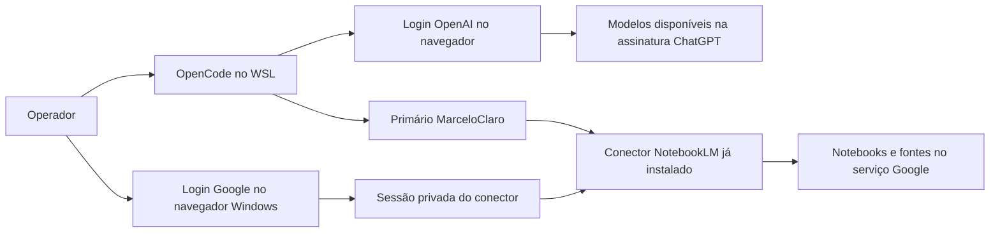

# ChatGPT e NotebookLM no terminal do Core

Inspeção local em 17/10/2026. O operador apresentou a saída `Login successful`
do OpenCode após autorizar a conta ChatGPT pelo navegador. Isso confirma o
resultado informado pelo comando; uma primeira resposta do modelo ainda é
necessária para confirmar inferência. Não foram lidos arquivos de sessão nem
confirmadas cotas da conta. O login Google do NotebookLM é independente.

## ChatGPT pelo OpenCode

A instalação encontrada pelo mesmo `bash -lic` usado pelo operador é o
OpenCode 1.18.35. Seu binário anuncia os métodos **ChatGPT Pro/Plus (browser)**
e **ChatGPT Pro/Plus (headless)**. O comando `auth login` aceita seleção de
provedor e método. Para autorizar pelo navegador:

```powershell
wsl.exe -d Ubuntu --cd /home/marceloclaro/opencode-ecosystem-core -- bash -lic "opencode auth login --provider openai"
```

Selecione **ChatGPT Pro/Plus (browser)** e conclua o login na página da OpenAI.
Também é possível abrir o OpenCode normalmente, executar `/connect`, escolher
OpenAI e o método ChatGPT. Depois use `/models` para escolher um modelo
disponível nessa conexão. A presença de um modelo no catálogo não comprova
permissão ou saldo: somente uma inferência concluída confirma acesso naquele momento.

Esse modo usa autenticação OAuth. Não exige manter o aplicativo ChatGPT aberto
nem colocar usuário/senha no repositório. O navegador pode ser necessário para
autorizar ou renovar o acesso. Não importa automaticamente a conversa atual.
A documentação oficial distingue acesso por assinatura de acesso por chave
de API; disponibilidade e limites dependem da conta e do workspace.

Fonte: [autenticação oficial OpenAI](https://learn.chatgpt.com/docs/auth).
O suporte específico do OpenCode foi observado na instalação local, não
certificado pela documentação da OpenAI.



Os ramos representam autenticações diferentes. O ramo Google fornece pesquisa
com fontes; não transforma NotebookLM em provedor padrão dos modelos OpenAI.

## NotebookLM pelo conector do Core

O executável `.venv/bin/nlm` está instalado e oferece `login --wsl`, que
encaminha o navegador para o Chrome do Windows. Execute no terminal do operador:

```powershell
wsl.exe -d Ubuntu --cd /home/marceloclaro/opencode-ecosystem-core --exec .venv/bin/nlm login --wsl
```

Entre na conta Google na janela de login. Confirme a conexão no seu terminal:

```powershell
wsl.exe -d Ubuntu --cd /home/marceloclaro/opencode-ecosystem-core --exec .venv/bin/nlm login --check
```

Depois use `/gemini-notebook` no OpenCode. Solicite primeiro o estado e o
catálogo, depois a operação concreta no notebook desejado. A fachada existente
é `ecosystem_gemini_notebook`; todas as ações passam pelo MarceloClaro.
Criação, exclusão e compartilhamento têm seus próprios gates.

Essa CLI é um conector comunitário baseado na sessão do navegador. Não é uma
API oficial de conta pessoal, e mudanças do serviço podem interrompê-la.
NotebookLM processa fontes na infraestrutura Google; esse percurso não é offline.
Não compartilhe senha, cookies ou arquivos de autenticação no chat/repositório.

O serviço oficial Enterprise possui API e requer projeto, permissões e
licenciamento próprios. Não confunda login pessoal do navegador com essa API:
[documentação Google](https://docs.cloud.google.com/gemini/enterprise/notebooklm-enterprise/docs/api-notebooks).
Para uso normal, adicione documentos e consulte as fontes no
[NotebookLM](https://notebooklm.google.com/), conforme a
[ajuda de fontes do Google](https://support.google.com/gemininotebook/answer/16215270?hl=pt-BR).

## Contribuição e limites do REA

REA 6.4.0 analisou estaticamente o pacote instalado `opencode-ai`: quatro
arquivos relevantes, um JavaScript analisado, 839 nós AST e 12 achados.
SHA-256 da resposta preservada:
`f15c529c4a3abc45168ebe633256f877c789f31396c3b611f4d30002332426c8`.
O grafo recuperado manteve 154 desconhecidos sem convertê-los em prova de execução.

A tentativa de analisar diretamente `notebooklm_tools/services/auth.py` foi
recusada como alvo incompatível pelo analisador JavaScript. Essa falha foi
preservada, SHA-256 `457926db27dfc85c96d8340af6f0cc898f9feaa91dd8dbf739ff7290ab9bda27`.
Não se alegou decompilação Python. A inspeção foi complementada pela leitura
do código público instalado e da ajuda da CLI. O executável OpenCode possui
185.690.240 bytes, acima do limite de 128 MiB da operação nativa do Core;
não foi submetido a Ghidra para contornar esse limite.

Os métodos OAuth foram identificados em texto estático do binário. A evidência
de login veio posteriormente da saída apresentada pelo operador, e não dessa
análise estática. Ainda não foi observada uma inferência da conta nesta revisão.
Veja também [integração Notebook no Core](GEMINI_NOTEBOOK_CORE.md).

## Chat Gemini pelo terminal

O Gemini CLI oficial também permite autenticar uma conta Google pelo navegador,
sem cadastrar chave de API nesse modo. Na inspeção local, `gemini --version`
reportou 0.61.0. Para abrir o cliente instalado:

```powershell
wsl.exe -d Ubuntu --cd /home/marceloclaro/opencode-ecosystem-core -- bash -lic "gemini"
```

Selecione **Sign in with Google**. Contas individuais normalmente não precisam
de projeto Google Cloud, com exceções descritas na
[documentação oficial](https://geminicli.com/docs/get-started/authentication/).
Elegibilidade e limites dependem da conta. Esta inspeção confirmou a instalação;
o operador apresentou posteriormente a confirmação de autorização Google.
Uma resposta do Gemini CLI dessa conta ainda não foi observada nesta revisão.

O login do Gemini CLI é independente do conector NotebookLM. Não importa
conversas do site Gemini nem configura automaticamente um provedor no OpenCode.
O adaptador `integrations/gemini_cli.py` permite execução externa pelo Core,
mantendo a coordenação do MarceloClaro e a necessidade de verificar cada resposta.

## Atualização de verificação R916 — 18/10/2026

Foram observadas respostas dos modelos solicitados GPT-6 Luna e GPT-6.1 Sol
pelo cliente OpenCode, em sondas sintéticas isoladas e com critérios explícitos.
Isso confirma somente essas chamadas naquele momento. O primeiro ensaio de
Luna falhou no conteúdo, embora o processo tenha concluído.

O Gemini CLI 0.61.0 recusou a solicitação da conta com UNSUPPORTED_CLIENT
e indicou migração para Antigravity. Também relatou diretório temporário não
confiável. A autorização Google apresentada anteriormente não comprova
elegibilidade deste cliente para inferência. Antigravity não foi autenticado
ou testado por esta revisão, e nenhum token foi reutilizado para contornar o gate.

Consulte [modelos e custo de tokens](MODELOS_E_CUSTO_DE_TOKENS.md) e o
[recibo das quatro sondas](evidence/r916/model-selection.json). As afirmações
acima, datadas de 17/10, conservam o alcance histórico da inspeção inicial.
