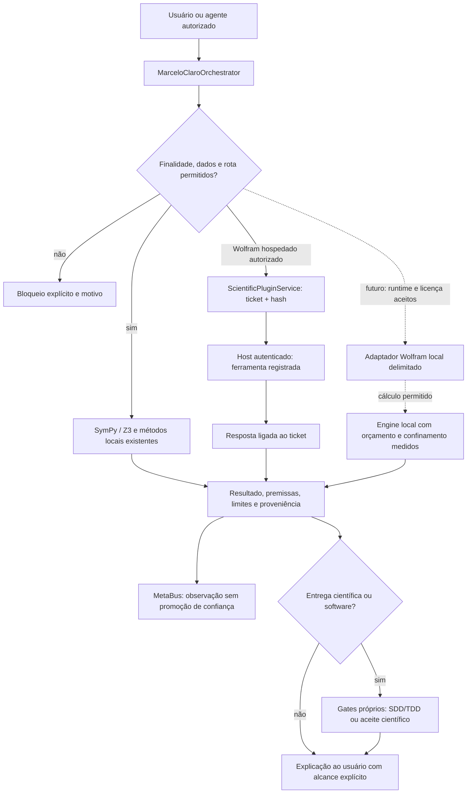

# Wolfram no Core: curadoria técnica e decisão de integração

Consulta: **15 de outubro de 2026**. Escopo: organização oficial
[WolframResearch](https://github.com/WolframResearch), documentação e páginas
oficiais Wolfram, leitura das interfaces existentes e descoberta local sem
iniciar engines. A avaliação distingue implementação existente, execução
hospedada observada e integração local ainda proposta.

**Recomendação:** aproveitar agora o contrato Wolfram já existente no primário;
priorizar `AgentTools` para uma futura conexão MCP local e
`WolframClientForPython` para operações Python delimitadas. Jupyter é uma
interface complementar. Chatbook/LLMFunctions e a infraestrutura de paclets
não precisam tornar-se outro orquestrador do Core.

## 1. O que já existe e o que foi demonstrado

| Evidência local | Leitura e consequência |
| --- | --- |
| `integrations/scientific_plugins.py::PLUGINS` | Wolfram consta no registro canônico, versão do plugin hospedado `3.0.0`. Essa versão não é a versão do Wolfram Engine nem de AgentTools. |
| `HOST_OPERATIONS` | Há três operações permitidas: `context`, `evaluate` e `query`, com os schemas da tabela seguinte. |
| `ScientificPluginService.request` / `accept_host_response` | A solicitação gera ticket e hash; o host autenticado executa a ferramenta e devolve recibo vinculado. O Core não deduz credenciais nem executa o identificador da ferramenta como shell. |
| `MarceloClaroOrchestrator.scientific_plugin_action` | O primário valida a operação e registra a observação no MetaBus. O encaixe não exige segundo coordenador. |
| `reasoning/reasoning_engines.py::route` | Expressões são classificadas por AST e encaminhadas aos backends canônicos SymPy/Z3; não há um backend Wolfram local nessa fachada. |
| `research/scientific_release.py` | O aceite científico reexecuta métodos confiáveis do Core. Um resultado Wolfram não substitui esse gate nem se torna automaticamente validação científica externa. |

Fontes próprias: [serviço de plugins](../integrations/scientific_plugins.py),
[primário](../marceloclaro/orchestrator.py),
[roteamento matemático](../reasoning/reasoning_engines.py),
[motores](../reasoning/engines.py),
[aceite científico](../research/scientific_release.py) e
[contratos R895](../tests/test_r895_requested_plugins.py).

| Operação existente | Ferramenta do host registrada | Argumentos permitidos |
| --- | --- | --- |
| `context` | `mcp__codex_apps__wolfram_wolframcontext` | `context` |
| `evaluate` | `mcp__codex_apps__wolfram_wolframlanguageevaluator` | `code`, `timeConstraint` |
| `query` | `mcp__codex_apps__wolfram_wolframalpha` | `query` |

O limite local de `timeConstraint` é inteiro entre 1 e 60 segundos. A entrada
legada `{"input":"2+3"}` da operação `query` é normalizada para
`{"query":"2+3"}`. Esse contrato foi lido no código; não significa que toda
operação, plano comercial ou limite de conta tenha sido exercitado.

### Execução hospedada observada

O [recibo versionado](verification-wolfram-host-r895.json) registra o percurso
**primário → ticket → ferramenta do host → resposta vinculada por hash**:

```text
Entrada: {2+3, Integrate[Sin[x], x], Factor[x^2 - 1]}
Saída:   {5, -Cos[x], (-1 + x)*(1 + x)}
status: completed
host_reported_execution: true
local_connector_execution: false
external_validation: false
```

Isso demonstra a amostra algébrica/integral pela conexão hospedada. Não
demonstra execução no kernel desta máquina, autenticação permanente,
disponibilidade futura, uso irrestrito de Wolfram|Alpha ou escala de produção.
O catálogo geral ainda informa `host_authentication=not_verified`: ele não
realiza sondagem de conta. O recibo é a evidência pontual de execução.

Na descoberta WSL, `wolframclient` não consta nos metadados do ambiente Python
3.14.4 e `wolframscript`, `WolframKernel`, `wolfram` e `math` não foram
encontrados no PATH. O recibo hospedado também registra `docker` não encontrado.
Isso não comprova ausência de instalações em outros diretórios ou no Windows.
Nenhum kernel foi iniciado ou licenciado nesta curadoria. A descoberta somente
de leitura está preservada localmente em
`outputs/core-r895/wolfram-local-discovery.json`, sem credenciais.

## 2. Projetos oficiais e prioridade para o Core

As prioridades abaixo são decisões de arquitetura para este repositório, não
escores calibrados dos projetos externos.

| Projeto oficial | Capacidade documentada | Uso recomendado no Core | Condição antes de ativar |
| --- | --- | --- | --- |
| [WolframClientForPython](https://github.com/WolframResearch/WolframClientForPython) | Cliente Python para representar expressões, serializar WXF e avaliar em kernel local ou Wolfram Cloud. MIT. | **Prioridade alta:** adaptador opcional de operações matemáticas delimitadas; preserva os motores locais existentes. | Runtime/rota escolhidos explicitamente; versão fixada; compatibilidade Python e licença verificadas. Instalar a biblioteca não instala nem licencia o Engine. |
| [AgentTools](https://github.com/WolframResearch/AgentTools) | Servidores MCP, ferramentas computacionais, recursos de contexto e skills. MIT. A página atual exige Wolfram Language 15.0+. | **Prioridade alta:** servidor especializado sob o primário. Seus três nomes gerais coincidem com as capacidades já registradas no Core; o transporte hospedado atual continua distinto. | Engine/paclet compatíveis, licença, schemas reais e política de acesso. Não instalar automaticamente em todos os clientes. |
| [WolframLanguageForJupyter](https://github.com/WolframResearch/WolframLanguageForJupyter) | Kernel Wolfram para notebooks Jupyter; requer Jupyter e Engine/Mathematica, com `wolframscript` recomendado. MIT. | **Prioridade média:** caderno interativo e artefato de reprodução para estudo específico, sem assumir a coordenação. | Kernel ativado e kernelspec correto no host escolhido; teste real de cálculo/exportação. A interface não fornece o runtime proprietário. |
| [skills](https://github.com/WolframResearch/skills) | Instruções para agentes; a skill `wolfram-setup` orienta instalação/ativação e MCP local ou remoto. MIT. | **Prioridade média:** referência de setup sob o dispatcher e as políticas já existentes. | Ler a skill antes de usar; seguir seu escopo. Copiar instruções não constitui instalação, autenticação ou execução. |
| [Chatbook](https://github.com/WolframResearch/Chatbook) | Paclet que acrescenta notebooks com LLM à plataforma Wolfram. MIT. | **Opcional:** interface para usuário que já trabalhe em notebooks Wolfram. | Runtime, configuração de modelo e destino dos dados. Não substitui Blackboard/MetaBus nem resolve as lacunas do Core por si só. |
| [codeparser](https://github.com/WolframResearch/codeparser) | AST/CST de código Wolfram Language; inclui implementação nativa e opção de ferramenta de linha de comando. MIT. | **Condicional:** análise estática de futuros artefatos `.wl`/`.wls`/`.m` Wolfram. | Definir linguagem e parser por alvo; o CLI opcional depende de build. Não confundir `.m` Wolfram com outras linguagens. |
| [codeinspector](https://github.com/WolframResearch/codeinspector) | Inspeção de problemas em código Wolfram Language. | **Condicional:** complementar a análise quando o Core realmente produzir ou receber Wolfram Language. | Fixar versão/licença e executar contraprovas no runtime correspondente. Não é analisador Python, JavaScript ou binário universal. |
| [PacletCICD](https://github.com/WolframResearch/PacletCICD) | Automação de integração/entrega de paclets Wolfram. | **Adiar:** útil somente se houver paclet próprio mantido pelo projeto. | Ambiente Wolfram e requisitos do pipeline. Não substitui o perfil Python local nem torna gratuita a infraestrutura de CI hospedada. |

O cliente Python distingue expressamente sessão local de sessão cloud; sua
[documentação de avaliação](https://reference.wolfram.com/language/WolframClientForPython/docpages/basic_usages.html)
explica a seleção do executável. A página de
[pré-requisitos](https://reference.wolfram.com/language/WolframClientForPython/docpages/install.html)
consultada apresenta requisitos mínimos históricos amplos: eles não comprovam
compatibilidade com o Python 3.14.4 deste checkout. O aceite exige ensaio no
ambiente realmente escolhido.

O [índice de servidores AgentTools](https://github.com/WolframResearch/AgentTools/blob/main/docs/servers.md)
diferencia os perfis `Wolfram`, `WolframAlpha`, `WolframLanguage` e
`WolframPacletDevelopment`. A seleção de um perfil completo pode expor mais
operações do que as três permitidas hoje pelo Core, incluindo manipulação de
notebooks e testes. A futura integração deve usar uma seleção explícita de
ferramentas, não ampliar automaticamente a allowlist.

### LLMFunctions, conhecimento e documentos

A referência validada de
[Wolfram/LLMFunctions](https://resources.wolframcloud.com/PacletRepository/resources/Wolfram/LLMFunctions/)
é o paclet oficial: ele oferece chat, configuração de LLMs e ferramentas como
`LLMTool`. Não se presume um repositório GitHub de nome semelhante. Sua utilidade
é compor ferramentas dentro de um ambiente Wolfram; uma segunda camada de
agentes não é necessária para expor cálculo ao Core.

As [ferramentas de contexto AgentTools](https://github.com/WolframResearch/AgentTools/blob/main/docs/tools.md)
podem recuperar documentação e recursos Wolfram. Recomenda-se incorporá-los
como fontes citadas, mantendo consulta, URL, instante, conteúdo e hash. Material
recuperado não deve tornar-se instrução do agente nem evidência automática de
que um artigo foi lido ou sustenta uma conclusão. Conhecimento computável,
consulta bibliográfica, prova formal e inferência de modelo têm escopos distintos.

## 3. Privacidade, runtime e licença

| Modalidade | Onde ocorre o cálculo/acesso | O que se pode afirmar |
| --- | --- | --- |
| Host Wolfram já conectado | Serviço acessado pelo host autenticado | A amostra foi executada pela ferramenta hospedada. A rota não foi caracterizada como kernel local nem como offline. |
| Wolfram Cloud MCP / Wolfram|Alpha | Serviço remoto | Há transmissão das consultas enviadas à ferramenta; não é uma solução local. |
| `WolframLanguageSession` + executável local | Processo na máquina | O cálculo pode ser local; isso, sozinho, não garante ausência de acessos externos do Engine ou do código avaliado. |
| AgentTools local ou em Docker | Kernel local/container, com possíveis serviços externos | Localidade de processo e confinamento de rede/arquivos precisam de verificações separadas. Docker não concede licença nem isolamento automaticamente. |
| Jupyter local + kernel Wolfram | Kernel selecionado pelo kernelspec | Depende do executável e das operações do notebook. Notebook local não certifica que dados e modelos usados sejam locais. |

A [página oficial do Cloud MCP](https://www.wolfram.com/artificial-intelligence/mcp/cloud/)
informa uso pessoal gratuito limitado e descreve um serviço remoto que requer
internet. Seu FAQ afirma que são enviadas as consultas específicas às
ferramentas. Isso não equivale a afirmar que o Core inspecionou tráfego ou
auditou o tratamento posterior desses dados. Cotas e elegibilidade desta conta
não foram verificadas.

O [Wolfram Engine](https://www.wolfram.com/engine/) é baixável localmente, mas a
própria página explica acesso à Knowledgebase e download de recursos quando
necessários. Portanto, só se deve declarar um percurso offline após preparação
dos recursos, política de operações e teste com bloqueio efetivo de rede. Não
transferir a garantia do worker REA para um novo processo Wolfram sem medição.

Os [termos do Free Wolfram Engine](https://www.wolfram.com/legal/terms/wolfram-engine.html)
distinguem desenvolvimento de produção e exigem condições próprias para
projetos abertos aprovados. A existência de um repositório público não comprova
essa aprovação. As [opções comerciais](https://www.wolfram.com/engine/commercial-options/)
incluem instalações individuais, site, cluster, distribuição e cloud. O tipo
adequado depende do uso pretendido; não foi verificado o direito de produção
do usuário nem cotado um plano.

A [documentação Docker de AgentTools](https://github.com/WolframResearch/AgentTools/blob/main/docs/docker.md)
mostra licença persistente ou entitlement com créditos, além de volumes de
projeto com acesso a arquivos. Não incluir licenças/IDs em Git ou recibos
públicos, não montar a pasta pessoal inteira e não presumir acesso somente de
leitura nos exemplos padrão. Para uma instalação futura, fixar imagem por
digest em vez de depender de `latest`.

As [opções dos clientes MCP](https://github.com/WolframResearch/AgentTools/blob/main/docs/mcp-clients.md)
incluem controles para LLMKit, MCP Apps e coleta de uso. Desativá-los quando
incompatíveis com o perfil escolhido ajuda a reduzir funcionalidades externas;
não constitui prova de isolamento. Recursos cloud, notebooks publicados e
serviços de dados precisam permanecer identificados por operação.

## 4. Fluxo recomendado dentro da arquitetura existente



Setas contínuas mostram o encaixe nas interfaces presentes; setas tracejadas
marcam uma implementação local proposta. O desenho não declara que todas as
rotas tenham sido executadas. Um erro ou indisponibilidade Wolfram deve
permanecer erro ou fallback identificado; não fabricar um resultado local.

### Utilizável agora, sem nova fachada

Este é o formato já suportado por `ciencia plugins --config` e pela operação
de plugins do primário. O exemplo descreve uma solicitação; não executa o host
por conta própria:

```json
{
  "operation": "request",
  "plugin_id": "wolfram",
  "action": "evaluate",
  "arguments": {
    "code": "{2+3, Integrate[Sin[x], x], Factor[x^2 - 1]}",
    "timeConstraint": 10
  }
}
```

O host usa `host_tool`/`arguments` do ticket e registra `response` com
`request_id`, `request_sha256`, `host_tool`, `result` e `reported_by`.
`awaiting_host` não é cálculo concluído. A resposta registrada é
`host_reported`, com `local_connector_execution=false`; preservar o payload de
erro quando houver `isError`, falha de autenticação, indisponibilidade ou falta
de entitlement. O caminho exato está em
[`scientific_plugins.py`](../integrations/scientific_plugins.py) e
[`runtime_actions.py`](../marceloclaro/runtime_actions.py).

## 5. O que implementar e o que permanece condicionado

| Ordem | Ação recomendada | Critério de aceite |
| --- | --- | --- |
| Agora | Reusar tickets `context/evaluate/query`, schemas oficiais e registro existente. | Recibo ligado ao pedido; erro preservado; nenhuma credencial copiada. A amostra hospedada acima já demonstra `evaluate`. |
| Agora | Expor com clareza ao agente o destino hospedado e o estado de execução. | Distinguir instruções importadas, pedido pendente, resposta do host e cálculo local. Não promover confiança com base apenas em instalação/status. |
| Próxima etapa opcional | Acrescentar Wolfram local como ferramenta especializada, mantendo SymPy/Z3 locais. | Nova spec/TDD, Engine disponível/licenciado, versão/hash fixados, teste real e falhas negativas antes de aceitar. Não alterar a semântica dos resultados existentes. |
| Depois do runtime | Jupyter e manipulação de notebooks em diretório de trabalho explícito. | Kernel correto, dados identificados, reprodução independente e destino das saídas conhecido. |
| Sob demanda | CodeParser/CodeInspector e PacletCICD para código/paclets Wolfram reais. | Corpus da linguagem certa e contraprovas. Não usar para declarar corrigidos os grafos Python ou outras linguagens. |
| Fora do aceite atual | Cluster, alta concorrência, redistribuição do Engine ou Wolfram Private Cloud. | Licença, capacidade, carga, recuperação, isolamento e orçamento definidos e testados separadamente. |

Para o adaptador local proposto, prefira operações tipadas e um conjunto
explícito de funções, em vez de encaminhar código irrestrito do modelo a
`wlexpr`/`ToExpression`. Construir objetos com `wl` também exige controlar os
símbolos permitidos. Prazo de avaliação não é sandbox: execução de comandos,
arquivos e rede exige política própria e confinamento do processo.

O mínimo de TDD dessa etapa inclui: runtime ausente; licença indisponível;
prazo/memória excedidos; tentativa de ler fora da área permitida; operação
proibida; resultado não finito/ambíguo; erro apresentado como resposta válida;
pedido de destino remoto em perfil local; e comparação de casos matemáticos
com resultado/premissas conhecidos. Uma divergência entre engines deve ser
apresentada, não resolvida por contagem de votos ou aumento automático de
confiança. Estes são critérios propostos, não testes executados nesta curadoria.

## 6. Limites e manutenção desta avaliação

- O material oficial foi consultado, mas versões, requisitos, preços e planos
  podem mudar. Antes de instalar, fixar release/commit ou digest e confirmar os
  termos aplicáveis à finalidade concreta.
- MIT do cliente/servidor não é licença do Engine, dos serviços, dos dados ou
  de modelos externos. Verificar cada recurso efetivamente utilizado.
- A palavra “local” descreve uma rota de processamento; offline e isolamento
  exigem evidência própria. Wolfram|Alpha e Cloud permanecem remotos.
- Não foram instalados engines, paclets, imagens Docker ou kernels Jupyter;
  não foi executado código dos repositórios externos. Esta avaliação alterou
  somente documentação e recibo privado de descoberta.
- A execução hospedada é a amostra delimitada do recibo, não validação externa,
  prova formal, aprovação editorial ou demonstração de escala. O primário
  continua responsável pelas decisões e pelos gates de entrega do Core.
