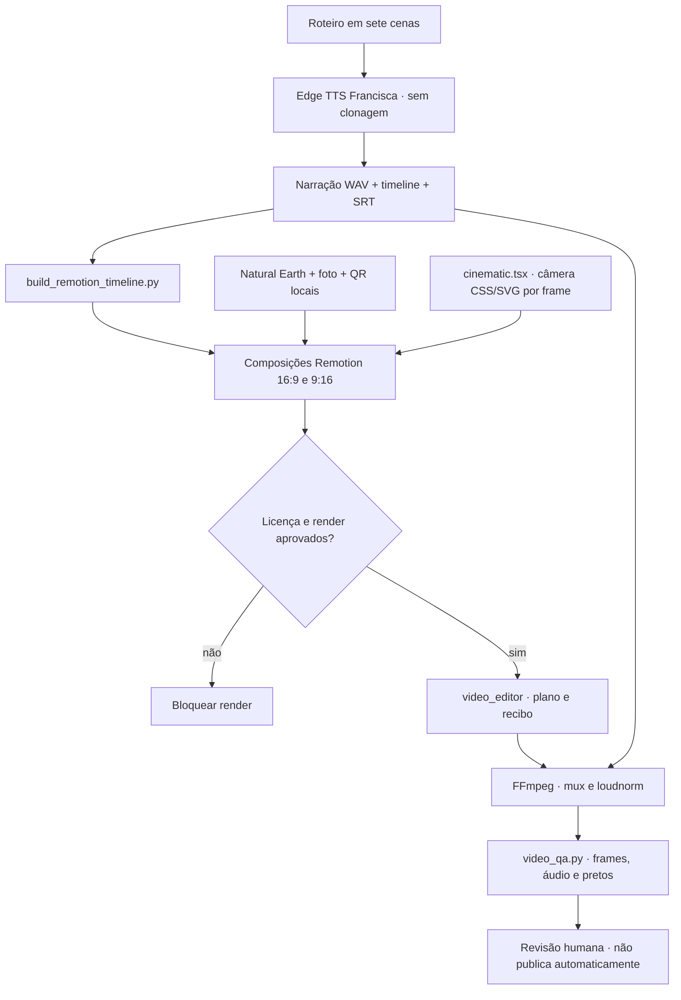

# Câmera cinematográfica e motion auditável no Remotion — R1055

Este documento registra a pesquisa de efeitos, plugins e skills de motion
graphics usados como referência e a implementação reutilizável que passou a
integrar o Core. A implementação é **original** e não copia código de
terceiros; os padrões de ofício foram estudados e reescritos para a linguagem
do projeto.

## Pipeline audiovisual R1055

[Piloto](../pilots/r1055-qubit/README.md) ·
[Roteiro](../pilots/r1055-qubit/SCRIPT.md) ·
[Referências](../pilots/r1055-qubit/REFERENCES.md) ·
[QC/hashes](../reports/r1055/README.md) ·
[Versão animada do diagrama](architecture/ANIMATED.md).

<!-- svg-presentation:diagram-a5f718c8b3d6d219 -->


<sub>[GIF](architecture/animated/diagram-a5f718c8b3d6d219.gif) · [PNG](architecture/animated/diagram-a5f718c8b3d6d219.png) · [Fonte Mermaid](architecture/animated/diagram-a5f718c8b3d6d219.mmd)</sub>

<details>
<summary>Fonte Mermaid (auditoria)</summary>



</details>

O diagrama documenta a composição do piloto, não uma execução nova. Os MP4
locais duram 109,73 s; código e recibos estão no commit `c800112d`.
O QC não comprova precisão científica, inteligibilidade ou qualidade estética.

## 1. O que foi pesquisado

| Fonte | Licença | O que foi aproveitado | O que não foi usado |
|---|---|---|---|
| [Remotion Docs](https://www.remotion.dev/docs/) | Remotion License; conferir termos por versão/uso | `interpolate`, `spring`, `Easing`, `useCurrentFrame`, `staticFile` | Nenhum plugin novo |
| [Claude Remotion Skill](https://github.com/haidrrrry/claude-remotion-skill) | MIT | Ken Burns, parallax, entradas com 2–3 propriedades, stagger, respiração, regra “render → inspecionar → corrigir” | Não foi instalado como skill; nenhum código copiado |
| [Motion Canvas](https://github.com/motion-canvas/motion-canvas) | MIT | Ideia de câmera como nó de cena e interpolação com easing | Não integrado (stack diferente) |
| [Manim Community](https://github.com/ManimCommunity/manim) | MIT | Câmera 3D, zoom e composição matemática | Não integrado (Python/Scene) |
| [Theatre.js](https://github.com/theatre-js/theatre) | Apache-2.0 | Noção de keyframes e timeline visual | Não integrado |
| [GSAP](https://gsap.com/) | licença padrão (não open source) | Referência de timeline | Não usado |
| [OpenTimelineIO](https://github.com/AcademySoftwareFoundation/OpenTimelineIO) | Apache-2.0 | Referência de interoperabilidade de timeline | Não usado |
| [Blender](https://www.blender.org/) | GPL | Referência de câmera 3D | Não usado no render |

A escolha foi **não adicionar dependências**: o render já é caro e o guard do
Remotion exige aprovação explícita. A câmera foi implementada com APIs que já
estão no projeto.

## 2. Módulo `cinematic.tsx`

Arquivo:
`editor-workspace/remotion-smoke/src/r1055-qubit/cinematic.tsx`

### API

```tsx
<SceneCamera
  index={2}
  options={{
    zoomFrom: 1,
    zoomTo: 1.04,
    focusAt: SCENES[2].captions[2]?.startFrame,
    focusZoom: 1.09,
    panX: -8,
    shakeAt: SCENES[2].captions[2]?.startFrame,
    shakeAmount: 6,
  }}
>
  {/* conteúdo da cena */}
</SceneCamera>
```

- `index`: índice da cena em `SCENES`; a câmera usa `startFrame`/`endFrame`.
- `zoomFrom`/`zoomTo`: zoom base com `Easing.inOut(Easing.cubic)`.
- `focusAt`: referência global da batida; a transição começa 12 frames antes
  e atinge o pico 20 frames depois. Não é alinhamento palavra a palavra.
- `focusZoom`: zoom no pico; o valor decai para 45% do push até o fim.
- `panX`/`panY`: deslocamento suave em px.
- `shakeAt`/`shakeAmount`: shake com decaimento exponencial (7 frames).
- `breathe`: oscilação vertical de ±1,1 px, sempre ativa, para evitar rigidez.

`TravelingPulse` é um helper disponível. O feixe do piloto é implementado
separadamente por `CorrelationBeam` em `QubitExplainer.tsx`. Seu movimento é
ilustrativo: emaranhamento não transmite sinais entre os qubits.

### Regras de segurança visual

1. Margens precisam ser inspecionadas em cada composição; não há teste
   geométrico automatizado que garanta 25 px em todos os frames.
2. O zoom incide sobre o conteúdo da cena, **nunca** sobre a legenda global;
   a legenda fica fora do `SceneCamera`.
3. O pico do zoom é ancorado no início da legenda, não em um percentual
   arbitrário.
4. O shake é curto (decaimento de 7 frames) e ≤6 px; não desloca o QR do
   cartão final.
5. Toda interpolação usa `extrapolateLeft/Right: 'clamp'` e easing; não há
   interpolação linear.
6. Entradas combinam opacidade + translate + escala; nunca só fade.

## 3. Esfera de Bloch

`BlochSphere` em `QubitExplainer.tsx` foi ampliada com:

- wireframe 3D: cinco latitudes e três longitudes;
- `phase`: rotação do vetor em torno do eixo vertical, com profundidade;
- `glow`: aura radial que respira;
- `mixed`: estado misto com halo pulsante no centro (sem vetor);
- `collapsed`: vetor no polo, usado quando a medição é mostrada;
- trail e blur óptico no vetor.

Ela é compartilhada pelas composições 16:9 e 9:16. O rótulo e as cores são
passados por cena; não há estado global.

## 4. Câmera do mapa

O mapa usa uma câmera própria (`QubitMap.tsx`) com:

- conversão latitude/longitude → pixel;
- keyframes de escala, longitude e latitude;
- modo “banda” no vertical, em que o mapa vira uma faixa central e a síntese
  ocupa o espaço abaixo;
- marcadores pulsantes com `cue` derivado das legendas;
- rótulos que desaparecem com o zoom e voltam como clusters;
- anéis dourados do Nobel.

A sequência de câmera é: Europa (2,9×) → EUA (2,6×) → Atlântico (0,62× no
vertical; 1,05× no 16:9).

## 5. Verificação

```bash
# stills de controle
node node_modules/@remotion/cli/remotion-cli.js still \
  src/r1055-qubit/EntryQubit.tsx QubitExplainer /tmp/still.png --frame=1600

# QC do master
python3 scripts/video_qa.py --video pilots/r1055-qubit/out/qubit-master-final.mp4 \
  --out pilots/r1055-qubit/out/qa-final.json --expect-frames 3292 \
  --expect-fps 30/1 --loudness-target -14 --loudness-tolerance 1.0 \
  --max-true-peak -1.5 --max-silence 4.0 --max-black 0.2
```

O ciclo obrigatório é **render → extrair frames → olhar → corrigir →
re-renderizar**. Nenhum master é declarado pronto só porque o comando
terminou.

## 6. Limites

- A câmera é 2D (transformações CSS/SVG); não há profundidade de campo real
  nem motion blur de múltiplas camadas. Isso reduz custo e mantém o render
  determinístico.
- O módulo não substitui direção de arte: ele dá ritmo, não decide o que
  mostrar.
- A skill de referência é MIT; o código deste módulo é original do projeto.
