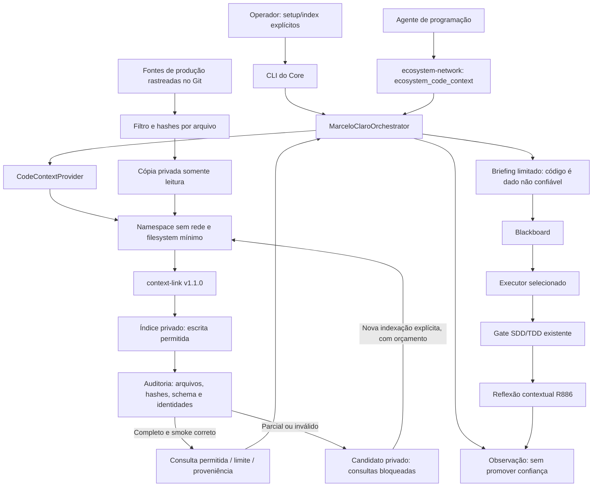

# Contexto de código local — R887

O primário MarceloClaro consulta um provedor context-link isolado. O retorno
entra no mesmo briefing metacognitivo entregue ao executor pelo Blackboard;
as observações ficam no MetaBus. Não há um segundo coordenador ou outra memória.



## Configuração e uso

Na raiz do checkout, use o Python do ambiente do Core:

```bash
.venv/bin/python -m marceloclaro.cli code-context setup
.venv/bin/python -m marceloclaro.cli code-context index --timeout 120
.venv/bin/python -m marceloclaro.cli code-context status
.venv/bin/python -m marceloclaro.cli code-context query --tool get_code_by_symbol --arguments '{"symbol_name":"MarceloClaroOrchestrator"}'
.venv/bin/python -m marceloclaro.cli code-context query --tool get_file_skeleton --arguments '{"file_path":"mci/metacognitive_loop.py"}'
```

`setup` baixa somente o asset fixado, confere tamanho/digest e preserva a licença.
A consulta comum não instala, baixa pesos ou reindexa automaticamente. Os dados
ficam em `.mci_state/code_context`, fora dos arquivos fonte e fora do Git.
O piloto requer Linux x86_64, bubblewrap e prlimit funcionais. A indexação e as
consultas têm rede bloqueada; indisponibilidade do isolamento bloqueia a operação.

No OpenCode, `/code-context` usa a fachada do MCP já existente. Em clientes MCP:

```json
{"operation":"query","tool":"semantic_search_symbols","arguments":{"query":"persistir reflexão contextual","top_k":3},"timeout_seconds":30}
```

A fachada MCP permite somente `status` e `query`; indexação e instalação passam
pela ação explícita da CLI. Delegações com capacidades `python`, `coding`,
`code_review`, `software` ou `python_development` consultam o índice pronto para
compor contexto. Fontes alteradas exigem nova indexação; não se usa conteúdo
obsoleto como se fosse atual. O [aceite integral R889](INDEXACAO_INTEGRAL_R889.md)
exige auditoria do banco e retomada explícita de candidatos parciais. Um código
de saída zero com ping bem-sucedido não é suficiente para declarar prontidão. As permissões do executor e o gate SDD continuam
responsáveis pela entrega: recuperar código não comprova sua correção.

## Ferramentas e limites observados

| Consulta | Estado do piloto |
|---|---|
| `ping` | Habilitada: transporte MCP |
| `semantic_search_symbols` | Habilitada: similaridade não calibrada |
| `get_code_by_symbol` | Habilitada: trecho de fonte indexada |
| `get_file_skeleton` | Habilitada: estrutura estática |
| `get_symbol_usages` | Bloqueada: contraprova semântica em Python |
| `get_call_tree` | Bloqueada: contraprova semântica em Python |
| `get_blast_radius` | Bloqueada: contraprova semântica em Python |

O teste real com `calculate()` chamando `add()` encontrou arestas ausentes e
uma atribuição incorreta de caller na versão fixada. O Core retorna
`blocked_semantic_validation` para essas três consultas. Não há fallback
fabricado nem alegação de grafo completo. A lista nativa é inspecionada no
handshake, mas anunciar uma ferramenta não comprova seu resultado.

Corpus: fontes Git selecionadas, sem testes, documentação, histórico, binários,
symlinks e marcadores de segredos. O filtro é uma política de escopo e detecção
heurística; não constitui certificação de ausência de segredos. Índice/cache
podem receber escrita; as fontes originais não são montadas no processo filho.
Briefings delimitam conteúdo e proveniência; truncagem é declarada.

## Medida e evidências

O contador interno do provedor estima tokens por bytes/4; essa estimativa não
é usada como consumo real, redução financeira ou benefício ao agente. A comparação
local utiliza perguntas fixas, trechos equivalentes, bytes e chamadas, separando
negociação/schema. Os testes herméticos não substituem o smoke nativo.

Consulte `verification-local-r887.json` para o escopo efetivamente executado,
resultados e limitações; os arquivos em `outputs/core-r887` guardam os recibos
locais detalhados. R886 possui recibo histórico separado. A execução da suíte
inteira do Core permanece incompleta; as regressões desta etapa são dirigidas.
