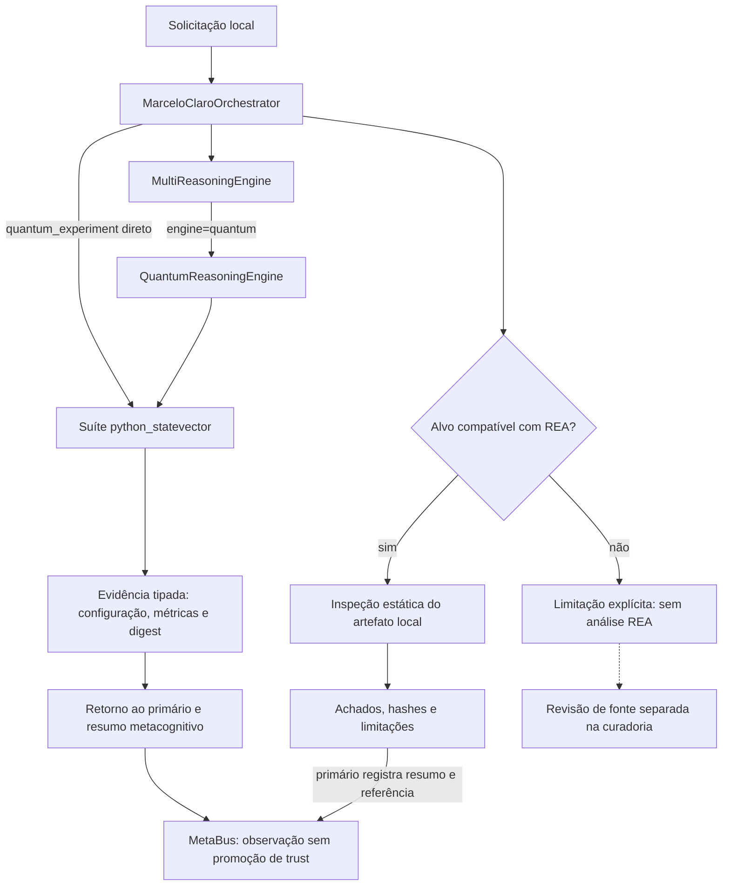

# Decisões de adaptação dos quinze repositórios — R890

Data de referência: 14 de outubro de 2026. Este documento consolida os levantamentos [A](AVALIACAO_REPOS_R890_A.md), [B](AVALIACAO_REPOS_R890_B.md) e [C](AVALIACAO_REPOS_R890_C.md), com seus [manifestos A](repo-reviews-r890-a.json), [B](repo-reviews-r890-b.json) e [C](repo-reviews-r890-c.json). As decisões correspondem aos commits examinados dos forks; não afirmam atualização das respectivas origens.

A mudança efetiva escolhida foi corrigir o contrato do simulador clássico já existente no Core. As demais contribuições permanecem referências ou propostas, sem instalar os quinze runtimes, conectar contas ou ativar voz, hardware e serviços. `MarceloClaroOrchestrator` continua como primário; Blackboard e MetaBus mantêm seus papéis de coordenação e memória.

## Legenda de decisão

- **Padrão aplicado:** conceito reimplementado no código existente do Core, com origem e limites declarados; não significa instalação do projeto externo.
- **Padrão proposto:** contrato útil para evolução posterior; ainda depende de especificação, implementação e verificação próprias.
- **Opcional:** especialista ou material para necessidade concreta, sem ativação automática nem alteração da venv principal.
- **Não ativar neste ciclo:** sobreposição, efeito externo ou requisito ainda não resolvido; o repositório continua disponível como referência.

## Matriz dos quinze projetos

Cada link abaixo fixa a árvore examinada. Licenças são as declarações observadas na amostra, sem auditoria transitiva de todos os dados e componentes.

| Repositório fixado | Papel possível | Decisão neste ciclo | Sobreposição com o Core | Condições e limites principais |
|---|---|---|---|---|
| [deepchem](https://github.com/MarceloClaro/deepchem/tree/5dafef7771067f3baddedeafd579e0e179def87f) | Especialista de química/biologia; splits e transformações de dados. | **Opcional**, sem instalação. | `experiment_designer`, `preregistration_protocol`, `statistical_validator`, plugins científicos. | MIT; setup exige Python `<3.13`, diferente do Core 3.14; downloads e pickle/joblib precisam de origem confiável. Não demonstra validade clínica. |
| [ipleiria-thesis](https://github.com/MarceloClaro/ipleiria-thesis/tree/faadc18cb4bacc407abc5fec4520c1ea80b2efd0) | Organização modular de artefatos acadêmicos e metadados. | **Opcional como referência documental.** | `livro-core`, manuscritos e `artigo_academico_mcp`. | LPPL-1.3c; perfil institucional português não comprova ABNT/PUCRS. Shell escape e comandos de compilação não foram executados; preservar campos institucionais pendentes. |
| [torchquantum](https://github.com/MarceloClaro/torchquantum/tree/57f19172981b8e1d360038a62bec53e157f3a57d) | Distinguir simulação clássica, backend e execução quântica real. | **Padrão aplicado no simulador existente; runtime não instalado.** | `reasoning.quantum`, `QuantumReasoningEngine`, retorno do primário e observação metacognitiva. | MIT; PyTorch/Qiskit/TensorFlow e acesso IBM não foram ativados. Simulação pode consultar rede dependendo do ruído/backend; não inferir QPU ou vantagem quântica. |
| [ai-edge-quantizer](https://github.com/MarceloClaro/ai-edge-quantizer/tree/87cda53576a55a71114a4945b3ff18e27c2fa42b) | Quantização de modelo TFLite e comparação numérica com referência. | **Opcional futuro**, em ambiente separado. | Backend LiteRT-LM e desenho de avaliações. | Apache-2.0; dependências nightly e formato FP32 `.tflite` exigem compatibilidade demonstrada. Sanity check não substitui avaliação de tarefa; nenhum peso convertido. |
| [AI-ML-Cheatsheets](https://github.com/MarceloClaro/AI-ML-Cheatsheets/tree/65f5a291b42ac3ad8ff27f6db4d439c94b6e18b6) | Consulta didática rastreável. | **Opcional como material.** | Biblioteca técnica, livro e produção acadêmica. | MIT declarada na raiz; termos/proveniência de cada PDF não foram auditados. Não é runtime, fonte científica primária ou validação de um motor. |
| [ASSISTENTE-SHI](https://github.com/MarceloClaro/ASSISTENTE-SHI/tree/d60749a608b3c1317b527b491bfc50cafb98cecb) | Interface opcional de voz/visão e estados de escuta. | **Padrão proposto** de modalidade/rede; **cliente não ativado**. | Fork de py-xiaozhi; ferramentas MCP e memória devem continuar subordinadas ao primário. | MIT; WSS usa contexto sem validação de certificado. Fallback chamado local usa gTTS de rede; SmolVLM2 aceita código remoto no carregamento. Sem captura ou benchmark executado. |
| [py-xiaozhi](https://github.com/MarceloClaro/py-xiaozhi/tree/2c6eca47873d19f5fc7227a1d0460926c1b55e69) | Referência do cliente ancestral e transporte assíncrono de áudio. | **Não ativar junto ao SHI** como segundo cliente equivalente. | Protocolos/GUI/plugins sobrepostos ao SHI; escolher um adaptador por papel. | MIT; mesmo problema TLS, endpoints externos e identidade de máquina persistida. GUI/áudio/dependências não tiveram compatibilidade com Python 3.14 demonstrada. |
| [xiaozhi-esp32-server](https://github.com/MarceloClaro/xiaozhi-esp32-server/tree/1f6a89ada5375ac10f09c5246ef8c6f389aef167) | Separação de VAD/ASR/LLM/TTS e providers. | **Opcional futuro**, sem iniciar outro ecossistema. | Orquestração, memória, plugins e configuração já existentes no Core. | MIT; defaults com host aberto e auth desabilitada; providers locais/remotos coexistem. Sherpa pode baixar modelo; áudio e relatórios exigem política própria. Requirements recomendam Python 3.10. |
| [xiaozhi-esp32](https://github.com/MarceloClaro/xiaozhi-esp32/tree/b48506171b89f25eff99f46d18ac7808cd3564b6) | Terminal de borda com formato de áudio e capacidades MCP declarados. | **Opcional futuro** como dispositivo do primário. | Transporte de entrada/saída; não substitui harness de programação. | MIT; ESP-IDF/hardware necessários. Nenhum flash, conexão ou inferência foi realizado; ferramentas de volume/tela/atuadores não ganham autorização pela descoberta. |
| [anny](https://github.com/MarceloClaro/anny/tree/68a310e2a0eaa2dba1a9e0676525f99f94886bc4) | Modelo corporal para avatar/visão; referência de fronteiras multimodais. | **Não importar o fork inteiro; baixa prioridade para orquestração.** | A árvore mistura `src/anny` com aplicativo de classificação de pele, sem um único papel no Core. | Apache-2.0 no modelo, CC0-1.0 nos assets MPFB2 e MIT declarado no pacote web. Forge/STT/Umami/Fonts externos; números clínicos não reproduzidos não devem migrar para o Core. |
| [TorBot](https://github.com/MarceloClaro/TorBot/tree/abb44f69d44d59bbf53301911e860e2f15440cb9) | Especialista separado de coleta de rede e inventário de links. | **Não ativar neste ciclo.** | Coleta deve permanecer separada da compreensão de artefatos locais. | Texto GPL v3/classificador GPLv3; API de licença inconclusiva. Faz rede e pode atualizar Git; sem crawler, Tor ou destinos acionados. Não converter o fluxo local em coleta automática. |
| [litert-samples](https://github.com/MarceloClaro/litert-samples/tree/d7939f4f8720ed444afc2078674560dfac09b259) | Referência de visão CPU/GPU/NPU em dispositivos. | **Opcional futuro**, com modelo e dispositivo definidos. | Complemento possível de visão, sem substituir LiteRT-LM do Core/WSL. | Apache-2.0; amostra Android/ARM e build podem baixar modelo. Desempenho de telefone não representa execução no computador atual; nenhum peso baixado. |
| [mcp_server_exe](https://github.com/MarceloClaro/mcp_server_exe/tree/ad5555bc090813f26bdc9fdf402e7d517102de2b) | Referência de empacotamento, transporte e composição MCP. | **Não ativar como segundo roteador.** | `ecosystem-network`, gerador OpenCode e coordenação do primário já cumprem esse papel. | MIT; configuração JavaScript pode executar código e iniciar filhos; SSE/host público/CORS amplo exigem revisão. Nenhum `.exe` ou configuração foi executado. |
| [whatsapp-mcp](https://github.com/MarceloClaro/whatsapp-mcp/tree/7d6a06dcdce1f01dfb24f60e1030d5efba9f3b88) | Especialista opcional de comunicação, com leitura e envio separados. | **Não ativar conta nem envio neste ciclo.** | Deve ser adaptador de efeito externo, sem nova memória canônica. | MIT; rede/QR/conta pessoal e SQLite local. Conteúdo lido pode chegar ao LLM; envio exige instrução humana explícita. Nenhuma conta, mensagem ou mídia acionada. |
| [genai-toolbox](https://github.com/MarceloClaro/genai-toolbox/tree/648eede62b65b4d3d6d1728e726237384df5f32c) | Ferramentas de dados nomeadas, parâmetros e toolsets delimitados. | **Padrão proposto**, sem instalar o runtime. | Pode aprimorar `mcp_validation`/gerador canônico, sem duplicar coordenação. | Apache-2.0; SQLite não impõe leitura e SQL/templates podem escrever ou alterar texto. Exigir efeitos/raiz/transporte explícitos; ocorrência estática de toolset com posições nulas não foi executada. |

## O que R890 mudou no código existente

A comparação com TorchQuantum motivou uma correção independente no Core; não foi incorporado seu runtime. A implementação lida altera `reasoning/quantum.py`, `reasoning/engines.py::QuantumReasoningEngine`, `mci/metacognitive_loop.py::observe_reasoning` e `MarceloClaroOrchestrator.quantum_experiment`.

A suíte Bell/GHZ/superposição continua predefinida e agora declara `execution_kind=classical_simulation`, `backend=python_statevector`, `quantum_hardware_used=false` e `query_evaluated=false`. Ela não apresenta os circuitos como interpretação ou resposta à pergunta textual. A confiança numérica legada é zero com esse significado explícito, não uma probabilidade calibrada.

O relatório conserva configuração, contagens por seed, métricas e digest canônico. Limites de qubits, shots e quantidade/tipo de seeds são verificados antes das alocações e laços; a presença de Qiskit não libera uma alocação Python maior. O custo do statevector continua exponencial. Cada seed deve ser um inteiro em `0..2**63-1`, inclusive; valores fora dessa faixa são recusados antes da construção dos circuitos, com regressões negativas executadas.

O retorno do primário preserva a evidência tipada. A observação persistida guarda somente natureza de execução, backend, configuração e digest, sem despejar histogramas na memória nem promover trust pela execução da própria simulação. O caminho direto de experimento e o caminho do motor mantêm essa distinção.

O diagrama representa contratos de execução e registro; não adiciona coordenação autônoma, inferência de voz ou um backend quântico externo. A observação no MetaBus conserva o tipo de evidência; descoberta estática e simulação não se tornam validação externa.

## Migração dos consumidores de métricas

| Nome anterior | Contrato atual | Ação de migração |
|---|---|---|
| `experiments.*.runs[].fidelity` | `support_mass`: fração de amostras no suporte da distribuição do próprio simulador. | Atualizar leitores e rótulos; não interpretar como fidelidade de estado, ajuste perfeito ou qualidade. A saída nova não precisa manter a alegação antiga. |
| `experiments.*.runs[].entropy` | `measurement_entropy`: Shannon das probabilidades de medição. | Atualizar o campo consumido e a descrição; não chamar essa quantidade de emaranhamento de uma partição. |
| `QuantumSimulator.entanglement_entropy()` | Alias depreciado de `measurement_entropy()`, com aviso explícito. | Migrar a chamada; o alias preserva compatibilidade de invocação, sem preservar a interpretação física inadequada. |
| `best_seed`/`worst_seed` selecionados por `fidelity` | Ranking explícito por `total_variation_distance`. | Ler `ranking_metric`; distância menor descreve aproximação amostral ao próprio simulador, sem comprovar hardware ou generalização. |
| Conclusão genérica e confiança fixa para qualquer consulta | `query_evaluated=false`, limites e natureza clássica explícitos. | Não exibir a suíte como resposta ao texto do usuário nem somar sua execução ao ledger de confiança. |

Preservar recibos e relatórios históricos como foram produzidos. Se uma visualização reinterpretar nomes antigos, deve marcar essa conversão e sua origem, sem reescrever silenciosamente o registro histórico. O digest identifica o conteúdo serializado; não certifica a verdade do resultado.

## Propostas que permanecem fora da implementação R890

1. **Modalidade e política de rede antes de fallback:** declarar áudio/texto/imagem, endpoint, preparação e prontidão nos providers existentes. Uma tarefa local-only deve recusar provider remoto ou de localidade desconhecida; gTTS/Vision/STT externo não pode entrar silenciosamente. Nenhuma captura deve ser ativada pela descoberta de um cliente.
2. **Pré-verificação declarativa MCP:** adaptar `integrations/mcp_validation.py` e o gerador OpenCode para transporte, destino, raízes, ferramentas permitidas e efeitos. Configuração `.js` é código; banco local não implica ferramenta SQL de leitura; comunicação externa conserva autorização própria.
3. **Especialistas em ambientes separados:** química, quantização e visão em dispositivo só entram com artefato, dados, hashes, requisitos, orçamento e avaliação de tarefa definidos. Não resolver sobreposição instalando todas as alternativas.
4. **Referências editoriais e didáticas:** incorporar apenas material necessário e rastreável, preservando modelo institucional e licença aplicável; curadoria não certifica qualidade científica ou editorial.

## Fronteira de REA e verificação

REA apoiou somente alvos compatíveis selecionados: JavaScript do manager-web, HTML de configuração ESP32 e do cliente anny, além de uma projeção JavaScript do MCP Server.exe. Houve recusas preservadas para arquivo JS isolado/saída excessiva e tipos Python não suportados. No lote A, a operação de status comprovou inventário da ferramenta, não análise dos cinco repositórios Python/TeX/PDF.

Os recibos e manifestos dos três lotes distinguem aquisição pública no GitHub, análise estática local, workers isolados quando utilizados, código do próprio Core executado e runtimes externos que não foram acionados. Nenhum resultado deste levantamento demonstra contas conectadas, áudio/hardware em funcionamento, ganho de tokens, eficácia clínica, vantagem quântica ou ausência integral de falhas.

O [recibo local R890](verification-local-r890.json) identifica o commit de produção e os artefatos testados; deve ser lido junto à documentação e à [SPEC-935-R890](../specs/SPEC-935-R890-curadoria-e-simulacao-delimitada.md), incluindo regressões e casos negativos da faixa de seeds. Contagens intermediárias de testes não são duplicadas aqui, pois mudam durante a correção. Indexação integral R889 é um aceite separado: um índice parcial não passa a ser completo por esta curadoria.
