# Mapa histórico da arquitetura — R433–R438

Este arquivo preserva o mapa histórico R433–R438. As contagens e resultados
abaixo pertencem àquela edição e não representam o estado atual. Consulte o
[mapa completo R879](ARQUITETURA_COMPLETA_CORE_R879.md) e a
[página navegável atual](architecture_map.html) para as novas implementações.

## Como reproduzir

```bash
# Validar sintaxe e gerar PNG/SVG
npx --yes @mermaid-js/mermaid-cli -i docs/mapa-arquitetura-r433-r438.mmd -o /tmp/mapa-r433-r438.png
# ou SVG
npx --yes @mermaid-js/mermaid-cli -i docs/mapa-arquitetura-r433-r438.mmd -o /tmp/mapa-r433-r438.svg

# Validar todos os blocos Mermaid do README
python3 -c "import re, subprocess, pathlib; blocks=re.findall(r'```mermaid\n(.*?)\n```', pathlib.Path('README.md').read_text()); print(f'{len(blocks)} blocos')"

# Rodar suíte que cobre a arquitetura
python3 -m pytest tests/test_r433_deepseek_harness_bridge.py tests/test_r434_deepseek_harness_reasoning.py tests/test_r435_harness_universal.py tests/test_r436_enhanced_search_rag.py tests/test_r437_reversa_universal.py tests/test_r438_caminho_100.py -q
# → 98 passed

# Doctor (infraestrutura)
python3 -m marceloclaro.cli doctor
# → 103 specs, 2 loops pass, 258/258 ciclos
```

## Diagrama



<sub>SVG estático renderizado a partir de <a href="mapa-arquitetura-r433-r438.mmd">mapa-arquitetura-r433-r438.mmd</a>. O diagrama integral tem 132 linhas e 59 nós; a versão estática evita o limite do renderizador do GitHub.</sub>
