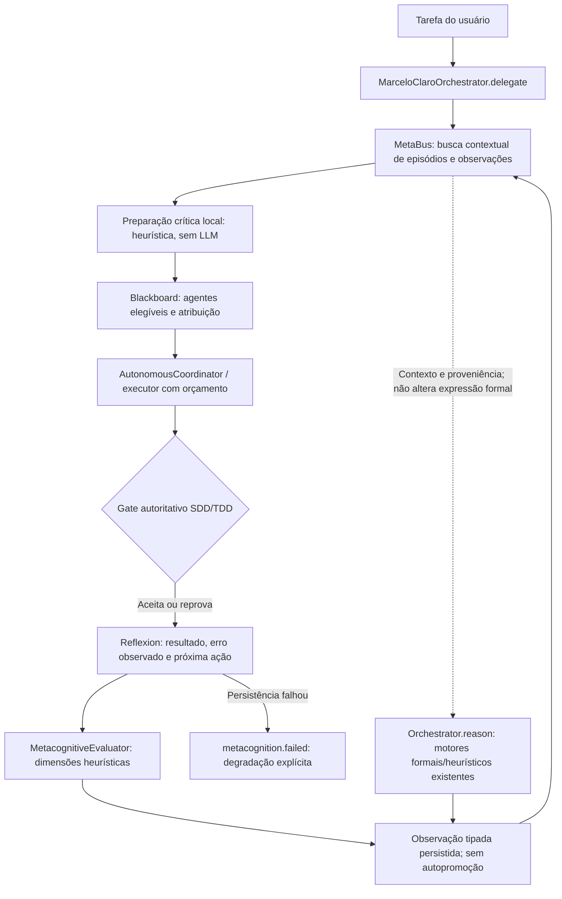

# Ciclo metacognitivo integrado — R886

O primário `marceloclaro` conecta preparação, execução, avaliação e memória.
A mudança corrige caminhos delimitados; não demonstra que todo o repositório
esteja integrado ou livre de falhas.



**Legenda:** setas contínuas representam o caminho de controle ou dados
indicado; a pontilhada delimita contexto auditável. As caixas não comprovam
que um executor externo esteja instalado, autenticado ou tenha concluído
inferência. O diagrama descreve R886; o inventário integral R879/R881 continua
explicitamente vinculado ao snapshot histórico `6380cfa`.

[Abrir o fluxograma em SVG](architecture/metacognitive-loop-r886.svg).

## Mudanças funcionais

- As buscas lexical e hierárquica agora incluem `observation`, usando a mesma
  projeção textual. Um resultado persistido não fica invisível ao próximo ciclo.
- A delegação recupera até cinco registros relevantes com IDs de origem e
  resumo limitado. A análise crítica chama o motor stdlib já existente;
  é preparação heurística, sem realizar inferência LLM ou prova formal.
- O executor recebe o briefing como dados históricos. Esses dados não são
  instruções nem autorização e não substituem gates, políticas ou a tarefa.
- O Blackboard transmite o resultado autoritativo do gate à reflexão. O
  controlador conserva tarefa, resultado, erro observado, próxima ação,
  avaliação heurística e referências declaradas — sempre sem validá-las.
- Replay da mesma conclusão serializável reutiliza o episódio. Uma conclusão
  diferente conserva o histórico e aponta `supersedes`; o briefing ignora
  episódios substituídos conhecidos na memória atual.
- O retorno da rede autônoma identifica `metacognition.status`: `recorded`,
  `degraded` ou `not_recorded`. Falha de gravação não vira aprendizado fictício.
- O escore do próprio motor deixou de atualizar o ledger de confiança e de
  produzir lições semânticas autoaprovadas. `confidence` continua disponível
  por compatibilidade, com `calibrated: false` e `confidence_promoted: false`.

A API legada `add_reflection` ainda possui atualização EMA explícita;
eliminou-se seu uso nos caminhos automáticos de raciocínio e Reflexion desta
mudança. O gate SDD conserva seu registro de verificação e `TrustEngine`
conserva o histórico operacional. Nenhum desses mecanismos prova confiança
calibrada ou validade científica. A avaliação de cada episódio utiliza um traço unitário; não mede adaptação
entre ciclos nem frequência histórica de erros. Os indicadores conservadores do avaliador
não são inflados para recompensar a própria mudança.

## Raciocínio e memória: limite deliberado

`orchestrator.reason` consulta a mesma memória, executa o motor solicitado e
registra sua conclusão como observação. O retorno inclui IDs recuperados e
`contextual_review`. A memória **não modifica a expressão matemática nem
introduz premissas em um solver**. Isso oferece contexto e rastreabilidade;
não se afirma que a conclusão formal melhorou por consultar histórico.

A execução autônoma é o caminho em que o briefing efetivamente chega ao
executor. Os testes de dois ciclos verificam o segundo prompt e o vínculo
com o primeiro episódio. Esses testes usam um executor simulado e são
identificados como tal; não comprovam inferência de Claude, Codex ou Antigravity.

## Uso local pelo primário

```python
from marceloclaro.orchestrator import MarceloClaroOrchestrator

core = MarceloClaroOrchestrator(auto_load_agents=False)
resultado = core.reason("2+3", engine="sympy")
print(resultado["conclusion"])
print(resultado["metacognition"])
```

Esse exemplo grava uma observação na memória local configurada. A CLI e os
MCPs existentes continuam usando o mesmo primário; `ecosystem_run` transmite
as observações no briefing e devolve o estado da reflexão. Entrega de software
continua exigindo a spec e o histórico RED definidos pelo gate existente.

## Fontes e manutenção

- [Controlador canônico](../mci/metacognitive_loop.py).
- [Memória e busca](../mci/metabus.py), [recuperação hierárquica](../transformer/memory.py).
- [Primário](../marceloclaro/orchestrator.py), [rede autônoma](../marceloclaro/autonomous.py).
- [Reflexion](../mci/reflexion.py), [Blackboard](../mci/blackboard.py).
- [Spec R886](../specs/SPEC-935-R886-ciclo-metacognitivo-integrado.md).
- [Avaliação dos cinco repositórios](AVALIACAO_REPOS_METACOGNICA_R886.md) e
  [snapshots estruturados](metacognition-candidates-r886.json).

Rode os testes R886 e as regressões de rede, workflow, memória e entrega.
Índices lexicais e embeddings por feature hashing medem relevância aproximada,
não verdade. A memória em JSON conserva os limites de retenção e concorrência
do MetaBus; esta etapa não promete banco transacional multi-host.

O [recibo local R886](verification-local-r886.json) diferencia as verificações
focadas, as sondas reais e a interrupção da suíte abrangente no ambiente WSL.
