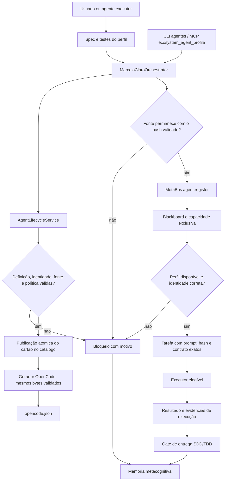
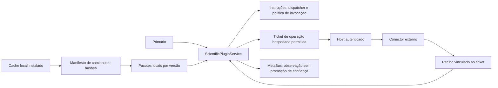
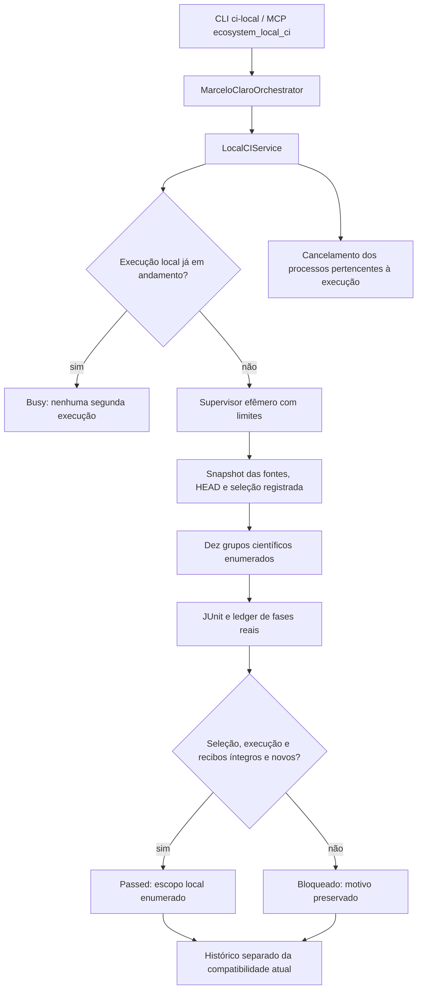

# Agentes persistentes, plugins científicos e verificação local

## Escopo desta atualização

MarceloClaro permanece o primário. A atualização acrescenta 35 perfis de trabalho
identificados nesta tarefa e 20 perfis correspondentes aos plugins solicitados,
mantidos no mesmo catálogo e na mesma configuração do OpenCode. Os nomes e aliases
estão em [session_profiles.json](../agents/session_profiles.json). Alguns nomes
históricos correspondem a tentativas de delegação: o inventário não prova que
todos executaram ou concluíram trabalhos anteriores.

A validação de um perfil cobre sua definição, política, referências e roteamento.
Não mede a competência de um modelo nem transforma uma tarefa atribuída em inferência
concluída. O resultado de execução continua exigindo recibo próprio.

## Registro e ativação pelo primário



Setas representam o contrato do percurso. A existência de uma seta não comprova
que cada executor foi autenticado ou que todas as tarefas foram executadas.

```bash
.venv/bin/python -m marceloclaro.cli agentes inventory
.venv/bin/python -m marceloclaro.cli agentes validar readme-contract-audit
.venv/bin/python -m marceloclaro.cli agentes registrar readme-contract-audit
.venv/bin/python -m marceloclaro.cli agentes ativar readme-contract-audit --task "Auditar o contrato de uso do README com fontes locais."
.venv/bin/python -m marceloclaro.cli agentes criar --config perfil.json
```

Um `perfil.json` novo contém `agent_id`, `name`, `description`, `capabilities`,
`spec_file`, `test_file` e `prompt`; `allow_edit` é opcional e booleano.
Identificadores gerenciados usam letras minúsculas, números e hífen. O prefixo de
capacidade `profile_` é reservado ao ciclo de vida. Não se pode apropriar a
capacidade exclusiva de outro perfil. Referências devem existir dentro do
repositório, sem redirecionamentos por symlink. O serviço publica o cartão de
modo exclusivo; não sobrescreve uma definição já existente.

Uma ativação prepara e encaminha uma tarefa. `executed=false` e
`execution_status=pending_executor` distinguem essa etapa da execução. Nova
ativação de um perfil ocupado deve aguardar a conclusão ou resolução da tarefa;
um novo registro não pode apagar seu estado de ocupação.

As instruções [AGENTS.md](../AGENTS.md) exigem este percurso antes de novas
delegações. O gate também protege a carga do catálogo e a geração do OpenCode.
Não é possível interceptar automaticamente ferramentas de criação de agentes
executadas por aplicações independentes. Elas precisam chamar a interface do Core
e cumprir as instruções antes da delegação.

Os 260 arquivos anteriores têm baseline vinculado a seus bytes. Essa preservação
de compatibilidade não declara que os agentes históricos cumprem o novo contrato.
Uma alteração invalida a isenção; não atualize o baseline para contornar o gate.

## Vinte plugins, um registro de capacidades

As instruções locais solicitadas foram importadas e tiveram seus hashes conferidos.
O catálogo canônico possui 25 entradas, incluindo cinco integrações preservadas.
Os 20 pedidos constam em `REQUESTED_PLUGIN_IDS`, no
[serviço canônico](../integrations/scientific_plugins.py). Não foram executados
hooks dos pacotes ou copiadas credenciais durante a importação.



Importação, autenticação e execução são estados diferentes. SciGrant exige
intenção de redação de projeto; sua integração não dispara o workflow de
submissão. Nenhum pet, site, mensagem, documento clínico ou processo jurídico
é criado apenas porque o respectivo plugin foi catalogado. Skills com invocação
implícita desabilitada passam pelo dispatcher e pela leitura das instruções no
contexto autorizado.

Os novos pacotes e recibos privados do host permanecem locais. Não publique
credenciais ou cópias indiscriminadas de instruções de terceiros. O manifesto
permite nomes legítimos de documentos como `identity-and-secrets.md`, enquanto
continua rejeitando arquivos de credenciais e campos sensíveis em argumentos
ou respostas hospedadas.

### Wolfram

O [parecer técnico](AVALIACAO_WOLFRAM_CORE_R895.md) prioriza AgentTools e
WolframClientForPython. O [recibo de execução hospedada](verification-wolfram-host-r895.json)
registra soma, integral e fatoração pelo fluxo de ticket do primário. Um kernel
local ainda exige descoberta, versão compatível, licença e teste próprios.
Wolfram|Alpha e Wolfram Cloud são serviços externos; não são análise offline.

## Grafo Python: alternativa explícita às operações nativas bloqueadas

As três operações nativas de grafo do provedor continuam bloqueadas por falhas
semânticas conhecidas. O backend novo `core_python_ast` é uma alternativa explícita
para Python, chamada pela operação `python_graph`; não altera o resultado do
provedor nem esconde seus bloqueios.

```bash
.venv/bin/python -m marceloclaro.cli code-context python_graph --tool get_call_tree --arguments '{"symbol_name":"research/scientific_release.py::verify_scientific_package"}'
```

No MCP, use `ecosystem_code_context` com `operation="python_graph"`, `tool`
e `arguments`. O primário registra a observação. As ferramentas desse backend
são `get_call_tree`, `get_symbol_usages` e `get_blast_radius`.

Cada relação resolvida preserva arquivo, linha e hash. Chamadas dinâmicas,
importações ambíguas e relações não demonstráveis são declaradas não resolvidas.
Erros de parse, truncamento e limites aparecem no resultado. O grafo estático
não prova execução, ausência de ciclos em tempo de execução ou cobertura de
linguagens diferentes de Python.

## CI independente da cobrança GitHub



```bash
.venv/bin/python -m marceloclaro.cli ci-local iniciar --profile scientific
.venv/bin/python -m marceloclaro.cli ci-local status --run-id ID_RETORNADO
.venv/bin/python -m marceloclaro.cli ci-local listar --limit 10
.venv/bin/python -m marceloclaro.cli ci-local cancelar --run-id ID_RETORNADO
```

Substitua `ID_RETORNADO` pelo identificador efetivo. A inicialização é assíncrona;
`running` não significa teste aprovado. Apenas o perfil científico fechado é
aceito: não há parâmetro de shell, seleção arbitrária de testes ou comandos
recebidos de plugins. Cada grupo mantém limite de 180 segundos e 1.536 MiB de
RSS observado; variáveis de bibliotecas numéricas limitam threads. Isso não é
isolamento contra código malicioso executado pelo próprio dono do host.

O supervisor valida fases de testes, seleção exata, recibos atuais, arquivos e
compatibilidade de fontes. HMAC protege a integridade local dos registros,
sem autenticar um avaliador externo. Histórico aprovado pode ficar incompatível
com o HEAD atual após uma alteração; os dois estados são exibidos separadamente.

Esse percurso executa na máquina sem criar jobs ou checks no GitHub. Uma execução
local verde não muda o estado remoto bloqueado. Os recibos R891–R893 descrevem
o perfil histórico de cinco grupos; a seleção atual, ampliada, tem dez grupos.
Resultados antigos não devem ser renomeados como execução da nova seleção.

### Outras alternativas de infraestrutura

O GitHub documenta [uso de runners próprios](https://docs.github.com/en/billing/concepts/product-billing/github-actions)
e [controle de acesso](https://docs.github.com/en/actions/how-tos/manage-runners/self-hosted-runners/manage-access).
Isso não comprova que um runner próprio contornará um bloqueio da conta. Em
repositórios públicos, contribuições não confiáveis exigem isolamento; nenhum
runner persistente foi registrado nesta atualização.

[Codeberg/Woodpecker](https://docs.codeberg.org/getting-started/faq/) é uma
alternativa independente, sujeita aos requisitos e à aprovação do serviço.
Não foi criada conta, espelhado repositório ou executada CI nessa plataforma.
O backend local já implementado é a alternativa operacional imediata.

## Pacote REA fornecido e limites restantes

A [avaliação do ZIP](AVALIACAO_ZIP_REA_PTBR.md) preserva seu hash e as
contraprovas. Ele é referência didática; não substitui o Core nem fornece
resultados científicos executados. Nenhum programa do ZIP foi executado.

Os testes selecionados, o diagnóstico estrutural e os recibos locais delimitam
o que foi verificado. Escala de produção, avaliação científica externa e
disponibilidade permanente dos provedores continuam exigindo evidência própria.
