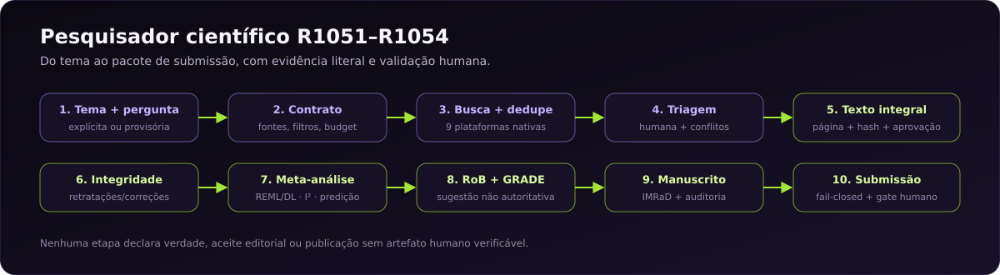
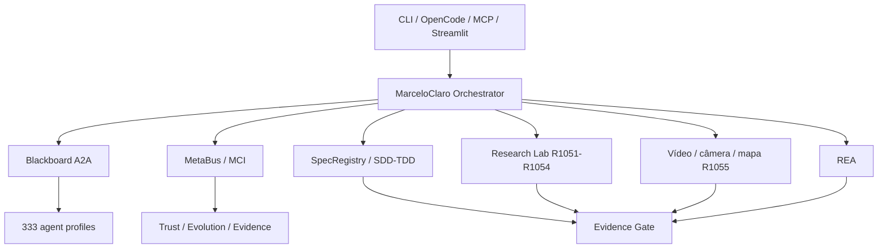

# Documentação do OpenCode Ecosystem Core

Versão animada: <a href="images/research-pipeline-r1054.gif">GIF do pipeline</a> · gerado por <a href="../scripts/generate_readme_gif.py"><code>scripts/generate_readme_gif.py</code></a>.

**Pesquisa, agentes e evidência — com um mapa para cada tipo de leitor.**

O README principal é a porta de entrada executiva. Este índice organiza a
documentação por **trilha**, **domínio** e **nível de evidência**, para que você
não precise adivinhar onde está a verdade, a especificação ou o limite.

[🏠 README principal](../README.md) ·
[📘 Manual](../MANUAL.md) ·
[🏗️ Arquitetura](../ARCHITECTURE.md) ·
[🎞️ Atlas animado](architecture/ANIMATED.md) ·
[🔬 Pipeline científico](SCIENTIFIC_RESEARCH_PIPELINE_R1054.md) ·
[🧪 Evidência R1054](../reports/r1054/README.md) ·
[📈 PROGRESS](../PROGRESS.md)

---

## Escolha sua trilha

| Você quer… | Comece por… | Depois veja… |
|---|---|---|
| Instalar e rodar o Core | [README § Início rápido local](../README.md#início-rápido-local) | [Instalador](../installer/README.md), [Manual](../MANUAL.md) |
| Entender a arquitetura | [ARCHITECTURE.md](../ARCHITECTURE.md) | [Guia R916](ARQUITETURA_COMPLETA_CORE_R916.md), [Atlas](architecture_map.html) |
| Pesquisar um tema e chegar a um artigo | [Pipeline R1054](SCIENTIFIC_RESEARCH_PIPELINE_R1054.md) | [Spec R1054](../specs/SPEC-1054-automacao-assistida-validacao-real.md), [Relatório](../reports/r1054/README.md) |
| Auditar claims e evidências | [R1054](../reports/r1054/README.md) | [Gate metacognitivo](../mci/metacognitive_gate.py), [CORRIGENDUM](../CORRIGENDUM.md) |
| Editar vídeo e dublar | [Editor universal](EDITOR_VIDEO_UNIVERSAL_R1042.md) | [Pipeline de dublagem](DUBBING_PIPELINE_R1041_R1045.md), [R1047](../reports/r1047/QUANTUM-DUB-EVIDENCE.md) |
| Construir agentes e plugins | [AGENTS.md](../AGENTS.md) | [CLAUDE.md](../CLAUDE.md), [Catálogo](../agents/catalog) |
| Fazer engenharia reversa | [REA](REA.md) | [Assistente local](ASSISTENTE_REA_LOCAL.md) |
| Contribuir com segurança | [Instalador](../installer/README.md) | [CLAUDE.md](../CLAUDE.md), [PROGRESS](../PROGRESS.md) |

## Comece aqui

| Ordem | Documento | Por quê |
|---|---|---|
| 1 | [README principal](../README.md) | visão, capacidades, limites e quickstart |
| 2 | [MANUAL.md](../MANUAL.md) | comandos, exemplos e estados |
| 3 | [ARCHITECTURE.md](../ARCHITECTURE.md) | componentes, fluxos e fronteiras |
| 4 | [PROGRESS.md](../PROGRESS.md) | ciclos, checkpoints e estado corrente |
| 5 | [CORRIGENDUM.md](../CORRIGENDUM.md) | alegações históricas corrigidas |

## Pesquisa científica R1051–R1054

| Ciclo | Documento | O que cobre |
|---|---|---|
| R1051 | [Pipeline R1051](SCIENTIFIC_RESEARCH_PIPELINE_R1051.md) | tema → contrato → busca → evidência → auditoria → manuscrito |
| R1052 | [Pipeline R1052](SCIENTIFIC_RESEARCH_PIPELINE_R1052.md) | texto integral, triagem humana, integridade, `refresh` |
| R1053 | [Pipeline R1053](SCIENTIFIC_RESEARCH_PIPELINE_R1053.md) | meta-análise, GRADE, LaTeX/DOCX/PDF, submissão |
| R1054 | [Pipeline R1054](SCIENTIFIC_RESEARCH_PIPELINE_R1054.md) | extração assistida, PLOS ONE, gate de publicação, BCG |
| — | [Relatório R1054](../reports/r1054/README.md) | benchmark BCG, limites e evidências |
| — | [Spec R1054](../specs/SPEC-1054-automacao-assistida-validacao-real.md) | contrato, critérios e RED/GREEN |

## MCP, autonomia e métricas R1088–R1107

| Ciclo | Documento | O que cobre |
|---|---|---|
| R1088 | [Spec](../specs/SPEC-935-R1088-mcp-recovery.md) | recuperação do Colibri, `colab-mcp` e gate federado |
| R1089 | [Spec MCP](../specs/SPEC-935-R1089-MCP.md) | servidor stdio Tiangong, quatro ferramentas e limites |
| R1089 | [Harness original](../specs/SPEC-935-R1089-tiangong-app-harness.md) | evidência REA, skill e contrato local |
| R1103 | [Dossiê IIT/autonomia](research/iit-autonomia-r1103/README.md) | fontes, lacunas, matriz técnica→teste e plano A0–A4 |
| R1104 | [Spec P0](../specs/SPEC-935-R1104-iit-metrics-p0.md) | correções de confiabilidade em `mci/iiit_metrics.py` |
| R1105 | [Spec P1](../specs/SPEC-935-R1105-autonomy-holdout-p1.md) | harness de autonomia e tarefas reservadas |
| R1106 | [Spec](../specs/SPEC-935-R1106-ecosystem-run-adapter.md) | adaptador do coordenador para o harness |
| R1107 | [Spec](../specs/SPEC-935-R1107-opencode-cli-adapter.md) | execução isolada do OpenCode CLI |
| — | [Verificação P0](research/iit-autonomia-r1103/p0-verification.md) | recibos RED/GREEN e contraprovas |
| — | [Verificação P1](research/iit-autonomia-r1103/p1-verification.md) | dry-run, limites e ausência de execução real |

## Mapa por domínio

### Orquestração, agentes e governança

| Necessidade | Documento |
|---|---|
| Agentes, plugins, grafo e CI | [Guia R894–R897](ORQUESTRACAO_AGENTES_PLUGINS_CI_R894_R897.md) |
| Criar/registrar agentes | [AGENTS.md](../AGENTS.md), [CLAUDE.md](../CLAUDE.md) |
| Workflows retomáveis | [Workflows](WORKFLOWS_R644.md) |
| Memória e metacognição | [Ciclo metacognitivo](../README.md#ciclo-metacognitivo-integrado), [MCI](../mci/) |
| Governança de custo de tokens | [Custo de tokens](GOVERNANCA_DE_CUSTO_DE_TOKENS.md), [Modelos e tokens](MODELOS_E_CUSTO_DE_TOKENS.md) |
| Federação e prontidão | [Prontidão R868](PRONTIDAO_LOCAL_CORE_R868.md), [Federação](../federation/activation.md) |

### Pesquisa, ciência e evidência

| Necessidade | Documento |
|---|---|
| Pipeline científico ponta a ponta | [R1054](SCIENTIFIC_RESEARCH_PIPELINE_R1054.md) |
| Scientific Lab nativo | [SCIENTIFIC_LAB_V42.md](SCIENTIFIC_LAB_V42.md) |
| Catálogo K-Dense (177 skills) | [Relatório R1049](../reports/r1049/kdense-177.md) |
| 9 adaptações originais | [Skill](../.opencode/skills/kdense-adaptacoes-originais/SKILL.md) |
| Laboratório isolado | [research_lab](../research_lab/README.md) |
| Integrações científicas | [R667–R671](INTEGRACOES_CIENTIFICAS_R667_R671.md) |
| Biblioteca e busca | [Biblioteca R657](BIBLIOTECA_AI_R657.md) |
| Publicação e proveniência | [Fluxo 12](architecture/flows/12-ciencia-publicacao.svg), [CORRIGENDUM](../CORRIGENDUM.md) |
| Autonomia mensurável e calibração | [R1103–R1107](research/iit-autonomia-r1103/README.md), [R1104](../specs/SPEC-935-R1104-iit-metrics-p0.md) |

### Vídeo, dublagem e motion

| Necessidade | Documento |
|---|---|
| Editor universal | [R1042](EDITOR_VIDEO_UNIVERSAL_R1042.md) |
| Multifaixa, transições e cor | [R1046](../reports/r1046/QUANTUM-REAL-EVIDENCE.md) |
| Pipeline de dublagem | [R1041–R1045](DUBBING_PIPELINE_R1041_R1045.md) |
| Evidência R1047 | [Quantum dub](../reports/r1047/QUANTUM-DUB-EVIDENCE.md) |
| Slide/palco com cartão | [R1050](../reports/r1050/CARD-STAGE.md) |
| Qubit 16:9 e vertical nativo | [Piloto R1055](../pilots/r1055-qubit/README.md), [QC e hashes](../reports/r1055/README.md) |
| Plano de ação Airam Veras | [Vídeo R1058](../pilots/r1058-airam-veras/README.md), [roteiro](../pilots/r1058-airam-veras/SCRIPT.md), [QC](../reports/r1058/README.md) |
| Piloto Monte Roraima | [Vídeo R1059](../pilots/r1059-roraima/README.md), [receita visual](../pilots/r1059-roraima/reference/receita-visual.json), [recibo](../pilots/r1059-roraima/out/render-receipt.json) |
| Desktop operator | [R1060](../pilots/r1060-desktop-operator/README.md), [receipt](../pilots/r1060-desktop-operator/install-receipt.json), [spec](../specs/SPEC-935-R1060-desktop-operator.md) |
| Storage operator | [R1061](../pilots/r1061-storage-operator/README.md), [resumo](../pilots/r1061-storage-operator/summary.json), [spec](../specs/SPEC-935-R1061-storage-operator.md) |
| Assistente acessível | [Spec R1063](../specs/SPEC-935-R1063-assistente-acessivel.md), [testes](../tests/test_r1063_accessible_assistant.py) |
| Câmera, mapa e narração por batida | [R1055](CINEMATIC_REMOTION_R1055.md), [roteiro](../pilots/r1055-qubit/SCRIPT.md), [créditos](../pilots/r1055-qubit/REFERENCES.md) |
| GIFs de arquitetura e fluxos | [Galeria R1056–R1057](architecture/ANIMATED.md), [geração e testes](../reports/r1057/README.md) |
| Remotion auditável | [Skill](../.opencode/skills/remotion-auditavel/SKILL.md), [Composição](../editor-workspace/remotion-smoke/src/r1047-slide/R1047Stage.tsx) |
| Catálogo de ferramentas | [R1043](VIDEO_EDITOR_TOOLCHAIN_R1043.md), [toolchain](../reports/r1043/toolchain.json) |

### Engenharia reversa, memória e conhecimento

| Necessidade | Documento |
|---|---|
| REA | [REA](REA.md), [Assistente local](ASSISTENTE_REA_LOCAL.md) |
| Navegador controlado | [Navegador](NAVEGADOR_REAL.md) |
| Memória no terminal | [README § Memória](../README.md#memória-no-terminal-e-painel) |
| Atlas e fluxogramas | [Atlas](architecture_map.html), [Mermaid integral — raw 2,4 MB](https://raw.githubusercontent.com/MarceloClaro/opencode-ecosystem-core/main/docs/architecture/dependencies.mmd) |
| Contexto de código | [README § Contexto](../README.md#contexto-de-código-e-consultas-de-grafo) |

### Integrações, autenticação e plugins

| Necessidade | Documento |
|---|---|
| ChatGPT, Gemini e NotebookLM | [Autenticação](AUTENTICACAO_CHATGPT_NOTEBOOKLM.md), [NotebookLM](GEMINI_NOTEBOOK_CORE.md) |
| Plugins locais | [Plugins](PLUGINS_LOCAIS_CORE.md), [Core no ChatGPT](USAR_CORE_NO_CHATGPT.md) |
| MCP e federação | [ARCHITECTURE.md](../ARCHITECTURE.md), [opencode.json](../opencode.json) |
| MCP Tiangong local | [Spec R1089](../specs/SPEC-935-R1089-MCP.md), [servidor](../integrations/tiangong_mcp.py), [skill](../.opencode/skills/tiangong-harness/HDR/SKILL.md) |
| Instalação e procedência | [Instalador](../installer/README.md), [One-click](../installer/ONECLICK.md) |

## Trilha de evidências

| Nível | O que significa | Onde ver |
|---|---|---|
| **L0 — implementado** | código e contrato existem | `scientific_lab/`, `integrations/`, `marceloclaro/` |
| **L1 — testado** | testes herméticos passam | `tests/`, [regressão R1054](../reports/r1054/final-regression.txt) |
| **L2 — renderizado** | mídia/PDF/DOCX com recibo | [R1047](../reports/r1047/QUANTUM-DUB-EVIDENCE.md), [R1053](../reports/r1053/README.md) |
| **L3 — benchmarkado** | replicação em dados públicos | [BCG R1054](../reports/r1054/real-meta-benchmark.json) |
| **L4 — validação externa** | artefato independente verificado | gate R1054; não emitido |
| **L5 — aceite/publicação** | decisão do periódico | não emitido |

**Regra:** um nível não promove o outro. Hash confirma bytes, não verdade.
Teste não é validação externa. Render não é aprovação estética. Aceite não é
publicação.

## Como ler as evidências

- `specs/` declara requisitos e critérios de aceitação.
- `tests/` contém verificações executáveis.
- `reports/` preserva benchmarks, recibos e limites datados.
- `docs/evidence/` preserva evidências delimitadas.
- `outputs/` pode conter dados locais e resultados privados.
- `docs/architecture/` contém mapas e fluxogramas; são projeções, não execução.
- `CORRIGENDUM.md` registra alegações históricas corrigidas.

Não copie sessões, cookies, chaves, dados sensíveis ou fontes privadas para o
Git. Um artefato versionado não é certificado de prontidão.

## Visão renderizável no GitHub

O grafo integral tem **2,4 MB** e excede o limite do renderizador Mermaid do
GitHub; ele fica disponível como [raw para renderização local](https://raw.githubusercontent.com/MarceloClaro/opencode-ecosystem-core/main/docs/architecture/dependencies.mmd).
Para uma visão que o GitHub renderiza, use o bloco abaixo ou o
[SVG curado](architecture/curated-overview.svg).

<!-- svg-presentation:diagram-e19b5e3314e41476 -->

[GIF](architecture/animated/diagram-e19b5e3314e41476.gif) · [PNG](architecture/animated/diagram-e19b5e3314e41476.png) · [Fonte Mermaid](architecture/animated/diagram-e19b5e3314e41476.mmd)

Fonte Mermaid (auditoria)

> **Regra:** diagramas grandes são evidência de inventário, não prova de
> execução. O SVG e a página offline são as fontes de leitura; o `.mmd` integral
> é matéria-prima para renderização local.

## Atlas e fluxogramas

- [Todos os diagramas do escopo em GIF/PNG/SVG/Mermaid](architecture/ANIMATED.md)
- [Manifesto de cobertura e hashes](architecture/animated/manifest.json)
- [Reprodução local e limites R1057](../reports/r1057/README.md)
- SVG é a visualização primária; a fonte Mermaid fica em `
` de auditoria.
- [Atlas offline](architecture_map.html)
- [Mapa curado](architecture/curated-overview.svg)
- [Dependências Mermaid — raw 2,4 MB](https://raw.githubusercontent.com/MarceloClaro/opencode-ecosystem-core/main/docs/architecture/dependencies.mmd)
- [Fluxo 01 — panorama](architecture/flows/01-panorama.svg)
- [Fluxo 12 — ciência e publicação](architecture/flows/12-ciencia-publicacao.svg)
- [Fluxo 22 — Ollama e contexto](architecture/flows/22-ollama-contexto-erros.svg)
- [README § Arquitetura completa](../README.md#arquitetura-completa-e-fluxogramas-atuais)

## Documentos históricos

A R1056 anima os diagramas publicados; não transforma o inventário R916 em
uma auditoria atual do runtime. A síntese por camadas não substitui o grafo
integral. As prévias da galeria são estáticas para evitar movimento compulsório.

Os atlas R433–R438, R879, R900 e R911 permanecem como retratos históricos. O
livro tem processo editorial e atlas próprios; atualizar estes mapas não
recompila nem revalida automaticamente o livro ou seus teoremas.

---

**Contribuição:** [AGENTS.md](../AGENTS.md) · [CLAUDE.md](../CLAUDE.md) ·
[Instalador](../installer/README.md) · [PROGRESS.md](../PROGRESS.md)
