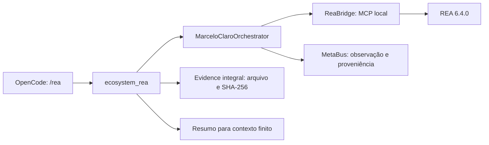

# Integração REA e revisão do ecossistema — 2026-10-11

## Resultado entregue

REA 6.4.0 foi instalado e compilado em um checkout externo ao Core, a partir de
[MarceloClaro/rea](https://github.com/MarceloClaro/rea), commit
`4daea941bfeeb426886f2d048aed7f3cb2dbf97b`. O runtime instalado usa Node.js
22.23.1 e npm 10.9.8. A licença MIT e as referências da skill upstream foram
preservadas. O recibo de instalação registra o comando e a origem.

O marceloclaro coordena `status`, `catalog`, `session` e análise estática de
aplicações JavaScript por `ecosystem_rea`, `/rea` e pela CLI. O servidor REA
completo permanece registrado. A sessão real anunciou **170 ferramentas e
6 prompts**; isso não implica disponibilidade dos providers nativos.

O adaptador não executa JavaScript do alvo. Falhas de protocolo, prazo,
`isError`, erros estruturados e identidades de sessão ausentes não concluem
como sucesso. O prazo coordenado é finito, até 180 segundos; os processos
subordinados são encerrados no cancelamento. Respostas completas permanecem
em `.opencode/rea/evidence/<sha256>.json`, com gravação atômica e hash conferido.
CLI e ponte conservam a resposta integral. O gateway entrega um resumo
explicitamente identificado e o caminho do arquivo completo.

As ferramentas diretas `rea_*` ficam ocultas por padrão nos agentes. Essa
decisão evita colocar todos os schemas no contexto de modelos locais e segue
a [configuração de ferramentas MCP do OpenCode](https://opencode.ai/docs/mcp-servers/#per-agent).
Outras operações podem ser expostas seletivamente para uma tarefa concreta.

## Prova operacional real

O OpenCode CLI conectou aos **16 servidores MCP** da configuração, incluindo
REA e ecosystem-network. A ponte recebeu catálogo e identidade reais, e o
gateway coordenado concluiu `session` e `analyze`, com persistência metacognitiva.
Os hashes dos arquivos completos foram recalculados e coincidiram com o recibo.

O alvo real foi
`research/producao_real/deploy_estatico_cloudflare/src`: 1 arquivo JavaScript,
2.309 bytes, 342 nós AST, 1 achado e nenhuma falha de parsing. O grafo de
artefatos contém 4 nós/3 arestas. O grafo semântico contém 233 nós,
176 relações e **67 desconhecidos**, com cobertura semântica `unknown`.
Os hashes dos arquivos do alvo permaneceram iguais.

A resposta completa de análise tem **759.664 bytes**, com SHA-256
`d51a9a9332de1138fb6d6c1178d30f6c345b3f42e4bbfe45ada37d7851a9a7fd`.
O gateway entregou um recibo de 3.501 bytes. Essa redução é de transporte
para o contexto: o arquivo completo conserva a evidência e os limites.
Imports, endpoints e relações estáticas não comprovam comportamento em execução.
O ledger de confiança permaneceu igual; nenhuma validação externa foi atribuída.

Uma análise maior do site da dissertação excedeu o limite de resposta MCP
upstream (10 MB) e retornou `resource_constraint`. O modo upstream resumido
funcionou, mas suas referências dependem da sessão. A ponte preserva a falha
do modo completo; não substitui silenciosamente a evidência por referências
que perderiam validade ao encerrar o processo. Para esse caso, reduza o escopo.

## Revisão operacional e correções

| Rodada | Problema demonstrado | Correção e limite |
|---|---|---|
| R808 | REA não integrado; respostas grandes e erros de sessão | Runtime identificado, MCP real, ponte coordenada, Evidence por hash, resumo delimitado e erros preservados |
| R809 | Importação de rede podia escapar do core check; IDs ausentes/duplicados colapsavam avaliação | Detecção de imports/aliases, rejeição antes da leitura e regressões de ordem de importação |
| R809 | Cobertura Lean era checada na direção inversa | Comparação dos teoremas reais com a spec, incluindo identificadores em maiúsculas; índice explícito dos teoremas |
| R810 | Doctor estrutural executava processos, rede e exemplos formais/clínicos | Inventário local por padrão; `doctor --live` seleciona probes operacionais; sem inferir prova ou inferência do inventário |
| R811 | Perfil R678 ausente, impedindo registro e atribuição | Perfil `library-empty-input-audit` restaurado, somente interfaces centrais existentes e permissões restritas |
| R812 | Testes/documentos fixavam contagens antigas e launchers no PATH | Inventário atual reconciliado, migração histórica preservada e contratos compatíveis com instalação local resolvida |
| R813 | Regex de segredos capturava sufixo de identificador e exemplos artificiais | Fronteira de token e exceção somente para dois hashes artificiais auditados; candidatos desconhecidos continuam bloqueados |

Também foi corrigido o launcher arXiv: a instalação de `uvx` estava fora do
PATH do cliente. A resolução já usada pelo fetch foi aplicada e a reconexão
dos 16 MCPs passou. O arquivo `opencode.json` coincide com o gerador e declara
**254 agentes, 16 MCPs e 30 comandos**. As modificações anteriores do usuário
foram preservadas; não houve commit, push nem registro global de outros clientes.

O doctor estrutural contém **21 checks: 19 pass, 2 warn, 0 fail**, com duração
interna observada de 2,50–3,48 segundos. O processo frio, incluindo imports,
foi medido em 5,52 segundos. Inventário não equivale a inferência, autenticação
ou execução bem-sucedida de todos os executores. Os avisos permanecem visíveis.
O modo `doctor --live` também foi executado: 19 pass, 2 warn, 0 fail em
10,77 segundos. Ele registra probes locais, sem atribuir validação externa.

## Testes e evidências

| Escopo executado | Resultado | Registro |
|---|---|---|
| Gate final conjunto das superfícies alteradas e regressões | **771 aprovados**, nenhuma falha; 128,91 s | [texto](../outputs/rea-r808/final-release-gate.txt), [JUnit](../outputs/rea-r808/final-release-gate.xml) |
| Suíte geral inicial | 6.084 aprovados, 38 falhas, 2 erros, 77 skips; 1.137,77 s | [texto](../outputs/rea-r808/full-suite.txt), [JUnit](../outputs/rea-r808/full-suite.xml) |
| Ponte e superfícies REA após endurecimento | 62 aprovados; 11,81 s | [GREEN](../outputs/rea-r808/session-identity-green.txt) |
| Rede, gateways e workflows | 284 aprovados; 42,70 s | [regressão](../outputs/rea-r808/network-regression.txt) |
| Integridade R809 | 47 aprovados; 80,97 s | [GREEN](../outputs/rea-r808/integrity-green.txt) |
| Doctor e contratos adjacentes finais | 170 aprovados, 2 skips; 52,70 s | [release](../outputs/rea-r808/r810-release-green.txt) |
| Inventário/documentação/catálogo final | 279 aprovados; 35,63 s | [texto](../outputs/rea-r808/inventory-final.txt), [JUnit](../outputs/rea-r808/inventory-final.xml) |
| Gate de padrões de segredos | 26 aprovados; 45,39 s | [GREEN](../outputs/rea-r808/r813-green.txt) |
| Mutação da ponte em cópias isoladas | Baseline 22 aprovados; 2 mutantes mortos, 0 sobreviventes | [metadados](../outputs/rea-r808/mutation-summary.json) |
| MCP real e análise coordenada final | Sessão/análise concluídas; arquivo, hash e MetaBus conferidos | [prova](../outputs/rea-r808/gateway-proof-final.txt) |
| OpenCode CLI real | 16/16 MCPs conectados | [registro](../outputs/rea-r808/opencode-mcp-list-final.txt) |

Esses conjuntos podem se sobrepor; suas contagens não devem ser somadas.
Os quatro casos R808 que falharam na suíte inicial foram corrigidos durante
sua execução e passaram nas reexecuções focadas. Os testes de transporte e
mutação usam servidores herméticos, explicitamente diferentes da prova MCP real.
As demais falhas corrigidas também possuem registros RED/GREEN em
`outputs/rea-r808`. A suíte geral inicial continua preservada como evidência;
não foi reinterpretada como uma suíte geral verde.

## Pendências e limites da revisão

Foram identificadas **21 falhas nesses gates: 18 do livro e 3 de OdontoCA**.
A [triagem editorial com hashes](../outputs/rea-r808/editorial-backlog-audit.json)
comparou 40 entradas rastreadas com HEAD; todas permanecem idênticas.
Os contratos misturam requisitos ainda aplicáveis e rótulos/snapshots antigos,
portanto cada correção exige análise de seu significado.

- Os gates R617–R620 do livro apontaram pendências de estrutura didática,
  inventário do catálogo, números de consulta e justificativas de fluxogramas.
  Não houve reescrita do livro nem recompilação/inspeção de PDF nesta tarefa.
  A correção editorial exige revisar geradores, fontes e evidências em conjunto.
- R645 contém expectativas históricas sobre ausência de palavras no manuscrito
  OdontoCA. A versão atual mudou e declara limitações de amostragem/controle;
  o scanner atribui o mesmo crédito lexical a frases afirmativas e negativas.
  Seus escores não são avaliação científica nem substituem PROBAST+AI ou
  revisão humana. Restaurar a ausência de palavras alteraria indevidamente o texto.
- Templates antigos de `/reason`, `/diagnose`, `/maswos` e `/pypi` interpolam
  argumentos em código Python textual. Uma entrada com apóstrofo reproduziu
  erro de parsing. A substituição desses templates permanece uma pendência
  de robustez dos comandos legados; o comando `/rea` usa instrução ao agente.
- Ghidra, Hopper e IDA não estão configurados para análise nativa neste host.
  O doctor geral upstream mantém essas ausências; a inspeção JavaScript
  demonstrada usa parsing estático e não requer tais providers.
- Testes locais, conexão MCP e análise de um alvo não constituem certificação
  externa, equivalência de comportamento, cobertura integral do ecossistema
  ou validação científica dos manuscritos.

Consulte [REA.md](REA.md) para uso. O fechamento técnico da revisão conserva
as pendências e os skips, em vez de afirmar saúde integral sem evidência.

O alerta R453 anterior correspondeu a 59 ocorrências em 33 arquivos, já presentes
em HEAD: dois exemplos artificiais exatos e um sufixo de identificador comum.
R813 preserva o índice, as evidências históricas e o teste de divergência entre
índice e workingtree. A política usa fronteira de token e somente os dois hashes
artificiais auditados; não existe exceção geral para tokens repetidos ou de baixa
entropia. Casos positivos em JSON, `token=`, Bearer e tokens artificiais não
registrados permanecem bloqueados. A auditoria não tentou autenticação e não
constitui um levantamento de credenciais fora do índice.
Consulte [metadados da auditoria](../outputs/rea-r808/secret-pattern-audit.json)
e [contraprovas R813](../outputs/rea-r808/r813-summary.json).
