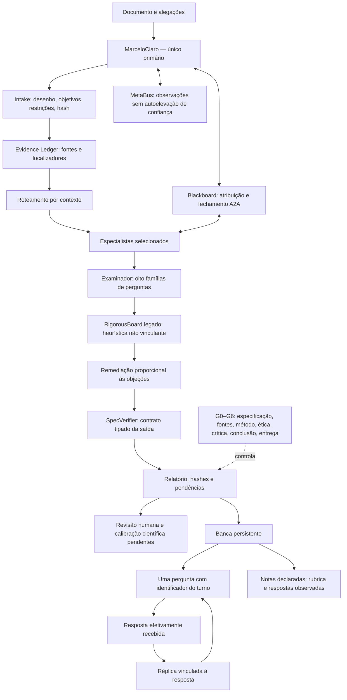

# Rigor acadêmico adversarial — R914

O módulo acrescenta auditoria documental com alegações explícitas e banca
interativa persistente. Reaproveita MarceloClaro, Blackboard, MetaBus,
SpecVerifier e RigorousBoard. Os 34 perfis seguem a especificação recebida;
a instalação começa com oito especialistas antes da expansão.

O handler implementado faz **verificações locais por regras e contratos**.
Não executa automaticamente 34 modelos nem mede equivalência a uma banca humana.
Os perfis podem receber tarefas dos executores existentes pelo primário, com SDD
e recibo real. Esse percurso semântico não é presumido pelo registro de um perfil.

## Fluxo e legenda



Setas contínuas representam dependências; a pontilhada indica gate. Os nós são
etapas de software, não resultados científicos comprovados. Cada saída é checada
antes do fechamento A2A. SpecVerifier valida o contrato estrutural, não a verdade
da afirmação. A04 coordena apenas o parecer sob MarceloClaro. G6 exige humano.

Os núcleos são: coordenação/rastreabilidade (A01–04), originalidade/epistemologia
(A05–09), método/validade (A10–17), ética/governança (A18–21), fontes/resultados
(A22–26), viabilidade (A27–29) e aderência/defesa (A30–34). A lista integral e
as responsabilidades estão na [especificação recebida](SPEC-OCRE-ACADEMIC-RIGOR-v1-user.md).

## Uso local

```bash
python3 -m marceloclaro.cli rigor status
python3 -m marceloclaro.cli rigor plan --config projeto.json
python3 -m marceloclaro.cli rigor review --config projeto.json
```

Exemplo de `projeto.json`, substituindo caminho e conteúdo pelo projeto real:

```json
{
  "project": {
    "research_id": "estudo-001", "spec_id": "SPEC-935-R914",
    "artifact_path": "/home/marceloclaro/pesquisa/projeto.md",
    "problem": "Qual questão será investigada?",
    "objectives": ["Delimitar o problema e confrontar interpretações rivais"],
    "study_type": "qualitative",
    "context": {"humans": null, "personal_data": null, "indigenous_knowledge": null},
    "sources": [],
    "claims": [{
      "claim_id": "c1", "statement": "A hipótese ainda requer investigação.",
      "claim_type": "theoretical", "evidence_status": "hypothetical",
      "source_refs": [], "limitations": ["Ainda não testada"],
      "reviewer_agent_ids": [], "attributes": {}
    }]
  }
}
```

Tipos de estudo: `bibliographic`, `qualitative`, `quantitative`, `experimental`,
`before_after`, `mixed`, `computational`, `protocol`. Formatos: TXT, Markdown,
LaTeX, JSON, CSV, PDF com texto e DOCX. Limites: 16 MiB por arquivo, 200 alegações
e 300 fontes. Extração acima de 300 páginas ou dois milhões de caracteres é
parcial; documento sem texto exige transcrição. Só alegações explícitas são
examinadas; não há extração semântica exaustiva automática.

Flags são booleanos JSON reais; contagens planejadas, observadas e unidades
independentes são campos distintos. `attributes` permite explicitar sinais como
`causal_claim`, `claims_novelty`, `independent_observations`, `metric` e
`interpretation`. Uma fonte local tem `source_id`, `path`, `locator` e `sha256`
opcional. URLs declaradas não são recuperadas nesta operação. Recupere e inspecione
fontes pelos mecanismos existentes antes de integrá-las ao ledger.

O relatório distingue integridade física de verificação semântica. `verified`
recebido é rebaixado a `reported` até verificação reproduzida. Contradições são
preservadas. Revisores declarados pelo usuário não se tornam revisores executados.

## Banca, rubricas e notas

`banca_start` recebe `review_id` persistido ou `project`. `banca_question`
apresenta uma pergunta. `banca_answer` exige `session_id`, `answer` e `turn_id`
recebido; turnos repetidos são recusados. A réplica cita a resposta registrada
antes de avançar de família. Não há resposta modelo antecipada.
`banca_report` preserva objeções e competências não observadas.
`banca_cancel` encerra a sessão, conservando histórico.

Uma `rubric` opcional no início exige `source_path`, `source_sha256`, `locator`
e `criteria`, cada qual com `criterion_id` e `maximum`. A fonte precisa estar
disponível localmente. `banca_rate` recebe critério, `score`, `answer_turn_ids`,
`justification` e `reviewer_id`. A nota é julgamento **declarado e simulado**;
o sistema não autentica avaliador ou instituição. Critérios não observados
continuam sem nota; resposta registrada não equivale a competência aprovada.

A especificação do usuário declara, para treinamento MIH/UNILAB, cinco dimensões
de até dois pontos: clareza/argumentação, teoria/metodologia, trajetória,
produção/aderência e interdisciplinaridade/disponibilidade. Isso não autentica
rubrica institucional. Para uso institucional, forneça o documento pertinente,
localizador e avaliação humana responsável. Não invente critérios oficiais.

## Integração e recuperação

MCP: `ecosystem_research_rigor(config)`; OpenCode: `/rigor`; CLI: `rigor`.
As superfícies usam `MarceloClaroOrchestrator.academic_rigor_action`.
O código de saída zero indica que o comando produziu seu relatório; o campo
`review_status`, os gates e as pendências determinam o resultado da auditoria.
Esse código de processo não representa aprovação científica.
Produtores acadêmicos do primário anexam preflight e mantêm
`scientific_release_allowed=false`. O preflight solicita intake explícito;
não inventa alegações extraídas do manuscrito. Aceite computacional continua
separado de mérito científico, autorização ética e submissão humana.

`configure` com `enabled:false` desativa novas auditorias e preserva relatórios;
`enabled:true` reativa. Estados ficam em `$MCI_STATE_DIR/academic_rigor` ou
`.mci_state/academic_rigor`. Para retomar, consulte `report`/`banca_report`.
Documento ou rubrica alterados exigem nova avaliação. Hash detecta corrupção
acidental; não autentica contra quem consegue reescrever todo o estado.

Perfis passam por `install_profiles(primary, phase="pilot")`, depois `phase="full"`,
usando a API R894. O compilador oficial gera `opencode.json`. Falha de ativação,
contrato, prazo ou orçamento produz relatório parcial e gates inconclusos.
Stakes são resolvidos no escopo do contrato, sem medir confiança científica.

## Avaliação e limites

O banco de regressão contém os oito casos positivos/negativos solicitados:
território/novidade, erro/injustiça epistêmica, contagem/independência,
antes-depois/causalidade, publicidade/autorização, métrica/reconstrução linguística,
cronograma/disponibilidade e afinidade/escopo internacional empírico.
Cada detecção exige justificativa, evidência de resolução, severidade e alegação alvo.

São testes de software, não amostra calibrada de pesquisas. Permanecem pendentes
comparação com especialistas humanos, concordância, falsos positivos/negativos e
generalização entre disciplinas. Não há promessa de equivalência a banca,
aprovação editorial ou ausência universal de falhas.
