# Atlas animado de arquitetura e fluxos — R1056–R1057

Todos os diagramas do escopo têm GIF, PNG, SVG e Mermaid editável.
A animação percorre as arestas na ordem topológica do desenho e destaca
os nós sem arestas em sequência. É **guia de leitura**, não telemetria,
execução observada ou garantia de que o caminho ocorra.

**Acessibilidade:** a visualização padrão é estática. Abra o GIF apenas
quando desejar movimento; ele executa um ciclo de 8 s, sem repetição
infinita. Para repetir, recarregue o arquivo. Amplie o SVG para ler grafos densos.

[README](../../README.md) · [Arquitetura](../../ARCHITECTURE.md) ·
[Manifesto e hashes](animated/manifest.json) · [Reprodução](../../reports/r1057/README.md)

## Cobertura

| Vista | Animação | Sem movimento | Fonte |
|---|---|---|---|
| 01. Visão das camadas | [GIF](animated/diagram-0a347110aad90186.gif) | [PNG](animated/diagram-0a347110aad90186.png) · [SVG](animated/diagram-0a347110aad90186.svg) | [Mermaid](animated/diagram-0a347110aad90186.mmd) |
| 02. Diagrama operacional atual | [GIF](animated/diagram-4c75ee83141913a3.gif) | [PNG](animated/diagram-4c75ee83141913a3.png) · [SVG](animated/diagram-4c75ee83141913a3.svg) | [Mermaid](animated/diagram-4c75ee83141913a3.mmd) |
| 03. Diagrama de Alto Nível | [GIF](animated/diagram-a85a7f71216ef7ff.gif) | [PNG](animated/diagram-a85a7f71216ef7ff.png) · [SVG](animated/diagram-a85a7f71216ef7ff.svg) | [Mermaid](animated/diagram-a85a7f71216ef7ff.mmd) |
| 04. Arquitetura em 60 segundos | [GIF](animated/diagram-e19b5e3314e41476.gif) | [PNG](animated/diagram-e19b5e3314e41476.png) · [SVG](animated/diagram-e19b5e3314e41476.svg) | [Mermaid](animated/diagram-e19b5e3314e41476.mmd) |
| 05. Mapa da Arquitetura Completa (v3.9.0) | [GIF](animated/diagram-c2a59e1bc061653c.gif) | [PNG](animated/diagram-c2a59e1bc061653c.png) · [SVG](animated/diagram-c2a59e1bc061653c.svg) | [Mermaid](animated/diagram-c2a59e1bc061653c.mmd) |
| 06. Diagrama Operacional Atual | [GIF](animated/diagram-8e1e0ff7aba73edb.gif) | [PNG](animated/diagram-8e1e0ff7aba73edb.png) · [SVG](animated/diagram-8e1e0ff7aba73edb.svg) | [Mermaid](animated/diagram-8e1e0ff7aba73edb.mmd) |
| 07. Fluxos multiárea do checkout atual | [GIF](animated/diagram-9d889efcf6907944.gif) | [PNG](animated/diagram-9d889efcf6907944.png) · [SVG](animated/diagram-9d889efcf6907944.svg) | [Mermaid](animated/diagram-9d889efcf6907944.mmd) |
| 08. Como funciona a apresentação MIRA | [GIF](animated/diagram-0fc0fb3f7256d5ba.gif) | [PNG](animated/diagram-0fc0fb3f7256d5ba.png) · [SVG](animated/diagram-0fc0fb3f7256d5ba.svg) | [Mermaid](animated/diagram-0fc0fb3f7256d5ba.mmd) |
| 09. Ciclo de Vida SDD / TDD | [GIF](animated/diagram-ae341a88b5319133.gif) | [PNG](animated/diagram-ae341a88b5319133.png) · [SVG](animated/diagram-ae341a88b5319133.svg) | [Mermaid](animated/diagram-ae341a88b5319133.mmd) |
| 10. Panorama completo por camadas | [GIF](animated/diagram-a131171c4c7e9553.gif) | [PNG](animated/diagram-a131171c4c7e9553.png) · [SVG](animated/diagram-a131171c4c7e9553.svg) | [Mermaid](animated/diagram-a131171c4c7e9553.mmd) |
| 11. Orquestração primária e execução CLI | [GIF](animated/diagram-fca207c4f2853c70.gif) | [PNG](animated/diagram-fca207c4f2853c70.png) · [SVG](animated/diagram-fca207c4f2853c70.svg) | [Mermaid](animated/diagram-fca207c4f2853c70.mmd) |
| 12. Workflow DAG e retomada | [GIF](animated/diagram-b05977d545b7de24.gif) | [PNG](animated/diagram-b05977d545b7de24.png) · [SVG](animated/diagram-b05977d545b7de24.svg) | [Mermaid](animated/diagram-b05977d545b7de24.mmd) |
| 13. SDD e histórico RED–GREEN | [GIF](animated/diagram-f30ae99066baffe7.gif) | [PNG](animated/diagram-f30ae99066baffe7.png) · [SVG](animated/diagram-f30ae99066baffe7.svg) | [Mermaid](animated/diagram-f30ae99066baffe7.mmd) |
| 14. REA e camadas de provedores | [GIF](animated/diagram-5f149863d07e3240.gif) | [PNG](animated/diagram-5f149863d07e3240.png) · [SVG](animated/diagram-5f149863d07e3240.svg) | [Mermaid](animated/diagram-5f149863d07e3240.mmd) |
| 15. REA local direto e evidência | [GIF](animated/diagram-f64391e6f070fd4a.gif) | [PNG](animated/diagram-f64391e6f070fd4a.png) · [SVG](animated/diagram-f64391e6f070fd4a.svg) | [Mermaid](animated/diagram-f64391e6f070fd4a.mmd) |
| 16. REA com agente local e gate de recibos | [GIF](animated/diagram-9695787734dbc84f.gif) | [PNG](animated/diagram-9695787734dbc84f.png) · [SVG](animated/diagram-9695787734dbc84f.svg) | [Mermaid](animated/diagram-9695787734dbc84f.mmd) |
| 17. Conhecimento, RAG e grafos de evidência | [GIF](animated/diagram-b6d478484fbf90e1.gif) | [PNG](animated/diagram-b6d478484fbf90e1.png) · [SVG](animated/diagram-b6d478484fbf90e1.svg) | [Mermaid](animated/diagram-b6d478484fbf90e1.mmd) |
| 18. Rede de memória observável | [GIF](animated/diagram-d8277393ea44679f.gif) | [PNG](animated/diagram-d8277393ea44679f.png) · [SVG](animated/diagram-d8277393ea44679f.svg) | [Mermaid](animated/diagram-d8277393ea44679f.mmd) |
| 19. Raciocínio restrito e fallbacks | [GIF](animated/diagram-a52c85b1012c269c.gif) | [PNG](animated/diagram-a52c85b1012c269c.png) · [SVG](animated/diagram-a52c85b1012c269c.svg) | [Mermaid](animated/diagram-a52c85b1012c269c.mmd) |
| 20. Diagnóstico, confiança, federação e evolução | [GIF](animated/diagram-b1191de7207d8158.gif) | [PNG](animated/diagram-b1191de7207d8158.png) · [SVG](animated/diagram-b1191de7207d8158.svg) | [Mermaid](animated/diagram-b1191de7207d8158.mmd) |
| 21. Ciência, proveniência e publicação | [GIF](animated/diagram-829bfb0c2728f8e8.gif) | [PNG](animated/diagram-829bfb0c2728f8e8.png) · [SVG](animated/diagram-829bfb0c2728f8e8.svg) | [Mermaid](animated/diagram-829bfb0c2728f8e8.mmd) |
| 22. Validação e entrega | [GIF](animated/diagram-29a96da731327441.gif) | [PNG](animated/diagram-29a96da731327441.png) · [SVG](animated/diagram-29a96da731327441.svg) | [Mermaid](animated/diagram-29a96da731327441.mmd) |
| 23. Plugins locais, Lean 4 e MiroFish | [GIF](animated/diagram-83a0417e20f0d613.gif) | [PNG](animated/diagram-83a0417e20f0d613.png) · [SVG](animated/diagram-83a0417e20f0d613.svg) | [Mermaid](animated/diagram-83a0417e20f0d613.mmd) |
| 24. NotebookLM coordenado e política R915 | [GIF](animated/diagram-d6956b6d79e1eb30.gif) | [PNG](animated/diagram-d6956b6d79e1eb30.png) · [SVG](animated/diagram-d6956b6d79e1eb30.svg) | [Mermaid](animated/diagram-d6956b6d79e1eb30.mmd) |
| 25. Autenticações de ChatGPT, Gemini e NotebookLM | [GIF](animated/diagram-052725f98ca383e6.gif) | [PNG](animated/diagram-052725f98ca383e6.png) · [SVG](animated/diagram-052725f98ca383e6.svg) | [Mermaid](animated/diagram-052725f98ca383e6.mmd) |
| 26. Ciclo metacognitivo e memória de outcomes | [GIF](animated/diagram-456a5348c47deb90.gif) | [PNG](animated/diagram-456a5348c47deb90.png) · [SVG](animated/diagram-456a5348c47deb90.svg) | [Mermaid](animated/diagram-456a5348c47deb90.mmd) |
| 27. Lifecycle permanente de agentes e subagentes | [GIF](animated/diagram-09169c4fd46e8766.gif) | [PNG](animated/diagram-09169c4fd46e8766.png) · [SVG](animated/diagram-09169c4fd46e8766.svg) | [Mermaid](animated/diagram-09169c4fd46e8766.mmd) |
| 28. CI local e validação delimitada | [GIF](animated/diagram-4dda0aecf20b2d9d.gif) | [PNG](animated/diagram-4dda0aecf20b2d9d.png) · [SVG](animated/diagram-4dda0aecf20b2d9d.svg) | [Mermaid](animated/diagram-4dda0aecf20b2d9d.mmd) |
| 29. Seleção econômica de modelos e contexto | [GIF](animated/diagram-5e4fa5583c5976f3.gif) | [PNG](animated/diagram-5e4fa5583c5976f3.png) · [SVG](animated/diagram-5e4fa5583c5976f3.svg) | [Mermaid](animated/diagram-5e4fa5583c5976f3.mmd) |
| 30. Contexto de código e consultas de grafo | [GIF](animated/diagram-61c4c013d6202872.gif) | [PNG](animated/diagram-61c4c013d6202872.png) · [SVG](animated/diagram-61c4c013d6202872.svg) | [Mermaid](animated/diagram-61c4c013d6202872.mmd) |
| 31. Contexto, erros e telemetria de Ollama local | [GIF](animated/diagram-9e5a1f7dd8a923ea.gif) | [PNG](animated/diagram-9e5a1f7dd8a923ea.png) · [SVG](animated/diagram-9e5a1f7dd8a923ea.svg) | [Mermaid](animated/diagram-9e5a1f7dd8a923ea.mmd) |
| 32. Contribuindo | [GIF](animated/diagram-f7dff79343b1ad37.gif) | [PNG](animated/diagram-f7dff79343b1ad37.png) · [SVG](animated/diagram-f7dff79343b1ad37.svg) | [Mermaid](animated/diagram-f7dff79343b1ad37.mmd) |
| 33. O que foi integrado | [GIF](animated/diagram-1372cc41a353c17e.gif) | [PNG](animated/diagram-1372cc41a353c17e.png) · [SVG](animated/diagram-1372cc41a353c17e.svg) | [Mermaid](animated/diagram-1372cc41a353c17e.mmd) |
| 34. ChatGPT pelo OpenCode | [GIF](animated/diagram-81a3f5bb1dc6f17f.gif) | [PNG](animated/diagram-81a3f5bb1dc6f17f.png) · [SVG](animated/diagram-81a3f5bb1dc6f17f.svg) | [Mermaid](animated/diagram-81a3f5bb1dc6f17f.mmd) |
| 35. Fluxo recomendado dentro da arquitetura existente | [GIF](animated/diagram-bf3f77a82c45ea0f.gif) | [PNG](animated/diagram-bf3f77a82c45ea0f.png) · [SVG](animated/diagram-bf3f77a82c45ea0f.svg) | [Mermaid](animated/diagram-bf3f77a82c45ea0f.mmd) |
| 36. Pipeline audiovisual R1055 | [GIF](animated/diagram-a5f718c8b3d6d219.gif) | [PNG](animated/diagram-a5f718c8b3d6d219.png) · [SVG](animated/diagram-a5f718c8b3d6d219.svg) | [Mermaid](animated/diagram-a5f718c8b3d6d219.mmd) |
| 37. Evolução do conhecimento e pesquisa reproduzível | [GIF](animated/diagram-2a9d97dea7a3cd7c.gif) | [PNG](animated/diagram-2a9d97dea7a3cd7c.png) · [SVG](animated/diagram-2a9d97dea7a3cd7c.svg) | [Mermaid](animated/diagram-2a9d97dea7a3cd7c.mmd) |
| 38. Contexto de código local — R887 | [GIF](animated/diagram-a240de7a75b447de.gif) | [PNG](animated/diagram-a240de7a75b447de.png) · [SVG](animated/diagram-a240de7a75b447de.svg) | [Mermaid](animated/diagram-a240de7a75b447de.mmd) |
| 39. O que R890 mudou no código existente | [GIF](animated/diagram-96fc8cf3f7a01e0f.gif) | [PNG](animated/diagram-96fc8cf3f7a01e0f.png) · [SVG](animated/diagram-96fc8cf3f7a01e0f.svg) | [Mermaid](animated/diagram-96fc8cf3f7a01e0f.mmd) |
| 40. Ciclo metacognitivo integrado — R886 | [GIF](animated/diagram-a74ec60eff3c99a2.gif) | [PNG](animated/diagram-a74ec60eff3c99a2.png) · [SVG](animated/diagram-a74ec60eff3c99a2.svg) | [Mermaid](animated/diagram-a74ec60eff3c99a2.mmd) |
| 41. Registro e ativação pelo primário | [GIF](animated/diagram-899949e238720352.gif) | [PNG](animated/diagram-899949e238720352.png) · [SVG](animated/diagram-899949e238720352.svg) | [Mermaid](animated/diagram-899949e238720352.mmd) |
| 42. Vinte plugins, um registro de capacidades | [GIF](animated/diagram-b3a6ae7a9d2b3d4d.gif) | [PNG](animated/diagram-b3a6ae7a9d2b3d4d.png) · [SVG](animated/diagram-b3a6ae7a9d2b3d4d.svg) | [Mermaid](animated/diagram-b3a6ae7a9d2b3d4d.mmd) |
| 43. CI independente da cobrança GitHub | [GIF](animated/diagram-9a0642ee46b2aafb.gif) | [PNG](animated/diagram-9a0642ee46b2aafb.png) · [SVG](animated/diagram-9a0642ee46b2aafb.svg) | [Mermaid](animated/diagram-9a0642ee46b2aafb.mmd) |
| 44. Resultado entregue | [GIF](animated/diagram-88e2b4838b9045f6.gif) | [PNG](animated/diagram-88e2b4838b9045f6.png) · [SVG](animated/diagram-88e2b4838b9045f6.svg) | [Mermaid](animated/diagram-88e2b4838b9045f6.mmd) |
| 45. Coordenação em etapas e retomada | [GIF](animated/diagram-57fc3d7d66f7c94b.gif) | [PNG](animated/diagram-57fc3d7d66f7c94b.png) · [SVG](animated/diagram-57fc3d7d66f7c94b.svg) | [Mermaid](animated/diagram-57fc3d7d66f7c94b.mmd) |
| 46. Inventário integral — síntese por camadas | [GIF](animated/diagram-5252748b2be4fc04.gif) | [PNG](animated/diagram-5252748b2be4fc04.png) · [SVG](animated/diagram-5252748b2be4fc04.svg) | [Mermaid](animated/diagram-5252748b2be4fc04.mmd) |

## Prévias estáticas e origens

### Visão das camadas

<a href="animated/diagram-0a347110aad90186.gif">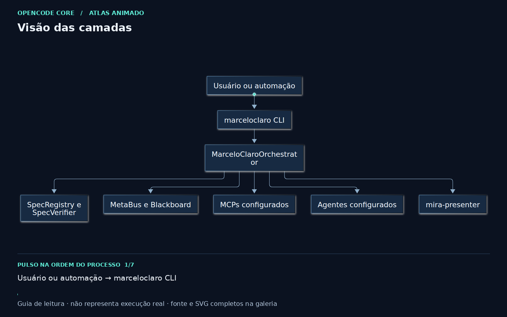</a>

[Abrir animação](animated/diagram-0a347110aad90186.gif) · [SVG ampliável](animated/diagram-0a347110aad90186.svg) · [Mermaid](animated/diagram-0a347110aad90186.mmd)

Origens: [ARCHITECTURE.md](../../ARCHITECTURE.md) (bloco 1).

### Diagrama operacional atual

<a href="animated/diagram-4c75ee83141913a3.gif">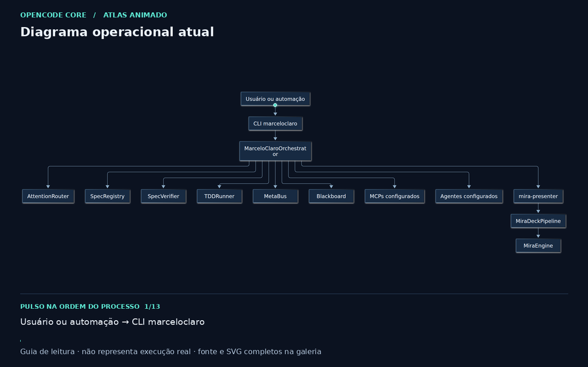</a>

[Abrir animação](animated/diagram-4c75ee83141913a3.gif) · [SVG ampliável](animated/diagram-4c75ee83141913a3.svg) · [Mermaid](animated/diagram-4c75ee83141913a3.mmd)

Origens: [ARCHITECTURE.md](../../ARCHITECTURE.md) (bloco 2).

### Diagrama de Alto Nível

<a href="animated/diagram-a85a7f71216ef7ff.gif">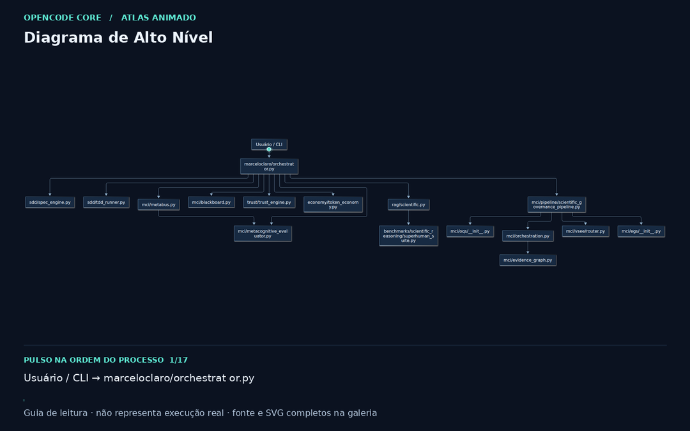</a>

[Abrir animação](animated/diagram-a85a7f71216ef7ff.gif) · [SVG ampliável](animated/diagram-a85a7f71216ef7ff.svg) · [Mermaid](animated/diagram-a85a7f71216ef7ff.mmd)

Origens: [MAPA_ECOSSISTEMA_COMPLETO_2026-07-06.md](../../MAPA_ECOSSISTEMA_COMPLETO_2026-07-06.md) (bloco 1).

### Arquitetura em 60 segundos

<a href="animated/diagram-e19b5e3314e41476.gif">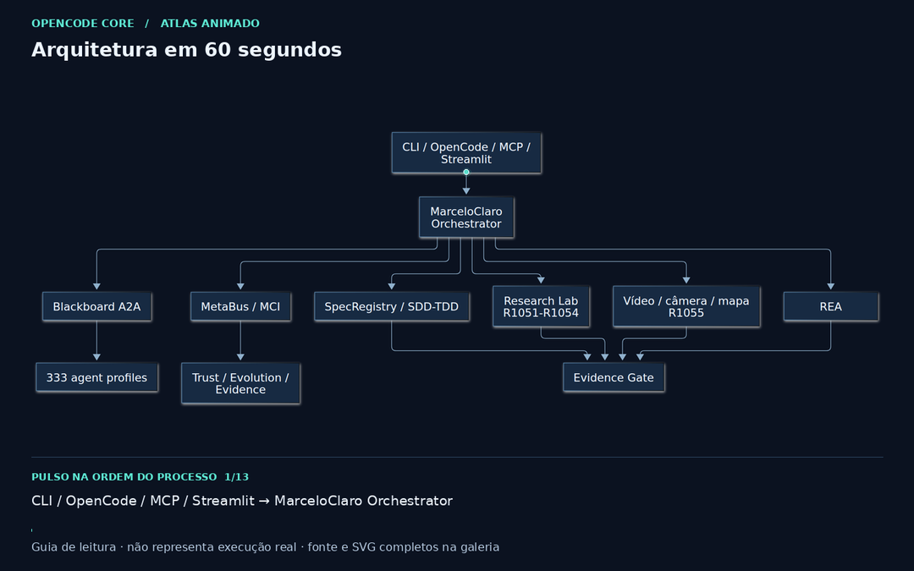</a>

[Abrir animação](animated/diagram-e19b5e3314e41476.gif) · [SVG ampliável](animated/diagram-e19b5e3314e41476.svg) · [Mermaid](animated/diagram-e19b5e3314e41476.mmd)

Origens: [README.md](../../README.md) (bloco 1); [docs/README.md](../../docs/README.md) (bloco 1).

### Mapa da Arquitetura Completa (v3.9.0)

<a href="animated/diagram-c2a59e1bc061653c.gif">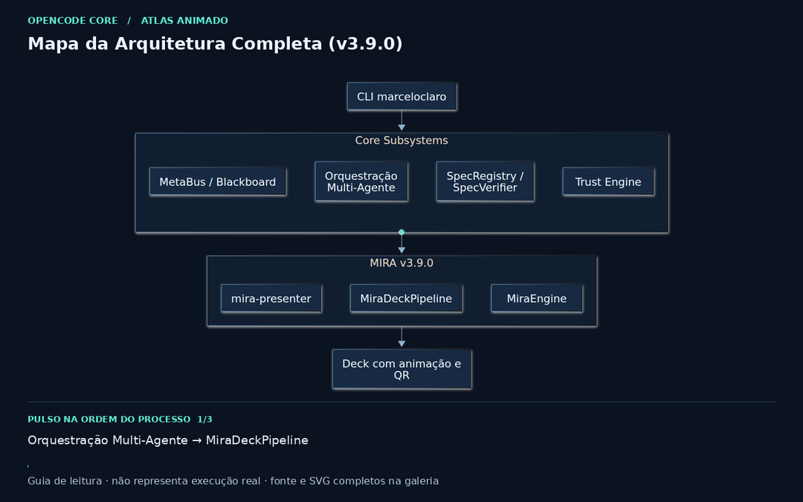</a>

[Abrir animação](animated/diagram-c2a59e1bc061653c.gif) · [SVG ampliável](animated/diagram-c2a59e1bc061653c.svg) · [Mermaid](animated/diagram-c2a59e1bc061653c.mmd)

Origens: [README.md](../../README.md) (bloco 2).

### Diagrama Operacional Atual

<a href="animated/diagram-8e1e0ff7aba73edb.gif">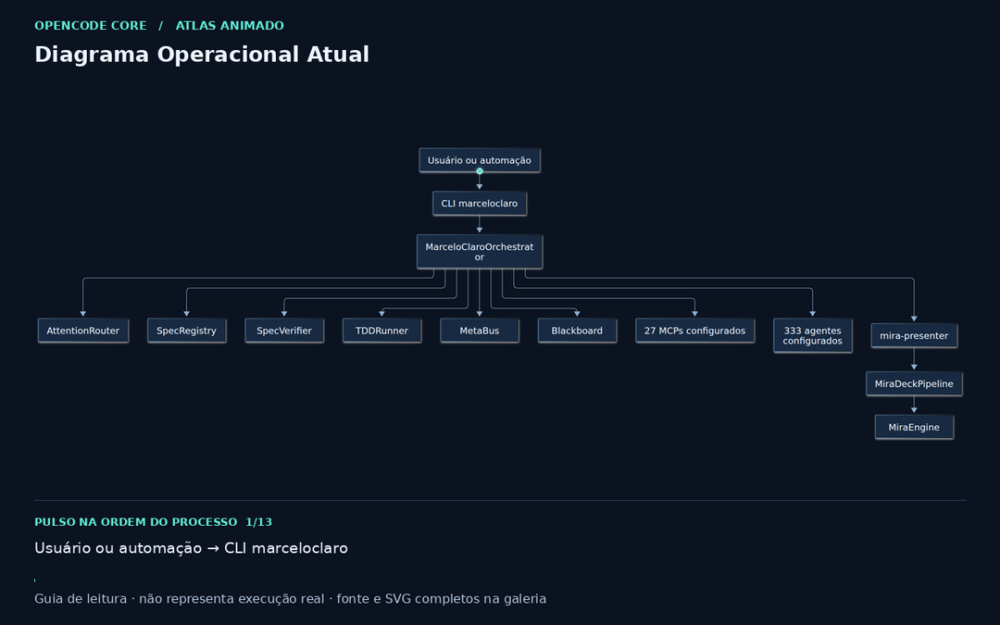</a>

[Abrir animação](animated/diagram-8e1e0ff7aba73edb.gif) · [SVG ampliável](animated/diagram-8e1e0ff7aba73edb.svg) · [Mermaid](animated/diagram-8e1e0ff7aba73edb.mmd)

Origens: [README.md](../../README.md) (bloco 3).

### Fluxos multiárea do checkout atual

<a href="animated/diagram-9d889efcf6907944.gif">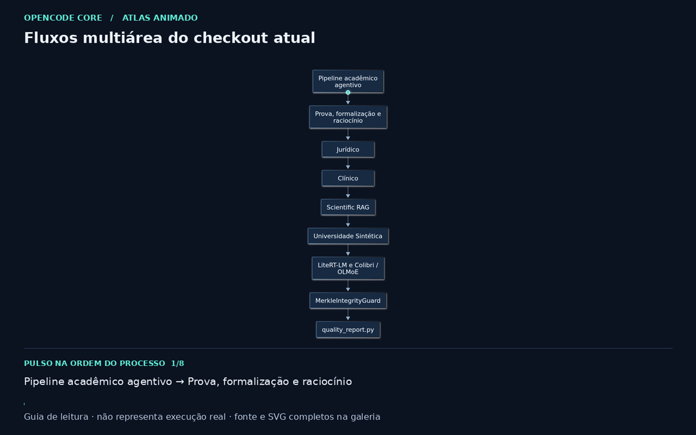</a>

[Abrir animação](animated/diagram-9d889efcf6907944.gif) · [SVG ampliável](animated/diagram-9d889efcf6907944.svg) · [Mermaid](animated/diagram-9d889efcf6907944.mmd)

Origens: [README.md](../../README.md) (bloco 4).

### Como funciona a apresentação MIRA

<a href="animated/diagram-0fc0fb3f7256d5ba.gif">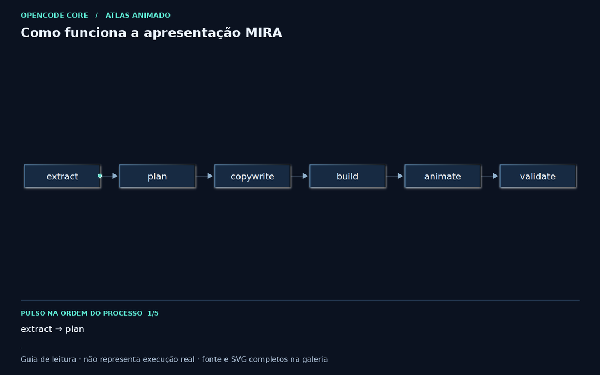</a>

[Abrir animação](animated/diagram-0fc0fb3f7256d5ba.gif) · [SVG ampliável](animated/diagram-0fc0fb3f7256d5ba.svg) · [Mermaid](animated/diagram-0fc0fb3f7256d5ba.mmd)

Origens: [README.md](../../README.md) (bloco 5).

### Ciclo de Vida SDD / TDD

<a href="animated/diagram-ae341a88b5319133.gif">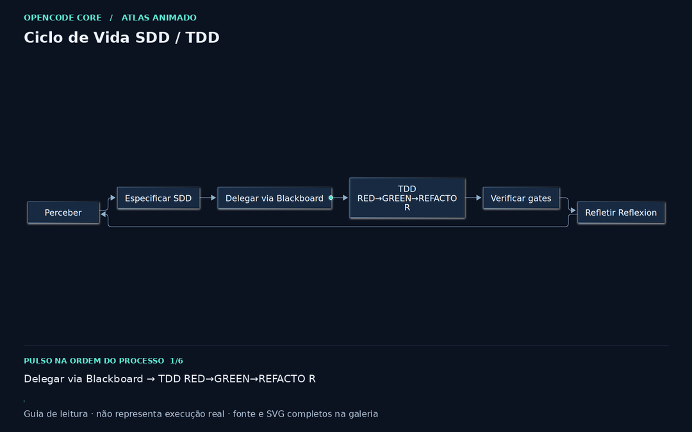</a>

[Abrir animação](animated/diagram-ae341a88b5319133.gif) · [SVG ampliável](animated/diagram-ae341a88b5319133.svg) · [Mermaid](animated/diagram-ae341a88b5319133.mmd)

Origens: [README.md](../../README.md) (bloco 6).

### Panorama completo por camadas

<a href="animated/diagram-a131171c4c7e9553.gif">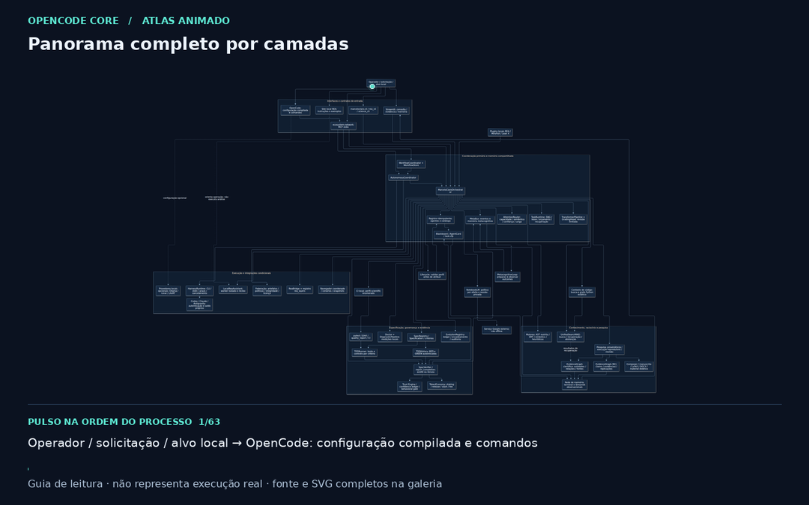</a>

[Abrir animação](animated/diagram-a131171c4c7e9553.gif) · [SVG ampliável](animated/diagram-a131171c4c7e9553.svg) · [Mermaid](animated/diagram-a131171c4c7e9553.mmd)

Origens: [README.md](../../README.md) (bloco 7); [docs/architecture/flows/01-panorama.mmd](../../docs/architecture/flows/01-panorama.mmd).

### Orquestração primária e execução CLI

<a href="animated/diagram-fca207c4f2853c70.gif">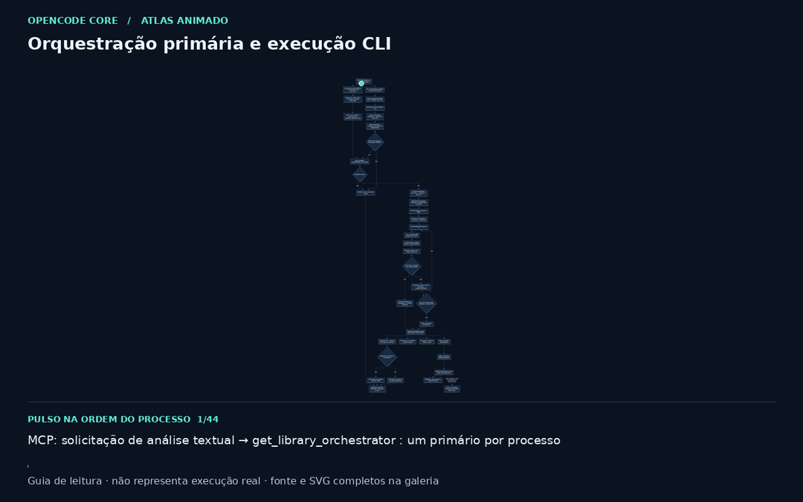</a>

[Abrir animação](animated/diagram-fca207c4f2853c70.gif) · [SVG ampliável](animated/diagram-fca207c4f2853c70.svg) · [Mermaid](animated/diagram-fca207c4f2853c70.mmd)

Origens: [README.md](../../README.md) (bloco 8); [docs/architecture/flows/02-orquestracao.mmd](../../docs/architecture/flows/02-orquestracao.mmd).

### Workflow DAG e retomada

<a href="animated/diagram-b05977d545b7de24.gif">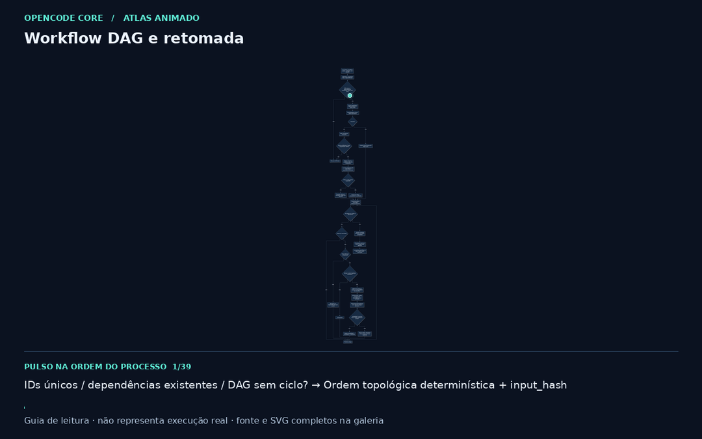</a>

[Abrir animação](animated/diagram-b05977d545b7de24.gif) · [SVG ampliável](animated/diagram-b05977d545b7de24.svg) · [Mermaid](animated/diagram-b05977d545b7de24.mmd)

Origens: [README.md](../../README.md) (bloco 9); [docs/architecture/flows/03-workflow-dag.mmd](../../docs/architecture/flows/03-workflow-dag.mmd).

### SDD e histórico RED–GREEN

<a href="animated/diagram-f30ae99066baffe7.gif">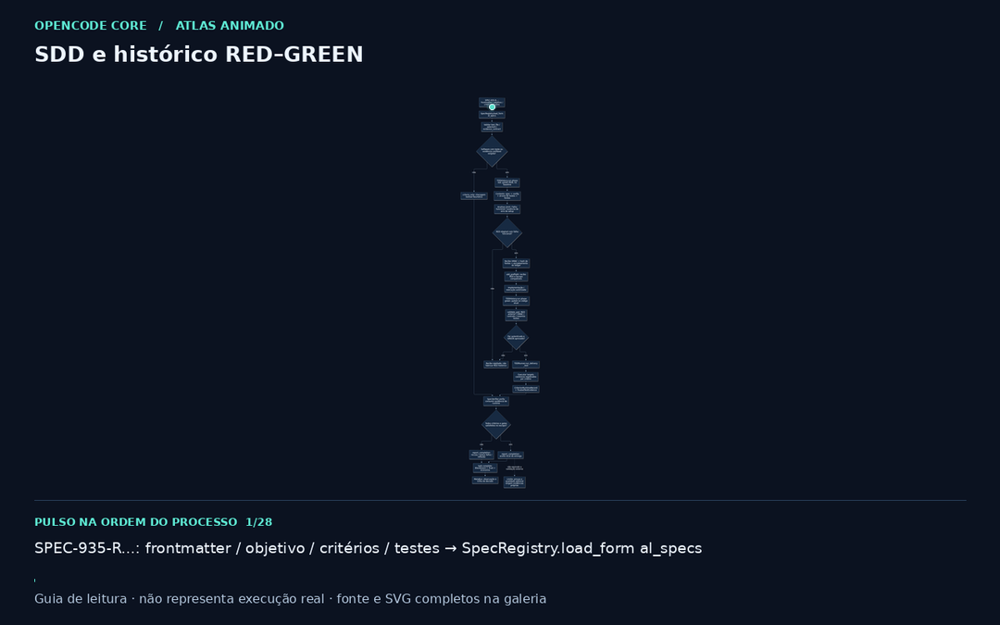</a>

[Abrir animação](animated/diagram-f30ae99066baffe7.gif) · [SVG ampliável](animated/diagram-f30ae99066baffe7.svg) · [Mermaid](animated/diagram-f30ae99066baffe7.mmd)

Origens: [README.md](../../README.md) (bloco 10); [docs/architecture/flows/04-sdd-tdd.mmd](../../docs/architecture/flows/04-sdd-tdd.mmd).

### REA e camadas de provedores

<a href="animated/diagram-5f149863d07e3240.gif">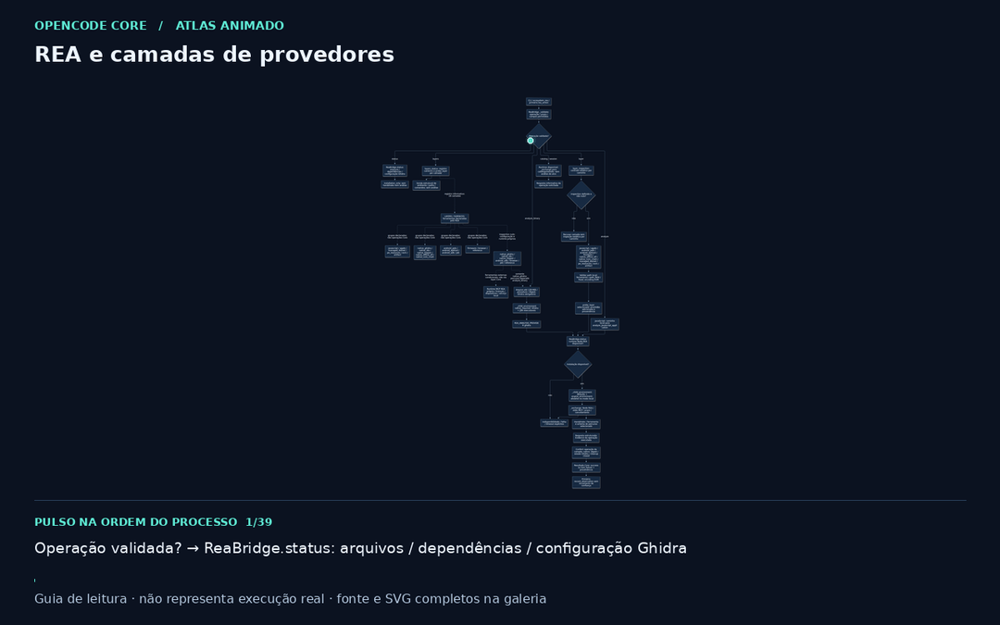</a>

[Abrir animação](animated/diagram-5f149863d07e3240.gif) · [SVG ampliável](animated/diagram-5f149863d07e3240.svg) · [Mermaid](animated/diagram-5f149863d07e3240.mmd)

Origens: [README.md](../../README.md) (bloco 11); [docs/architecture/flows/05-rea-provedores.mmd](../../docs/architecture/flows/05-rea-provedores.mmd).

### REA local direto e evidência

<a href="animated/diagram-f64391e6f070fd4a.gif">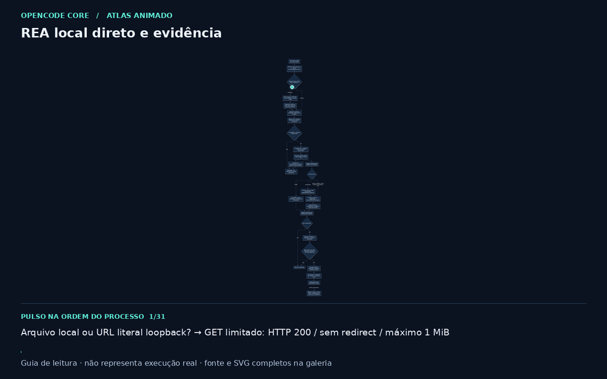</a>

[Abrir animação](animated/diagram-f64391e6f070fd4a.gif) · [SVG ampliável](animated/diagram-f64391e6f070fd4a.svg) · [Mermaid](animated/diagram-f64391e6f070fd4a.mmd)

Origens: [README.md](../../README.md) (bloco 12); [docs/architecture/flows/06-rea-local.mmd](../../docs/architecture/flows/06-rea-local.mmd).

### REA com agente local e gate de recibos

<a href="animated/diagram-9695787734dbc84f.gif">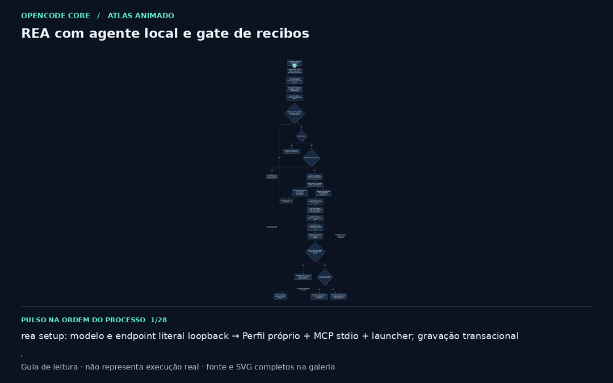</a>

[Abrir animação](animated/diagram-9695787734dbc84f.gif) · [SVG ampliável](animated/diagram-9695787734dbc84f.svg) · [Mermaid](animated/diagram-9695787734dbc84f.mmd)

Origens: [README.md](../../README.md) (bloco 13); [docs/architecture/flows/07-rea-agente.mmd](../../docs/architecture/flows/07-rea-agente.mmd).

### Conhecimento, RAG e grafos de evidência

<a href="animated/diagram-b6d478484fbf90e1.gif">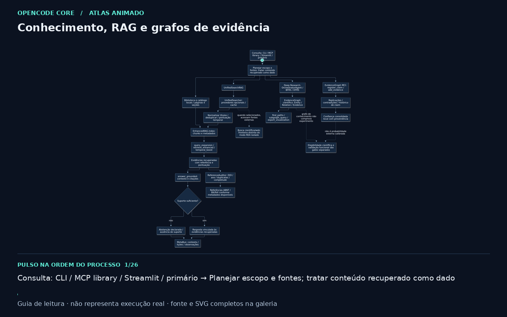</a>

[Abrir animação](animated/diagram-b6d478484fbf90e1.gif) · [SVG ampliável](animated/diagram-b6d478484fbf90e1.svg) · [Mermaid](animated/diagram-b6d478484fbf90e1.mmd)

Origens: [README.md](../../README.md) (bloco 14); [docs/architecture/flows/08-conhecimento-rag.mmd](../../docs/architecture/flows/08-conhecimento-rag.mmd).

### Rede de memória observável

<a href="animated/diagram-d8277393ea44679f.gif">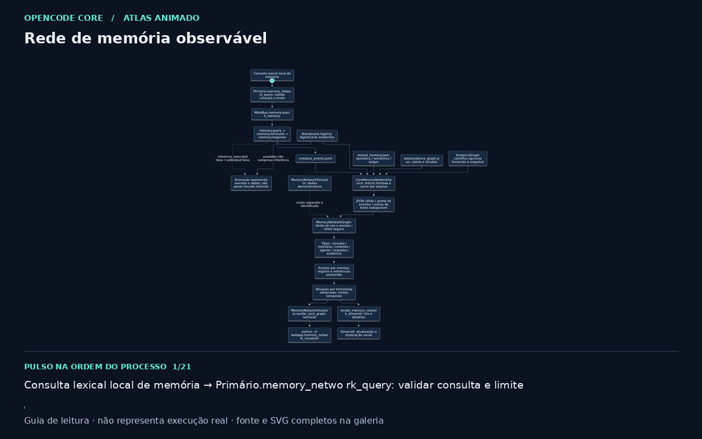</a>

[Abrir animação](animated/diagram-d8277393ea44679f.gif) · [SVG ampliável](animated/diagram-d8277393ea44679f.svg) · [Mermaid](animated/diagram-d8277393ea44679f.mmd)

Origens: [README.md](../../README.md) (bloco 15); [docs/architecture/flows/09-memoria-observavel.mmd](../../docs/architecture/flows/09-memoria-observavel.mmd).

### Raciocínio restrito e fallbacks

<a href="animated/diagram-a52c85b1012c269c.gif">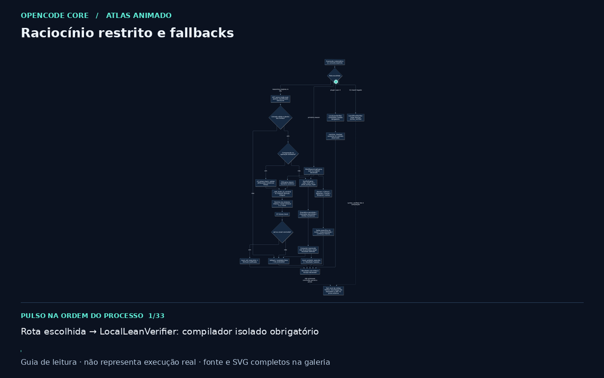</a>

[Abrir animação](animated/diagram-a52c85b1012c269c.gif) · [SVG ampliável](animated/diagram-a52c85b1012c269c.svg) · [Mermaid](animated/diagram-a52c85b1012c269c.mmd)

Origens: [README.md](../../README.md) (bloco 16); [docs/architecture/flows/10-raciocinio.mmd](../../docs/architecture/flows/10-raciocinio.mmd).

### Diagnóstico, confiança, federação e evolução

<a href="animated/diagram-b1191de7207d8158.gif">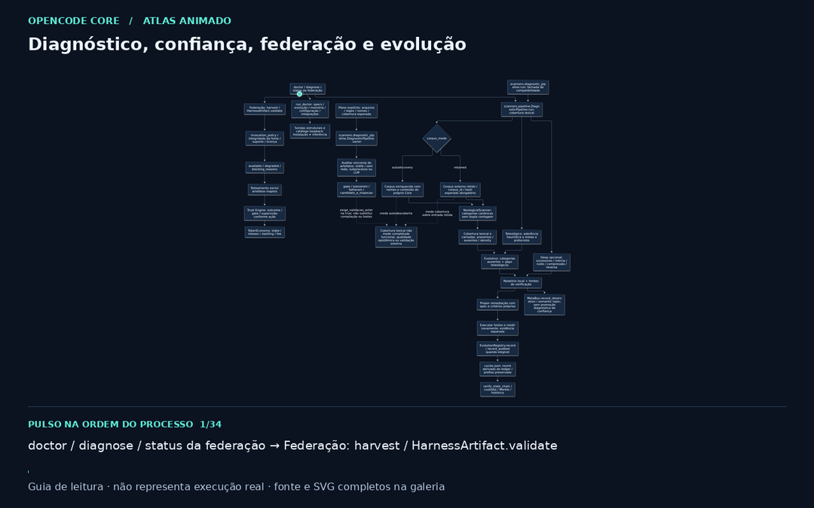</a>

[Abrir animação](animated/diagram-b1191de7207d8158.gif) · [SVG ampliável](animated/diagram-b1191de7207d8158.svg) · [Mermaid](animated/diagram-b1191de7207d8158.mmd)

Origens: [README.md](../../README.md) (bloco 17); [docs/architecture/flows/11-diagnostico-governanca.mmd](../../docs/architecture/flows/11-diagnostico-governanca.mmd).

### Ciência, proveniência e publicação

<a href="animated/diagram-829bfb0c2728f8e8.gif">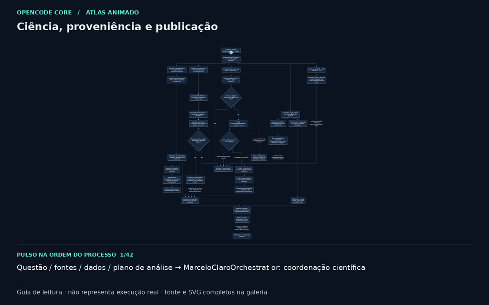</a>

[Abrir animação](animated/diagram-829bfb0c2728f8e8.gif) · [SVG ampliável](animated/diagram-829bfb0c2728f8e8.svg) · [Mermaid](animated/diagram-829bfb0c2728f8e8.mmd)

Origens: [README.md](../../README.md) (bloco 18); [docs/architecture/flows/12-ciencia-publicacao.mmd](../../docs/architecture/flows/12-ciencia-publicacao.mmd).

### Validação e entrega

<a href="animated/diagram-29a96da731327441.gif">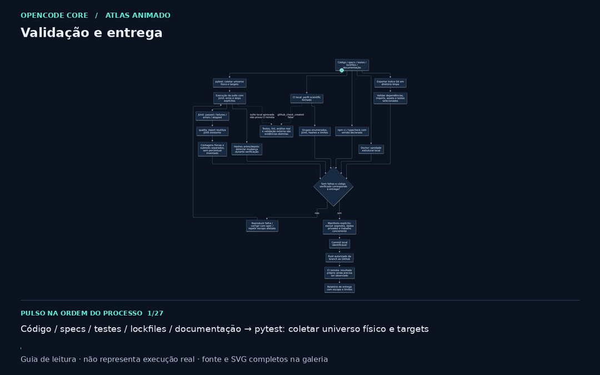</a>

[Abrir animação](animated/diagram-29a96da731327441.gif) · [SVG ampliável](animated/diagram-29a96da731327441.svg) · [Mermaid](animated/diagram-29a96da731327441.mmd)

Origens: [README.md](../../README.md) (bloco 19); [docs/architecture/flows/13-validacao-entrega.mmd](../../docs/architecture/flows/13-validacao-entrega.mmd).

### Plugins locais, Lean 4 e MiroFish

<a href="animated/diagram-83a0417e20f0d613.gif">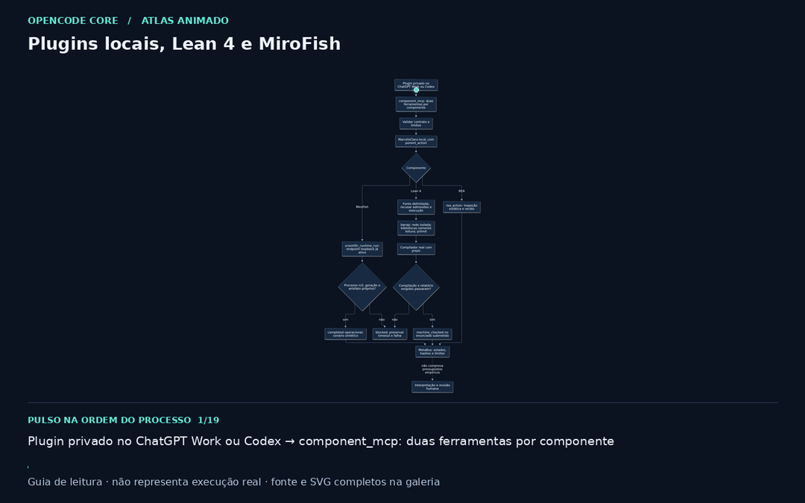</a>

[Abrir animação](animated/diagram-83a0417e20f0d613.gif) · [SVG ampliável](animated/diagram-83a0417e20f0d613.svg) · [Mermaid](animated/diagram-83a0417e20f0d613.mmd)

Origens: [README.md](../../README.md) (bloco 20); [docs/architecture/flows/14-plugins-locais.mmd](../../docs/architecture/flows/14-plugins-locais.mmd).

### NotebookLM coordenado e política R915

<a href="animated/diagram-d6956b6d79e1eb30.gif">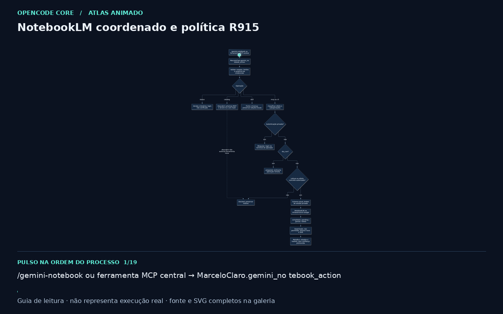</a>

[Abrir animação](animated/diagram-d6956b6d79e1eb30.gif) · [SVG ampliável](animated/diagram-d6956b6d79e1eb30.svg) · [Mermaid](animated/diagram-d6956b6d79e1eb30.mmd)

Origens: [README.md](../../README.md) (bloco 21); [docs/architecture/flows/15-notebooklm.mmd](../../docs/architecture/flows/15-notebooklm.mmd).

### Autenticações de ChatGPT, Gemini e NotebookLM

<a href="animated/diagram-052725f98ca383e6.gif">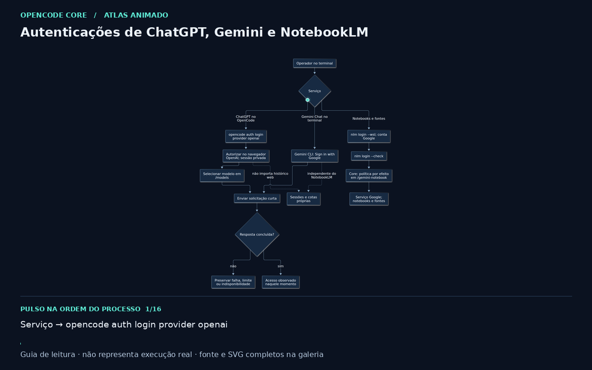</a>

[Abrir animação](animated/diagram-052725f98ca383e6.gif) · [SVG ampliável](animated/diagram-052725f98ca383e6.svg) · [Mermaid](animated/diagram-052725f98ca383e6.mmd)

Origens: [README.md](../../README.md) (bloco 22); [docs/architecture/flows/16-autenticacoes.mmd](../../docs/architecture/flows/16-autenticacoes.mmd).

### Ciclo metacognitivo e memória de outcomes

<a href="animated/diagram-456a5348c47deb90.gif">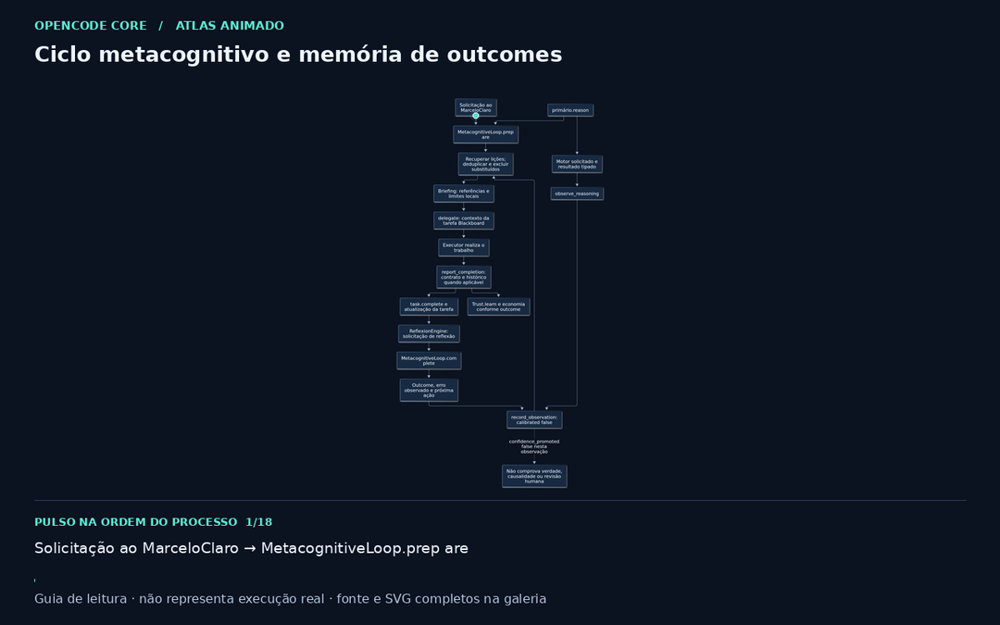</a>

[Abrir animação](animated/diagram-456a5348c47deb90.gif) · [SVG ampliável](animated/diagram-456a5348c47deb90.svg) · [Mermaid](animated/diagram-456a5348c47deb90.mmd)

Origens: [README.md](../../README.md) (bloco 23); [docs/architecture/flows/17-metacognicao.mmd](../../docs/architecture/flows/17-metacognicao.mmd).

### Lifecycle permanente de agentes e subagentes

<a href="animated/diagram-09169c4fd46e8766.gif">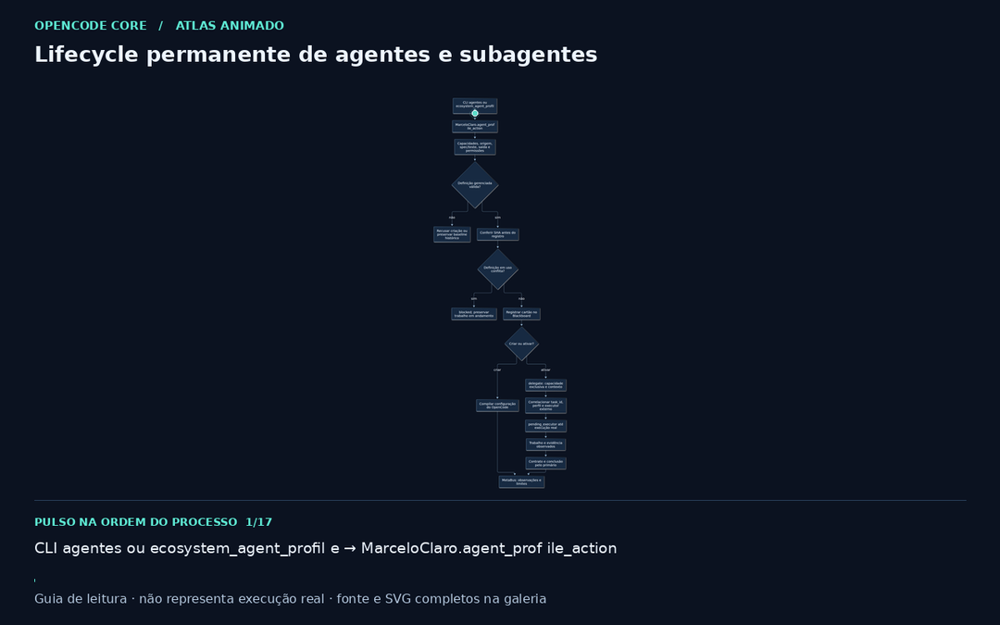</a>

[Abrir animação](animated/diagram-09169c4fd46e8766.gif) · [SVG ampliável](animated/diagram-09169c4fd46e8766.svg) · [Mermaid](animated/diagram-09169c4fd46e8766.mmd)

Origens: [README.md](../../README.md) (bloco 24); [docs/architecture/flows/18-lifecycle.mmd](../../docs/architecture/flows/18-lifecycle.mmd).

### CI local e validação delimitada

<a href="animated/diagram-4dda0aecf20b2d9d.gif">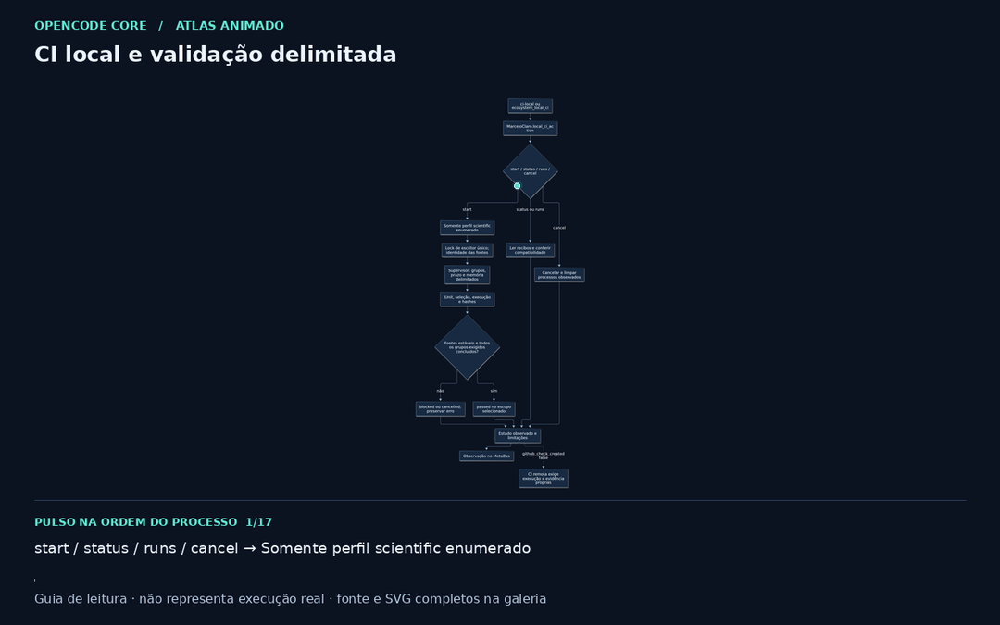</a>

[Abrir animação](animated/diagram-4dda0aecf20b2d9d.gif) · [SVG ampliável](animated/diagram-4dda0aecf20b2d9d.svg) · [Mermaid](animated/diagram-4dda0aecf20b2d9d.mmd)

Origens: [README.md](../../README.md) (bloco 25); [docs/architecture/flows/19-ci-local.mmd](../../docs/architecture/flows/19-ci-local.mmd).

### Seleção econômica de modelos e contexto

<a href="animated/diagram-5e4fa5583c5976f3.gif">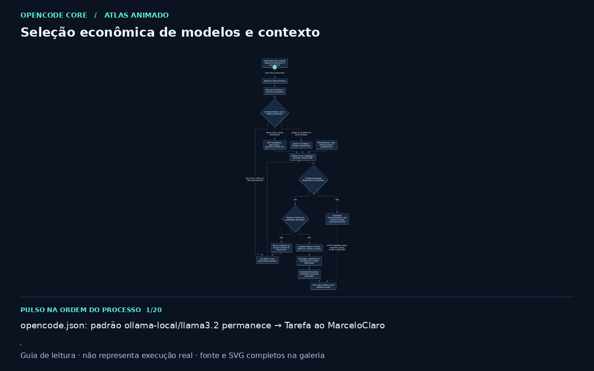</a>

[Abrir animação](animated/diagram-5e4fa5583c5976f3.gif) · [SVG ampliável](animated/diagram-5e4fa5583c5976f3.svg) · [Mermaid](animated/diagram-5e4fa5583c5976f3.mmd)

Origens: [README.md](../../README.md) (bloco 26); [docs/architecture/flows/20-economia-modelos.mmd](../../docs/architecture/flows/20-economia-modelos.mmd).

### Contexto de código e consultas de grafo

<a href="animated/diagram-61c4c013d6202872.gif">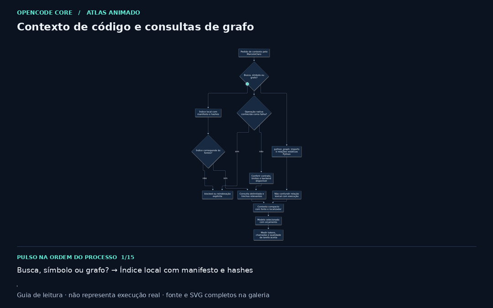</a>

[Abrir animação](animated/diagram-61c4c013d6202872.gif) · [SVG ampliável](animated/diagram-61c4c013d6202872.svg) · [Mermaid](animated/diagram-61c4c013d6202872.mmd)

Origens: [README.md](../../README.md) (bloco 27); [docs/architecture/flows/21-contexto-codigo.mmd](../../docs/architecture/flows/21-contexto-codigo.mmd).

### Contexto, erros e telemetria de Ollama local

<a href="animated/diagram-9e5a1f7dd8a923ea.gif">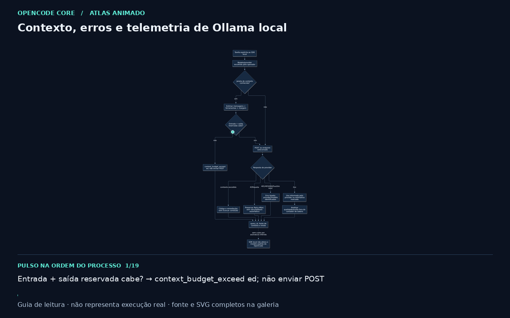</a>

[Abrir animação](animated/diagram-9e5a1f7dd8a923ea.gif) · [SVG ampliável](animated/diagram-9e5a1f7dd8a923ea.svg) · [Mermaid](animated/diagram-9e5a1f7dd8a923ea.mmd)

Origens: [README.md](../../README.md) (bloco 28); [docs/architecture/flows/22-ollama-contexto-erros.mmd](../../docs/architecture/flows/22-ollama-contexto-erros.mmd).

### Contribuindo

<a href="animated/diagram-f7dff79343b1ad37.gif">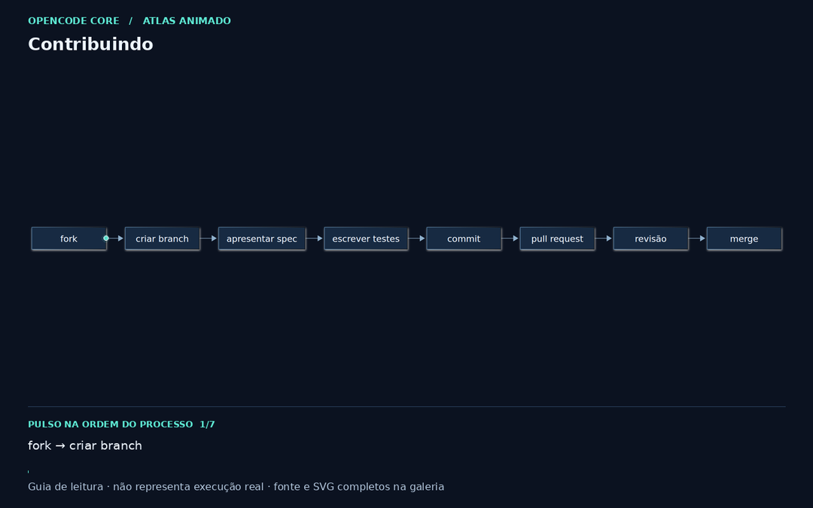</a>

[Abrir animação](animated/diagram-f7dff79343b1ad37.gif) · [SVG ampliável](animated/diagram-f7dff79343b1ad37.svg) · [Mermaid](animated/diagram-f7dff79343b1ad37.mmd)

Origens: [README.md](../../README.md) (bloco 29).

### O que foi integrado

<a href="animated/diagram-1372cc41a353c17e.gif">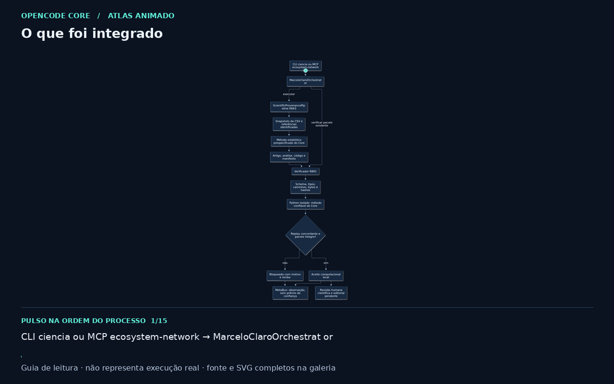</a>

[Abrir animação](animated/diagram-1372cc41a353c17e.gif) · [SVG ampliável](animated/diagram-1372cc41a353c17e.svg) · [Mermaid](animated/diagram-1372cc41a353c17e.mmd)

Origens: [docs/ACEITE_CIENTIFICO_LOCAL_R891.md](../../docs/ACEITE_CIENTIFICO_LOCAL_R891.md) (bloco 1).

### ChatGPT pelo OpenCode

<a href="animated/diagram-81a3f5bb1dc6f17f.gif">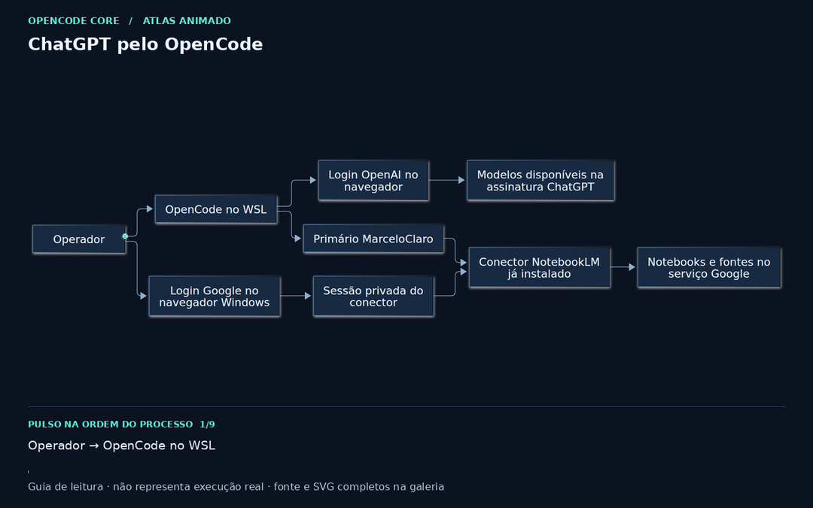</a>

[Abrir animação](animated/diagram-81a3f5bb1dc6f17f.gif) · [SVG ampliável](animated/diagram-81a3f5bb1dc6f17f.svg) · [Mermaid](animated/diagram-81a3f5bb1dc6f17f.mmd)

Origens: [docs/AUTENTICACAO_CHATGPT_NOTEBOOKLM.md](../../docs/AUTENTICACAO_CHATGPT_NOTEBOOKLM.md) (bloco 1).

### Fluxo recomendado dentro da arquitetura existente

<a href="animated/diagram-bf3f77a82c45ea0f.gif">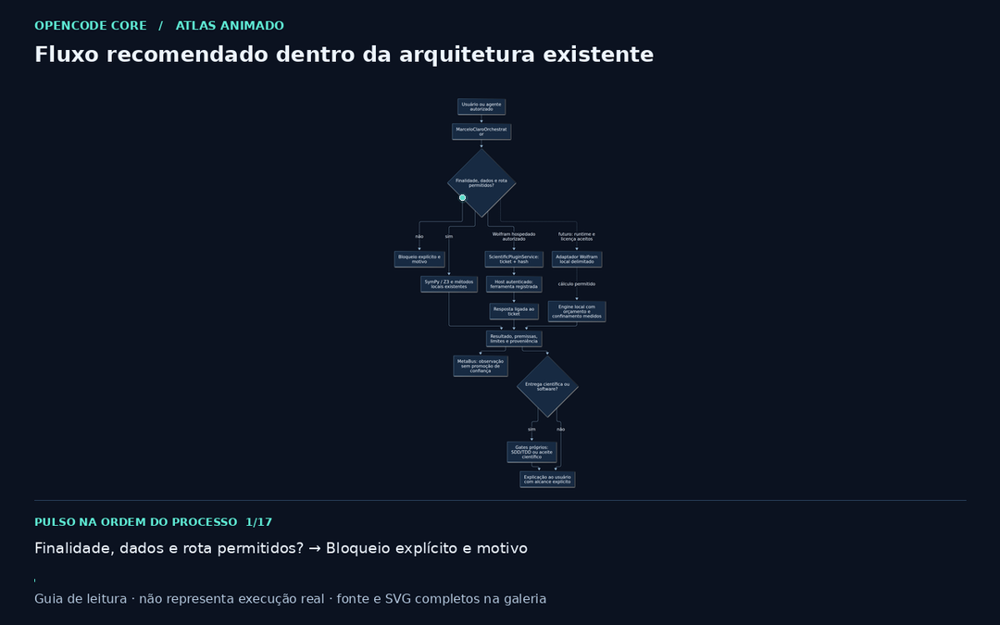</a>

[Abrir animação](animated/diagram-bf3f77a82c45ea0f.gif) · [SVG ampliável](animated/diagram-bf3f77a82c45ea0f.svg) · [Mermaid](animated/diagram-bf3f77a82c45ea0f.mmd)

Origens: [docs/AVALIACAO_WOLFRAM_CORE_R895.md](../../docs/AVALIACAO_WOLFRAM_CORE_R895.md) (bloco 1).

### Pipeline audiovisual R1055

<a href="animated/diagram-a5f718c8b3d6d219.gif">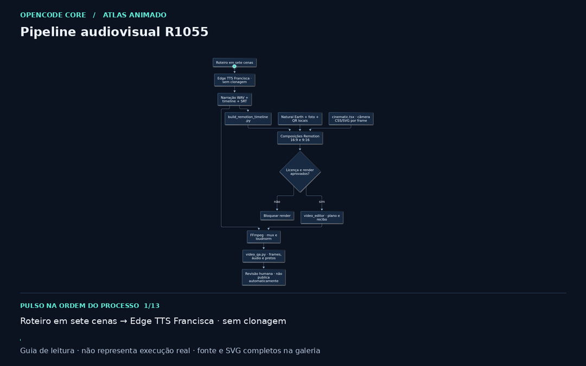</a>

[Abrir animação](animated/diagram-a5f718c8b3d6d219.gif) · [SVG ampliável](animated/diagram-a5f718c8b3d6d219.svg) · [Mermaid](animated/diagram-a5f718c8b3d6d219.mmd)

Origens: [docs/CINEMATIC_REMOTION_R1055.md](../../docs/CINEMATIC_REMOTION_R1055.md) (bloco 1).

### Evolução do conhecimento e pesquisa reproduzível

<a href="animated/diagram-2a9d97dea7a3cd7c.gif">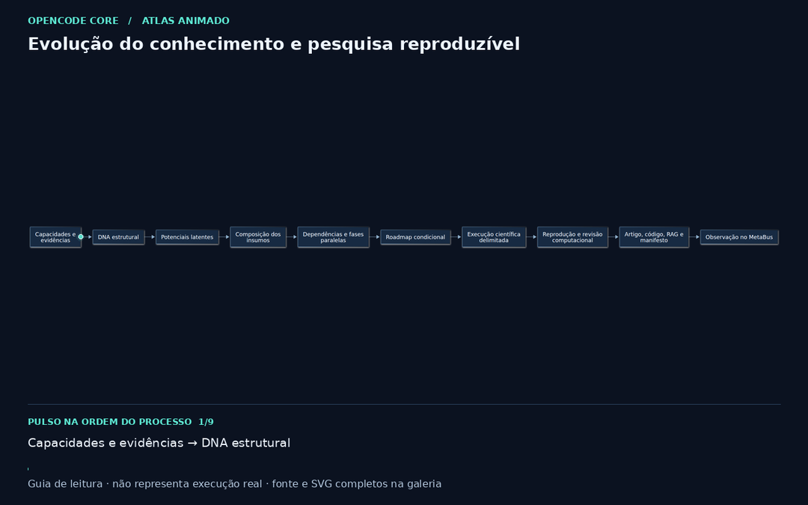</a>

[Abrir animação](animated/diagram-2a9d97dea7a3cd7c.gif) · [SVG ampliável](animated/diagram-2a9d97dea7a3cd7c.svg) · [Mermaid](animated/diagram-2a9d97dea7a3cd7c.mmd)

Origens: [docs/CONHECIMENTO_CIENTIFICO_R663_R666.md](../../docs/CONHECIMENTO_CIENTIFICO_R663_R666.md) (bloco 1).

### Contexto de código local — R887

<a href="animated/diagram-a240de7a75b447de.gif">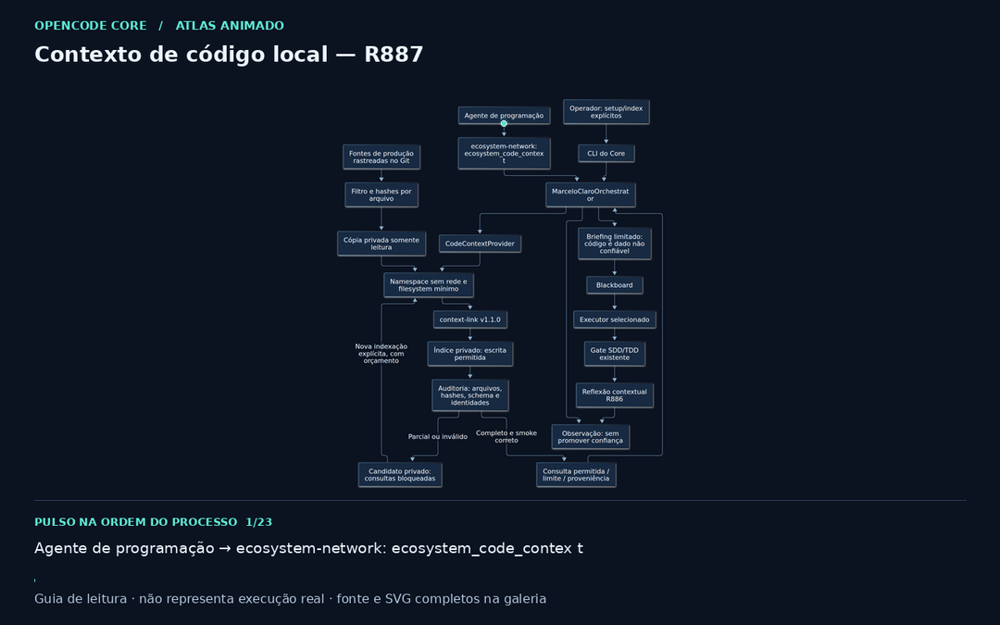</a>

[Abrir animação](animated/diagram-a240de7a75b447de.gif) · [SVG ampliável](animated/diagram-a240de7a75b447de.svg) · [Mermaid](animated/diagram-a240de7a75b447de.mmd)

Origens: [docs/CONTEXTO_CODIGO_LOCAL_R887.md](../../docs/CONTEXTO_CODIGO_LOCAL_R887.md) (bloco 1).

### O que R890 mudou no código existente

<a href="animated/diagram-96fc8cf3f7a01e0f.gif">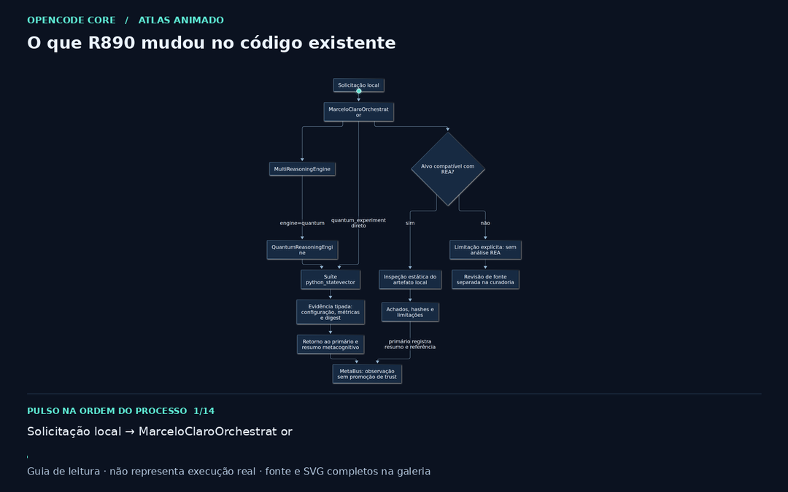</a>

[Abrir animação](animated/diagram-96fc8cf3f7a01e0f.gif) · [SVG ampliável](animated/diagram-96fc8cf3f7a01e0f.svg) · [Mermaid](animated/diagram-96fc8cf3f7a01e0f.mmd)

Origens: [docs/DECISOES_ADAPTACAO_REPOS_R890.md](../../docs/DECISOES_ADAPTACAO_REPOS_R890.md) (bloco 1).

### Ciclo metacognitivo integrado — R886

<a href="animated/diagram-a74ec60eff3c99a2.gif">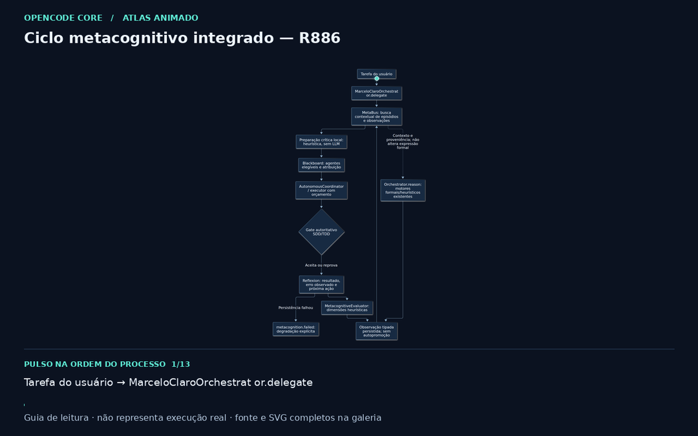</a>

[Abrir animação](animated/diagram-a74ec60eff3c99a2.gif) · [SVG ampliável](animated/diagram-a74ec60eff3c99a2.svg) · [Mermaid](animated/diagram-a74ec60eff3c99a2.mmd)

Origens: [docs/METACOGNICA_INTEGRADA_R886.md](../../docs/METACOGNICA_INTEGRADA_R886.md) (bloco 1).

### Registro e ativação pelo primário

<a href="animated/diagram-899949e238720352.gif">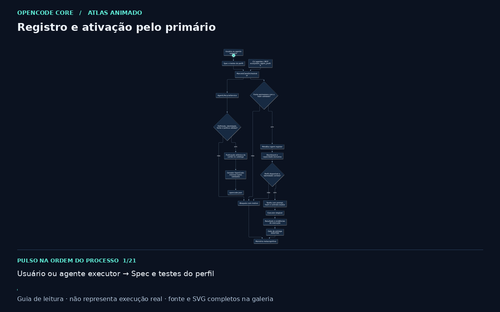</a>

[Abrir animação](animated/diagram-899949e238720352.gif) · [SVG ampliável](animated/diagram-899949e238720352.svg) · [Mermaid](animated/diagram-899949e238720352.mmd)

Origens: [docs/ORQUESTRACAO_AGENTES_PLUGINS_CI_R894_R897.md](../../docs/ORQUESTRACAO_AGENTES_PLUGINS_CI_R894_R897.md) (bloco 1).

### Vinte plugins, um registro de capacidades

<a href="animated/diagram-b3a6ae7a9d2b3d4d.gif">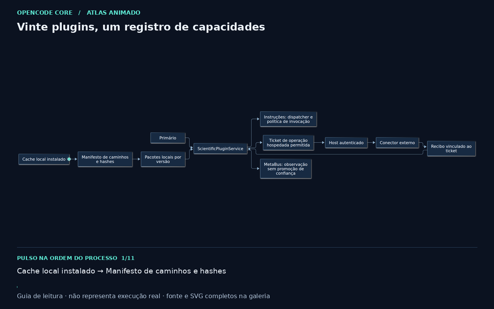</a>

[Abrir animação](animated/diagram-b3a6ae7a9d2b3d4d.gif) · [SVG ampliável](animated/diagram-b3a6ae7a9d2b3d4d.svg) · [Mermaid](animated/diagram-b3a6ae7a9d2b3d4d.mmd)

Origens: [docs/ORQUESTRACAO_AGENTES_PLUGINS_CI_R894_R897.md](../../docs/ORQUESTRACAO_AGENTES_PLUGINS_CI_R894_R897.md) (bloco 2).

### CI independente da cobrança GitHub

<a href="animated/diagram-9a0642ee46b2aafb.gif">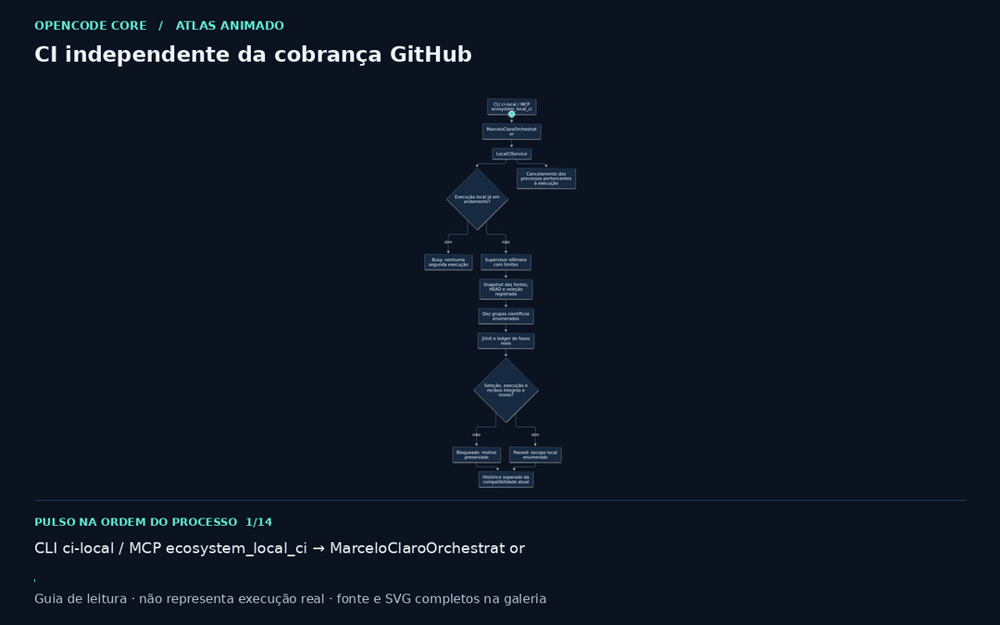</a>

[Abrir animação](animated/diagram-9a0642ee46b2aafb.gif) · [SVG ampliável](animated/diagram-9a0642ee46b2aafb.svg) · [Mermaid](animated/diagram-9a0642ee46b2aafb.mmd)

Origens: [docs/ORQUESTRACAO_AGENTES_PLUGINS_CI_R894_R897.md](../../docs/ORQUESTRACAO_AGENTES_PLUGINS_CI_R894_R897.md) (bloco 3).

### Resultado entregue

<a href="animated/diagram-88e2b4838b9045f6.gif">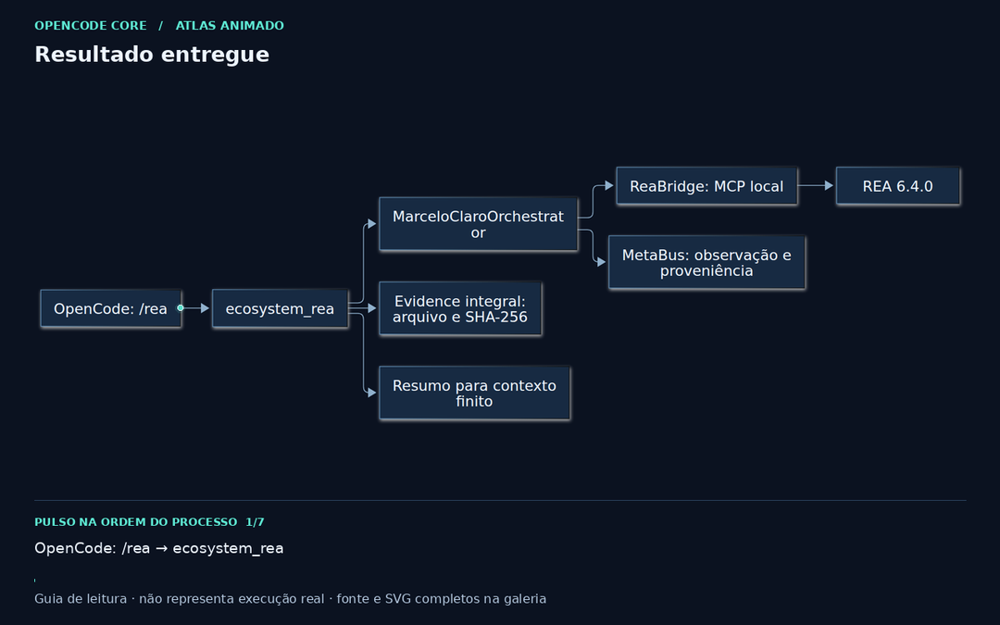</a>

[Abrir animação](animated/diagram-88e2b4838b9045f6.gif) · [SVG ampliável](animated/diagram-88e2b4838b9045f6.svg) · [Mermaid](animated/diagram-88e2b4838b9045f6.mmd)

Origens: [docs/REVISAO_ECOSSISTEMA_R808.md](../../docs/REVISAO_ECOSSISTEMA_R808.md) (bloco 1).

### Coordenação em etapas e retomada

<a href="animated/diagram-57fc3d7d66f7c94b.gif">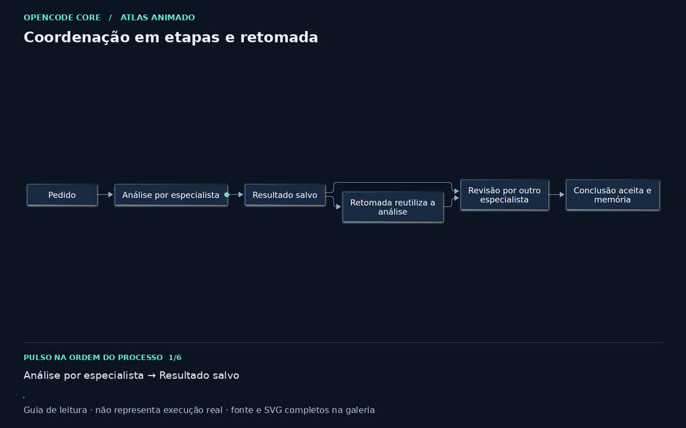</a>

[Abrir animação](animated/diagram-57fc3d7d66f7c94b.gif) · [SVG ampliável](animated/diagram-57fc3d7d66f7c94b.svg) · [Mermaid](animated/diagram-57fc3d7d66f7c94b.mmd)

Origens: [docs/WORKFLOWS_R644.md](../../docs/WORKFLOWS_R644.md) (bloco 1).

### Inventário integral — síntese por camadas

<a href="animated/diagram-5252748b2be4fc04.gif">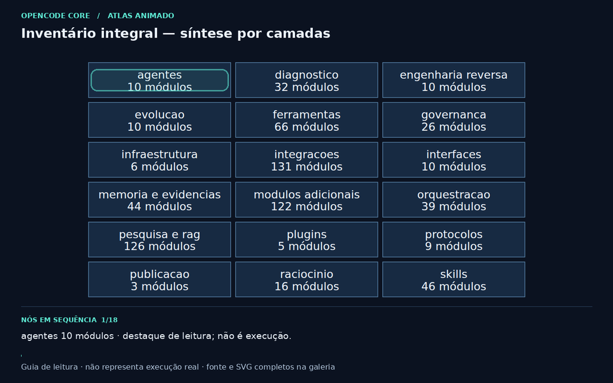</a>

[Abrir animação](animated/diagram-5252748b2be4fc04.gif) · [SVG ampliável](animated/diagram-5252748b2be4fc04.svg) · [Mermaid](animated/diagram-5252748b2be4fc04.mmd)

Origens: [docs/architecture/architecture-inventory.json](../../docs/architecture/architecture-inventory.json).

## Limites de cobertura

Escopo: Markdown rastreado na raiz e em `docs/`, mais os 22 fluxos
do catálogo. Fontes duplicadas compartilham bytes e mídia. Históricos
continuam históricos: animação não atualiza a auditoria R916 nem R808.
O grafo integral recebe uma **síntese por camadas**, sem suas arestas;
[711 módulos e relações originais](dependencies.svg) permanecem disponíveis.
Specs, relatórios, fornecedores e livros não são reescritos por esta rodada.
