```{=html}
<div class="capa">
  <div class="capa-arte"></div>
  <div class="capa-conteudo">
    <p class="capa-eyebrow">OPENCODE ECOSYSTEM CORE · EDIÇÃO BLACK</p>
    <h1 class="capa-titulo">Bohm na Escola</h1>
    <p class="capa-subtitulo">Onda piloto, diálogo e totalidade no ensino de informação quântica</p>
    <p class="capa-livro">Livro didático e laboratório · PennyLane · Cirq · Qiskit</p>
    <p class="capa-publico">9º ano do Ensino Fundamental e Ensino Médio</p>
    <div class="capa-selo">BNCC Computação · Design black · Práticas de laboratório</div>
  </div>
</div>
```

```{=html}
<div class="rosto">
  <p class="rosto-colecao">Coleção Educação Básica · Edição Black</p>
  <h1 class="rosto-titulo">Bohm na Escola</h1>
  <p class="rosto-subtitulo">Onda piloto, diálogo e totalidade no ensino de informação quântica</p>
  <p class="rosto-linha"></p>
  <p class="rosto-descricao">Livro do estudante, laboratório de práticas e manual do professor.<br>
  Uma aula sobre o que pode estar acontecendo — e sobre como pensar juntos.</p>
  <p class="rosto-autoria">Orquestração editorial: <strong>marceloclaro</strong><br>
  OpenCode Ecosystem Core</p>
  <p class="rosto-edicao">1.ª edição · 2026</p>
  <p class="rosto-aviso">Material didático para uso em sala de aula.<br>
  Bohm é apresentado como uma lente entre várias — não como consenso científico.<br>
  </p>
</div>
```

# Como ler este livro {#como-ler}

Esta edição foi desenhada em **preto**, para tela, projetor e leitura noturna.
Ela não substitui a edição clara: para impressão em grande quantidade, o fundo
escuro consome tinta. Use esta versão quando a tela for o meio principal.

## Os sinais do caminho

::: {.box-bohm}
**🌊 Lente de Bohm.** Uma ideia de David Bohm — onda piloto, diálogo, ordem
implicada — apresentada com o cuidado de distinguir **interpretação**, **analogia**
e **fato experimental**.
:::

::: {.box-pratica}
**🧪 Prática de laboratório.** Código executável em PennyLane, Cirq ou Qiskit.
Toda prática tem objetivo, código, resultado esperado e um checkpoint.
:::

::: {.box-limite}
**⚠️ Limite.** O ponto em que a analogia, o modelo ou a interpretação deixa de
funcionar. Não é um detalhe: é parte do conceito.
:::

::: {.box-dialogo}
**🗣️ Roda de diálogo.** Um gesto bohminiano: suspender suposições, escutar,
desacelerar e investigar o pensamento em conjunto.
:::

::: {.box-diario}
**✍️ Diário de bordo.** Três perguntas: o que eu vi, o que eu suponho, o que eu
quero testar. O diário é o elo entre a prática e o pensamento.
:::

## A promessa e o limite desta edição

A promessa é simples: você vai **ver** a mecânica quântica funcionando em três
bibliotecas diferentes, vai **desenhar** o mesmo estado de Bell em PennyLane,
Cirq e Qiskit, e vai **discutir** o que essas representações não mostram.

O limite é igualmente simples: nenhuma dessas bibliotecas prova que a onda piloto
é a descrição correta do mundo. Elas calculam previsões. A interpretação de Bohm
é uma das leituras possíveis dessas previsões — não a única, nem a majoritária.

> **Regra de ouro desta edição:** sempre que alguém disser “a física quântica é
> assim”, pergunte: *isso é um resultado experimental, uma interpretação ou uma
> analogia?* As três coisas têm valor, mas não são a mesma coisa.

## O que você precisa ter em mãos

- Este livro (PDF ou HTML).
- O notebook `AULA_BOHM_LABORATORIO.ipynb` no Google Colab ou Jupyter.
- Acesso à internet para instalar as bibliotecas na primeira vez.
- Caderno, lápis e, se possível, um projetor para as rodas de diálogo.

## Instalação rápida (Colab)

No início do notebook, execute uma vez:

```bash
!pip install -q pennylane qiskit cirq pylatexenc
```

As três bibliotecas são gratuitas e de código aberto. O notebook foi testado com
PennyLane 0.45, Cirq 1.7 e Qiskit 2.6. Versões diferentes podem mudar pequenos
detalhes de desenho, mas os conceitos permanecem.

# Carta ao estudante {#carta-estudante}

Você já ouviu que a mecânica quântica é estranha. Provavelmente ouviu também que
ninguém entende. As duas frases são meio verdadeiras e meio preguiçosas.

David Bohm foi um físico que levou a estranheza a sério. Em vez de dizer “não
pergunte o que acontece antes da medição”, ele propôs uma imagem: **uma onda que
guia partículas que sempre têm uma posição**. Essa imagem não é a única, mas é
poderosa — e nos obriga a dizer, com clareza, o que estamos supondo.

Este livro usa Bohm de três modos:

1. **Como lente ontológica:** e se houver uma trajetória? O que ganhamos e o que
   perdemos ao imaginar isso?
2. **Como pedagogia do diálogo:** como pensar junto sem transformar a conversa
   em disputa?
3. **Como poética da totalidade:** a ideia de que o todo pode estar presente em
   cada parte — uma analogia para o emaranhamento, não uma prova.

Você não precisa concordar com Bohm. Precisa saber **o que ele propôs**, **por que
isso faz as mesmas previsões** e **qual é o preço** da proposta. Isso é educação
científica: não é colecionar nomes, é aprender a avaliar modelos.

::: {.box-diario}
**✍️ Antes de começar.** Escreva em uma frase: *o que eu acho que acontece entre
duas medições?* Guarde. No final, releia e veja se a pergunta mudou.
:::

# Carta ao professor {#carta-professor}

Esta edição nasceu de um pedido: ensinar Bohm na educação básica, com rigor e com
prática o tempo todo, usando ilustrações geradas por PennyLane, Cirq e Qiskit.

## O que esta edição é

- Uma **lente interpretativa** sobre a informação quântica, não um curso de
  mecânica quântica completa.
- Um **laboratório** com três bibliotecas reais e figuras geradas por código.
- Uma **pedagogia de diálogo** inspirada em Bohm, com protocolo de sala.
- Um material **visual black**, pensado para tela e projetor.
- Um convite a separar **fato**, **interpretação** e **analogia**.

## O que esta edição não é

- Não afirma que a onda piloto é a interpretação correta.
- Não afirma que a ordem implicada é uma teoria física comprovada.
- Não substitui a edição clara para impressão em massa.
- Não promete aprendizagem, nota ou aprovação.

## Como usar em 100 minutos

| Tempo | Bloco | O que fazer |
|---|---|---|
| 0–10 | Abertura | pergunta: “o que acontece entre duas medições?” |
| 10–25 | Lente de Bohm | cap. 1–2 + figura da onda piloto |
| 25–45 | Diálogo | cap. 3 + roda de 15 min |
| 45–70 | Laboratório | cap. 6–7 + PennyLane/Cirq/Qiskit |
| 70–85 | Totalidade | cap. 4–5 + holograma/emaranhamento |
| 85–100 | Síntese | projeto + diário + checkpoint |

## Como usar em duas aulas de 50 minutos

- **Aula A:** cap. 1–3 + roda de diálogo + prática PennyLane.
- **Aula B:** cap. 4–6 + práticas Cirq/Qiskit + projeto.

## Uma advertência sobre o design black

O fundo preto é ótimo para projetor e tela, mas **não é econômico para impressão**.
Se a escola for imprimir para 40 estudantes, use a edição clara ou imprima apenas
as páginas de prática. Esta edição foi feita para ser lida com luz baixa e para
destacar as figuras geradas por código.

## Uma advertência sobre Bohm

Bohm não é consenso. A interpretação de onda piloto faz as mesmas previsões da
mecânica quântica não relativística, mas paga um preço: **não localidade** e uma
descrição em espaço de configuração. Apresente-a como uma lente, não como a
verdade revelada. O valor pedagógico está em comparar modelos — não em recrutar
adeptos.

# Sumário {#sumario}

<div class="toc">

<p class="toc-parte">Abertura</p>
<ul>
  <li><a href="#como-ler">Como ler este livro</a></li>
  <li><a href="#carta-estudante">Carta ao estudante</a></li>
  <li><a href="#carta-professor">Carta ao professor</a></li>
</ul>

<p class="toc-parte">Parte I — A lente de Bohm</p>
<ul>
  <li><a href="#cap1">1. Por que Bohm?</a></li>
  <li><a href="#cap2">2. A onda piloto: uma imagem do que pode acontecer</a></li>
  <li><a href="#cap3">3. Diálogo: pensar juntos sem vencer</a></li>
</ul>

<p class="toc-parte">Parte II — Totalidade</p>
<ul>
  <li><a href="#cap4">4. A ordem implicada: o todo em cada parte</a></li>
  <li><a href="#cap5">5. Emaranhamento e não separabilidade</a></li>
</ul>

<p class="toc-parte">Parte III — Laboratório</p>
<ul>
  <li><a href="#cap6">6. Três linguagens, um mesmo estado</a></li>
  <li><a href="#cap7">7. Prática 1 — PennyLane</a></li>
  <li><a href="#cap8">8. Prática 2 — Cirq</a></li>
  <li><a href="#cap9">9. Prática 3 — Qiskit</a></li>
  <li><a href="#cap10">10. Prática 4 — Onda piloto e interferência</a></li>
  <li><a href="#cap11">11. Prática 5 — Holograma e ordem implicada</a></li>
  <li><a href="#cap12">12. Prática 6 — Diálogo como experimento</a></li>
</ul>

<p class="toc-parte">Parte IV — Limites e projeto</p>
<ul>
  <li><a href="#cap13">13. Limites, ética e o que Bohm não resolve</a></li>
  <li><a href="#cap14">14. Projeto final: Diálogo quântico</a></li>
  <li><a href="#cap15">15. Manual do professor</a></li>
</ul>

<p class="toc-parte">Apêndices</p>
<ul>
  <li><a href="#glossario">Glossário</a></li>
  <li><a href="#referencias">Referências</a></li>
  <li><a href="#anexo">Anexo: instalação e Colab</a></li>
</ul>

</div>

# 1. Por que Bohm? {#cap1}

::: {.epigrafe}
“A fragmentação do pensamento é o problema; a totalidade é a investigação.”
:::

David Bohm (1917–1992) foi um físico teórico que trabalhou com plasmas, teoria
quântica e filosofia da ciência. Ele ficou conhecido por duas contribuições muito
diferentes:

1. uma **interpretação da mecânica quântica** com variáveis ocultas não locais —
   a teoria da onda piloto, também chamada de mecânica bohmiana;
2. uma **proposta pedagógica e filosófica** de diálogo e de totalidade, expressa
   em obras como *Wholeness and the Implicate Order* e *On Dialogue*.

Nenhuma das duas é consenso. E é justamente por isso que Bohm é útil na escola:
ele nos obriga a perguntar **o que estamos supondo** quando dizemos que uma
partícula “não tem trajetória”, que a medição “colapsa” o estado ou que o mundo
é feito de partes separadas.

## 1.1 A fragmentação

Bohm observou que o pensamento humano tende a dividir o mundo em pedaços:
ciências e humanidades, teoria e prática, mente e corpo, nós e eles. A divisão é
útil para organizar o estudo, mas pode se tornar uma armadilha quando esquecemos
que foi **nós** que a fizemos.

Na física quântica, a fragmentação aparece em várias formas:

- **observador × observado:** quem mede está fora do sistema?
- **onda × partícula:** são duas coisas ou duas descrições?
- **estado × medição:** o que existe entre uma medição e outra?
- **local × global:** o todo pode ser explicado pelas partes?

Bohm não oferece uma resposta definitiva para todas elas. Oferece uma **disciplina
de perguntar** e uma **imagem** para testar.

## 1.2 Três gestos bohminianos

### Gesto 1 — Ontologia explícita

A interpretação de Bohm diz: **partículas têm posições definidas o tempo todo**.
Uma onda (a função de onda) as guia. Isso não é uma afirmação experimental; é uma
escolha sobre o que existe. O ganho é uma imagem clara do que pode estar
acontecendo. O preço é a não localidade.

### Gesto 2 — Diálogo

Bohm propôs que pensemos juntos de um modo diferente do debate. Em vez de defender
posições, suspendemos as suposições e investigamos o que está por trás delas.
Isso não é uma técnica de “conversa mole”: é uma prática exigente de escuta e de
observação do próprio pensamento.

### Gesto 3 — Totalidade

A ideia de **ordem implicada** sugere que o todo pode estar presente em cada parte,
como em um holograma. É uma metáfora poderosa para o emaranhamento e para a
interdisciplinaridade — mas **não** é uma teoria física comprovada. Voltaremos a
isso no capítulo 4.

## 1.3 O que Bohm não é

- **Não é um algoritmo quântico.** A onda piloto não acelera cálculo; é uma
  interpretação.
- **Não é uma refutação da mecânica quântica.** Ela reproduz as previsões.
- **Não é uma seita.** Não há dogma; há modelos, custos e críticas.
- **Não é a única leitura.** Copenhagen, múltiplos mundos, QBism e outras
  interpretações continuam em debate.

::: {.box-limite}
**⚠️ Limite da lente.** A teoria de Bohm é não relativística na sua forma padrão.
Extensões relativísticas existem, mas são tecnicamente difíceis e não são consenso.
Não diga “Bohm explica tudo”; diga “Bohm oferece uma imagem com um preço”.
:::

::: {.box-pratica}
**🧪 Prática 1 — Mapa da fragmentação (10 min, sem código).**

Em grupos de quatro, listem cinco divisões que vocês usam no estudo (por exemplo:
“exatas × humanas”, “teoria × prática”, “eu × grupo”). Para cada divisão,
respondam:

1. Quem se beneficia dela?
2. O que ela deixa de fora?
3. O que aconteceria se fosse borrada?

Depois, escolham **uma** divisão e escrevam uma frase que comece com “E se…”.
Guardem no diário. Na roda de diálogo do capítulo 3, essa frase será o ponto de
partida.

**Checkpoint:** você consegue nomear uma divisão e o que ela exclui? Então a
prática funcionou.
:::

# 2. A onda piloto: uma imagem do que pode acontecer {#cap2}

::: {.epigrafe}
“A partícula sempre está em algum lugar; a onda diz para onde ela vai.”
:::

A mecânica quântica padrão costuma ser ensinada assim: o estado é uma função de
onda; a medição produz um resultado probabilístico; antes da medição, não faz
sentido falar em trajetória. Essa é uma leitura possível — e muito útil para
calcular.

Bohm propôs outra leitura. Ele manteve a função de onda, mas acrescentou algo:
**partículas com posições definidas**, guiadas pela onda. A função de onda não é
apenas um cálculo de probabilidades; ela é um **campo que pilota** o movimento.

## 2.1 A equação do guia

Para uma partícula de massa , a velocidade é dada por

<div class="math-display"></div>

avaliada na posição  da partícula. Em palavras: a fase da função de onda
funciona como um **campo de velocidades**. Onde a fase muda rapidamente, a
partícula se move mais depressa; onde a fase é plana, ela quase para.

A função de onda evolui pela equação de Schrödinger, como sempre. O que muda é
que a partícula tem uma trajetória — e a trajetória é guiada pelo todo da função
de onda, não apenas por uma região local.

::: {.box-bohm}
**🌊 Lente de Bohm.** Imagine uma folha flutuando em um rio. A folha tem uma
posição definida; o rio a carrega. A função de onda é o rio; a partícula é a folha.
A analogia é imperfeita: o “rio” é um campo matemático, e para várias partículas
ele vive em um espaço de configuração de muitas dimensões. Mas a intuição ajuda:
**a partícula não é a onda, e a onda não é a partícula.**
:::

## 2.2 Duas fendas, duas histórias

No experimento de dupla fenda, a história padrão diz que não podemos dizer por
qual fenda a partícula passou sem destruir o padrão de interferência. A história
bohmiana diz algo diferente:

- a **partícula** passa por **uma** fenda;
- a **onda** passa pelas **duas**;
- a onda que passou pela outra fenda ainda guia a partícula;
- o resultado é um padrão de franjas, mesmo que cada partícula tenha ido por um
  caminho definido.

Isso é mostrado na figura 1. As trajetórias se curvam e se agrupam nas regiões
claras do padrão. O padrão de intensidade está à direita.

{#fig01}

O padrão de interferência em si é calculado pela fórmula usual:

{#fig02}

::: {.box-limite}
**⚠️ Limite da figura 1.** O campo de velocidades usado na figura é **estilizado**.
Ele foi desenhado para mostrar o agrupamento nas franjas, não para resolver a
equação de Bohm com um potencial real. A figura 2, sim, é uma curva física
padrão. Não misture as duas: uma é imagem, a outra é cálculo.
:::

## 2.3 O que acontece na medição?

Na leitura de Bohm, não há “colapso” como um processo físico fundamental. O que
acontece é mais parecido com isto:

1. o sistema (partícula) interage com o aparelho;
2. a função de onda do conjunto sistema+aparelho se ramifica em várias componentes;
3. a partícula, que sempre tem posição, termina em **uma** das componentes;
4. para todos os efeitos práticos, o resultado é o que a componente escolhida diz.

Isso é chamado às vezes de **colapso efetivo**. A palavra “efetivo” é importante:
não é um postulado adicional; é uma consequência da dinâmica, desde que a
distribuição inicial das posições seja .

## 2.4 Por que a regra de Born funciona?

Se as posições iniciais forem distribuídas segundo , a dinâmica de
Bohm preserva essa distribuição para sempre. Essa propriedade se chama
**equivariância**. É por isso que a teoria reproduz as probabilidades quânticas:
a regra de Born não é um postulado independente; ela é uma **distribuição de
equilíbrio** — a “hipótese de equilíbrio quântico”.

Isso não é uma demonstração de que a natureza siga Bohm. É uma explicação de por
que, **se** ela seguir, os números batem.

## 2.5 O preço: não localidade

Para uma partícula, a onda vive no espaço tridimensional. Para duas partículas
emaranhadas, a função de onda vive em um espaço de **seis** dimensões (3 por
partícula); para  partículas, . A velocidade de uma partícula depende
da posição de todas as outras, através da função de onda.

É assim que Bohm reproduz as correlações de Bell: a influência é **não local**.
Mas não há envio de mensagem mais rápido que a luz, porque a distribuição de
equilíbrio impede que essa influência seja controlada para codificar um sinal.

::: {.box-limite}
**⚠️ O que Bohm não resolve.** A não localidade explícita torna a extensão
relativística difícil. A teoria padrão também tem correlações não locais, mas não
precisa de um “guia” que conecte posições instantaneamente. Não apresente Bohm
como uma solução fácil para a relatividade.
:::

::: {.box-pratica}
**🧪 Prática 2 — Ver a onda guiar (15 min, notebook).**

No notebook, execute a célula da prática 4. Ela desenha trajetórias em um campo
de fase estilizado. Depois:

1. mude a largura das fendas ou a distância entre elas;
2. observe o espaçamento das franjas;
3. escreva uma frase explicando por que as trajetórias se agrupam.

**Checkpoint:** você consegue dizer o que é modelo e o que é medida? Se sim,
avançou.
:::

# 3. Diálogo: pensar juntos sem vencer {#cap3}

::: {.epigrafe}
“O objetivo não é concordar; é ver o que estamos pensando.”
:::

Bohm não foi apenas um físico de interpretações. Ele também propôs uma prática
coletiva: o **diálogo**. Não é debate, não é terapia, não é assembleia. É uma
investigação em grupo sobre as próprias suposições.

## 3.1 Debate × diálogo

| Debate | Diálogo |
|---|---|
| defende posições | examina suposições |
| busca vencer | busca compreender |
| interrompe | escuta |
| pressupõe que um está certo | pressupõe que todos podem aprender |
| termina com vencedor | termina com mais consciência |

O diálogo bohminiano não exige consenso. Exige **presença** e **honestidade**.

## 3.2 Os oito gestos

A figura 3 resume oito gestos que sustentam uma roda de diálogo.

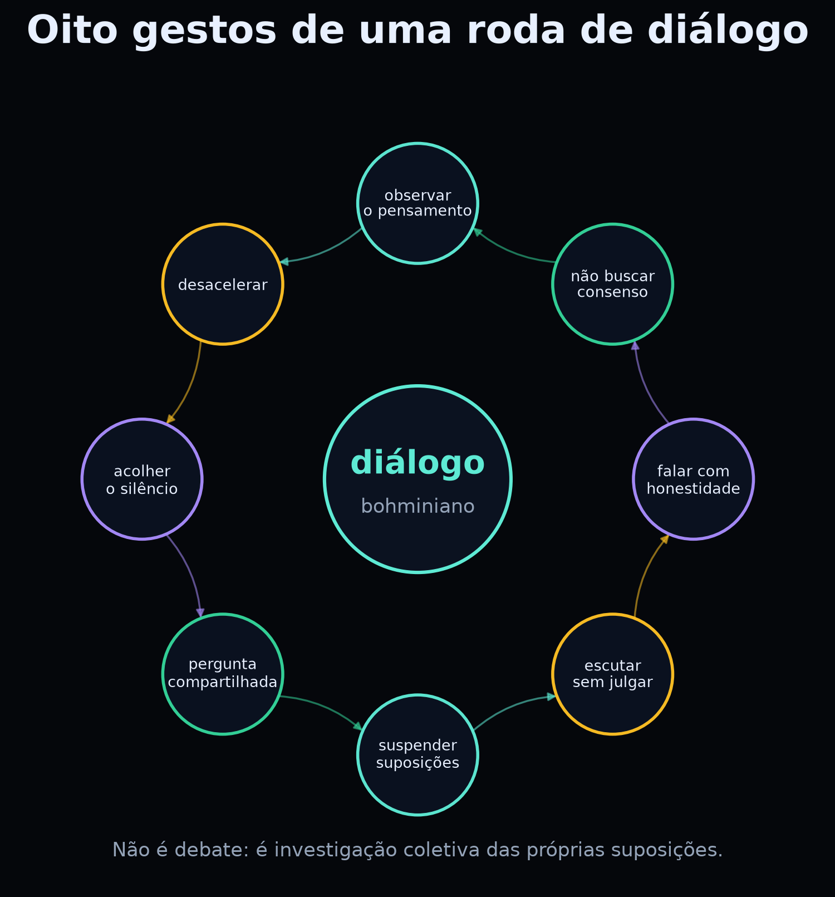{#fig03}

1. **Suspender suposições.** Não abandonar; colocar entre parênteses para examinar.
2. **Escutar sem julgar.** Ouvir o que o outro diz, não apenas preparar a resposta.
3. **Falar com honestidade.** Dizer o que se pensa, sem performance.
4. **Não buscar consenso.** A diferença pode ser informative.
5. **Observar o pensamento.** Notar quando uma emoção ou um hábito assume o controle.
6. **Desacelerar.** Dar tempo para que a ideia apareça.
7. **Acolher o silêncio.** O silêncio não é falha; é espaço.
8. **Pergunta compartilhada.** Todos investigam a mesma pergunta, não a mesma resposta.

## 3.3 Protocolo de 15 minutos

**Material:** uma pergunta, um objeto para passar (talking piece), um caderno.

1. **Roda (2 min).** Cada pessoa diz uma palavra sobre como chegou.
2. **Pergunta (1 min).** O facilitador lê a pergunta e não a explica demais.
3. **Rodada 1 (4 min).** Cada pessoa fala **uma vez**, sem ser interrompida.
4. **Silêncio (1 min).** Todos escrevem uma suposição que apareceu.
5. **Rodada 2 (5 min).** Quem quiser responde ao que ouviu, não à pessoa.
6. **Fechamento (2 min).** Uma frase: “o que eu levo desta conversa?”.

**Regras de segurança:** ninguém é obrigado a falar; não se corrige a fala do
outro; não se transforma a roda em julgamento pessoal; o professor facilita, não
doutrina.

::: {.box-dialogo}
**🗣️ Perguntas que funcionam.** “O que é medir?”; “O que muda quando alguém
observa?”; “O que queremos dizer com ‘real’?”; “Quando uma analogia ajuda e quando
ela engana?”. Evite perguntas com resposta única ou com tom de prova.
:::

## 3.4 O diário de suposições

Depois da roda, cada estudante registra:

| Campo | Exemplo |
|---|---|
| Pergunta | O que é medir? |
| Suposição que eu trouxe | “Medir é descobrir um valor que já estava lá.” |
| O que mudou | “Percebi que eu confundia medir com ler.” |
| O que quero testar | “Ver se a ordem das portas muda o resultado.” |

O diário não é confissão. É registro de pensamento.

::: {.box-pratica}
**🧪 Prática 3 — Roda de diálogo (15 min, sem código).**

Pergunta: **“O que acontece entre duas medições?”**

Dividam-se em facilitador, observador e participantes. O observador não participa
da fala; anota:

- quantas vezes alguém defendeu uma posição em vez de examinar uma suposição;
- quantos silêncios aconteceram;
- que pergunta nova apareceu.

No fim, o observador lê as notas sem julgar. A turma decide se a pergunta mudou.

**Checkpoint:** a pergunta inicial ainda é a mesma? Se mudou, o diálogo fez seu
trabalho.
:::

# 4. A ordem implicada: o todo em cada parte {#cap4}

::: {.epigrafe}
“O explícito é o desdobramento do implícito.” — David Bohm (paráfrase)
:::

Bohm propôs uma distinção filosófica entre duas ordens:

- **ordem explícita** (*explicate order*): o mundo das coisas separadas, visíveis,
  localizadas, que podemos apontar;
- **ordem implícita** (*implicate order*): um fundo de relações e informações que
  se “desdobra” no mundo explícito.

A imagem que ele usou é a do **holograma**: cada parte de um holograma contém
informação sobre o todo. Se você corta um holograma em pedaços, cada pedaço ainda
reconstrói uma versão borrada da imagem inteira — não porque cada pedaço seja
mágico, mas porque a informação está distribuída de forma não local.

## 4.1 O holograma como analogia computacional

A figura 4 mostra uma versão computacional dessa ideia. A imagem original é a
letra “B”. O espectro de Fourier contém a informação distribuída. Quando mantemos
apenas **1,1%** dos coeficientes, ainda reconstruímos uma versão borrada do “B”.

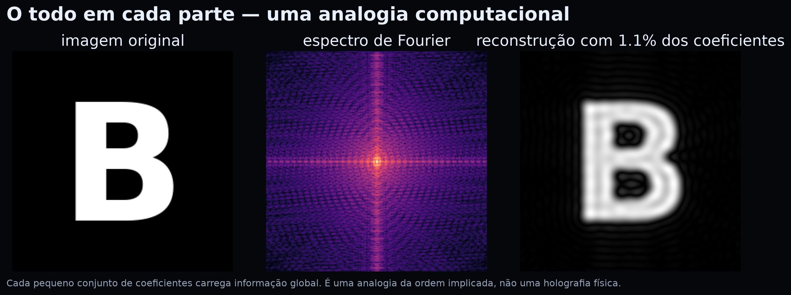{#fig04}

O ponto pedagógico é: **a informação pode estar no todo, não apenas nas partes**.
Isso ajuda a imaginar por que o emaranhamento não é uma soma de duas histórias
independentes. Mas há um limite importante.

::: {.box-limite}
**⚠️ Limite da analogia.** Um holograma é um padrão de interferência clássico.
A ordem implicada é uma proposta filosófica de Bohm, não uma teoria física
comprovada. Não diga “o universo é um holograma” como se fosse fato. Diga: “essa
imagem nos ajuda a pensar sobre totalidade; ela não substitui a matemática”.
:::

## 4.2 O que a ordem implicada não é

- **Não é emaranhamento.** Emaranhamento é um fenômeno físico com previsões
  testáveis; ordem implicada é uma interpretação filosófica.
- **Não é um mecanismo de comunicação.** A distribuição da informação não permite
  enviar sinais mais rápido que a luz.
- **Não é uma teoria de tudo.** Bohm não a apresentou como uma teoria completa da
  física; é uma visão de mundo em diálogo com a ciência.

## 4.3 Totalidade na sala de aula

A ideia de totalidade tem uma consequência pedagógica: um conceito não é uma
ilha. “Medição” envolve aparelho, teoria, probabilidade e interpretação. “Qubit”
envolve álgebra, física e tecnologia. Ensinar por fragmentos pode até funcionar
na prova, mas não forma compreensão.

::: {.box-dialogo}
**🗣️ Pergunta para a roda.** “O que muda no meu jeito de estudar se eu acreditar
que as partes carregam o todo?” Não há resposta certa. O objetivo é observar como
a suposição altera a prática.
:::

::: {.box-pratica}
**🧪 Prática 4 — O todo em 1% (10 min, notebook).**

Execute a célula do holograma. Depois:

1. reconstrua com 0,5%, 1%, 2% e 5% dos coeficientes;
2. compare a nitidez;
3. escreva uma frase sobre o que se ganha e o que se perde.

**Checkpoint:** você consegue explicar por que a imagem borrada ainda é
reconhecível? Se sim, entendeu a ideia de informação distribuída.
:::

# 5. Emaranhamento e não separabilidade {#cap5}

::: {.epigrafe}
“Duas partes, um estado. Correlação não é mensagem.”
:::

O emaranhamento é o fenômeno que mais desafia a imagem de um mundo feito de
partes independentes. Dois qubits podem ser descritos por um único estado:

<div class="math-display"></div>

Se Alice mede o primeiro qubit e obtém 0, o segundo qubit de Bob está em 0. Se
ela obtém 1, o de Bob está em 1. A correlação é perfeita — mas cada resultado
isolado é 50%/50%.

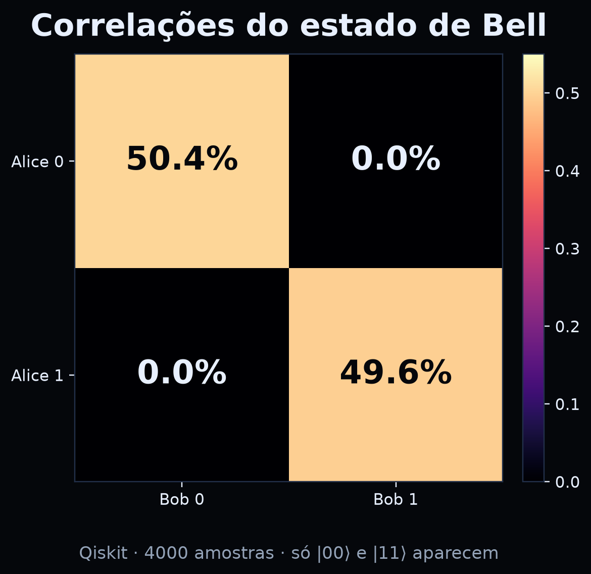{#fig05}

## 5.1 Não separabilidade

Na leitura padrão, o estado de Bell é **não separável**: não podemos escrevê-lo
como “estado de Alice × estado de Bob”. Não é que não saibamos os estados
individuais; é que o todo não se decompõe em partes independentes.

Na leitura de Bohm, o guia (a função de onda) vive em um espaço de configuração
de dimensão maior. A velocidade de uma partícula depende da posição da outra. A
não separabilidade é explícita: o todo guia as partes.

## 5.2 O teorema de Bell

Bell mostrou que nenhuma teoria de **variáveis ocultas locais** consegue reproduzir
todas as correlações quânticas. Isso não refuta Bohm, porque a teoria de Bohm é
**não local**. O preço da imagem clara é a não localidade.

| Modelo | Variáveis ocultas? | Local? | Reproduz Bell? |
|---|---|---|---|
| Quântica padrão | não (ou contextual) | não | sim |
| Bohm | sim (posições) | não | sim |
| Variáveis ocultas locais | sim | sim | **não** |

## 5.3 Por que não há mensagem mais rápida que a luz

Alice não escolhe o resultado que vai obter. Bob, sozinho, vê 50/50. A correlação
só aparece quando eles comparam os registros — e a comparação exige um canal
clássico, que respeita o limite da velocidade da luz.

Na teoria de Bohm, a influência não local existe, mas não é controlável. A
distribuição de equilíbrio  garante que nenhum sinal possa ser
codificado nela. Não localidade não é o mesmo que comunicação.

::: {.box-limite}
**⚠️ Cuidado com a palavra “instantâneo”.** A onda piloto descreve uma dependência
instantânea no espaço de configuração, mas isso não significa que um experimentador
possa enviar um bit instantaneamente. A teoria é não local; a signaling é proibida.
:::

::: {.box-pratica}
**🧪 Prática 5 — Correlação e anti-correlação (15 min, notebook).**

No notebook, execute a prática 3 com Qiskit. Depois, troque o estado de Bell
 por  e
repita a amostragem.

1. O que aparece na matriz de correlação?
2. Qual é a diferença entre correlação e anti-correlação?
3. A conclusão sobre “não há mensagem” muda?

**Checkpoint:** você consegue explicar a diferença entre “resultados iguais” e
“resultados opostos” sem dizer que um sinal foi enviado? Se sim, avançou.
:::

## 5.4 O que Bohm acrescenta — e o que não acrescenta

Bohm acrescenta uma **imagem**: partículas com trajetórias, guiadas por uma onda
não local. Isso pode ajudar a pensar sobre o que acontece entre medições.

Bohm **não** acrescenta uma nova previsão experimental para os fenômenos desta
aula. As probabilidades, as correlações e a violação de Bell são as mesmas. A
diferença é interpretativa — e interpretações não são descartáveis, mas também
não são fatos experimentais.

> **Pergunta para levar adiante:** se duas interpretações fazem as mesmas
> previsões, o que mais conta na escolha? Simplicidade? Intuição? Ontologia?
> Ensino? Essa é uma pergunta filosófica legítima — e uma ótima roda de diálogo.

# 6. Três linguagens, um mesmo estado {#cap6}

::: {.epigrafe}
“O mapa não é o território — mas três mapas bons ajudam a ver o território.”
:::

PennyLane, Cirq e Qiskit são bibliotecas de código aberto para computação
quântica. Elas têm filosofias diferentes, mas descrevem o mesmo estado de Bell com
as mesmas portas. Comparar as três é uma excelente prática meticulosa: você
percebe o que é **conceito** e o que é **convenção da ferramenta**.

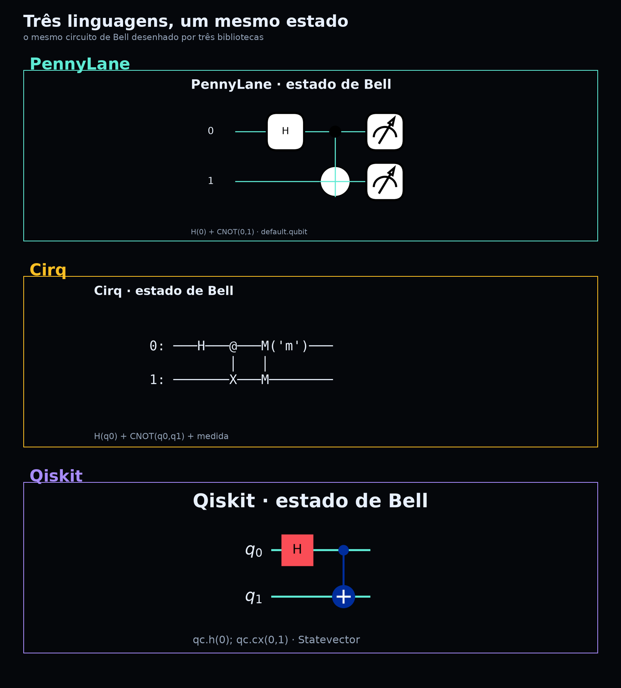{#fig06}

## 6.1 O que é igual

- O estado final: .
- As probabilidades: 50% para |00⟩, 50% para |11⟩, 0% para |01⟩ e |10⟩.
- A correlação: os resultados de Alice e Bob concordam.

## 6.2 O que muda

| Aspecto | PennyLane | Cirq | Qiskit |
|---|---|---|---|
| Unidade | *wires* (fios) | `LineQubit` | `QuantumCircuit` |
| Porta H | `qml.Hadamard(0)` | `cirq.H(q0)` | `qc.h(0)` |
| CNOT | `qml.CNOT([0,1])` | `cirq.CNOT(q0,q1)` | `qc.cx(0,1)` |
| Medição | `qml.probs` / `qml.sample` | `cirq.measure` | `Statevector` / `sample_counts` |
| Desenho | `qml.draw_mpl` | diagrama textual | `qc.draw("mpl")` |
| Ordem dos qubits | declarada nos wires | linha | convenção little-endian |

A diferença de ordem é a fonte mais comum de erro. Em Qiskit, o bitstring `10`
pode significar “qubit 1 = 1, qubit 0 = 0”; em Cirq, a ordem é a dos qubits na
linha. **Sempre confira a convenção antes de comparar resultados.**

## 6.3 As probabilidades coincidem

A figura 7 mostra as probabilidades calculadas por PennyLane (exatas) e as
frequências observadas em Cirq e Qiskit (2000 tiros cada). As barras de |00⟩ e
|11⟩ ficam em torno de 50%; |01⟩ e |10⟩ ficam em zero.

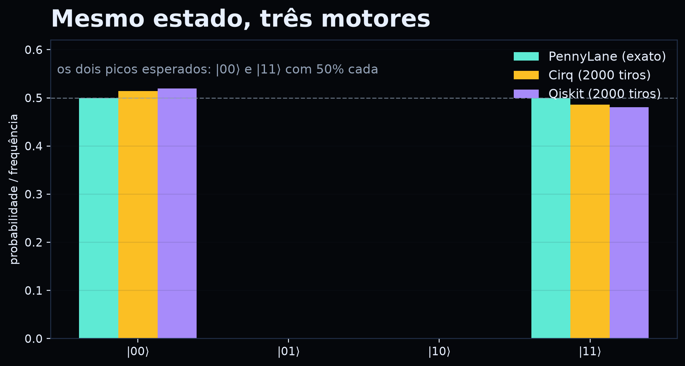{#fig07}

::: {.box-pratica}
**🧪 Prática 6 — Três linguagens, uma tabela (20 min).**

No notebook, execute as três práticas (PennyLane, Cirq e Qiskit). Preencha:

| Grandeza | PennyLane | Cirq | Qiskit |
|---|---|---|---|
| P(00) |  |  |  |
| P(11) |  |  |  |
| P(01) |  |  |  |
| P(10) |  |  |  |

Depois, responda: as diferenças são conceituais ou estatísticas? Como você pode
distinguir?

**Checkpoint:** você consegue explicar por que as três bibliotecas concordam?
:::

# 7. Prática 1 — PennyLane {#cap7}

::: {.epigrafe}
“Um circuito é uma função; a medição é o retorno.”
:::

PennyLane foi desenhada para **diferenciação automática** de circuitos quânticos.
Para esta aula, usaremos apenas o básico: um dispositivo `default.qubit`, um
QNode e medições de probabilidade.

## 7.1 Código mínimo

```python
import pennylane as qml

dev = qml.device("default.qubit", wires=2)

@qml.qnode(dev)
def bell():
    qml.Hadamard(wires=0)
    qml.CNOT(wires=[0, 1])
    return qml.probs(wires=[0, 1])

print(bell())          # [0.5 0.  0.  0.5]
qml.draw_mpl(bell)()   # desenha o circuito
```

{#fig08}

## 7.2 O que observar

- `qml.Hadamard(0)` cria  no fio 0.
- `qml.CNOT([0,1])` inverte o fio 1 quando o fio 0 é 1.
- `qml.probs(wires=[0,1])` devolve um vetor de quatro posições.
- A ordem do vetor é  para os
  wires declarados.

## 7.3 Prática guiada

1. Rode o código e confira `[0.5, 0, 0, 0.5]`.
2. Troque `qml.CNOT` por `qml.Z(1)` e observe o que muda.
3. Troque `qml.Hadamard(0)` por `qml.Hadamard(1)` e compare.
4. Use `qml.draw_mpl(bell)` para ver o desenho.

::: {.box-limite}
**⚠️ Limite.** PennyLane calcula probabilidades **exatas** no simulador. Isso não
é o mesmo que medir 2000 vezes. Para comparar com Cirq/Qiskit, use `qml.sample`
ou amostre a distribuição.
:::

::: {.box-pratica}
**🧪 Checkpoint da prática 1.**

- [ ] O vetor tem quatro posições.
- [ ] As posições 00 e 11 valem 0,5.
- [ ] Você sabe explicar o que o CNOT faz.
- [ ] Você desenhou o circuito.

Se faltou algum, releia a seção 6.1 e refaça.
:::

# 8. Prática 2 — Cirq {#cap8}

::: {.epigrafe}
“A linha é o palco; as portas são os gestos.”
:::

Cirq organiza o circuito em **linhas de qubits**. É uma biblioteca muito usada
em pesquisa com hardware supercondutor. Para nós, o valor está no diagrama
textual e na simulação de medições.

## 8.1 Código mínimo

```python
import cirq

q0, q1 = cirq.LineQubit.range(2)
circuito = cirq.Circuit(
    cirq.H(q0),
    cirq.CNOT(q0, q1),
    cirq.measure(q0, q1, key="m"),
)
print(circuito)

resultado = cirq.Simulator().run(circuito, repetitions=2000)
print(resultado.measurements["m"][:10])
```

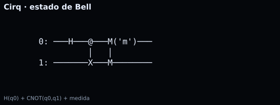{#fig09}

## 8.2 O que observar

- `cirq.H(q0)` cria a superposição.
- `cirq.CNOT(q0, q1)` emaranha.
- `cirq.measure(..., key="m")` registra os resultados.
- `Simulator().run(...)` devolve um dicionário de medições.

## 8.3 Prática guiada

1. Rode 2000 tiros e conte quantos 00 e 11 aparecem.
2. Adicione `cirq.H(q0)` **antes** da medição e meça de novo. O que muda?
3. Meça apenas `q0` e depois apenas `q1`. As marginais são 50/50?
4. Desenhe o circuito com `print(circuito)` e compare com a figura 9.

::: {.box-limite}
**⚠️ Limite.** O diagrama textual é ótimo para o terminal, mas não é uma figura
pronta para o livro. Para a versão visual, usamos um renderizador que transforma
o texto em imagem — o conteúdo é o mesmo.
:::

::: {.box-pratica}
**🧪 Checkpoint da prática 2.**

- [ ] Você obteve 00 e 11, sem 01/10.
- [ ] Você explicou o efeito de um H extra antes da medição.
- [ ] Você comparou as marginais.
- [ ] Você identificou a ordem dos qubits no diagrama.
:::

# 9. Prática 3 — Qiskit {#cap9}

::: {.epigrafe}
“O estado é um vetor; a esfera é uma janela.”
:::

Qiskit é a biblioteca da IBM. Ela oferece `QuantumCircuit`, `Statevector`,
desenho de circuito e ferramentas de visualização. Usaremos três recursos:
circuito, esfera de Bloch e amostragem.

## 9.1 Código mínimo

```python
from qiskit import QuantumCircuit
from qiskit.quantum_info import Statevector

qc = QuantumCircuit(2)
qc.h(0)
qc.cx(0, 1)

estado = Statevector(qc)
print(estado)                 # amplitudes
print(estado.probabilities()) # [0.5 0. 0. 0.5]
print(estado.sample_counts(2000, qargs=[0, 1]))
qc.draw("mpl")
```

{#fig10}

## 9.2 A esfera de Bloch

Para um único qubit, a esfera de Bloch é uma representação visual do estado.
A figura 11 mostra , que aponta para o equador (superposição
equilibrada).

{#fig11}

## 9.3 Prática guiada

1. Rode o código e confira as probabilidades.
2. Troque `qc.cx(0,1)` por `qc.x(1)` e observe o estado.
3. Troque o estado de Bell por  e repita a
   amostragem. O que aparece na matriz de correlação?
4. Compare a saída de Qiskit com a de Cirq. As probabilidades coincidem?

::: {.box-limite}
**⚠️ Limite.** A esfera de Bloch de um qubit isolado **não** mostra emaranhamento.
Para ver a correlação, é preciso olhar o estado de dois qubits ou a matriz de
probabilidades conjuntas. Não confunda “estado de um qubit” com “estado do par”.
:::

::: {.box-pratica}
**🧪 Checkpoint da prática 3.**

- [ ] Você obteve `[0.5, 0, 0, 0.5]`.
- [ ] Você viu a esfera de Bloch de H|0⟩.
- [ ] Você gerou a matriz de correlação.
- [ ] Você explicou por que a esfera isolada não mostra a correlação.
:::

# 10. Prática 4 — Onda piloto e interferência {#cap10}

::: {.epigrafe}
“Ver a trajetória é fácil; ver o que a trajetória significa é o trabalho.”
:::

Esta prática usa NumPy e Matplotlib para construir um **modelo didático** de
trajetórias guiadas por um campo de fase. O objetivo não é resolver a equação de
Bohm, mas tornar visível a ideia: **a partícula segue uma trajetória; a onda
guia essa trajetória**.

## 10.1 O campo de velocidade

No modelo, a velocidade vertical é

<div class="math-display"></div>

Isso cria “poços” de velocidade em . As trajetórias
são integradas passo a passo:

```python
for x in np.linspace(0.20, 0.98, 650)[1:]:
    y = y + dx * vy(y, x)
```

O resultado são trajetórias que se agrupam nas franjas claras. A figura 1 do
capítulo 2 mostra o resultado.

## 10.2 A intensidade

A intensidade no anteparo é calculada pela fórmula de duas fendas:

<div class="math-display"></div>

A figura 2 mostra a curva. Repare: a **curva** é uma previsão quantitativa; as
**trajetórias** são uma imagem qualitativa.

## 10.3 Prática guiada

1. Rode a célula da prática 4 no notebook.
2. Mude a distância entre as fendas . O espaçamento das franjas aumenta ou
   diminui?
3. Mude o número de trajetórias. O padrão muda?
4. Mude a fase relativa entre as duas fendas. As trajetórias se deslocam?
5. Escreva uma frase: “o que este modelo mostra e o que ele não mostra?”.

::: {.box-limite}
**⚠️ Limite.** O modelo não inclui a equação de Schrödinger, potenciais, spin ou
interação com o aparelho. Ele mostra **uma ideia** (guia + trajetória), não uma
solução. Se você apresentar a figura como “prova” da teoria de Bohm, estará
confundindo pedagogia com evidência.
:::

::: {.box-pratica}
**🧪 Checkpoint da prática 4.**

- [ ] Você rodou o modelo.
- [ ] Você variou  e observou o espaçamento.
- [ ] Você distinguiu a curva de intensidade das trajetórias.
- [ ] Você escreveu uma frase sobre o limite.
:::

# 11. Prática 5 — Holograma e ordem implicada {#cap11}

::: {.epigrafe}
“Cada parte do holograma conta uma versão borrada do todo.”
:::

Esta prática usa a transformada de Fourier para construir uma **analogia
computacional** da ordem implicada. Não é holografia física; é uma forma de ver
como a informação pode estar distribuída.

## 11.1 O código

```python
letra = _letra_b(256)                     # imagem 256x256
F = np.fft.fftshift(np.fft.fft2(letra))   # espectro
yy, xx = np.mgrid[0:256, 0:256]
mask = ((xx-128)**2 + (yy-128)**2) < (0.06*256)**2
rec = np.abs(np.fft.ifft2(np.fft.ifftshift(F * mask)))
```

A máscara mantém apenas **1,1%** dos coeficientes. Mesmo assim, a reconstrução
mostra a letra “B” borrada.

## 11.2 Prática guiada

1. Rode a célula e compare original, espectro e reconstrução.
2. Diminua a máscara para 0,5%. O que acontece?
3. Aumente para 5%. O que melhora?
4. Retire o centro do espectro (frequências baixas). O que desaparece?
5. Escreva uma frase sobre a diferença entre “informação distribuída” e
   “holografia”.

::: {.box-limite}
**⚠️ Limite.** A analogia da ordem implicada é filosófica. Ela não explica o
emaranhamento, não prevê resultados e não substitui a teoria quântica. Use-a para
**pensar**, não para **provar**.
:::

::: {.box-pratica}
**🧪 Checkpoint da prática 5.**

- [ ] Você viu a reconstrução com 1,1%.
- [ ] Você comparou 0,5% e 5%.
- [ ] Você entendeu que a informação está distribuída.
- [ ] Você escreveu o limite da analogia.
:::

# 12. Prática 6 — Diálogo como experimento {#cap12}

::: {.epigrafe}
“O diálogo é um experimento com o próprio pensamento.”
:::

As práticas anteriores usaram código. Esta usa **presença**. O “dado” é qualitativo:
o que muda na pergunta, nas suposições e na escuta.

## 12.1 Desenho do experimento

| Elemento | Descrição |
|---|---|
| Pergunta | “O que acontece entre duas medições?” |
| Participantes | 6 a 10 estudantes |
| Facilitador | lê a pergunta, guarda o tempo, não opina |
| Observador | não fala; registra gestos, silêncios e suposições |
| Duração | 15 min |
| Registro | diário de suposições + notas do observador |

## 12.2 Roteiro

1. **Roda inicial (2 min).** Uma palavra por pessoa.
2. **Pergunta (1 min).** O facilitador lê e não explica.
3. **Rodada 1 (4 min).** Uma fala por pessoa, sem interrupção.
4. **Silêncio (1 min).** Todos escrevem uma suposição.
5. **Rodada 2 (5 min).** Respostas ao que foi ouvido, não à pessoa.
6. **Fechamento (2 min).** “O que eu levo?”.

## 12.3 O que observar

O observador registra:

- quantas vezes alguém defendeu uma posição;
- quantas vezes alguém reformulou a própria fala;
- quantos silêncios de mais de 3 segundos;
- que pergunta nova apareceu;
- se a pergunta inicial mudou.

Não há “certo” ou “errado”. Há evidência de qualidade do diálogo.

::: {.box-dialogo}
**🗣️ Regra de ouro.** Não corrija a fala do outro. Pergunte: “o que te levou a
dizer isso?”. A correção vem depois, se vier. O objetivo é ver o pensamento
funcionando, não vencer a conversa.
:::

::: {.box-pratica}
**🧪 Checkpoint da prática 6.**

- [ ] A roda aconteceu com tempo protegido.
- [ ] O observador registrou sem julgar.
- [ ] Cada participante escreveu uma suposição.
- [ ] A turma identificou uma pergunta nova.
- [ ] O diário foi preenchido.

Se algum item faltou, a prática não foi concluída — e tudo bem: dialogue é
prática, não performance.
:::

# 13. Limites, ética e o que Bohm não resolve {#cap13}

::: {.epigrafe}
“Uma interpretação que não declara seu preço não é uma boa interpretação.”
:::

Bohm é uma lente poderosa, mas não é uma varinha mágica. Este capítulo separa o
que a teoria faz, o que ela não faz e o que a tecnologia quântica pode ou não
fazer. A disciplina de distinguir é parte da educação científica.

## 13.1 Limites da teoria de Bohm

| Questão | O que a teoria diz | O que ainda é difícil |
|---|---|---|
| Relatividade | extensões existem | não há consenso; a forma padrão é não relativística |
| Várias partículas | guia vive em  dimensões | a não localidade é explícita |
| Regra de Born | distribuição de equilíbrio | por que o universo começou em equilíbrio? |
| Medição | colapso efetivo | a análise completa do aparelho é complexa |
| Spin | extensão com feixe de campos | detalhes técnicos para especialistas |

Nada disso torna a teoria “falsa”. Torna-a **uma interpretação com custos**. A
mecânica quântica padrão também tem custos: o problema da medição, a ausência de
uma ontologia consensual, a dificuldade de conciliar gravidade e quântica.

## 13.2 Limites da ordem implicada

A ordem implicada é uma **visão filosófica**. Ela sugere uma totalidade
indivisível, mas não fornece um modelo calculável que substitua a função de onda.
Não diga:

- “o universo é um holograma” (como fato);
- “a ordem implicada explica o emaranhamento” (ela inspira, não explica);
- “Bohm provou que a consciência cria a realidade” (não é isso que a teoria diz).

Diga:

- “Bohm propôs uma imagem de totalidade”;
- “a analogia do holograma ajuda a pensar”;
- “a física testável é outra coisa”.

## 13.3 Limites da tecnologia quântica

- **Não é mais rápida em tudo.** Só há vantagem quando existe algoritmo adequado.
- **Não é barata.** Refrigeração, controle e correção de erros são caros.
- **Não é imune a erros.** Decoerência e ruído são obstáculos centrais.
- **Não é mágica.** Sem um problema bem formulado, não há ganho.

## 13.4 Ética

Toda tecnologia poderosa levanta perguntas:

- **Acesso:** quem terá computadores quânticos? Quem ficará de fora?
- **Dupla finalidade:** a mesma capacidade que simula remédios pode apoiar
  vigilância ou quebra de sigilo.
- **Ambiente:** refrigeração e energia têm custo ecológico.
- **Trabalho:** novas profissões exigem formação; quem será incluído?
- **Educação:** ensinar o quê, para quem e com que propósito?

A escola não precisa resolver tudo. Precisa **formular bem**.

::: {.box-pratica}
**🧪 Prática 7 — Teste dos quatro filtros (15 min, sem código).**

Aplique os filtros a três afirmações:

1. “O computador quântico do Nordeste vai resolver problemas da escola.”
2. “Bohm provou que a consciência cria a realidade.”
3. “A criptografia quântica é invulnerável.”

Para cada uma, responda:

- **Problema:** que problema exato?
- **Algoritmo/teoria:** qual mecanismo?
- **Hardware/evidência:** qual evidência?
- **Limite:** o que falta?

**Checkpoint:** você consegue classificar cada afirmação como fato, promessa ou
exagero? Se sim, a prática funcionou.
:::

# 14. Projeto final: Diálogo quântico {#cap14}

::: {.epigrafe}
“O projeto é uma pergunta que vira prática e uma prática que vira pergunta.”
:::

O projeto final combina as duas metades da edição: **laboratório** e **diálogo**.
Cada grupo produz uma investigação pequena, mas completa.

## 14.1 O que entregar

| Componente | O que é | Evidência |
|---|---|---|
| **Pergunta** | uma pergunta que não tem resposta pronta | frase + justificativa |
| **Suposições** | três suposições do grupo | diário de suposições |
| **Experimento** | um circuito em PennyLane, Cirq ou Qiskit | código + figura |
| **Evidência** | dados ou resultados | tabela/gráfico |
| **Limite** | o que o experimento não mostra | parágrafo específico |
| **Diálogo** | registro de uma roda de 15 min | notas do observador |

## 14.2 Roteiro

| Etapa | Tempo | Entrega |
|---|---|---|
| Escolha da pergunta | 10 min | pergunta + suposições |
| Desenho do experimento | 20 min | circuito no papel |
| Implementação | 40 min | código rodando |
| Roda de diálogo | 15 min | notas do observador |
| Revisão | 20 min | versão 2 |
| Apresentação | 3 min/grupo | pitch + figura |

## 14.3 Exemplos de perguntas

- “O que muda se eu medir na base X em vez da base Z?”
- “Por que a esfera de Bloch não mostra emaranhamento?”
- “A ordem das portas muda o resultado? Sempre?”
- “O que a palavra ‘observar’ esconde?”
- “Quando uma analogia deixa de ajudar?”

## 14.4 Rubrica

| Critério | 4 — Excelente | 3 — Bom | 2 — Em desenvolvimento | 1 — Insuficiente |
|---|---|---|---|---|
| Pergunta | aberta, delimitada, investigável | clara, pouco delimitada | vaga | não há pergunta |
| Suposições | explícitas e examinadas | listadas | mencionadas | ausentes |
| Experimento | circuito correto e reproduzível | correto com apoio | parcial | não funciona |
| Evidência | dados + interpretação | dados parciais | opinião | nenhuma |
| Limite | específico e justificado | genérico | reconhece sem detalhar | ausente |
| Diálogo | escuta e reformulação visíveis | participação | registro mínimo | não houve |

## 14.5 Exemplo forte e exemplo fraco

**Forte:** “Medir na base X muda a correlação do estado de Bell?” O grupo mostra o
circuito em Qiskit, mede em Z e em X, compara as matrizes, explica por que a
correlação desaparece na base errada e declara que o experimento não testa a
interpretação de Bohm.

**Fraco:** “Bohm é a verdadeira física quântica.” Não há pergunta investigável,
não há experimento, não há limite. É opinião, não projeto.

::: {.box-checkpoint}
**🎯 Checkpoint do projeto.** Sua pergunta pode ser respondida com um experimento
de 40 minutos? Suas suposições estão escritas? Seu limite é específico? Se alguma
resposta for “não”, revise antes de apresentar.
:::

# 15. Manual do professor {#cap15}

::: {.epigrafe}
“O professor não entrega a resposta; desenha as condições para investigar.”
:::

## 15.1 Plano de 100 minutos

| Tempo | Bloco | Condução |
|---|---|---|
| 0–10 | Abertura | pergunta “o que acontece entre duas medições?” |
| 10–25 | Bohm | cap. 1–2 + figura 1 |
| 25–40 | Diálogo | cap. 3 + roda de 15 min |
| 40–65 | Laboratório | cap. 6–7 + PennyLane/Cirq/Qiskit |
| 65–80 | Totalidade | cap. 4–5 + holograma/emaranhamento |
| 80–95 | Limites | cap. 13 + teste dos filtros |
| 95–100 | Síntese | diário + projeto |

## 15.2 Duas aulas de 50 minutos

**Aula A:** cap. 1–3; roda de diálogo; prática PennyLane.
**Aula B:** cap. 4–6; práticas Cirq/Qiskit; projeto.

## 15.3 Materiais e instalação

- Notebook `AULA_BOHM_LABORATORIO.ipynb`.
- Projetor ou dispositivos dos estudantes.
- Internet para `pip install` na primeira vez.
- Caderno para o diário de suposições.
- Objeto para a roda (talking piece).

No Colab:

```bash
!pip install -q pennylane qiskit cirq pylatexenc
```

Teste antes da aula. Se a rede falhar, use as figuras já geradas e faça as
práticas desplugadas (cap. 10–12).

## 15.4 Erros comuns

| Erro | O que está por trás | Resposta |
|---|---|---|
| “Bohm provou que a partícula tem trajetória.” | confunde interpretação com experimento | “A teoria prevê o mesmo; a trajetória é uma escolha ontológica.” |
| “Emaranhamento transmite mensagem.” | confunde correlação com sinal | “Qual é a marginal de Bob? 50/50.” |
| “A esfera de Bloch mostra o emaranhamento.” | confunde um qubit com o par | “A esfera é de um qubit; o par precisa de outra representação.” |
| “A ordem implicada é uma teoria quântica.” | confunde filosofia com física | “É uma visão de totalidade; não faz previsões.” |
| “Quântico é sempre mais rápido.” | slogan | “Qual problema? Qual algoritmo? Qual hardware?” |
| “O diálogo precisa terminar em consenso.” | confunde diálogo com assembleia | “O objetivo é compreender, não concordar.” |

## 15.5 Avaliação

Combine:

- **checkpoints do notebook** (formativos);
- **práticas** (execução e explicação);
- **diálogo** (observação qualitativa);
- **projeto** (rubrica do cap. 14).

Sugestão de pesos: 20% práticas, 20% diálogo, 20% diário, 40% projeto. Ajuste ao
seu currículo.

## 15.6 Adaptações

- **6º–7º ano:** sem equações; usar as figuras e a roda de diálogo; prática
  desplugada de duas fendas com corda/ondas.
- **Ensino Médio:** incluir a equação do guia e a discussão de não localidade.
- **Sem internet:** usar as figuras geradas e os códigos impressos; rodar o
  notebook do professor.
- **Deficiência visual:** descrever as figuras; usar saídas numéricas; diário em
  áudio.
- **Turma grande:** dividir em grupos de 8 para a roda; usar observadores.

## 15.7 Segurança e ética

- Não prometa acesso a hardware quântico.
- Não trate Bohm como consenso.
- Não incentive invasão ou quebra de sistemas.
- Respeite a LGPD ao coletar dados dos estudantes.
- Proteja a roda de diálogo de julgamentos pessoais.

## 15.8 Respostas dos checkpoints

| Capítulo | Ideia central |
|---|---|
| 1 | a fragmentação é uma escolha; Bohm propõe totalidade e diálogo |
| 2 | a partícula tem trajetória; a onda guia; o preço é não localidade |
| 3 | diálogo não é debate; o objetivo é examinar suposições |
| 4 | a informação pode estar distribuída; a analogia tem limite |
| 5 | correlação não é comunicação; Bohm é não local |
| 6 | as três bibliotecas concordam; as convenções mudam |
| 7 | PennyLane calcula probabilidades exatas |
| 8 | Cirq amostra medições e desenha texto |
| 9 | Qiskit mostra estado, Bloch e correlações |
| 10 | o modelo de trajetórias é qualitativo; a curva é quantitativa |
| 11 | 1,1% dos coeficientes reconstrói o todo borrado |
| 12 | o diálogo produz dados qualitativos |
| 13 | fato, promessa e exagero são categorias diferentes |
| 14 | projeto = pergunta + suposição + experimento + limite |

## 15.9 Perguntas frequentes

**“Preciso saber Bohm para dar a aula?”**
Não. O livro apresenta o necessário. O importante é não transformar Bohm em
dogma.

**“As três bibliotecas são gratuitas?”**
Sim. PennyLane, Cirq e Qiskit são open source.

**“Posso usar só uma biblioteca?”**
Sim. O capítulo 6 mostra o mesmo estado nas três; escolha a que funcionar melhor
na sua escola.

**“O design black funciona no projetor?”**
Sim, se o projetor tiver bom contraste. Para impressão em massa, use a edição
clara.

**“Bohm é a interpretação correta?”**
Não há consenso. Bohm é uma interpretação entre várias; o valor pedagógico está
na comparação.

# Glossário {#glossario}

**Amplitude.** Número (real ou complexo) que descreve o peso de um estado de base.
A probabilidade é o quadrado do módulo.

**Bohm, David (1917–1992).** Físico teórico britânico-brasileiro. Propôs a
interpretação de onda piloto e uma filosofia de totalidade e diálogo.

**Bohmian mechanics.** Interpretação não local da mecânica quântica em que
partículas têm posições definidas e são guiadas pela função de onda.

**Cirq.** Biblioteca open source do Google para circuitos quânticos, com ênfase em
linhas de qubits e simulação.

**Colapso efetivo.** Na teoria de Bohm, o fato de a partícula terminar em uma das
componentes da função de onda após a interação com o aparelho, sem postular um
colapso fundamental.

**Configuração (espaço de).** Espaço de  dimensões que descreve as posições
de  partículas. A função de onda de Bohm vive nesse espaço.

**Diálogo (bohminiano).** Prática coletiva de investigar suposições por meio de
escuta, suspensão de julgamento e desaceleração, sem buscar consenso forçado.

**Equivariância.** Propriedade pela qual a distribuição  é preservada
pela dinâmica de Bohm. É a base da regra de Born na teoria.

**Emaranhamento.** Correlação quântica entre partes de um sistema, descrita por um
estado conjunto não separável.

**Esfera de Bloch.** Representação geométrica do estado de um qubit.

**Estado de Bell.** Estado maximalmente emaranhado de dois qubits, como
.

**Explicate order.** Ordem explícita: o mundo das coisas separadas e localizadas.

**Holomovimento.** Termo de Bohm para o fluxo dinâmico do qual emergem as formas
explícitas.

**Implicate order.** Ordem implicada: a totalidade de relações que se desdobra no
mundo explícito.

**Interpretação.** Leitura filosófica de uma teoria física que preserva as
previsões experimentais.

**Não localidade.** Dependência instantânea entre partes separadas no espaço. Em
Bohm, é explícita na equação do guia.

**Onda piloto.** Função de onda que guia o movimento das partículas na teoria de
Bohm.

**PennyLane.** Biblioteca open source para computação quântica diferenciável.

**Qiskit.** Biblioteca open source da IBM para circuitos, estados e visualização.

**Qubit.** Unidade de informação quântica descrita por duas amplitudes.

**Regra de Born.** , .

**Suspensão de suposições.** Gesto de colocar uma crença entre parênteses para
examiná-la, sem necessariamente abandoná-la.

**Totalidade.** Ideia de que o todo não se reduz à soma de partes independentes.

# Referências {#referencias}

BELL, J. S. On the Einstein Podolsky Rosen paradox. *Physics*, v. 1, n. 3,
p. 195–200, 1964.

BLACK, P.; WILIAM, D. Assessment and classroom learning. *Assessment in
Education*, v. 5, n. 1, p. 7–74, 1998.

BLOOM, B. S. Learning for mastery. *Evaluation Comment*, v. 1, n. 2, 1968.

BOHM, D. *Quantum Theory*. New York: Prentice-Hall, 1951.

BOHM, D. *Causality and Chance in Modern Physics*. London: Routledge, 1957.

BOHM, D. *Wholeness and the Implicate Order*. London: Routledge, 1980.

BOHM, D. *Thought as a System*. London: Routledge, 1992.

BOHM, D. *On Dialogue*. Edited by Lee Nichol. London: Routledge, 1996.

BOHM, D.; HILEY, B. J. *The Undivided Universe: An Ontological Interpretation of
Quantum Theory*. London: Routledge, 1993.

BOHM, D.; PEAT, F. D. *Science, Order, and Creativity*. New York: Bantam, 1987.

BRASIL. Ministério da Educação. *Base Nacional Comum Curricular*. Brasília:
MEC, 2018.

BRASIL. Conselho Nacional de Educação. *Normas sobre Computação na Educação
Básica — Complemento à BNCC*. Brasília: CNE, 2022.

BRUNER, J. S. *Toward a Theory of Instruction*. Cambridge: Harvard University
Press, 1966.

CIRQ DEVELOPERS. *Cirq Documentation*. Disponível em:
https://quantumai.google/cirq. Acesso em: 6 nov. 2026.

FEYNMAN, R. P. Simulating physics with computers. *International Journal of
Theoretical Physics*, v. 21, n. 6–7, p. 467–488, 1982.

HOLLAND, P. R. *The Quantum Theory of Motion: An Account of the de Broglie–Bohm
Causal Interpretation of Quantum Mechanics*. Cambridge: Cambridge University
Press, 1993.

MAYER, R. E. *Multimedia Learning*. 2. ed. Cambridge: Cambridge University Press,
2009.

NIELSEN, M. A.; CHUANG, I. L. *Quantum Computation and Quantum Information*.
Cambridge: Cambridge University Press, 2000.

NIST. *FIPS 203, 204 e 205*: padrões de criptografia pós-quântica. Gaithersburg:
NIST, 2024.

PENNYLANE DEVELOPERS. *PennyLane Documentation*. Disponível em:
https://docs.pennylane.ai. Acesso em: 6 nov. 2026.

PRESKILL, J. Quantum computing in the NISQ era and beyond. *Quantum*, v. 2,
p. 79, 2018.

QISKIT DEVELOPERS. *Qiskit Documentation*. Disponível em:
https://docs.quantum.ibm.com. Acesso em: 6 nov. 2026.

ROEDIGER, H. L.; KARPICKE, J. D. Test-enhanced learning: taking memory tests
improves long-term retention. *Psychological Science*, v. 17, n. 3, p. 249–255,
2006.

SWELLER, J. Cognitive load during problem solving: effects on learning.
*Cognitive Science*, v. 12, n. 2, p. 257–285, 1988.

VYGOTSKY, L. S. *Mind in Society: The Development of Higher Psychological
Processes*. Cambridge: Harvard University Press, 1978.

# Anexo: instalação e Colab {#anexo}

## 1. Abrir o notebook

1. Acesse `colab.research.google.com`.
2. **Arquivo → Fazer upload de notebook**.
3. Selecione `AULA_BOHM_LABORATORIO.ipynb`.
4. Execute a primeira célula para checar as bibliotecas.
5. Se faltar alguma, rode no início:

```bash
!pip install -q pennylane qiskit cirq pylatexenc
```

6. **Ambiente de execução → Executar tudo**.

## 2. Versões testadas

| Biblioteca | Versão testada |
|---|---|
| PennyLane | 0.45.1 |
| Cirq | 1.7.0 |
| Qiskit | 2.6.2 |
| pylatexenc | 2.11 |
| Python | 3.14 |

Versões diferentes podem mudar detalhes de desenho, mas não os conceitos.

## 3. Se algo der errado

| Sintoma | Causa provável | Solução |
|---|---|---|
| `ModuleNotFoundError: pennylane` | biblioteca ausente | rode o `pip install` acima |
| `ModuleNotFoundError: cirq` | biblioteca ausente | rode o `pip install` acima |
| `ModuleNotFoundError: qiskit` | biblioteca ausente | rode o `pip install` acima |
| desenho do circuito estranho | versão diferente | use o diagrama textual ou atualize |
| figura não aparece | célula não executada | rode a célula de ambiente e a célula da figura |
| resultado diferente de 0,5 | convenção de ordem ou amostragem | confira a ordem dos qubits e o número de tiros |

## 4. Licenças

PennyLane, Cirq e Qiskit são projetos open source com licenças próprias. Consulte
os repositórios oficiais antes de redistribuir código. Este livro é material
didático; as figuras foram geradas por código e podem ser reutilizadas em sala
com atribuição.

## 5. Como citar

> OPENCODE ECOSYSTEM CORE. *Bohm na Escola: onda piloto, diálogo e totalidade no
> ensino de informação quântica — edição black*. 1. ed. 2026. Material didático.

Para redistribuição, mantenha a atribuição, a seção de limites e a nota de que
Bohm é apresentado como uma interpretação entre várias.