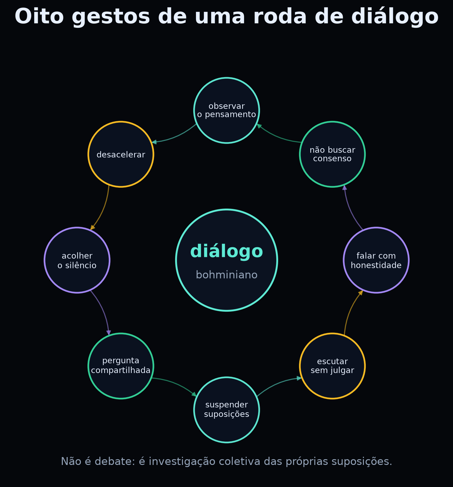

# Sumário {#sumario}

Abertura

<ul>
  <li><a href="#como-ler">Como ler este livro</a></li>
  <li><a href="#carta-estudante">Carta ao estudante</a></li>
  <li><a href="#carta-professor">Carta ao professor</a></li>
</ul>

Parte I — A lente de Bohm

<ul>
  <li><a href="#cap1">1. Por que Bohm?</a></li>
  <li><a href="#cap2">2. A onda piloto: uma imagem do que pode acontecer</a></li>
  <li><a href="#cap3">3. Diálogo: pensar juntos sem vencer</a></li>
</ul>

Parte II — Totalidade

<ul>
  <li><a href="#cap4">4. A ordem implicada: o todo em cada parte</a></li>
  <li><a href="#cap5">5. Emaranhamento e não separabilidade</a></li>
</ul>

Parte III — Laboratório

<ul>
  <li><a href="#cap6">6. Três linguagens, um mesmo estado</a></li>
  <li><a href="#cap7">7. Prática 1 — PennyLane</a></li>
  <li><a href="#cap8">8. Prática 2 — Cirq</a></li>
  <li><a href="#cap9">9. Prática 3 — Qiskit</a></li>
  <li><a href="#cap10">10. Prática 4 — Onda piloto e interferência</a></li>
  <li><a href="#cap11">11. Prática 5 — Holograma e ordem implicada</a></li>
  <li><a href="#cap12">12. Prática 6 — Diálogo como experimento</a></li>
</ul>

Parte IV — Limites e projeto

<ul>
  <li><a href="#cap13">13. Limites, ética e o que Bohm não resolve</a></li>
  <li><a href="#cap14">14. Projeto final: Diálogo quântico</a></li>
  <li><a href="#cap15">15. Manual do professor</a></li>
</ul>

Apêndices

<ul>
  <li><a href="#glossario">Glossário</a></li>
  <li><a href="#referencias">Referências</a></li>
  <li><a href="#anexo">Anexo: instalação e Colab</a></li>
</ul>

# 1. Por que Bohm? {#cap1}

::: {.epigrafe}
“A fragmentação do pensamento é o problema; a totalidade é a investigação.”
:::

David Bohm (1917–1992) foi um físico teórico que trabalhou com plasmas, teoria
quântica e filosofia da ciência. Ele ficou conhecido por duas contribuições muito
diferentes:

1. uma **interpretação da mecânica quântica** com variáveis ocultas não locais —
   a teoria da onda piloto, também chamada de mecânica bohmiana;
2. uma **proposta pedagógica e filosófica** de diálogo e de totalidade, expressa
   em obras como *Wholeness and the Implicate Order* e *On Dialogue*.

Nenhuma das duas é consenso. E é justamente por isso que Bohm é útil na escola:
ele nos obriga a perguntar **o que estamos supondo** quando dizemos que uma
partícula “não tem trajetória”, que a medição “colapsa” o estado ou que o mundo
é feito de partes separadas.

## 1.1 A fragmentação

Bohm observou que o pensamento humano tende a dividir o mundo em pedaços:
ciências e humanidades, teoria e prática, mente e corpo, nós e eles. A divisão é
útil para organizar o estudo, mas pode se tornar uma armadilha quando esquecemos
que foi **nós** que a fizemos.

Na física quântica, a fragmentação aparece em várias formas:

- **observador × observado:** quem mede está fora do sistema?
- **onda × partícula:** são duas coisas ou duas descrições?
- **estado × medição:** o que existe entre uma medição e outra?
- **local × global:** o todo pode ser explicado pelas partes?

Bohm não oferece uma resposta definitiva para todas elas. Oferece uma **disciplina
de perguntar** e uma **imagem** para testar.

## 1.2 Três gestos bohminianos

### Gesto 1 — Ontologia explícita

A interpretação de Bohm diz: **partículas têm posições definidas o tempo todo**.
Uma onda (a função de onda) as guia. Isso não é uma afirmação experimental; é uma
escolha sobre o que existe. O ganho é uma imagem clara do que pode estar
acontecendo. O preço é a não localidade.

### Gesto 2 — Diálogo

Bohm propôs que pensemos juntos de um modo diferente do debate. Em vez de defender
posições, suspendemos as suposições e investigamos o que está por trás delas.
Isso não é uma técnica de “conversa mole”: é uma prática exigente de escuta e de
observação do próprio pensamento.

### Gesto 3 — Totalidade

A ideia de **ordem implicada** sugere que o todo pode estar presente em cada parte,
como em um holograma. É uma metáfora poderosa para o emaranhamento e para a
interdisciplinaridade — mas **não** é uma teoria física comprovada. Voltaremos a
isso no capítulo 4.

## 1.3 O que Bohm não é

- **Não é um algoritmo quântico.** A onda piloto não acelera cálculo; é uma
  interpretação.
- **Não é uma refutação da mecânica quântica.** Ela reproduz as previsões.
- **Não é uma seita.** Não há dogma; há modelos, custos e críticas.
- **Não é a única leitura.** Copenhagen, múltiplos mundos, QBism e outras
  interpretações continuam em debate.

::: {.box-limite}
**⚠️ Limite da lente.** A teoria de Bohm é não relativística na sua forma padrão.
Extensões relativísticas existem, mas são tecnicamente difíceis e não são consenso.
Não diga “Bohm explica tudo”; diga “Bohm oferece uma imagem com um preço”.
:::

::: {.box-pratica}
**🧪 Prática 1 — Mapa da fragmentação (10 min, sem código).**

Em grupos de quatro, listem cinco divisões que vocês usam no estudo (por exemplo:
“exatas × humanas”, “teoria × prática”, “eu × grupo”). Para cada divisão,
respondam:

1. Quem se beneficia dela?
2. O que ela deixa de fora?
3. O que aconteceria se fosse borrada?

Depois, escolham **uma** divisão e escrevam uma frase que comece com “E se…”.
Guardem no diário. Na roda de diálogo do capítulo 3, essa frase será o ponto de
partida.

**Checkpoint:** você consegue nomear uma divisão e o que ela exclui? Então a
prática funcionou.
:::

# 2. A onda piloto: uma imagem do que pode acontecer {#cap2}

::: {.epigrafe}
“A partícula sempre está em algum lugar; a onda diz para onde ela vai.”
:::

A mecânica quântica padrão costuma ser ensinada assim: o estado é uma função de
onda; a medição produz um resultado probabilístico; antes da medição, não faz
sentido falar em trajetória. Essa é uma leitura possível — e muito útil para
calcular.

Bohm propôs outra leitura. Ele manteve a função de onda, mas acrescentou algo:
**partículas com posições definidas**, guiadas pela onda. A função de onda não é
apenas um cálculo de probabilidades; ela é um **campo que pilota** o movimento.

## 2.1 A equação do guia

Para uma partícula de massa \(m\), a velocidade é dada por

\[
\frac{dQ}{dt} = \frac{\hbar}{m}\operatorname{Im}\!\left(\frac{\nabla\psi}{\psi}\right),
\]

avaliada na posição \(Q(t)\) da partícula. Em palavras: a fase da função de onda
funciona como um **campo de velocidades**. Onde a fase muda rapidamente, a
partícula se move mais depressa; onde a fase é plana, ela quase para.

A função de onda evolui pela equação de Schrödinger, como sempre. O que muda é
que a partícula tem uma trajetória — e a trajetória é guiada pelo todo da função
de onda, não apenas por uma região local.

::: {.box-bohm}
**🌊 Lente de Bohm.** Imagine uma folha flutuando em um rio. A folha tem uma
posição definida; o rio a carrega. A função de onda é o rio; a partícula é a folha.
A analogia é imperfeita: o “rio” é um campo matemático, e para várias partículas
ele vive em um espaço de configuração de muitas dimensões. Mas a intuição ajuda:
**a partícula não é a onda, e a onda não é a partícula.**
:::

## 2.2 Duas fendas, duas histórias

No experimento de dupla fenda, a história padrão diz que não podemos dizer por
qual fenda a partícula passou sem destruir o padrão de interferência. A história
bohmiana diz algo diferente:

- a **partícula** passa por **uma** fenda;
- a **onda** passa pelas **duas**;
- a onda que passou pela outra fenda ainda guia a partícula;
- o resultado é um padrão de franjas, mesmo que cada partícula tenha ido por um
  caminho definido.

Isso é mostrado na figura 1. As trajetórias se curvam e se agrupam nas regiões
claras do padrão. O padrão de intensidade está à direita.

{#fig01}

O padrão de interferência em si é calculado pela fórmula usual:

{#fig02}

::: {.box-limite}
**⚠️ Limite da figura 1.** O campo de velocidades usado na figura é **estilizado**.
Ele foi desenhado para mostrar o agrupamento nas franjas, não para resolver a
equação de Bohm com um potencial real. A figura 2, sim, é uma curva física
padrão. Não misture as duas: uma é imagem, a outra é cálculo.
:::

## 2.3 O que acontece na medição?

Na leitura de Bohm, não há “colapso” como um processo físico fundamental. O que
acontece é mais parecido com isto:

1. o sistema (partícula) interage com o aparelho;
2. a função de onda do conjunto sistema+aparelho se ramifica em várias componentes;
3. a partícula, que sempre tem posição, termina em **uma** das componentes;
4. para todos os efeitos práticos, o resultado é o que a componente escolhida diz.

Isso é chamado às vezes de **colapso efetivo**. A palavra “efetivo” é importante:
não é um postulado adicional; é uma consequência da dinâmica, desde que a
distribuição inicial das posições seja \(|\psi|^2\).

## 2.4 Por que a regra de Born funciona?

Se as posições iniciais forem distribuídas segundo \(|\psi|^2\), a dinâmica de
Bohm preserva essa distribuição para sempre. Essa propriedade se chama
**equivariância**. É por isso que a teoria reproduz as probabilidades quânticas:
a regra de Born não é um postulado independente; ela é uma **distribuição de
equilíbrio** — a “hipótese de equilíbrio quântico”.

Isso não é uma demonstração de que a natureza siga Bohm. É uma explicação de por
que, **se** ela seguir, os números batem.

## 2.5 O preço: não localidade

Para uma partícula, a onda vive no espaço tridimensional. Para duas partículas
emaranhadas, a função de onda vive em um espaço de **seis** dimensões (3 por
partícula); para \(N\) partículas, \(3N\). A velocidade de uma partícula depende
da posição de todas as outras, através da função de onda.

É assim que Bohm reproduz as correlações de Bell: a influência é **não local**.
Mas não há envio de mensagem mais rápido que a luz, porque a distribuição de
equilíbrio impede que essa influência seja controlada para codificar um sinal.

::: {.box-limite}
**⚠️ O que Bohm não resolve.** A não localidade explícita torna a extensão
relativística difícil. A teoria padrão também tem correlações não locais, mas não
precisa de um “guia” que conecte posições instantaneamente. Não apresente Bohm
como uma solução fácil para a relatividade.
:::

::: {.box-pratica}
**🧪 Prática 2 — Ver a onda guiar (15 min, notebook).**

No notebook, execute a célula da prática 4. Ela desenha trajetórias em um campo
de fase estilizado. Depois:

1. mude a largura das fendas ou a distância entre elas;
2. observe o espaçamento das franjas;
3. escreva uma frase explicando por que as trajetórias se agrupam.

**Checkpoint:** você consegue dizer o que é modelo e o que é medida? Se sim,
avançou.
:::

# 3. Diálogo: pensar juntos sem vencer {#cap3}

::: {.epigrafe}
“O objetivo não é concordar; é ver o que estamos pensando.”
:::

Bohm não foi apenas um físico de interpretações. Ele também propôs uma prática
coletiva: o **diálogo**. Não é debate, não é terapia, não é assembleia. É uma
investigação em grupo sobre as próprias suposições.

## 3.1 Debate × diálogo

| Debate | Diálogo |
|---|---|
| defende posições | examina suposições |
| busca vencer | busca compreender |
| interrompe | escuta |
| pressupõe que um está certo | pressupõe que todos podem aprender |
| termina com vencedor | termina com mais consciência |

O diálogo bohminiano não exige consenso. Exige **presença** e **honestidade**.

## 3.2 Os oito gestos

A figura 3 resume oito gestos que sustentam uma roda de diálogo.

{#fig03}

1. **Suspender suposições.** Não abandonar; colocar entre parênteses para examinar.
2. **Escutar sem julgar.** Ouvir o que o outro diz, não apenas preparar a resposta.
3. **Falar com honestidade.** Dizer o que se pensa, sem performance.
4. **Não buscar consenso.** A diferença pode ser informative.
5. **Observar o pensamento.** Notar quando uma emoção ou um hábito assume o controle.
6. **Desacelerar.** Dar tempo para que a ideia apareça.
7. **Acolher o silêncio.** O silêncio não é falha; é espaço.
8. **Pergunta compartilhada.** Todos investigam a mesma pergunta, não a mesma resposta.

## 3.3 Protocolo de 15 minutos

**Material:** uma pergunta, um objeto para passar (talking piece), um caderno.

1. **Roda (2 min).** Cada pessoa diz uma palavra sobre como chegou.
2. **Pergunta (1 min).** O facilitador lê a pergunta e não a explica demais.
3. **Rodada 1 (4 min).** Cada pessoa fala **uma vez**, sem ser interrompida.
4. **Silêncio (1 min).** Todos escrevem uma suposição que apareceu.
5. **Rodada 2 (5 min).** Quem quiser responde ao que ouviu, não à pessoa.
6. **Fechamento (2 min).** Uma frase: “o que eu levo desta conversa?”.

**Regras de segurança:** ninguém é obrigado a falar; não se corrige a fala do
outro; não se transforma a roda em julgamento pessoal; o professor facilita, não
doutrina.

::: {.box-dialogo}
**🗣️ Perguntas que funcionam.** “O que é medir?”; “O que muda quando alguém
observa?”; “O que queremos dizer com ‘real’?”; “Quando uma analogia ajuda e quando
ela engana?”. Evite perguntas com resposta única ou com tom de prova.
:::

## 3.4 O diário de suposições

Depois da roda, cada estudante registra:

| Campo | Exemplo |
|---|---|
| Pergunta | O que é medir? |
| Suposição que eu trouxe | “Medir é descobrir um valor que já estava lá.” |
| O que mudou | “Percebi que eu confundia medir com ler.” |
| O que quero testar | “Ver se a ordem das portas muda o resultado.” |

O diário não é confissão. É registro de pensamento.

::: {.box-pratica}
**🧪 Prática 3 — Roda de diálogo (15 min, sem código).**

Pergunta: **“O que acontece entre duas medições?”**

Dividam-se em facilitador, observador e participantes. O observador não participa
da fala; anota:

- quantas vezes alguém defendeu uma posição em vez de examinar uma suposição;
- quantos silêncios aconteceram;
- que pergunta nova apareceu.

No fim, o observador lê as notas sem julgar. A turma decide se a pergunta mudou.

**Checkpoint:** a pergunta inicial ainda é a mesma? Se mudou, o diálogo fez seu
trabalho.
:::