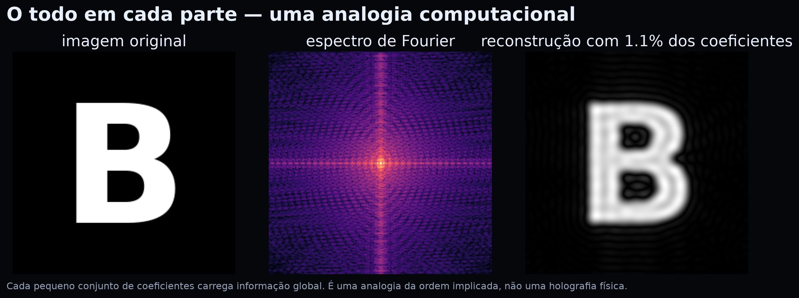
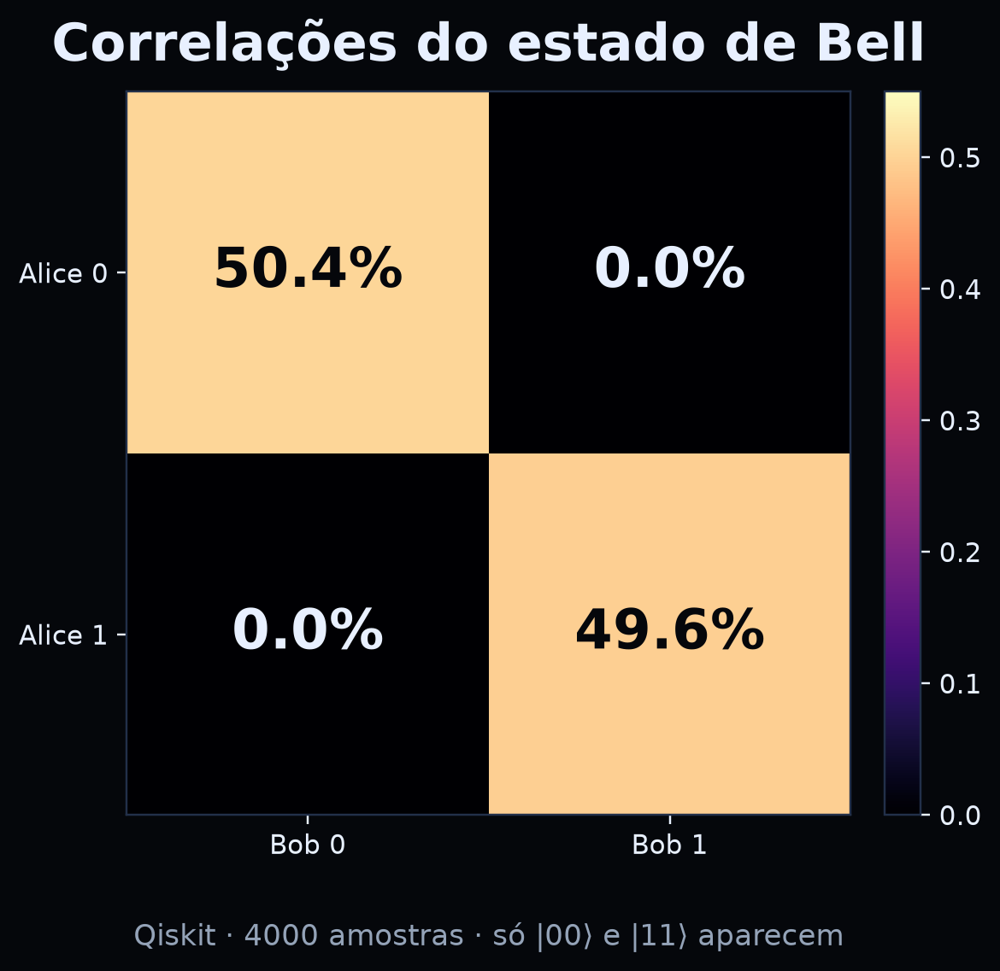

# 4. A ordem implicada: o todo em cada parte {#cap4}

::: {.epigrafe}
“O explícito é o desdobramento do implícito.” — David Bohm (paráfrase)
:::

Bohm propôs uma distinção filosófica entre duas ordens:

- **ordem explícita** (*explicate order*): o mundo das coisas separadas, visíveis,
  localizadas, que podemos apontar;
- **ordem implícita** (*implicate order*): um fundo de relações e informações que
  se “desdobra” no mundo explícito.

A imagem que ele usou é a do **holograma**: cada parte de um holograma contém
informação sobre o todo. Se você corta um holograma em pedaços, cada pedaço ainda
reconstrói uma versão borrada da imagem inteira — não porque cada pedaço seja
mágico, mas porque a informação está distribuída de forma não local.

## 4.1 O holograma como analogia computacional

A figura 4 mostra uma versão computacional dessa ideia. A imagem original é a
letra “B”. O espectro de Fourier contém a informação distribuída. Quando mantemos
apenas **1,1%** dos coeficientes, ainda reconstruímos uma versão borrada do “B”.

{#fig04}

O ponto pedagógico é: **a informação pode estar no todo, não apenas nas partes**.
Isso ajuda a imaginar por que o emaranhamento não é uma soma de duas histórias
independentes. Mas há um limite importante.

::: {.box-limite}
**⚠️ Limite da analogia.** Um holograma é um padrão de interferência clássico.
A ordem implicada é uma proposta filosófica de Bohm, não uma teoria física
comprovada. Não diga “o universo é um holograma” como se fosse fato. Diga: “essa
imagem nos ajuda a pensar sobre totalidade; ela não substitui a matemática”.
:::

## 4.2 O que a ordem implicada não é

- **Não é emaranhamento.** Emaranhamento é um fenômeno físico com previsões
  testáveis; ordem implicada é uma interpretação filosófica.
- **Não é um mecanismo de comunicação.** A distribuição da informação não permite
  enviar sinais mais rápido que a luz.
- **Não é uma teoria de tudo.** Bohm não a apresentou como uma teoria completa da
  física; é uma visão de mundo em diálogo com a ciência.

## 4.3 Totalidade na sala de aula

A ideia de totalidade tem uma consequência pedagógica: um conceito não é uma
ilha. “Medição” envolve aparelho, teoria, probabilidade e interpretação. “Qubit”
envolve álgebra, física e tecnologia. Ensinar por fragmentos pode até funcionar
na prova, mas não forma compreensão.

::: {.box-dialogo}
**🗣️ Pergunta para a roda.** “O que muda no meu jeito de estudar se eu acreditar
que as partes carregam o todo?” Não há resposta certa. O objetivo é observar como
a suposição altera a prática.
:::

::: {.box-pratica}
**🧪 Prática 4 — O todo em 1% (10 min, notebook).**

Execute a célula do holograma. Depois:

1. reconstrua com 0,5%, 1%, 2% e 5% dos coeficientes;
2. compare a nitidez;
3. escreva uma frase sobre o que se ganha e o que se perde.

**Checkpoint:** você consegue explicar por que a imagem borrada ainda é
reconhecível? Se sim, entendeu a ideia de informação distribuída.
:::

# 5. Emaranhamento e não separabilidade {#cap5}

::: {.epigrafe}
“Duas partes, um estado. Correlação não é mensagem.”
:::

O emaranhamento é o fenômeno que mais desafia a imagem de um mundo feito de
partes independentes. Dois qubits podem ser descritos por um único estado:

\[
|\Phi^+\rangle = \frac{|00\rangle+|11\rangle}{\sqrt{2}}.
\]

Se Alice mede o primeiro qubit e obtém 0, o segundo qubit de Bob está em 0. Se
ela obtém 1, o de Bob está em 1. A correlação é perfeita — mas cada resultado
isolado é 50%/50%.

{#fig05}

## 5.1 Não separabilidade

Na leitura padrão, o estado de Bell é **não separável**: não podemos escrevê-lo
como “estado de Alice × estado de Bob”. Não é que não saibamos os estados
individuais; é que o todo não se decompõe em partes independentes.

Na leitura de Bohm, o guia (a função de onda) vive em um espaço de configuração
de dimensão maior. A velocidade de uma partícula depende da posição da outra. A
não separabilidade é explícita: o todo guia as partes.

## 5.2 O teorema de Bell

Bell mostrou que nenhuma teoria de **variáveis ocultas locais** consegue reproduzir
todas as correlações quânticas. Isso não refuta Bohm, porque a teoria de Bohm é
**não local**. O preço da imagem clara é a não localidade.

| Modelo | Variáveis ocultas? | Local? | Reproduz Bell? |
|---|---|---|---|
| Quântica padrão | não (ou contextual) | não | sim |
| Bohm | sim (posições) | não | sim |
| Variáveis ocultas locais | sim | sim | **não** |

## 5.3 Por que não há mensagem mais rápida que a luz

Alice não escolhe o resultado que vai obter. Bob, sozinho, vê 50/50. A correlação
só aparece quando eles comparam os registros — e a comparação exige um canal
clássico, que respeita o limite da velocidade da luz.

Na teoria de Bohm, a influência não local existe, mas não é controlável. A
distribuição de equilíbrio \(|\psi|^2\) garante que nenhum sinal possa ser
codificado nela. Não localidade não é o mesmo que comunicação.

::: {.box-limite}
**⚠️ Cuidado com a palavra “instantâneo”.** A onda piloto descreve uma dependência
instantânea no espaço de configuração, mas isso não significa que um experimentador
possa enviar um bit instantaneamente. A teoria é não local; a signaling é proibida.
:::

::: {.box-pratica}
**🧪 Prática 5 — Correlação e anti-correlação (15 min, notebook).**

No notebook, execute a prática 3 com Qiskit. Depois, troque o estado de Bell
\((|00\rangle+|11\rangle)/\sqrt{2}\) por \((|01\rangle+|10\rangle)/\sqrt{2}\) e
repita a amostragem.

1. O que aparece na matriz de correlação?
2. Qual é a diferença entre correlação e anti-correlação?
3. A conclusão sobre “não há mensagem” muda?

**Checkpoint:** você consegue explicar a diferença entre “resultados iguais” e
“resultados opostos” sem dizer que um sinal foi enviado? Se sim, avançou.
:::

## 5.4 O que Bohm acrescenta — e o que não acrescenta

Bohm acrescenta uma **imagem**: partículas com trajetórias, guiadas por uma onda
não local. Isso pode ajudar a pensar sobre o que acontece entre medições.

Bohm **não** acrescenta uma nova previsão experimental para os fenômenos desta
aula. As probabilidades, as correlações e a violação de Bell são as mesmas. A
diferença é interpretativa — e interpretações não são descartáveis, mas também
não são fatos experimentais.

> **Pergunta para levar adiante:** se duas interpretações fazem as mesmas
> previsões, o que mais conta na escolha? Simplicidade? Intuição? Ontologia?
> Ensino? Essa é uma pergunta filosófica legítima — e uma ótima roda de diálogo.