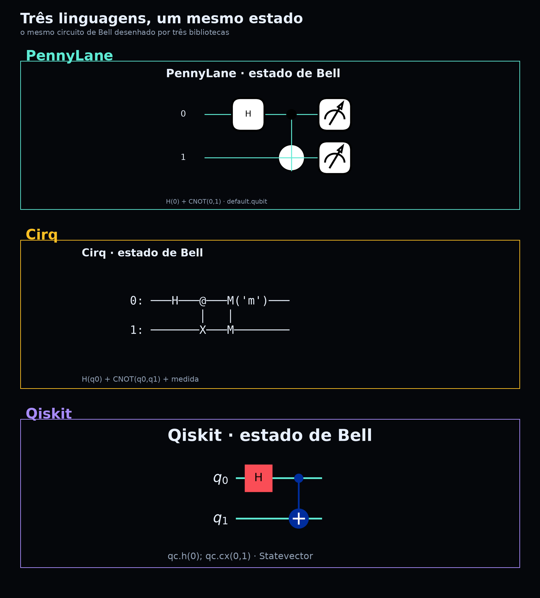
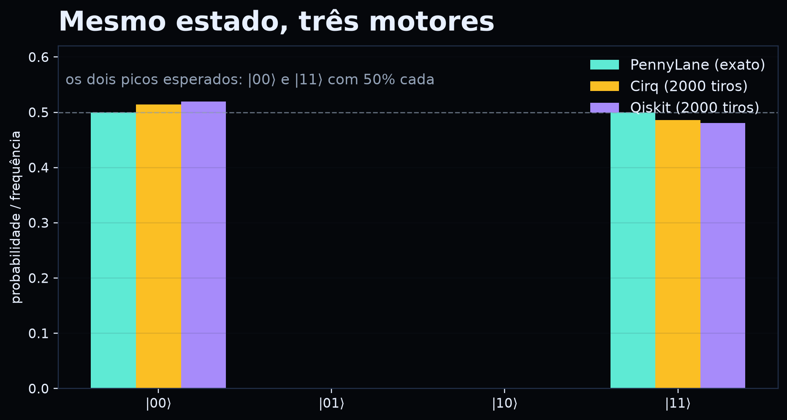
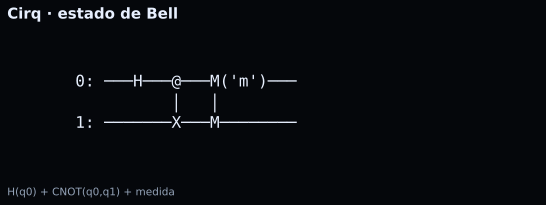
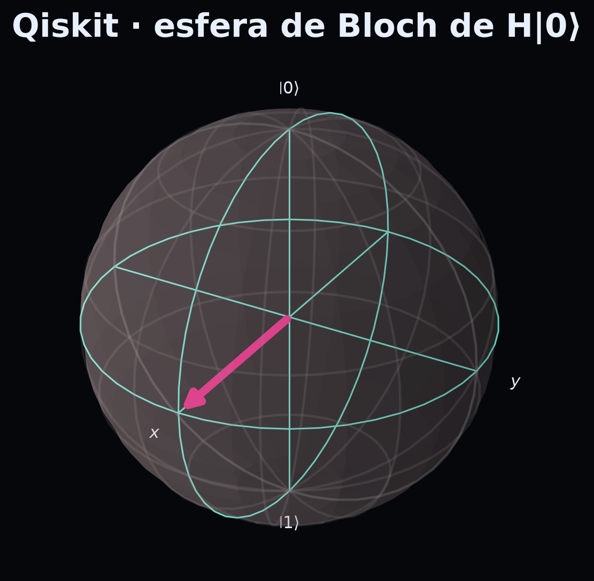

# 6. Três linguagens, um mesmo estado {#cap6}

::: {.epigrafe}
“O mapa não é o território — mas três mapas bons ajudam a ver o território.”
:::

PennyLane, Cirq e Qiskit são bibliotecas de código aberto para computação
quântica. Elas têm filosofias diferentes, mas descrevem o mesmo estado de Bell com
as mesmas portas. Comparar as três é uma excelente prática meticulosa: você
percebe o que é **conceito** e o que é **convenção da ferramenta**.

{#fig06}

## 6.1 O que é igual

- O estado final: \((|00\rangle+|11\rangle)/\sqrt{2}\).
- As probabilidades: 50% para |00⟩, 50% para |11⟩, 0% para |01⟩ e |10⟩.
- A correlação: os resultados de Alice e Bob concordam.

## 6.2 O que muda

| Aspecto | PennyLane | Cirq | Qiskit |
|---|---|---|---|
| Unidade | *wires* (fios) | `LineQubit` | `QuantumCircuit` |
| Porta H | `qml.Hadamard(0)` | `cirq.H(q0)` | `qc.h(0)` |
| CNOT | `qml.CNOT([0,1])` | `cirq.CNOT(q0,q1)` | `qc.cx(0,1)` |
| Medição | `qml.probs` / `qml.sample` | `cirq.measure` | `Statevector` / `sample_counts` |
| Desenho | `qml.draw_mpl` | diagrama textual | `qc.draw("mpl")` |
| Ordem dos qubits | declarada nos wires | linha | convenção little-endian |

A diferença de ordem é a fonte mais comum de erro. Em Qiskit, o bitstring `10`
pode significar “qubit 1 = 1, qubit 0 = 0”; em Cirq, a ordem é a dos qubits na
linha. **Sempre confira a convenção antes de comparar resultados.**

## 6.3 As probabilidades coincidem

A figura 7 mostra as probabilidades calculadas por PennyLane (exatas) e as
frequências observadas em Cirq e Qiskit (2000 tiros cada). As barras de |00⟩ e
|11⟩ ficam em torno de 50%; |01⟩ e |10⟩ ficam em zero.

{#fig07}

::: {.box-pratica}
**🧪 Prática 6 — Três linguagens, uma tabela (20 min).**

No notebook, execute as três práticas (PennyLane, Cirq e Qiskit). Preencha:

| Grandeza | PennyLane | Cirq | Qiskit |
|---|---|---|---|
| P(00) |  |  |  |
| P(11) |  |  |  |
| P(01) |  |  |  |
| P(10) |  |  |  |

Depois, responda: as diferenças são conceituais ou estatísticas? Como você pode
distinguir?

**Checkpoint:** você consegue explicar por que as três bibliotecas concordam?
:::

# 7. Prática 1 — PennyLane {#cap7}

::: {.epigrafe}
“Um circuito é uma função; a medição é o retorno.”
:::

PennyLane foi desenhada para **diferenciação automática** de circuitos quânticos.
Para esta aula, usaremos apenas o básico: um dispositivo `default.qubit`, um
QNode e medições de probabilidade.

## 7.1 Código mínimo

```python
import pennylane as qml

dev = qml.device("default.qubit", wires=2)

@qml.qnode(dev)
def bell():
    qml.Hadamard(wires=0)
    qml.CNOT(wires=[0, 1])
    return qml.probs(wires=[0, 1])

print(bell())          # [0.5 0.  0.  0.5]
qml.draw_mpl(bell)()   # desenha o circuito
```

{#fig08}

## 7.2 O que observar

- `qml.Hadamard(0)` cria \((|0\rangle+|1\rangle)/\sqrt{2}\) no fio 0.
- `qml.CNOT([0,1])` inverte o fio 1 quando o fio 0 é 1.
- `qml.probs(wires=[0,1])` devolve um vetor de quatro posições.
- A ordem do vetor é \(|00\rangle, |01\rangle, |10\rangle, |11\rangle\) para os
  wires declarados.

## 7.3 Prática guiada

1. Rode o código e confira `[0.5, 0, 0, 0.5]`.
2. Troque `qml.CNOT` por `qml.Z(1)` e observe o que muda.
3. Troque `qml.Hadamard(0)` por `qml.Hadamard(1)` e compare.
4. Use `qml.draw_mpl(bell)` para ver o desenho.

::: {.box-limite}
**⚠️ Limite.** PennyLane calcula probabilidades **exatas** no simulador. Isso não
é o mesmo que medir 2000 vezes. Para comparar com Cirq/Qiskit, use `qml.sample`
ou amostre a distribuição.
:::

::: {.box-pratica}
**🧪 Checkpoint da prática 1.**

- [ ] O vetor tem quatro posições.
- [ ] As posições 00 e 11 valem 0,5.
- [ ] Você sabe explicar o que o CNOT faz.
- [ ] Você desenhou o circuito.

Se faltou algum, releia a seção 6.1 e refaça.
:::

# 8. Prática 2 — Cirq {#cap8}

::: {.epigrafe}
“A linha é o palco; as portas são os gestos.”
:::

Cirq organiza o circuito em **linhas de qubits**. É uma biblioteca muito usada
em pesquisa com hardware supercondutor. Para nós, o valor está no diagrama
textual e na simulação de medições.

## 8.1 Código mínimo

```python
import cirq

q0, q1 = cirq.LineQubit.range(2)
circuito = cirq.Circuit(
    cirq.H(q0),
    cirq.CNOT(q0, q1),
    cirq.measure(q0, q1, key="m"),
)
print(circuito)

resultado = cirq.Simulator().run(circuito, repetitions=2000)
print(resultado.measurements["m"][:10])
```

{#fig09}

## 8.2 O que observar

- `cirq.H(q0)` cria a superposição.
- `cirq.CNOT(q0, q1)` emaranha.
- `cirq.measure(..., key="m")` registra os resultados.
- `Simulator().run(...)` devolve um dicionário de medições.

## 8.3 Prática guiada

1. Rode 2000 tiros e conte quantos 00 e 11 aparecem.
2. Adicione `cirq.H(q0)` **antes** da medição e meça de novo. O que muda?
3. Meça apenas `q0` e depois apenas `q1`. As marginais são 50/50?
4. Desenhe o circuito com `print(circuito)` e compare com a figura 9.

::: {.box-limite}
**⚠️ Limite.** O diagrama textual é ótimo para o terminal, mas não é uma figura
pronta para o livro. Para a versão visual, usamos um renderizador que transforma
o texto em imagem — o conteúdo é o mesmo.
:::

::: {.box-pratica}
**🧪 Checkpoint da prática 2.**

- [ ] Você obteve 00 e 11, sem 01/10.
- [ ] Você explicou o efeito de um H extra antes da medição.
- [ ] Você comparou as marginais.
- [ ] Você identificou a ordem dos qubits no diagrama.
:::

# 9. Prática 3 — Qiskit {#cap9}

::: {.epigrafe}
“O estado é um vetor; a esfera é uma janela.”
:::

Qiskit é a biblioteca da IBM. Ela oferece `QuantumCircuit`, `Statevector`,
desenho de circuito e ferramentas de visualização. Usaremos três recursos:
circuito, esfera de Bloch e amostragem.

## 9.1 Código mínimo

```python
from qiskit import QuantumCircuit
from qiskit.quantum_info import Statevector

qc = QuantumCircuit(2)
qc.h(0)
qc.cx(0, 1)

estado = Statevector(qc)
print(estado)                 # amplitudes
print(estado.probabilities()) # [0.5 0. 0. 0.5]
print(estado.sample_counts(2000, qargs=[0, 1]))
qc.draw("mpl")
```

{#fig10}

## 9.2 A esfera de Bloch

Para um único qubit, a esfera de Bloch é uma representação visual do estado.
A figura 11 mostra \(H|0\rangle\), que aponta para o equador (superposição
equilibrada).

{#fig11}

## 9.3 Prática guiada

1. Rode o código e confira as probabilidades.
2. Troque `qc.cx(0,1)` por `qc.x(1)` e observe o estado.
3. Troque o estado de Bell por \((|01\rangle+|10\rangle)/\sqrt{2}\) e repita a
   amostragem. O que aparece na matriz de correlação?
4. Compare a saída de Qiskit com a de Cirq. As probabilidades coincidem?

::: {.box-limite}
**⚠️ Limite.** A esfera de Bloch de um qubit isolado **não** mostra emaranhamento.
Para ver a correlação, é preciso olhar o estado de dois qubits ou a matriz de
probabilidades conjuntas. Não confunda “estado de um qubit” com “estado do par”.
:::

::: {.box-pratica}
**🧪 Checkpoint da prática 3.**

- [ ] Você obteve `[0.5, 0, 0, 0.5]`.
- [ ] Você viu a esfera de Bloch de H|0⟩.
- [ ] Você gerou a matriz de correlação.
- [ ] Você explicou por que a esfera isolada não mostra a correlação.
:::