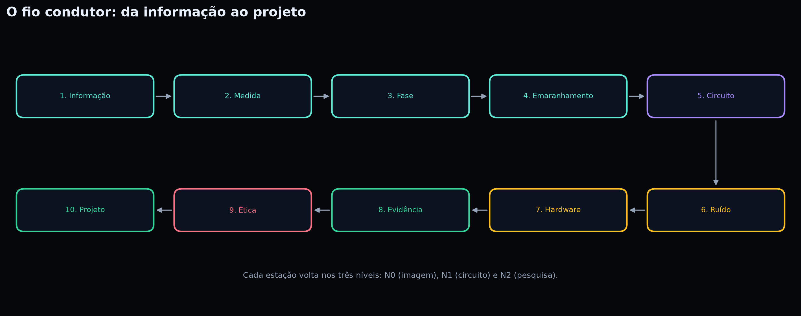

# Arquitetura de leitura: o contrato deste livro {#arquitetura}

> Este livro é longo de propósito. Mas ele não pede que você acredite nele:
> pede que você o atravesse, uma lauda por vez, e verifique.

## 1. A promessa e o limite

Este livro foi escrito para duas pessoas ao mesmo tempo: a que nunca estudou
física quântica e a que já a estuda. A diferença entre elas é a profundidade
que alcançam, não o respeito que recebem. Nenhuma lauda supõe que você já saiba
o que é uma amplitude, uma base ou um backend. Nenhuma lauda finge que você
não é capaz de entender uma definição precisa.

A promessa tem três partes:

1. **Explicar tudo o que usa.** Quando um símbolo aparece, ele é definido;
   quando um número aparece, ele é calculado; quando uma afirmação aparece,
   ela vem com o que prova e com o que não prova.
2. **Mostrar a conta.** Todo resultado quantitativo pode ser reconstruído à
   mão, com lápis, papel e uma calculadora. O capítulo *Cálculo manual* mostra
   o passo a passo; os scripts mostram o mesmo caminho em código.
3. **Não vender certeza.** A interpretação de Bohm é uma interpretação entre
   várias. O hardware tem ruído. Um resultado de quatro pontos não é uma
   política pública. O livro diz isso onde for necessário, não apenas no
   prefácio.

O limite também tem três partes:

1. O livro **não** substitui um curso com correção, laboratório presencial e
   orientação. Ele é uma trilha autossuficiente de estudo, não um diploma.
2. O livro **não** promete vantagem quântica, nota máxima, aceite editorial ou
   superioridade de um backend. Ele ensina a medir e a duvidar.
3. O livro **não** trata a Ponte Sonora como pré-requisito. O chinês aparece
   apenas nos blocos marcados como ponte; quem não quiser lê-los pode saltar
   sem perder o fio conceitual.

## 2. A unidade de leitura: a lauda

A obra tem **3000 laudas**. Cada lauda é um conceito, uma lente e um nível.
A conta é simples:

```text
100 conceitos × 10 lentes × 3 níveis = 3000 laudas
```

Uma lauda foi desenhada para **sete minutos** de leitura ativa. Sete minutos
não é uma promessa de velocidade: é um contrato de atenção. Se você gastar
sete minutos com lápis na mão, a lauda rende. Se você apenas deslizar os olhos,
ela não rende.

Na maioria dos casos, a lauda cabe em uma página. Quando a conta exige mais
espaço, a lauda **se expande para uma segunda página** e a explicação vai para
uma **nota de rodapé**. A nota é opcional: ela aprofunda a fórmula, a
substituição e o resultado, mas não muda a pergunta central. O contrato dos
sete minutos continua valendo para o corpo; a nota é o tempo extra de quem
quer conferir o número.

### 2.1 A anatomia de uma lauda

Toda lauda tem a mesma estrutura. Aprender a estrutura é aprender a ler o
livro inteiro.

| Elemento | O que é | Como usar |
|---|---|---|
| **Topo** | Código `L0001`, lente, conceito e nível | Localize-se antes de ler |
| **Dez pontos** | Marca a lente atual dentro do conceito | Saiba quanto falta para fechar o conceito |
| **Título** | Conceito + lente | Diga em voz alta o que vai aprender |
| **Corpo** | Texto principal, imagem e resultado | Leia uma vez sem parar |
| **Ponte Sonora** | Bloco opcional de chinês | Leia, repita, siga; ou pule sem culpa |
| **Resultado** | Experimento, contagem, tabela ou figura | Compare com a sua previsão |
| **Nota de cálculo** | Fórmula, conta, resultado e limite, no rodapé | Confira o número com lápis e papel |
| **Rigor** | Definição precisa e nota ao professor | Confira o limite da analogia |
| **Checkpoint** | Pergunta e microprática | Escreva antes de consultar o gabarito |
| **Rodapé** | `P01 · C001/100 · L0001 · [G001]` (o PDF acrescenta `/3000`) | Navegue por parte, conceito, lauda e gabarito |

O rodapé é o mapa portátil. `P01` é a parte; `C001` é o conceito; `L0001` é a
lauda; `G001` é o checkpoint correspondente no gabarito. Se você se perder,
volte ao rodapé: ele diz exatamente onde você está.

### 2.2 As dez lentes

Cada conceito é olhado por dez lentes. Elas não são dez capítulos independentes:
são dez perguntas sobre o mesmo objeto.

| Lente | Pergunta | O que deixa |
|---|---|---|
| **Ideia em 60s** | O que é, em uma frase? | Uma definição operacional |
| **Analogia + limite** | Que imagem ajuda — e onde ela quebra? | Intuição com fronteira |
| **Mão na massa** | O que eu faço com o corpo e com o papel? | Um procedimento |
| **Laboratório** | O que eu meço, simulo ou comparo? | Um resultado |
| **Erro comum** | Que concepção errada precisa ser desmontada? | Uma correção |
| **Para ir além** | Qual é a definição precisa? | Um formalismo mínimo |
| **Roda de diálogo** | Que pergunta eu não sei responder sozinho? | Uma pergunta coletiva |
| **Ética e sociedade** | Quem ganha, quem perde, quem decide? | Uma responsabilidade |
| **Conexão com a vida** | Onde isso aparece fora da escola? | Um contexto |
| **Checkpoint** | O que eu levo e o que vou testar? | Uma pergunta e um critério |

A ordem das lentes não é arbitrária. Primeiro a ideia, depois a imagem, depois
o gesto, depois a medida, depois o erro, depois a precisão, depois o outro,
depois a responsabilidade, depois a vida, depois a síntese. É uma escada do
concreto ao abstrato e do abstrato ao coletivo.

### 2.3 Os três níveis

O mesmo conceito retorna três vezes, com resolução crescente.

| Nível | Público | O que muda | O que permanece |
|---|---|---|---|
| **N0** | Leigo e fundamental | Sem fórmula; imagem, gesto e resultado | A pergunta e a evidência |
| **N1** | Médio e graduação | Circuito, tabela, fórmula curta, simulado × backend | A pergunta e a evidência |
| **N2** | Pós e PhD | Formalização, limite estatístico, replicação, pergunta aberta | A pergunta e a evidência |

Os três níveis não são três livros diferentes. São três passagens pelo mesmo
fio. O N0 mostra o que está em jogo; o N1 mostra como se monta; o N2 mostra
como se duvida. Quem lê os três vê o mesmo objeto em três resoluções — e é
essa comparação que produz maturidade, não a acumulação de páginas.

### 2.4 O invariante

Em toda lauda, há **uma evidência** e **uma pergunta**. A evidência pode ser
uma contagem, uma tabela, uma figura, um gráfico ou uma barra de resultado. A
pergunta pode ser um checkpoint, uma pergunta de roda ou uma pergunta de
projeto. Não há lauda de enchimento: se uma lauda não tem evidência nem
pergunta, ela não deveria existir.

### 2.5 A nota de cálculo

Nos níveis N1 e N2, as lentes **Laboratório** e **Para ir além** trazem uma
nota de rodapé com quatro partes:

| Parte | Pergunta | Exemplo |
|---|---|---|
| **Fórmula** | Qual é a relação matemática? | `P(0) = N₀/N` |
| **Conta** | Quais números entram? | `1016/1024 = 0,9922` |
| **Resultado** | O que sai? | `P(0) = 99,22%` |
| **Limite** | O que isso não prova? | O desvio é compatível com erro de leitura |

A nota não é um apêndice distante: ela fica no rodapé da página onde o número
aparece. Se você não quiser conferir a conta, pode ignorá-la e seguir o corpo.
Se quiser conferir, o caminho está completo: fórmula, substituição, resultado
e limites. É a mesma regra do capítulo *Cálculo manual*, aplicada no ponto de
uso.

## 3. Os sete movimentos

O livro não é uma pilha de 3000 páginas. É uma travessia em sete movimentos.
Cada movimento tem uma entrada, um trabalho e uma saída. A saída de um é a
entrada do próximo.

| Movimento | Partes | Pergunta que organiza | Saída |
|---|---|---|---|
| **1. Orientar** | Abertura, arquitetura, mapa, níveis, ponte, resultados, ferramentas | Como este livro funciona? | Uma rota escolhida |
| **2. Informação** | P1 — Informação e medida | Quando uma diferença vira informação? | Uma explicação de bit, qubit, medida, fase e emaranhamento |
| **3. Interpretação** | P2 — A lente de Bohm | A partícula tem trajetória? | A distinção entre interpretação e previsão |
| **4. Operação** | P3 — Circuitos; P4 — Ferramentas | O que significa inverter um estado? | Um circuito lido, escrito e executado |
| **5. Matéria** | P5 — Hardware e nuvem | Por que tanto frio? | A leitura de calibração, T1/T2, erro de leitura e fila |
| **6. Evidência** | P6 — Experimentos | Por que aparecem 1011 e 1101? | A separação entre modelo, ruído e afirmação |
| **7. Síntese** | P7 — Matemática; P8 — Pedagogia; P9 — Ética; P10 — Projeto | O que eu vou fazer com a resposta? | Um projeto reproduzível com limites declarados |

### 3.1 Movimento 1 — Orientar

Você não começa no conceito 1. Começa no contrato. Este capítulo, o *Modo
fácil*, o *Mapa dos 100 conceitos*, a *Ponte Sonora* e o *Caderno de resultados*
existem para que você saiba onde está, para onde vai e como voltar. A saída
deste movimento é uma decisão: qual rota você vai seguir — 30 dias, um
semestre, uma pesquisa ou uma disciplina.

### 3.2 Movimento 2 — Informação

A primeira parte constrói o vocabulário mínimo: bit, qubit, amplitude,
probabilidade, medição, base, fase, interferência, emaranhamento e estado de
Bell. O experimento que costura a parte é o **Bell**. Ele aparece primeiro como
história, depois como circuito, depois como contagem. A saída é uma explicação
que não depende de fórmula: você consegue dizer por que duas medidas separadas
não bastam para explicar a correlação.

### 3.3 Movimento 3 — Interpretação

A segunda parte apresenta a interpretação de Bohm: onda piloto, equação do
guia, equilíbrio quântico, não localidade, colapso efetivo, ordem implicada,
holomovimento, diálogo, suspensão de suposições e totalidade. O objetivo não é
converter você: é mostrar o que uma interpretação explica, o que ela não
explica e por que a física prevê os mesmos números em várias leituras. A saída
é a frase que separa **dado** de **leitura do dado**.

### 3.4 Movimento 4 — Operação

A terceira parte abre a caixa de ferramentas: X, H, Z, CNOT, circuito, Bell,
GHZ, QASM 2.0, transpilação e medição múltipla. A quarta parte mostra as três
bibliotecas que executam esses circuitos: PennyLane, Cirq e Qiskit, com QNode,
Circuit, QuantumCircuit, statevector, esfera de Bloch, amostragem e
`gjq-client`. A saída é um circuito que você consegue desenhar, transpor e
executar em mais de uma pilha.

### 3.5 Movimento 5 — Matéria

A quinta parte desce ao físico: supercondutor, qubit físico, decoerência,
T1/T2, erro de leitura, ruído, CIQuanta, Tiangong, fila de jobs e API key. A
saída é a leitura de uma calibração: você sabe distinguir o que é porta, o que
é leitura e o que é ambiente.

### 3.6 Movimento 6 — Evidência

A sexta parte transforma tudo em experimento: GHZ real, VQC XOR, classificador,
encoding, ansatz, treino, acurácia, phase damping, depolarizing e a pergunta
sobre ruído benéfico. A saída é um número com incerteza, backend, data e task
ID — e a consciência de que um resultado de quatro pontos não generaliza.

### 3.7 Movimento 7 — Síntese

As partes 7 a 10 formalizam, ensinam, julgam e projetam. Vetor, matriz, produto
interno, tensor, densidade, traço, autovalor, Fourier, holograma e Fourier
quântico dão a linguagem. Nanoaula, autodidatismo, feedback, checkpoint, erro
produtivo, roda de diálogo, projeto, rubrica, adaptação e acessibilidade dão o
método. Acesso, dupla finalidade, privacidade, LGPD, custo, ambiente, trabalho,
desinformação, consenso e responsabilidade dão o juízo. Pergunta, hipótese,
evidência, limite, replicação, narrativa, visualização, apresentação, portfólio
e próximo passo dão a saída. A saída final é um projeto que outra pessoa
consegue repetir.

## 4. O fio condutor

O fio condutor é uma cadeia de perguntas. Cada parte responde à pergunta que a
anterior deixou em aberto. A figura abaixo mostra as dez estações.

{#fig-a1}

| Estação | Parte | Pergunta motriz | Experimento que retorna |
|---|---|---|---|
| 1 | P1 — Informação e medida | Quando uma diferença vira informação? | Bell |
| 2 | P2 — A lente de Bohm | A partícula tem trajetória? | Duas fendas / onda piloto |
| 3 | P3 — Circuitos | O que significa inverter um estado? | Bell, GHZ |
| 4 | P4 — Ferramentas | O que significa “diferenciável”? | Mesmo circuito em três pilhas |
| 5 | P5 — Hardware e nuvem | Por que tanto frio? | Calibração, T1/T2, leitura |
| 6 | P6 — Experimentos | Por que aparecem 1011 e 1101? | GHZ, VQC, CHSH, SWAP |
| 7 | P7 — Matemática | O que a norma representa? | Statevector, densidade, Bloch |
| 8 | P8 — Pedagogia | O que cabe em 7 minutos? | A própria lauda |
| 9 | P9 — Ética | Quem fica de fora? | Custo, acesso, privacidade |
| 10 | P10 — Projeto | O que eu vou fazer com a resposta? | Um experimento replicável |

### 4.1 A espiral

O leitor atento vai notar que a mesma pergunta volta. Isso não é repetição: é
espiral. No N0, “o que é um qubit?” pede uma imagem. No N1, pede um circuito.
No N2, pede uma matriz densidade e um limite estatístico. A pergunta é a mesma;
a resolução muda. A comparação entre as três passagens é o que transforma
informação em entendimento.

### 4.2 Os cinco experimentos recorrentes

Cinco experimentos funcionam como espinha dorsal:

| Experimento | O que mede | Onde aparece primeiro | Onde retorna |
|---|---|---|---|
| **Bell** | Correlação de dois qubits | P1 | P3, P5, P6 |
| **GHZ** | Correlação de três ou quatro qubits | P3 | P6, P7 |
| **CHSH** | Violação de desigualdade | P1 | P6, P9 |
| **VQC** | Classificação com ruído | P6 | P7, P9 |
| **SWAP test** | Sobreposição de estados | P3 | P6, P7 |

O mesmo circuito não é executado do mesmo jeito no N0 e no N2. No N0, ele é
uma história; no N1, um diagrama; no N2, um objeto com ruído, calibração e
incerteza. A continuidade está no objeto, não na dificuldade.

## 5. O mapa de dependências

Nem todo capítulo depende de todos. O mapa abaixo mostra as dependências
fortes. Uma seta `→` significa “convém ler antes”.

```text
P1 ──> P2
 │
 ├──> P3 ──> P4
 │     └──> P5 ──> P6 ──> P9 ──> P10
 ├──> P7  (N2)
 └──> P8 ─────────────────────> P10
```

| Parte | Precisa de | Entrega | Se você pular |
|---|---|---|---|
| **P1** | Nada | Vocabulário de informação e medida | Todo o resto fica sem base |
| **P2** | P1 | Uma interpretação, com limites | Você perde a distinção entre dado e leitura |
| **P3** | P1 | Portas, circuitos, QASM | P4, P5 e P6 ficam bloqueados |
| **P4** | P3 | Três pilhas de programação | Você pode ler P5, mas não executar P6 |
| **P5** | P3 | Hardware, ruído, calibração | P6 fica sem a parte física |
| **P6** | P3, P5 | Evidência com incerteza | P9 e P10 ficam frágeis |
| **P7** | P1 | Formalização matemática | O N2 fica sem linguagem |
| **P8** | P1 | Método de ensino | P10 fica sem método |
| **P9** | P1, P6 | Juízo ético e social | P10 fica sem responsabilidade |
| **P10** | P6, P8, P9 | Projeto replicável | O livro termina sem saída |

### 5.1 O que você pode pular

- Se você só quer entender o debate conceitual: **P1 → P2 → P9**.
- Se você quer montar circuitos: **P1 → P3 → P4**.
- Se você quer rodar no hardware: **P1 → P3 → P5 → P6**.
- Se você quer ensinar: **P1 → P8 → P9**.
- Se você quer pesquisar: **P1 → P3 → P5 → P6 → P7 → P10**.

### 5.2 O que você não pode pular

Você não pode pular **P1**. Sem bit, amplitude, medida, fase e emaranhamento,
as partes seguintes viram vocabulário sem referência. Você também não pode
pular **P3** se quiser executar qualquer coisa: circuito é a ponte entre a
ideia e o backend. E não pode pular **P6** se quiser fazer uma afirmação
quantitativa: é lá que a incerteza entra.

## 6. As transições

A fluidez não depende de frases de ligação. Depende de três dispositivos
estruturais:

1. **O checkpoint de parte.** Cada parte termina com uma pergunta que só pode
   ser respondida com o que a parte ensinou. Se você não consegue responder,
   volte ao conceito que faltou.
2. **A pergunta motriz da parte seguinte.** A pergunta seguinte não é um novo
   assunto: é a consequência da anterior.
3. **O experimento que retorna.** O mesmo experimento reaparece com mais
   resolução, e é isso que dá a sensação de continuidade.

| Transição | O que fica | O que começa |
|---|---|---|
| P1 → P2 | A correlação de Bell | A pergunta sobre trajetória |
| P2 → P3 | A distinção entre interpretação e previsão | A pergunta sobre inverter um estado |
| P3 → P4 | O circuito desenhado | A pergunta sobre executá-lo em três pilhas |
| P4 → P5 | O código que roda | A pergunta sobre onde ele roda de verdade |
| P5 → P6 | A calibração e o ruído | A pergunta sobre o que o número prova |
| P6 → P7 | O número com incerteza | A pergunta sobre a norma e a matriz |
| P7 → P8 | A linguagem formal | A pergunta sobre o que cabe em sete minutos |
| P8 → P9 | O método de ensinar | A pergunta sobre quem fica de fora |
| P9 → P10 | O juízo sobre o custo e o acesso | A pergunta sobre o projeto |
| P10 → fim | O projeto replicável | A pergunta seguinte, que é sua |

Os abridores de parte aparecem **três vezes**, uma em cada nível. Eles repetem
a pergunta motriz e a lista dos dez conceitos. Isso é deliberado: o leitor que
entra no meio do livro encontra o mesmo contrato, e o leitor que faz a segunda
passagem reconhece a estrutura.

## 7. Como ler em três velocidades

| Unidade | Tempo aproximado | O que você faz | Critério de saída |
|---|---|---|---|
| **Uma lauda** | 7 min | Lê, faz a microprática, escreve o checkpoint | Uma frase própria |
| **Um conceito** | 70 min | Percorre as dez lentes | Explica, faz, mede e aponta um limite |
| **Uma parte** | 12 h | Percorre dez conceitos | Responde à pergunta motriz |
| **Um nível** | 120 h | Percorre cem conceitos | Ensina um conceito a alguém |
| **A obra** | 360 h | Percorre os três níveis | Compara os níveis e escreve um projeto |

Os tempos são estimativas de trabalho ativo, não promessas. Se você tem menos
tempo, escolha uma rota.

### 7.1 Quatro rotas

| Rota | Para quem | Caminho | Entregável |
|---|---|---|---|
| **30 dias** | Leigo, primeiro contato | Uma lauda por dia, uma prática por semana | Um caderno com 30 respostas |
| **Um semestre** | Graduação | Uma parte por semana, P1–P6 + P10 | Um experimento replicado |
| **Pesquisa** | Pós e PhD | P1–P7 + P10, com o anexo Qualis | Um protocolo com limites |
| **Disciplina** | Professor | P8 + P9 + partes selecionadas | Uma rubrica e uma aula |

A rota de 30 dias está detalhada na *Trilha do leigo*. A rota de pesquisa
encontra no *Anexo: exercício* o exemplo de um parecer que separa resultado de
alegação.

## 8. O protocolo quando travar

Travar faz parte. O que não faz parte é fingir que entendeu. Quando uma lauda
não abrir, siga cinco passos, nesta ordem:

1. **Releia o checkpoint.** A pergunta costuma dizer qual é o critério.
2. **Localize o conceito no mapa.** Talvez você tenha pulado um pré-requisito.
3. **Leia a mesma lauda no nível anterior.** O N0 mostra a imagem que o N1
   supõe; o N1 mostra o circuito que o N2 formaliza.
4. **Execute o experimento.** Um count, uma tabela, uma figura. O concreto
   desbloqueia o abstrato.
5. **Escreva a pergunta exata.** Não “não entendi”; mas “não entendo por que
   P(0) + P(1) = 1 depois da medição”.

| Se a dúvida é… | Vá para… |
|---|---|
| “O que este símbolo significa?” | *Glossário de bolso* e a caixa de Rigor da lauda |
| “Como este número foi calculado?” | *Cálculo manual* |
| “Como eu rodo isso?” | *Manual do leitor* e *Oficina de scripts* |
| “Qual é a resposta do checkpoint?” | *Gabarito comentado* (critério, não resposta única) |
| “Como eu represento o estado?” | *Esfera de Bloch* e *Cálculo manual*, seção 7 |
| “O que este resultado prova?” | *Anexo: exercício* e a caixa “O que prova / O que não prova” |
| “Onde encontro os dados?” | *Caderno de resultados* e as fichas de evidência |

## 9. O contrato de evidência

O livro faz três tipos de afirmação, e não confunde os três:

| Tipo | O que significa | Exemplo |
|---|---|---|
| **Demonstração** | Eu executei e obtive este número | “O GHZ no Guoji08 deu 78,8% de fidelidade proxy” |
| **Replicação** | Outra pessoa, com o mesmo código e o mesmo backend, obtém um número compatível | “O script e a seed estão no manual” |
| **Generalização** | O resultado vale para além da amostra | O livro **não** afirma isso sem desenho adequado |

Toda afirmação quantitativa vem com:

- **fonte**: simulador, hardware ou literatura;
- **contagem e total**: `418 + 389` em `1024` tiros;
- **incerteza**: erro padrão ou intervalo;
- **data e backend**: quando foi executado;
- **task ID**: quando veio de hardware;
- **limite**: o que o número não prova.

### 9.1 O que o livro não afirma

- Não afirma que o ruído é benéfico em geral. O teste com quatro pontos não
  sustenta essa hipótese; phase damping, neste experimento, ficou idêntico ao
  baseline.
- Não afirma que um backend é superior a outro. Dois backends, dois resultados;
  a comparação é sobre o que foi medido, não sobre o que é melhor.
- Não afirma que a interpretação de Bohm é a única. Ela é uma leitura entre
  várias, e o livro mostra o que ela explica e o que ela deixa em aberto.
- Não afirma que o leitor vai atingir nota máxima, aceite editorial ou
  vantagem quântica. O livro ensina o método, não vende o resultado.

## 10. O mapa físico do volume

| Bloco | O que contém | Como navegar |
|---|---|---|
| **Abertura** | Capa, rosto, este contrato, modo fácil, níveis, navegação, ponte, resultados, ferramentas, figuras, cartas, lentes | Leia na ordem, uma vez |
| **Miolo** | 3000 laudas em três passagens (N0, N1, N2) | Use os códigos `L` e os abridores de parte |
| **Fichas** | 100 fichas de evidência (`F001`–`F100`) | Consulte por conceito ou por experimento |
| **Apêndices** | Anexo Qualis, prática SWAP, oficina, cálculo manual, gabarito, Ceará/Paraíba, esfera de Bloch | Consulte quando a lauda pedir |
| **Fecho** | Glossário de bolso, referências, como citar | Volte ao glossário sempre que um termo escapar |

### 10.1 Os quatro índices

| Índice | Código | Serve para |
|---|---|---|
| **Conceito** | `C001`–`C100` | Achar o mesmo conceito nas dez lentes e nos três níveis |
| **Lauda** | `L0001`–`L3000` | Achar uma página exata |
| **Evidência** | `F001`–`F100` | Achar a ficha que sustenta um conceito |
| **Checkpoint** | `G001`–`G100` | Achar o critério de resposta |

O PDF tem marcadores por título. A busca textual encontra `L`, `C`, `F` e `G`.
Os links internos levam do checkpoint ao gabarito e do mapa à lauda. Use os
códigos, não os números de página: a paginação pode mudar entre edições, os
códigos não.

### 10.2 O que está dentro do livro

O livro foi escrito para quem tem **apenas o PDF**. Por isso, ele contém:

- a instalação do ambiente e a criação da API key;
- o código completo dos sete programas do leitor;
- os circuitos desenhados e a explicação de cada porta;
- os arquivos CSV e as tabelas de counts;
- as saídas reais e simuladas, com backend, data e task ID;
- as esferas de Bloch e os gráficos de resultado;
- o cálculo manual de cada métrica;
- o gabarito dos 100 checkpoints;
- a trilha de 30 dias e as rubricas de avaliação.

Você não precisa acessar um repositório externo para começar. Se o livro cita
um arquivo, ele mostra o conteúdo ou o caminho dentro do volume.

## 11. Checklist de entrada e de saída

### 11.1 Antes de começar

- [ ] Escolhi um nível: N0, N1 ou N2.
- [ ] Escolhi uma rota: 30 dias, semestre, pesquisa ou disciplina.
- [ ] Tenho um caderno ou um arquivo para anotar previsões e contas.
- [ ] Sei que a Ponte Sonora é opcional.
- [ ] Sei onde estão o mapa, o gabarito, o cálculo manual e o manual do leitor.
- [ ] Aceito a regra: primeiro a previsão, depois o resultado.

### 11.2 Depois de uma parte

- [ ] Consigo dizer a ideia central em uma frase.
- [ ] Consigo desenhar o experimento ou o circuito.
- [ ] Consigo calcular uma métrica à mão.
- [ ] Consigo apontar um limite do resultado.
- [ ] Consigo formular uma pergunta que ainda não sei responder.

Se algum item falhar, o livro não acabou: você sabe exatamente onde voltar.

## 12. Uma última advertência

Um livro de 3000 laudas não é melhor por ser longo. Ele é melhor se cada lauda
puder ser lida, testada e contestada. O tamanho é uma consequência do método:
repetir o mesmo fio em três resoluções, com evidência em cada passo, exige
páginas. O mérito não está no número de páginas; está na possibilidade de você
fechar o livro e dizer: “eu sei como isso foi obtido, eu sei o que isso não
prova, e eu sei qual é a próxima pergunta”.

O livro termina quando você consegue discordar dele com argumentos. Até lá,
ele é uma ferramenta. Use-a com lápis na mão.

## Para saber mais

As afirmações sobre a interpretação de Bohm se apoiam em Bohm (1952), Bohm e
Hiley (1993) e Bohm (1980); as desigualdades de Bell, em Bell (1964), Clauser
et al. (1969) e Aspect, Grangier e Roger (1982); a computação quântica, em
Nielsen e Chuang (2000) e Preskill (2018). As referências completas, com DOI,
estão nas fichas `F001`–`F100` e na **Verificação de DOIs**. Se uma lauda
citar um número, a ficha correspondente mostra a fonte; se citar uma fórmula,
a nota de cálculo mostra a conta.

> **Regra de citação:** nenhuma afirmação quantitativa do livro fica sem
> origem. A origem pode ser um experimento desta edição (com data, backend e
> task ID), uma fonte externa (com DOI) ou uma conta explícita (com fórmula e
> substituição). Quando nenhuma das três existe, o livro diz que não sabe.
