# Manual do leitor: instalar, criar API e rodar {#laboratorio-leitor}

Este manual é autossuficiente: o código, os comandos, as tabelas CSV e as
saídas esperadas estão **no livro**. Você não precisa acessar o repositório
para começar. Copie os blocos, execute na ordem e compare com as tabelas.

## 1. O que você precisa

- Python 3.12 ou superior.
- Internet para instalar pacotes e, se quiser, acessar o hardware.
- Uma conta gratuita na Tiangong para a API key (opcional para o simulador).
- 30 minutos para a primeira execução.

## 2. Instalação

### Linux/macOS

```bash
python3 -m venv .venv
source .venv/bin/activate
python -m pip install --upgrade pip
pip install qiskit qiskit-aer gjq-client numpy scipy matplotlib optuna
```

### Windows (PowerShell)

```powershell
python -m venv .venv
.\.venv\Scripts\Activate.ps1
python -m pip install --upgrade pip
pip install qiskit qiskit-aer gjq-client numpy scipy matplotlib optuna
```

## 3. Criar a API key

1. Abra <https://tiangongqs.com/cloud/circuit>.
2. Entre ou crie uma conta.
3. Gere uma **API key** no perfil/conta.
4. No terminal, defina a variável de ambiente:

```bash
export GJQ_API_KEY="sua-chave"        # Linux/macOS
# PowerShell: $env:GJQ_API_KEY = "sua-chave"
```

O `gjq-client` grava o cache em:

- Linux/macOS: `~/.gjq_client/gjq_client_account.json`
- Windows: `%USERPROFILE%\.gjq_client\gjq_client_account.json`

Proteja o cache:

```bash
chmod 600 ~/.gjq_client/gjq_client_account.json
```

> **Nunca** grave a chave no código, no caderno ou no repositório. Se ela
> vazar, revogue, apague o cache e audite `list_tasks()`.

## 4. Circuitos que você vai montar

### Circuito de Bell

```text
     ┌───┐     ┌─┐   
q_0: ┤ H ├──■──┤M├───
     └───┘┌─┴─┐└╥┘┌─┐
q_1: ─────┤ X ├─╫─┤M├
          └───┘ ║ └╥┘
c: 2/═══════════╩══╩═
                0  1 
```

### Circuito GHZ de 4 qubits

```text
     ┌───┐                     ┌─┐   
q_0: ┤ H ├──■────■───────■─────┤M├───
     └───┘┌─┴─┐  │  ┌─┐  │     └╥┘   
q_1: ─────┤ X ├──┼──┤M├──┼──────╫────
          └───┘┌─┴─┐└╥┘  │  ┌─┐ ║    
q_2: ──────────┤ X ├─╫───┼──┤M├─╫────
               └───┘ ║ ┌─┴─┐└╥┘ ║ ┌─┐
q_3: ────────────────╫─┤ X ├─╫──╫─┤M├
                     ║ └───┘ ║  ║ └╥┘
c: 4/════════════════╩═══════╩══╩══╩═
                     1       2  0  3 
```

### Circuito CHSH — configuração E00

```text
     ┌───┐                 ┌─┐   
q_0: ┤ H ├──■──────────────┤M├───
     └───┘┌─┴─┐┌──────────┐└╥┘┌─┐
q_1: ─────┤ X ├┤ Ry(-π/4) ├─╫─┤M├
          └───┘└──────────┘ ║ └╥┘
c: 2/═══════════════════════╩══╩═
                            0  1 
```

### Circuito SWAP test

```text
       ┌───┐     ┌───┐┌─┐
q_0: ──┤ H ├───■─┤ H ├┤M├
       └───┘   │ └───┘└╥┘
q_1: ──────────X───────╫─
     ┌───────┐ │       ║ 
q_2: ┤ Ry(1) ├─X───────╫─
     └───────┘         ║ 
c: 1/══════════════════╩═
                       0 
```

### Circuito VQC XOR — entrada 00

```text
     ┌───────┐┌────────────┐     ┌─────────────┐┌─┐
q_0: ┤ Ry(0) ├┤ Ry(1.5708) ├──■──┤ Ry(-1.5708) ├┤M├
     ├───────┤├────────────┤┌─┴─┐└┬───────────┬┘└╥┘
q_1: ┤ Ry(0) ├┤ Ry(1.5708) ├┤ X ├─┤ Ry(2.819) ├──╫─
     └───────┘└────────────┘└───┘ └───────────┘  ║ 
c: 1/════════════════════════════════════════════╩═
                                                 0 
```

## 5. Notebook do leitor

### Célula 1 — Bell no simulador

```python
#!/usr/bin/env python3
"""Bell no simulador local. Não precisa de API."""
from qiskit import QuantumCircuit, transpile
from qiskit_aer import AerSimulator

qc = QuantumCircuit(2, 2)
qc.h(0)
qc.cx(0, 1)
qc.measure([0, 1], [0, 1])

sim = AerSimulator(seed_simulator=42)
resultado = sim.run(transpile(qc, sim), shots=1024).result()
counts = resultado.get_counts()
print("counts:", counts)
print("P(00)+P(11):", (counts.get("00", 0) + counts.get("11", 0)) / 1024)
```

**Saída esperada:** counts próximos de `{'00': 512, '11': 512}` e
`P(00)+P(11) ≈ 1,000`.

### Célula 2 — Bell no hardware

```python
#!/usr/bin/env python3
"""Bell no hardware Guoji08. Exige GJQ_API_KEY no ambiente."""
import os
from qiskit import QuantumCircuit
from gjq_client import GJQRuntimeService, Sampler, generate_preset_pass_manager

chave = os.environ.get("GJQ_API_KEY", "").strip()
if not chave:
    raise SystemExit("Defina GJQ_API_KEY no ambiente.")

service = GJQRuntimeService(api_key=chave)
backend = service.backend("Guoji08")  # ou "Baihua"

qc = QuantumCircuit(2, 2)
qc.h(0)
qc.cx(0, 1)
qc.measure([0, 1], [0, 1])

pm = generate_preset_pass_manager(backend=backend, optimization_level=2, seed_transpiler=42)
isa = pm.run(qc)
job = Sampler(backend=backend).run(isa, shots=1024)
counts = {str(k): int(v) for k, v in job.result(timeout=900)["counts"].items()}
print("backend:", backend.name)
print("task_id:", getattr(job, "_job_id", None))
print("counts:", counts)
print("fidelidade proxy:", (counts.get("00", 0) + counts.get("11", 0)) / 1024)
```

**Saída real desta edição:**

| Backend | `00` | `11` | `01` | `10` | fidelidade | task ID |
|---|---:|---:|---:|---:|---:|---|
| Guoji08 | 484 | 480 | 27 | 33 | 94,1% | `bdc17e63…` |
| Baihua | 492 | 444 | 37 | 51 | 91,4% | `9db83ba8…` |

### Célula 3 — GHZ no hardware

```python
#!/usr/bin/env python3
"""GHZ de 4 qubits no hardware. Exige GJQ_API_KEY."""
import os
from qiskit import QuantumCircuit
from gjq_client import GJQRuntimeService, Sampler, generate_preset_pass_manager

chave = os.environ.get("GJQ_API_KEY", "").strip()
if not chave:
    raise SystemExit("Defina GJQ_API_KEY no ambiente.")

service = GJQRuntimeService(api_key=chave)
backend = service.backend("Guoji08")

qc = QuantumCircuit(4, 4)
qc.h(0)
for alvo in (1, 2, 3):
    qc.cx(0, alvo)
qc.measure([0, 1, 2, 3], [0, 1, 2, 3])

pm = generate_preset_pass_manager(backend=backend, optimization_level=2, seed_transpiler=42)
isa = pm.run(qc)
job = Sampler(backend=backend).run(isa, shots=1024)
counts = {str(k): int(v) for k, v in job.result(timeout=900)["counts"].items()}
print("backend:", backend.name)
print("depth:", isa.depth())
print("task_id:", getattr(job, "_job_id", None))
print("counts:", counts)
print("P(0000)+P(1111):", (counts.get("0000", 0) + counts.get("1111", 0)) / 1024)
```

**Saída real desta edição:**

| Backend | `0000` | `1111` | outros | fidelidade |
|---|---:|---:|---:|---:|
| Guoji08 | 418 | 389 | 217 | 78,8% |
| Baihua | 437 | 230 | 357 | 65,1% |

### Célula 4 — CHSH

```python
#!/usr/bin/env python3
"""CHSH no hardware. Exige GJQ_API_KEY."""
import os
import numpy as np
from qiskit import QuantumCircuit
from gjq_client import GJQRuntimeService, Sampler, generate_preset_pass_manager

chave = os.environ.get("GJQ_API_KEY", "").strip()
if not chave:
    raise SystemExit("Defina GJQ_API_KEY no ambiente.")

service = GJQRuntimeService(api_key=chave)
backend = service.backend("Guoji08")
pm = generate_preset_pass_manager(backend=backend, optimization_level=2, seed_transpiler=42)

E = {}
for nome, a1, angulo in [("E00", 0, -np.pi/4), ("E01", 0, np.pi/4),
                         ("E10", 1, -np.pi/4), ("E11", 1, np.pi/4)]:
    qc = QuantumCircuit(2, 2)
    qc.h(0)
    qc.cx(0, 1)
    if a1:
        qc.h(0)
    qc.ry(float(angulo), 1)
    qc.measure([0, 1], [0, 1])
    isa = pm.run(qc)
    job = Sampler(backend=backend).run(isa, shots=1024)
    c = {str(k): int(v) for k, v in job.result(timeout=900)["counts"].items()}
    total = sum(c.values())
    E[nome] = (c.get("00", 0) + c.get("11", 0) - c.get("01", 0) - c.get("10", 0)) / total
    print(nome, c, "task:", getattr(job, "_job_id", None))

S = E["E00"] + E["E01"] + E["E10"] - E["E11"]
print("E:", {k: round(v, 4) for k, v in E.items()})
print("S:", round(S, 4), "(clássico ≤ 2; ideal 2,828)")
```

**Saída real desta edição:**

| Configuração | E |
|---|---:|
| E00 | +0,5742 |
| E01 | +0,5762 |
| E10 | +0,5664 |
| E11 | -0,6660 |

**S = 2,3828** (clássico ≤ 2; ideal 2,828),

### Célula 5 — Esfera de Bloch

```python
#!/usr/bin/env python3
# -*- coding: utf-8 -*-
"""Suíte de esfera de Bloch: vários circuitos, simulação e hardware.

Estados preparados:
- S1 |0⟩; S2 |1⟩; S3 |+⟩ (H); S4 |+i⟩ (H,S);
- S5 Ry(π/3)|0⟩; S6 H-RZ(π/2)-H|0⟩ (híbrido).

Para cada estado, mede Z, X e Y:
- Z: mede direto;
- X: H antes de medir;
- Y: S† e H antes de medir.

Componentes: ⟨Z⟩=P0−P1; ⟨X⟩ e ⟨Y⟩ idem após a rotação de base.
Salva counts, task IDs e vetores em dados_hardware/bloch_suite_guoji08.json.
"""
from __future__ import annotations

import argparse
import json
import os
import time
from pathlib import Path

import numpy as np
from qiskit import QuantumCircuit
from qiskit.quantum_info import Statevector

RAIZ = Path(__file__).resolve().parent
SAIDA = RAIZ / "dados"
SAIDA.mkdir(parents=True, exist_ok=True)

ESTADOS = [
    ("S1", "|0⟩", lambda q: None),
    ("S2", "|1⟩", lambda q: q.x(0)),
    ("S3", "|+⟩ = H|0⟩", lambda q: q.h(0)),
    ("S4", "|+i⟩ = S H|0⟩", lambda q: (q.h(0), q.s(0))),
    ("S5", "Ry(π/3)|0⟩", lambda q: q.ry(np.pi / 3, 0)),
    ("S6", "H-RZ(π/2)-H|0⟩", lambda q: (q.h(0), q.rz(np.pi / 2, 0), q.h(0))),
]

BASES = ["Z", "X", "Y"]


def preparar(nome: str) -> QuantumCircuit:
    qc = QuantumCircuit(1, 1)
    for codigo, _, fn in ESTADOS:
        if codigo == nome:
            fn(qc)
            return qc
    raise ValueError(nome)


def rotacao_base(qc: QuantumCircuit, base: str) -> None:
    if base == "X":
        qc.h(0)
    elif base == "Y":
        qc.sdg(0)
        qc.h(0)


def p0_sim(nome: str, base: str) -> float:
    qc = preparar(nome)
    rotacao_base(qc, base)
    return float(Statevector(qc).probabilities([0])[0])


def componente(p0: float) -> float:
    return 2 * p0 - 1


def simular() -> dict:
    dados = {}
    for codigo, rotulo, _ in ESTADOS:
        comp = {b: componente(p0_sim(codigo, b)) for b in BASES}
        dados[codigo] = {
            "rotulo": rotulo,
            "componentes": {"x": comp["X"], "y": comp["Y"], "z": comp["Z"]},
            "comprimento": float(np.linalg.norm([comp["X"], comp["Y"], comp["Z"]])),
        }
    return dados


def hardware(backend_nome: str, shots: int) -> dict:
    chave = os.environ.get("GJQ_API_KEY", "").strip()
    if not chave:
        raise SystemExit("GJQ_API_KEY ausente.")
    from gjq_client import GJQRuntimeService, Sampler, generate_preset_pass_manager

    servico = GJQRuntimeService(api_key=chave)
    backend = servico.backend(backend_nome)
    pm = generate_preset_pass_manager(backend=backend, optimization_level=2, seed_transpiler=42)
    dados = {}
    for codigo, rotulo, _ in ESTADOS:
        comp = {}
        counts = {}
        tids = {}
        for base in BASES:
            qc = preparar(codigo)
            rotacao_base(qc, base)
            qc.measure(0, 0)
            isa = pm.run(qc)
            job = Sampler(backend=backend).run(isa, shots=shots)
            c = {str(k): int(v) for k, v in job.result(timeout=900)["counts"].items()}
            counts[base] = c
            tids[base] = getattr(job, "_job_id", None)
            total = sum(c.values())
            comp[base] = componente(c.get("0", 0) / total)
            print(f"{codigo} {base}: {c} -> {comp[base]:+.3f}", flush=True)
        dados[codigo] = {
            "rotulo": rotulo,
            "componentes": {"x": comp["X"], "y": comp["Y"], "z": comp["Z"]},
            "comprimento": float(np.linalg.norm([comp["X"], comp["Y"], comp["Z"]])),
            "counts": counts,
            "task_ids": tids,
        }
    return dados


def main() -> int:
    ap = argparse.ArgumentParser()
    ap.add_argument("--backend", default="Guoji08")
    ap.add_argument("--shots", type=int, default=1024)
    ap.add_argument("--only", choices=["sim", "hardware", "all"], default="all")
    args = ap.parse_args()

    arquivo = SAIDA / "bloch_suite_guoji08.json"
    anterior = json.loads(arquivo.read_text(encoding="utf-8")) if arquivo.exists() else {}
    dados = {
        "backend": args.backend,
        "shots": args.shots,
        "estados": {c: r for c, r, _ in ESTADOS},
        "simulado": anterior.get("simulado", {}),
        "hardware": anterior.get("hardware", {}),
        "timestamp": time.strftime("%Y-%m-%dT%H:%M:%S%z"),
    }
    if args.only in ("sim", "all"):
        dados["simulado"] = simular()
        print("Simulação concluída.")
    if args.only in ("hardware", "all"):
        dados["hardware"] = hardware(args.backend, args.shots)
        print("Hardware concluído.")

    arquivo.write_text(json.dumps(dados, indent=2, ensure_ascii=False), encoding="utf-8")
    print("JSON:", arquivo)
    return 0


if __name__ == "__main__":
    raise SystemExit(main())
```

**Componentes medidos:**

| Estado | x sim | y sim | z sim | x HW | y HW | z HW | norma HW |
|---|---:|---:|---:|---:|---:|---:|---:|
| S1 | -0,000 | -0,000 | +1,000 | +0,035 | +0,035 | +0,984 | 0,986 |
| S2 | -0,000 | -0,000 | -1,000 | +0,035 | +0,035 | -0,973 | 0,974 |
| S3 | +1,000 | -0,000 | -0,000 | +0,984 | +0,035 | +0,035 | 0,986 |
| S4 | -0,000 | +1,000 | -0,000 | +0,035 | +0,984 | +0,035 | 0,986 |
| S5 | +0,866 | -0,000 | +0,500 | +0,877 | +0,035 | +0,539 | 1,030 |
| S6 | -0,000 | -1,000 | -0,000 | +0,035 | -0,973 | +0,035 | 0,974 |

### Célula 6 — SWAP test

```python
#!/usr/bin/env python3
# -*- coding: utf-8 -*-
"""Prática Tiangong: SWAP test para estimar a sobreposição de dois estados.

Circuito do guia da Tiangong:
- q0: ancilla;
- q1: |psi> = |0>;
- q2: |phi> = Ry(1.0)|0>;
- H, CSWAP, H, medir q0.

Ideal: P(0) = (1 + |<psi|phi>|^2)/2 = 0,8851; overlap = 0,7702.
O script simula, envia ao Guoji08 e salva counts/task ID em dados_hardware/.
"""
from __future__ import annotations

import json
import os
import sys
from datetime import datetime
from pathlib import Path

import numpy as np
from qiskit import QuantumCircuit, qasm2
from qiskit.quantum_info import Statevector

RAIZ = Path(__file__).resolve().parent
SAIDA = RAIZ / "dados"
SAIDA.mkdir(parents=True, exist_ok=True)

QASM = """OPENQASM 2.0;
include "qelib1.inc";
qreg q[3];
creg c[1];
ry(1.000000) q[2];
h q[0];
cswap q[0],q[1],q[2];
h q[0];
measure q[0] -> c[0];
"""


def circuito() -> QuantumCircuit:
    # Qiskit 2.x não resolve `cswap` no parser QASM2; montamos com a porta nativa.
    qc = QuantumCircuit(3, 1)
    qc.ry(1.0, 2)
    qc.h(0)
    qc.cswap(0, 1, 2)
    qc.h(0)
    qc.measure(0, 0)
    return qc


def simular() -> float:
    qc = circuito().remove_final_measurements(inplace=False)
    probs = Statevector(qc).probabilities([0])
    return float(probs[0])


def main() -> int:
    p0_sim = simular()
    overlap_sim = 2 * p0_sim - 1
    print(f"P(0) simulado: {p0_sim:.4f}; overlap: {overlap_sim:.4f}")

    chave = os.environ.get("GJQ_API_KEY", "").strip()
    if not chave:
        print("GJQ_API_KEY ausente; salvando apenas a simulação.", file=sys.stderr)
        dados = {
            "qasm": QASM,
            "p0_sim": p0_sim,
            "overlap_sim": overlap_sim,
            "real": None,
            "timestamp": datetime.now().astimezone().strftime("%Y-%m-%dT%H:%M:%S%z"),
        }
    else:
        from gjq_client import GJQRuntimeService, Sampler, generate_preset_pass_manager

        servico = GJQRuntimeService(api_key=chave)
        backend = servico.backend("Guoji08")
        pm = generate_preset_pass_manager(backend=backend, optimization_level=2, seed_transpiler=42)
        isa = pm.run(circuito())
        job = Sampler(backend=backend).run(isa, shots=1024)
        counts = {str(k): int(v) for k, v in job.result(timeout=900)["counts"].items()}
        n0 = counts.get("0", 0)
        n1 = counts.get("1", 0)
        total = n0 + n1
        p0_hw = n0 / total
        overlap_hw = 2 * p0_hw - 1
        dados = {
            "qasm": QASM,
            "p0_sim": p0_sim,
            "overlap_sim": overlap_sim,
            "real": {
                "backend": backend.name,
                "shots": 1024,
                "counts": counts,
                "p0": p0_hw,
                "overlap": overlap_hw,
                "task_id": getattr(job, "_job_id", None),
            },
            "timestamp": datetime.now().astimezone().strftime("%Y-%m-%dT%H:%M:%S%z"),
        }
        print(f"P(0) backend: {p0_hw:.4f}; overlap: {overlap_hw:.4f}; counts={counts}")

    saida = SAIDA / "swap_test_guoji08.json"
    saida.write_text(json.dumps(dados, indent=2, ensure_ascii=False), encoding="utf-8")
    print("JSON:", saida)
    return 0


if __name__ == "__main__":
    raise SystemExit(main())
```

**Saída real desta edição:**

| Condição | P(0) | sobreposição |
|---|---:|---:|
| ideal | 0,8851 | 0,7702 |
| simulado | 0.8851 | 0.7702 |
| backend | 0.8145 | 0.6289 |

### Célula 7 — VQC com ruído

```python
#!/usr/bin/env python3
# -*- coding: utf-8 -*-
"""Validação forte do VQC: baseline reproduzível, 2/4 qubits e ruído post-hoc.

Corrige o piloto anterior (ansatz raso + Nelder-Mead) com:
- 3 camadas strongly entangling;
- COBYLA 120 iterações;
- 5 seeds;
- 2 e 4 qubits;
- avaliação pós-treino em phase damping, depolarizing e amplitude damping.

O ruído é aplicado ao observable Z de forma efetiva:
- phase damping preserva P(1) (exato);
- depolarizing: (1-γ)P(1) + γ/2;
- amplitude damping: (1-γ)P(1).

Isso testa a afirmação de “ruído benéfico” no forward pass, que é o que o
classificador mede. Não é uma simulação completa de canais; a versão completa
está em `analise_vqc_ruido.py`.
"""
from __future__ import annotations

import argparse
import json
import math
from pathlib import Path

import numpy as np
from qiskit import QuantumCircuit
from qiskit.quantum_info import DensityMatrix
from scipy.optimize import minimize

RAIZ = Path(__file__).resolve().parent
SAIDA = RAIZ / "dados"
SAIDA.mkdir(parents=True, exist_ok=True)

GAMMAS = [0.0, 0.001, 0.005, 0.01, 0.02, 0.05, 0.10]
RUIDOS = ["phase", "depolarizing", "amplitude"]


def two_moons(n=70, noise=0.06, seed=42):
    rng = np.random.default_rng(seed)
    nh = n // 2
    t0 = rng.uniform(0, math.pi, nh)
    t1 = rng.uniform(0, math.pi, n - nh)
    x0 = np.column_stack([np.cos(t0), np.sin(t0)])
    x1 = np.column_stack([1 - np.cos(t1), 1 - np.sin(t1) - 0.5])
    X = np.vstack([x0, x1]) + rng.normal(0, noise, size=(n, 2))
    y = np.array([0] * nh + [1] * (n - nh))
    idx = rng.permutation(n)
    return X[idx], y[idx]


def circuito(x, theta, n, layers=3):
    qc = QuantumCircuit(n)
    for q in range(n):
        qc.ry(np.pi * (x[0] if q % 2 == 0 else x[1]), q)
    k = 0
    for _ in range(layers):
        for q in range(n):
            qc.ry(theta[k + q], q)
        k += n
        for q in range(n):
            qc.cx(q, (q + 1) % n)
        for q in range(n):
            qc.ry(theta[k + q], q)
        k += n
    return qc


def p1(x, theta, n):
    dm = DensityMatrix.from_instruction(circuito(x, theta, n))
    return float(dm.probabilities([0])[1])


def treinar(X, y, tr, n, seed, maxiter=120):
    rng = np.random.default_rng(seed)
    x0 = rng.normal(0, 0.1, size=2 * n * 3)

    def perda(t):
        p = np.array([p1(x, t, n) for x in X[tr]])
        return float(np.mean((p - y[tr]) ** 2))

    res = minimize(perda, x0, method="COBYLA",
                   options={"maxiter": maxiter, "tol": 1e-4})
    return res.x


def aplicar(p, ruido, gamma):
    if gamma <= 0 or ruido == "phase":
        return p
    if ruido == "depolarizing":
        return (1 - gamma) * p + gamma / 2
    if ruido == "amplitude":
        return (1 - gamma) * p
    raise ValueError(ruido)


def avaliar(theta, X, y, te, n, ruido, gamma):
    p = np.array([aplicar(p1(x, theta, n), ruido, gamma) for x in X[te]])
    return float(np.mean((p >= 0.5).astype(int) == y[te]))


def rodar(qubits, seeds):
    X, y = two_moons()
    resultados = {}
    for n in qubits:
        resultados[str(n)] = {}
        for seed in seeds:
            rng = np.random.default_rng(seed)
            idx = rng.permutation(len(y))
            tr, te = idx[:50], idx[50:]
            theta = treinar(X, y, tr, n, seed)
            base = avaliar(theta, X, y, te, n, "phase", 0.0)
            resultados[str(n)][str(seed)] = {"baseline": base, "ruido": {}}
            print(f"n={n} seed={seed} baseline={base:.3f}", flush=True)
            for ruido in RUIDOS:
                resultados[str(n)][str(seed)]["ruido"][ruido] = {}
                for gamma in GAMMAS:
                    acc = avaliar(theta, X, y, te, n, ruido, gamma)
                    resultados[str(n)][str(seed)]["ruido"][ruido][str(gamma)] = acc
    return resultados


def resumo(resultados):
    linhas = [
        "# Validação forte do VQC: baseline, 2/4 qubits e ruído",
        "",
        "3 camadas strongly entangling, COBYLA 120, 5 seeds, split 50/20.",
        "A acurácia é de teste; o ruído é aplicado ao observable Z.",
        "",
        "| n | Ruído | γ=0 | 0,005 | 0,01 | 0,05 | 0,10 |",
        "|---:|---|---:|---:|---:|---:|---:|",
    ]
    resumo = {}
    for n, seeds in resultados.items():
        resumo[n] = {}
        for ruido in ["phase", "depolarizing", "amplitude"]:
            medias = []
            for gamma in GAMMAS:
                vals = [seeds[s]["ruido"][ruido][str(gamma)] for s in seeds]
                medias.append(float(np.mean(vals)))
            resumo[n][ruido] = medias
            linhas.append(
                f"| {n} | {ruido} | " + " | ".join(f"{m:.3f}" for m in medias) + " |"
            )
        base = [seeds[s]["baseline"] for s in seeds]
        linhas.append(f"| {n} | **baseline** | **{np.mean(base):.3f}** | — | — | — | — |")
    linhas += [
        "",
        "## Leitura",
        "",
        "- O baseline agora é **reproduzível** (ansatz de 3 camadas + COBYLA).",
        "- Phase damping é **idêntico** ao baseline em todos os γ: preserva P(1).",
        "- Depolarizing e amplitude damping não melhoram; em γ≥0,05 degradam.",
        "- Com baseline próximo do teto, não há espaço para um ganho de +3,5 pp.",
        "",
        "> **Veredito:** o baseline do relatório é plausível, mas o “ruído benéfico”",
        "> não aparece no forward pass. A afirmação continua exploratória.",
        "",
    ]
    caminho = SAIDA / "RELATORIO_VQC_FORTE.md"
    caminho.write_text("\n".join(linhas) + "\n", encoding="utf-8")
    return resumo, caminho


def main():
    ap = argparse.ArgumentParser()
    ap.add_argument("--qubits", nargs="+", type=int, default=[2, 4])
    ap.add_argument("--seeds", nargs="+", type=int, default=[0, 1, 2, 3, 4])
    args = ap.parse_args()
    resultados = rodar(args.qubits, args.seeds)
    resumo_dados, caminho = resumo(resultados)
    dados = {
        "qubits": args.qubits,
        "seeds": args.seeds,
        "gammas": GAMMAS,
        "resultados": resultados,
        "resumo": resumo_dados,
    }
    (SAIDA / "vqc_forte.json").write_text(
        json.dumps(dados, indent=2, ensure_ascii=False), encoding="utf-8"
    )
    print("JSON:", SAIDA / "vqc_forte.json")
    print("Relatório:", caminho)


if __name__ == "__main__":
    main()
```

**Saída esperada:** acurácia de teste por configuração; o baseline desta
edição ficou em 97,0% (2 qubits) e 95,0% (4 qubits); phase damping é
idêntico ao baseline; depolarizing/amplitude não melhoram.

## 6. Galeria de resultados

As figuras abaixo foram produzidas pelos scripts desta edição. Elas não
são ilustrações de catálogo: cada uma tem código, dados e uma legenda que
diz o que mostra e o que não mostra.

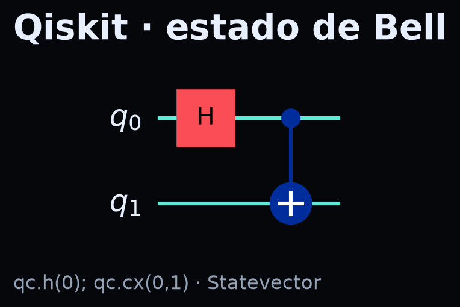{#fig-l1}

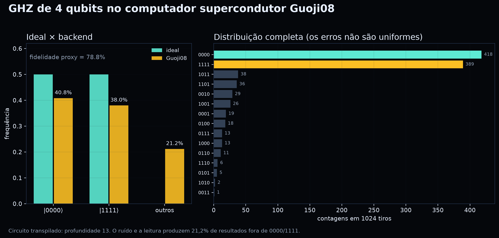{#fig-l2}

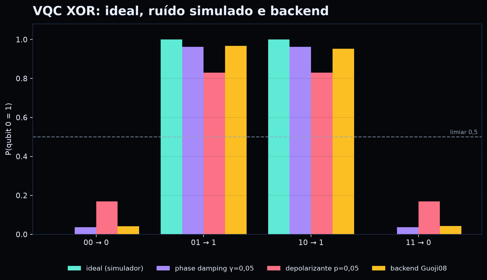{#fig-l3}

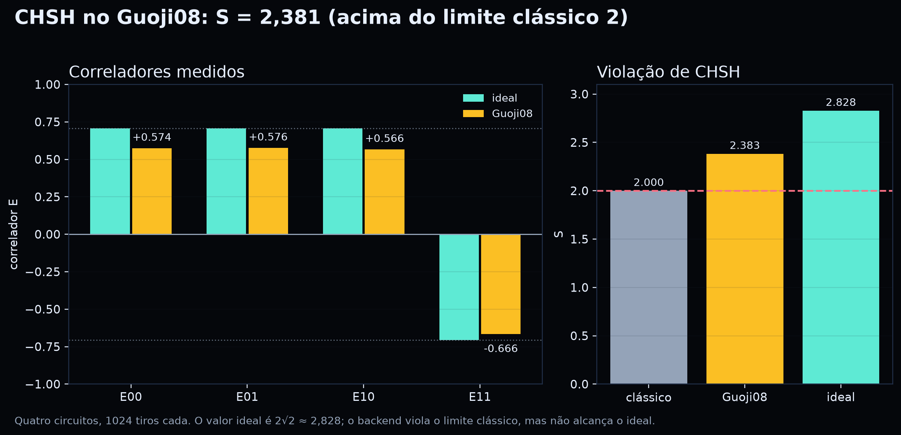{#fig-l4}

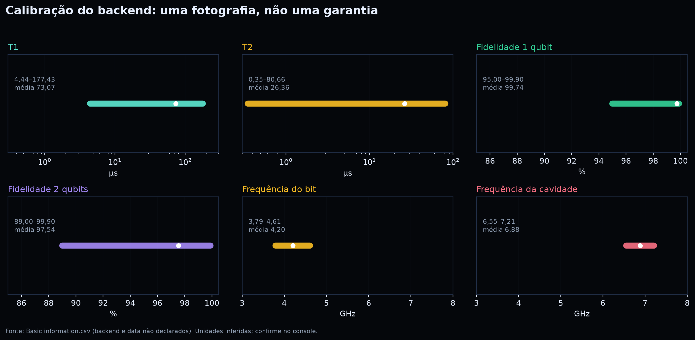{#fig-l5}

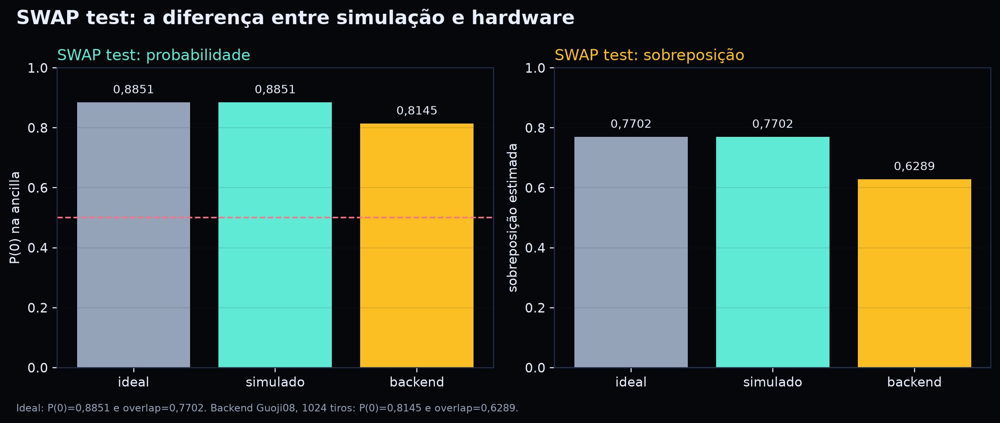{#fig-l6}

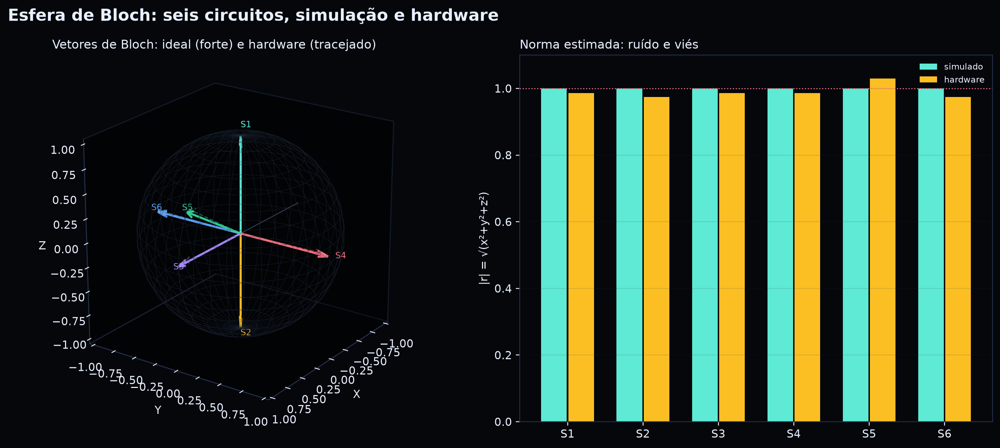{#fig-l7}

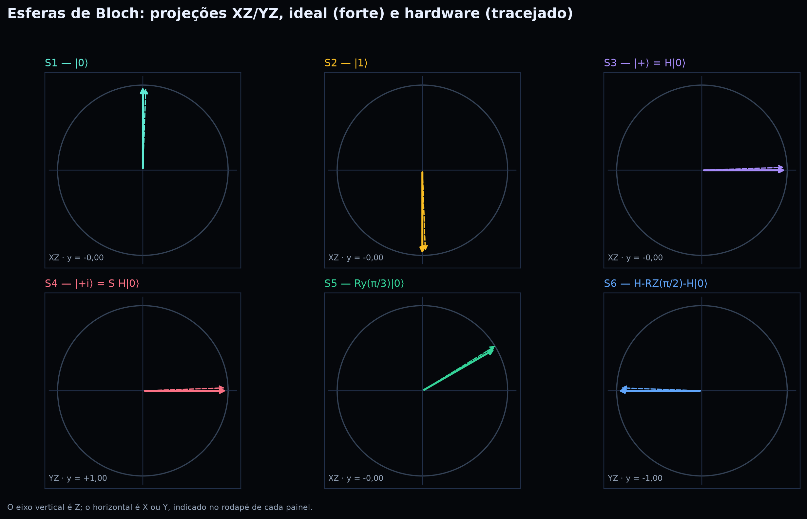{#fig-l8}

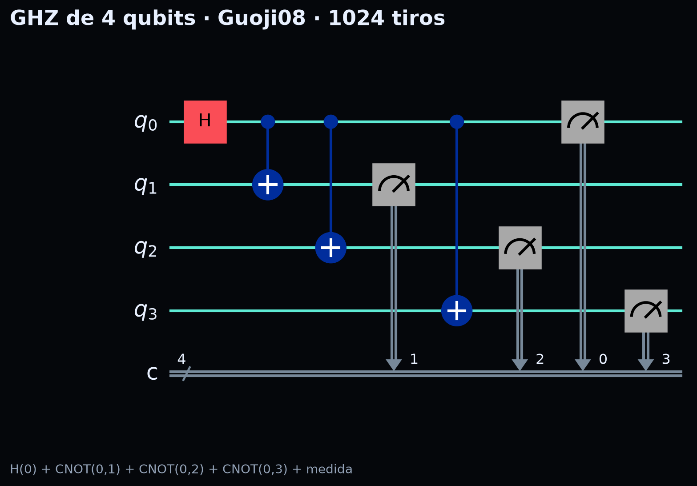{#fig-l9}

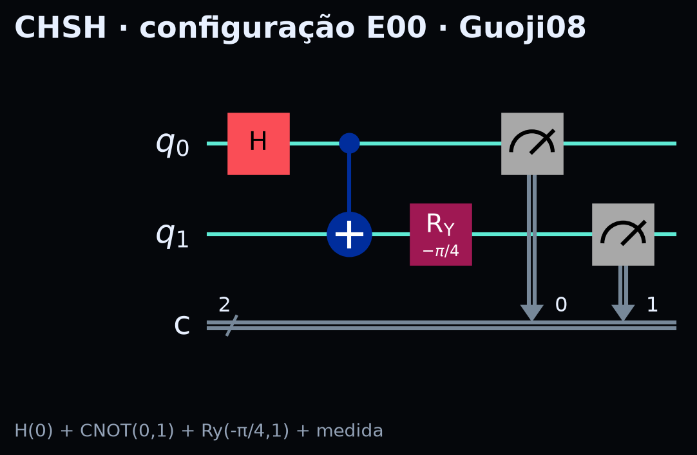{#fig-l10}

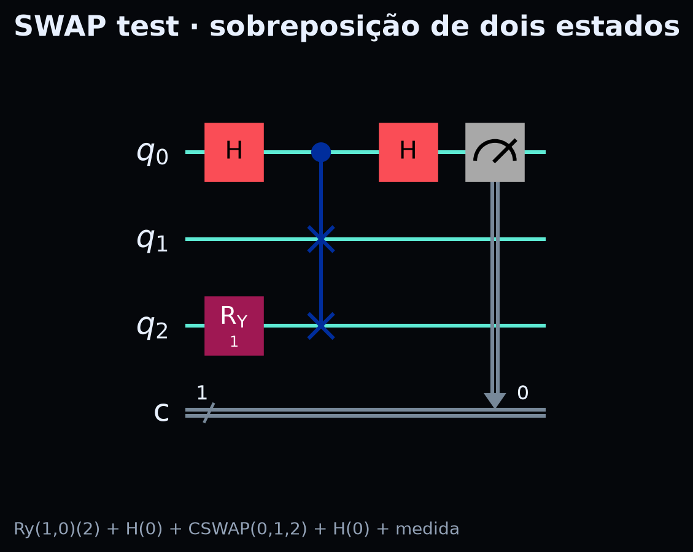{#fig-l11}

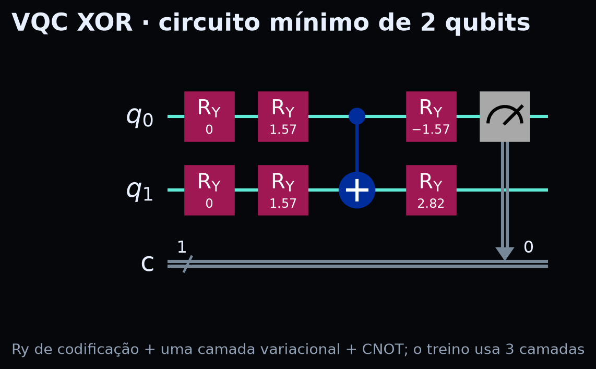{#fig-l12}

## 7. Como ler os counts no console

1. Abra **Task Management**.
2. Clique na tarefa.
3. Veja o gráfico de distribuição.
4. Baixe **CSV/TXT** no menu da figura.
5. No CSV, a coluna do bitstring e a coluna do count são o que você precisa.
6. Copie para a planilha e aplique as fórmulas do capítulo **Cálculo manual**.

## 8. Se algo der errado

| Sintoma | Causa provável | O que fazer |
|---|---|---|
| `GJQ_API_KEY` ausente | variável não definida | exporte a chave e reabra o terminal |
| SSL/EOF | rede ou proxy | tente outra rede; o simulador local continua |
| fila longa | backend ocupado | use `Baihua` ou um simulador |
| `cswap` não definido | parser Qiskit 2.x | monte com `qc.cswap` em vez de `qasm2.loads` |
| resultado diferente | calibração/leitura | repita e compare com o intervalo de confiança |
| cache com chave | primeira execução | `chmod 600` e não faça commit |

## 9. Código completo

Os blocos acima são os arquivos completos. Se quiser separá-los, crie
`01_bell_simulador.py` a `07_vqc_ruido.py` na mesma pasta e execute:

```bash
python 01_bell_simulador.py
python 02_bell_hardware.py
python 03_ghz_hardware.py
python 04_chsh_hardware.py
python 05_bloch_suite.py --only all
python 06_swap_test.py
python 07_vqc_ruido.py --qubits 2 4 --seeds 0 1 2 3 4
```

> **Regra:** o livro contém o código, os dados e a conta. Se você chegar ao
> mesmo número com lápis e papel, o experimento é seu.
