# Modo fácil: o livro em 30 páginas {#modo-facil}


Se você abriu o livro no meio e sentiu que estava difícil, **comece aqui**.
Esta seção explica as ideias que sustentam as 3000 laudas sem uma única fórmula.
Depois, você escolhe o nível: N0 (leigo), N1 (médio/graduação) ou N2 (pesquisa).

## As 10 ideias em uma frase

1. **Bit:** uma diferença que decidimos registrar — 0 ou 1.
2. **Qubit:** um estado que carrega duas amplitudes; a medição entrega **um**
   resultado.
3. **Medição:** não é ler um valor escondido; é obter uma **amostra**.
4. **Fase:** uma relação entre caminhos que não aparece na medição isolada, mas
   muda a interferência.
5. **Emaranhamento:** uma correlação que não se explica por valores locais.
6. **Circuito:** uma receita de operações; o **backend** traduz a receita para as
   portas que ele sabe executar.
7. **Ruído:** uma imperfeição que pode ser medida; às vezes estudada como
   recurso, nunca como garantia.
8. **Simulação × backend:** o simulador é limpo; o backend tem leitura, calibração
   e deriva.
9. **Estatística:** um número sem incerteza não é evidência.
10. **Ética:** quem paga, quem decide e quem pode ser prejudicado.

## Se você só tem 5 minutos

1. Escolha um conceito no **mapa**.
2. Leia a lauda **N0 — ideia em 60s**.
3. Leia a lauda **N0 — analogia + limite**.
4. Leia a caixa **RESULTADO** da lauda de prática.
5. Responda ao **CHECKPOINT** em uma frase.

Se entender essas cinco coisas, você já entendeu o essencial. O resto é
aprofundamento.

## O que cada caixa quer dizer

| Caixa | Pergunta | O que fazer |
|---|---|---|
| **PONTE SONORA** | como se diz em chinês? | leia o pinyin em voz alta, 3 vezes |
| **RIGOR CIENTÍFICO** | o que precisa ser preciso? | leia devagar; é o antídoto contra a analogia |
| **CHECKPOINT** | o que eu levo? | responda em uma frase, sem consultar |
| **RESULTADO** | o que o experimento mostrou? | compare simulado e backend |
| **NÍVEL** | qual é a profundidade? | N0 simples, N1 médio, N2 pesquisa |

## Perguntas frequentes

**Preciso saber matemática?**
No N0, não. No N1, porcentagem e vetor ajudam. No N2, matriz e estatística são
necessárias.

**O que é um backend?**
É o serviço que executa o circuito. Pode ser um simulador ou um computador
quântico. O nome aparece no console.

**O que é DOI?**
É o endereço permanente de um artigo. Um DOI ativo leva ao texto ou à ficha
oficial. Neste livro, os DOIs são verificados quando possível.

**O que é Qualis?**
É a nota de um **periódico**, não de um artigo. “Qualis A1” não é um selo que se
cola em um manuscrito.

**Por que chinês?**
Porque o mesmo conceito pode ser dito com outro som. A ponte sonora treina
pronúncia e memória, não substitui um curso de chinês.

**Por que Bohm?**
Porque a interpretação de Bohm oferece uma imagem determinista e não local. É
uma interpretação entre várias; não é consenso.

**O livro prova que Bohm está certo?**
Não. Ele apresenta a interpretação, compara com a leitura padrão e mostra o
preço: não localidade.

**O livro prova que o backend é hardware?**
Sim: o guia oficial da Tiangong lista Guoji No. 8 como quantum hardware, e a
verificação `simulator=False` em 7 nov. 2026 confirma. O console exibe
`(simulate)` como modo de execução. Ainda assim, “hardware” não significa
“resultado perfeito”: calibração, fila e leitura importam.

**O que é “ruído benéfico”?**
É a hipótese de que um pouco de ruído pode regularizar um modelo. É uma hipótese
empírica; este livro mostra como testá-la e por que 5 trials não bastam.

**Como citar o livro?**
Use o título, o ano e o URL do repositório. As referências externas têm DOI ou
URL estável.

## Tradutor de jargão

| Termo | Em palavras simples |
|---|---|
| **Amplitude** | o número que dá peso a cada resultado possível |
| **Backend** | o serviço que executa o circuito |
| **Base** | o conjunto de resultados que estamos comparando |
| **Bit** | uma diferença registrada: 0 ou 1 |
| **CHSH** | um teste que mede se a correlação é mais forte que a clássica |
| **Circuito** | a receita de operações quânticas |
| **CNOT** | uma porta que inverte o segundo qubit se o primeiro for 1 |
| **Coerência** | a capacidade de manter a fase previsível |
| **Decoerência** | a perda de coerência por interação com o ambiente |
| **DOI** | o endereço permanente de um artigo |
| **Emaranhamento** | correlação que não se explica por valores locais |
| **Estado de Bell** | o par emaranhado mais simples |
| **Fase** | a relação entre caminhos que muda a interferência |
| **Fidelidade proxy** | a fração de resultados que caem no padrão esperado |
| **GHZ** | um estado emaranhado de três ou mais qubits |
| **Hiperparâmetro** | uma escolha do experimento que não é aprendida pelo modelo |
| **Medição** | o ato que produz um resultado e atualiza o estado |
| **NISQ** | a era atual: poucos qubits, muito ruído |
| **Optuna** | uma biblioteca de busca de hiperparâmetros |
| **Pinyin** | a escrita fonética do chinês com tons |
| **QASM** | um texto que descreve o circuito |
| **Qubit** | a unidade de informação quântica |
| **Ruído** | uma imperfeição na preparação, no controle ou na leitura |
| **Sobreposição** | o quanto duas distribuições de resultados se parecem |
| **Superposição** | a combinação de duas amplitudes antes da medição |
| **Task ID** | o protocolo do pedido enviado ao backend |
| **TPE** | um método de otimização bayesiana |
| **Transpilação** | a tradução do circuito para as portas do backend |
| **VQC** | um circuito quântico com parâmetros ajustáveis |
| **X, Y, Z** | portas que giram o qubit em torno dos eixos |

## Trilha do leigo: 30 dias, 30 práticas

Se você nunca viu um qubit, esta é a sua trilha. Um conceito por dia, quatro
laudas por dia, uma prática por dia. Tempo: **20–25 minutos**. Não pule o
checkpoint; é ele que diz se você pode avançar.

| Dia | Parte | Conceito | Laudas (N0) | Prática | Checkpoint |
|---:|---|---|---|---|---|
| 1 | P01 | Bit | [L0001](#l-0001), [L0002](#l-0002), [L0003](#l-0003), [L0010](#l-0010) | [L0003](#l-0003) | [L0010](#l-0010) |
| 2 | P01 | Qubit | [L0011](#l-0011), [L0012](#l-0012), [L0013](#l-0013), [L0020](#l-0020) | [L0013](#l-0013) | [L0020](#l-0020) |
| 3 | P01 | Amplitude | [L0021](#l-0021), [L0022](#l-0022), [L0023](#l-0023), [L0030](#l-0030) | [L0023](#l-0023) | [L0030](#l-0030) |
| 4 | P02 | Onda piloto | [L0101](#l-0101), [L0102](#l-0102), [L0103](#l-0103), [L0110](#l-0110) | [L0103](#l-0103) | [L0110](#l-0110) |
| 5 | P02 | Equação do guia | [L0111](#l-0111), [L0112](#l-0112), [L0113](#l-0113), [L0120](#l-0120) | [L0113](#l-0113) | [L0120](#l-0120) |
| 6 | P02 | Equilíbrio quântico | [L0121](#l-0121), [L0122](#l-0122), [L0123](#l-0123), [L0130](#l-0130) | [L0123](#l-0123) | [L0130](#l-0130) |
| 7 | P03 | Porta X | [L0201](#l-0201), [L0202](#l-0202), [L0203](#l-0203), [L0210](#l-0210) | [L0203](#l-0203) | [L0210](#l-0210) |
| 8 | P03 | Porta H | [L0211](#l-0211), [L0212](#l-0212), [L0213](#l-0213), [L0220](#l-0220) | [L0213](#l-0213) | [L0220](#l-0220) |
| 9 | P03 | Porta Z | [L0221](#l-0221), [L0222](#l-0222), [L0223](#l-0223), [L0230](#l-0230) | [L0223](#l-0223) | [L0230](#l-0230) |
| 10 | P04 | PennyLane | [L0301](#l-0301), [L0302](#l-0302), [L0303](#l-0303), [L0310](#l-0310) | [L0303](#l-0303) | [L0310](#l-0310) |
| 11 | P04 | Cirq | [L0311](#l-0311), [L0312](#l-0312), [L0313](#l-0313), [L0320](#l-0320) | [L0313](#l-0313) | [L0320](#l-0320) |
| 12 | P04 | Qiskit | [L0321](#l-0321), [L0322](#l-0322), [L0323](#l-0323), [L0330](#l-0330) | [L0323](#l-0323) | [L0330](#l-0330) |
| 13 | P05 | Supercondutor | [L0401](#l-0401), [L0402](#l-0402), [L0403](#l-0403), [L0410](#l-0410) | [L0403](#l-0403) | [L0410](#l-0410) |
| 14 | P05 | Qubit físico | [L0411](#l-0411), [L0412](#l-0412), [L0413](#l-0413), [L0420](#l-0420) | [L0413](#l-0413) | [L0420](#l-0420) |
| 15 | P05 | Decoerência | [L0421](#l-0421), [L0422](#l-0422), [L0423](#l-0423), [L0430](#l-0430) | [L0423](#l-0423) | [L0430](#l-0430) |
| 16 | P06 | GHZ real | [L0501](#l-0501), [L0502](#l-0502), [L0503](#l-0503), [L0510](#l-0510) | [L0503](#l-0503) | [L0510](#l-0510) |
| 17 | P06 | VQC XOR | [L0511](#l-0511), [L0512](#l-0512), [L0513](#l-0513), [L0520](#l-0520) | [L0513](#l-0513) | [L0520](#l-0520) |
| 18 | P06 | Classificador | [L0521](#l-0521), [L0522](#l-0522), [L0523](#l-0523), [L0530](#l-0530) | [L0523](#l-0523) | [L0530](#l-0530) |
| 19 | P07 | Vetor | [L0601](#l-0601), [L0602](#l-0602), [L0603](#l-0603), [L0610](#l-0610) | [L0603](#l-0603) | [L0610](#l-0610) |
| 20 | P07 | Matriz | [L0611](#l-0611), [L0612](#l-0612), [L0613](#l-0613), [L0620](#l-0620) | [L0613](#l-0613) | [L0620](#l-0620) |
| 21 | P07 | Produto interno | [L0621](#l-0621), [L0622](#l-0622), [L0623](#l-0623), [L0630](#l-0630) | [L0623](#l-0623) | [L0630](#l-0630) |
| 22 | P08 | Nanoaula | [L0701](#l-0701), [L0702](#l-0702), [L0703](#l-0703), [L0710](#l-0710) | [L0703](#l-0703) | [L0710](#l-0710) |
| 23 | P08 | Autodidatismo | [L0711](#l-0711), [L0712](#l-0712), [L0713](#l-0713), [L0720](#l-0720) | [L0713](#l-0713) | [L0720](#l-0720) |
| 24 | P08 | Feedback | [L0721](#l-0721), [L0722](#l-0722), [L0723](#l-0723), [L0730](#l-0730) | [L0723](#l-0723) | [L0730](#l-0730) |
| 25 | P09 | Acesso | [L0801](#l-0801), [L0802](#l-0802), [L0803](#l-0803), [L0810](#l-0810) | [L0803](#l-0803) | [L0810](#l-0810) |
| 26 | P09 | Dupla finalidade | [L0811](#l-0811), [L0812](#l-0812), [L0813](#l-0813), [L0820](#l-0820) | [L0813](#l-0813) | [L0820](#l-0820) |
| 27 | P09 | Privacidade | [L0821](#l-0821), [L0822](#l-0822), [L0823](#l-0823), [L0830](#l-0830) | [L0823](#l-0823) | [L0830](#l-0830) |
| 28 | P10 | Pergunta | [L0901](#l-0901), [L0902](#l-0902), [L0903](#l-0903), [L0910](#l-0910) | [L0903](#l-0903) | [L0910](#l-0910) |
| 29 | P10 | Hipótese | [L0911](#l-0911), [L0912](#l-0912), [L0913](#l-0913), [L0920](#l-0920) | [L0913](#l-0913) | [L0920](#l-0920) |
| 30 | P10 | Evidência | [L0921](#l-0921), [L0922](#l-0922), [L0923](#l-0923), [L0930](#l-0930) | [L0923](#l-0923) | [L0930](#l-0930) |

### Como passar de dia

1. Leia a lauda **ideia** e diga a ideia em uma frase, sem consultar.
2. Leia a **analogia** e marque onde a imagem quebra.
3. Faça a **prática** e anote o resultado (simulado × backend).
4. Responda ao **checkpoint** e escreva uma pergunta que ficou.

**Critério:** se você fez 2 das 3 coisas (frase, prática, checkpoint), avance.
Se não, repita o dia. Não há pressa; há evidência.

### Diário de bordo (copie no caderno)

| Data | Conceito | Uma frase | Uma prática | Uma pergunta |
|---|---|---|---|---|
|  |  |  |  |  |

### O que você não precisa

- **Matemática:** no N0, nenhuma. No N1, porcentagem e vetor ajudam.
- **Programação:** o código está pronto; você pode só ler o resultado.
- **Chinês:** a ponte sonora é um bônus; pule na primeira leitura se quiser.
- **Inglês:** as fontes têm DOI, mas o texto do livro está em português.

### Depois dos 30 dias

- Você terá 30 conceitos, 30 práticas e 30 perguntas.
- Volte ao mapa e escolha um conceito para ler as 10 lentes no N1.
- Se quiser pesquisa, vá ao N2 e ao Anexo: exercício.
- Se quiser hardware, comece pelo SWAP test e pela suíte de Bloch.

---

# Do nível 0 ao PhD {#niveis}


Este livro é uma **escada**, não um labirinto. A mesma ideia aparece três vezes,
com voz, matemática e evidência diferentes. Você pode começar no nível 0 mesmo
sem saber o que é um qubit; pode parar no nível 1; ou descer ao nível 2 quando
quiser pesquisar. O importante é não pular a pergunta: **o que eu já sei, o que
estou medindo e o que ainda não posso concluir?**

| Nível | Para quem | Matemática | Experimento | Evidência |
|---|---|---|---|---|
| **N0** | leigo, 9º ano, qualquer curioso | nenhuma | 1 circuito simples | P(0), P(1), “parece?” |
| **N1** | ensino médio e graduação | porcentagem, vetor, probabilidade | 4 circuitos | counts, S, acurácia |
| **N2** | pós-graduação e PhD | matriz, densidade, estatística | 18 circuitos + réplica | sobreposição, incerteza, limite |

## Nível 0 — Leigo e Fundamental

**Promessa:** entender a ideia sem uma única fórmula. A lauda começa pela
imagem, pelo gesto e por uma pergunta; o resultado aparece como “o simulado” e
“o backend”, sem jargão.

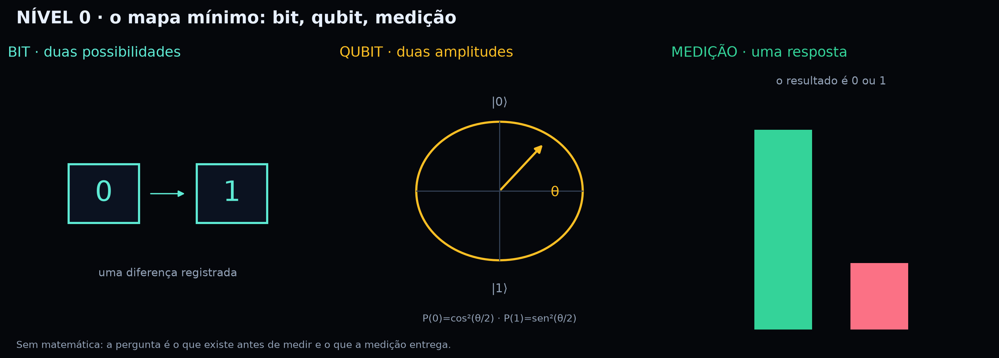{#fig-n0}

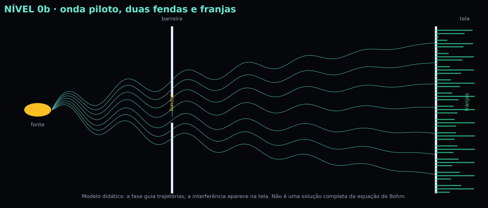{#fig-n0b}

**Comece em:** L0001 (Bit — ideia em 60s). **Faça:** a lauda de prática e a de
checkpoint. **Não faça:** cobrar de si mesmo a notação de ket.

## Nível 1 — Médio e Graduação

**Promessa:** comparar simulação e backend com uma tabela, um circuito e uma
métrica. Aqui entram probabilidade, vetor, fase, emaranhamento e os primeiros
testes estatísticos.

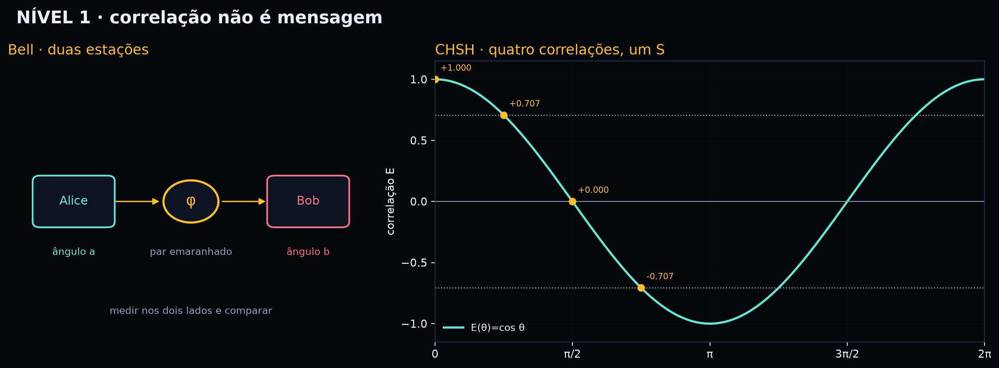{#fig-n1}

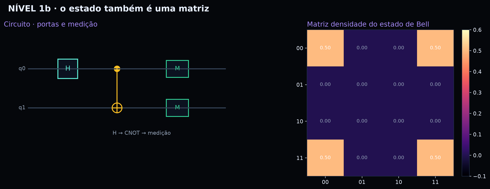{#fig-n1b}

**Comece em:** L1001 (Bit — ideia em 60s). **Faça:** as 10 laudas de um
conceito. **Não faça:** chamar 4/4 de generalização.

## Nível 2 — Pós e PhD

**Promessa:** formalizar, medir o limite e replicar. O nível 2 não é “mais
difícil por dificuldade”: é onde a pergunta vira desenho experimental, a
evidência vira distribuição e o resultado vira uma afirmação com escopo.

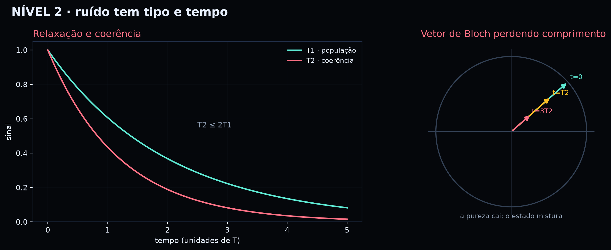{#fig-n2}

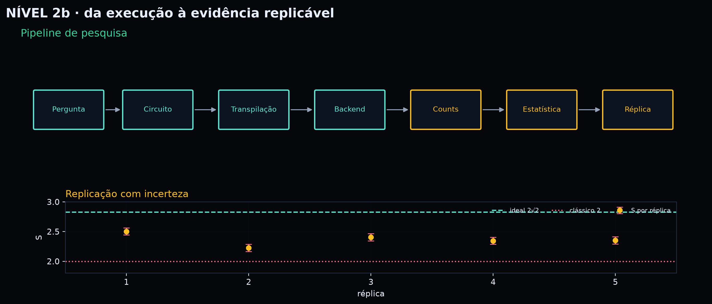{#fig-n2b}

**Comece em:** L2001 (Bit — ideia em 60s). **Faça:** a prática, a leitura dos
counts e a replicação com outra seed/backend. **Não faça:** declarar causalidade
ou “prova de hardware” sem confirmar o rótulo do console.

## Como escolher seu nível

1. **Nunca viu qubit?** Comece no N0 e leia as lentes “ideia”, “analogia” e
   “vida” de um conceito.
2. **Está no ensino médio ou na graduação?** Vá ao N1 e leia as 10 lentes do
   conceito; use a caixa de resultado como âncora.
3. **Pesquisa?** Vá ao N2, leia a formalização, o limite e a replicação; o
   relatório dos experimentos é o seu mapa de evidências.
4. **Quer comparar?** Leia o mesmo conceito nos três níveis. A diferença entre
   as respostas é o currículo.

## O que muda entre os níveis

| Dimensão | N0 | N1 | N2 |
|---|---|---|---|
| Linguagem | frase curta e imagem | definição + exemplo | formalização + limite |
| Matemática | nenhuma | vetor/probabilidade | matriz/estatística |
| Experimento | 1 circuito | 4 circuitos | 18 circuitos + réplica |
| Evidência | counts | S/acurácia | incerteza/replicação |
| Leitura | “o que eu vejo” | “o que eu comparo” | “o que eu não posso concluir” |

## A inspiração: Bohm na Escola

Esta obra dialoga com **Bohm na Escola: onda piloto, diálogo e totalidade no
ensino de informação quântica**. A ontologia de Bohm entra como **interpretação**
— não como consenso. O diálogo entra como **método**: a pergunta que não sei
responder sozinho. A totalidade entra como **limite**: o todo não se reduz à soma
das partes, mas também não dispensa a parte.

A escada N0 → N1 → N2 existe para não abandonar ninguém: o leigo não precisa de
uma fórmula para começar; o pesquisador não precisa fingir que a fórmula basta.

# Como navegar {#como-navegar}


Este livro foi feito para ser **lido em pedaços de 7 minutos**. Cada página é uma
**lauda** independente: um conceito, uma lente, uma prática e um checkpoint. Você
pode começar por qualquer lauda, mas há uma trilha sugerida no mapa.

## Os códigos

| Código | Significado |
|---|---|
| **P01–P10** | parte do livro |
| **C001–C100** | conceito (10 por parte) |
| **L0001–L3000** | lauda (10 lentes por conceito) |
| **N0 · L0001–L1000** | leigo e fundamental |
| **N1 · L1001–L2000** | médio e graduação |
| **N2 · L2001–L3000** | pós-graduação e PhD |
| **Lente** | o ângulo de abordagem (ideia, analogia, prática, laboratório, erro, além, diálogo, ética, vida, checkpoint) |

## As 10 lentes

| Ícone | Lente | Pergunta | Tempo |
|---|---|---|---|
| {.ico} | **Ideia em 60s** | Qual é a ideia em uma frase? | 5 min |
| {.ico} | **Analogia + limite** | Que imagem ajuda — e onde ela quebra? | 7 min |
| {.ico} | **Mão na massa** | O que eu faço com o corpo e com o papel? | 10 min |
| 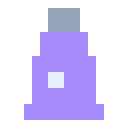{.ico} | **Laboratório** | O que eu meço, simulo ou comparo? | 10 min |
| {.ico} | **Erro comum** | Que concepção errada precisa ser desmontada? | 7 min |
| {.ico} | **Para ir além** | Qual é a definição precisa e o detalhe científico? | 7 min |
| {.ico} | **Roda de diálogo** | Que pergunta eu não sei responder sozinho? | 9 min |
| {.ico} | **Ética e sociedade** | Quem ganha, quem perde, quem decide? | 7 min |
| {.ico} | **Conexão com a vida** | Onde isso aparece fora da escola? | 5 min |
| {.ico} | **Checkpoint** | O que eu levo e o que vou testar? | 5 min |

## As caixas de cada lauda

::: {.rigor}
**RIGOR CIENTÍFICO.** Uma definição, fórmula ou cautela que impede a analogia de
virar erro. Leia mesmo quando o texto estiver leve.
:::

::: {.check}
**CHECKPOINT.** Uma tarefa curta. Se não conseguir fazer, volte à lente anterior
ou procure uma lauda do mesmo conceito.
:::

## Trilhas de estudo

- **N0 · 21 minutos:** ideia + analogia + vida de um conceito, sem matemática.
- **N1 · 70 minutos:** as 10 laudas de um conceito, com circuito e tabela.
- **N2 · 100 minutos:** as 10 laudas + replicação com outra seed/backend.
- **7 minutos:** uma lauda (comece pela lente “ideia”).
- **50 minutos:** cinco laudas do mesmo conceito (ideia → analogia → prática →
  laboratório → checkpoint).
- **100 minutos:** um conceito inteiro (10 laudas) + uma roda de diálogo.
- **7 dias:** um conceito por dia, com o diário de bordo.
- **Pesquisa:** um bloco de 10 laudas + uma replicação com outra seed/backend.

> **Dica de navegação:** use os **marcadores do PDF** (painel lateral). Cada parte
> é um marcador de nível 1; cada lauda é um marcador de nível 2. O mapa dos 100
> conceitos e o glossário sonoro trazem links para as laudas.

# Ponte sonora: chinês pelo conteúdo {#chines}


Este livro também ensina **mandarim** — não como um curso separado, mas como uma
**ponte sonora** para o conteúdo. No meio de cada lauda aparece um parágrafo
`PONTE SONORA · 中文`: o termo chinês do conceito, o pinyin com tons, uma leitura
de apoio em português e uma microfrase. A ideia é simples: **o conceito entra
pelo sentido e pelo som ao mesmo tempo**.

## Por que chinês?

A pergunta é justa: por que não apenas inglês, que já é a língua franca da
ciência? A resposta tem três camadas — prática, política e filosófica.

**A camada prática.** Os servidores quânticos usados neste livro vêm da
plataforma **Tiangong/CETC-ICQ**, parceira do projeto da Paraíba (CIQuanta). O
console, a documentação, os nomes dos backends e boa parte dos interlocutores
estão em chinês. O inglês continua sendo a língua de circulação internacional,
mas quem pesquisa nessa infraestrutura precisa ler o console, entender o
vocabulário do parceiro e reconhecer os termos que aparecem nos relatórios. O
chinês não é obrigatório para o primeiro experimento; ele se torna cada vez mais
útil conforme o leitor avança.

**A camada política.** Tratar o parceiro como fornecedor anônimo é uma escolha
política, mesmo quando parece apenas economia de esforço. Aprender alguns termos
é um gesto pequeno, mas sistemático: reconhece que a infraestrutura tem origem,
cultura e língua. Em um campo onde a assimetria entre quem tem laboratório e
quem não tem é enorme, esse reconhecimento não é enfeite; é parte da ética de
pesquisa.

**A camada filosófica.** Bohm insistia que o todo não se reduz às partes. A
língua é uma das formas pelas quais o todo se mostra: o termo chinês não é uma
tradução decorativa do conceito, é uma outra maneira de recortar o mundo. Ao
ouvir o som e ler o pinyin, o leitor é convidado a suspender a suposição de que
sua própria língua é neutra. É um exercício pequeno de diálogo — exatamente o
tipo de exercício que o livro propõe na roda de diálogo.

Por isso o chinês aparece **apenas** nos blocos de ponte, no guia da ponte e no
glossário. Ele não é pré-requisito, não é avaliação e não interrompe a física.
É uma porta lateral: quem quiser entra; quem não quiser segue pelo corpo do
texto. A presença massiva do inglês não é negada; ela é reconhecida. A diferença
é que o livro se recusa a tratar a língua do outro como detalhe invisível.

## Como ler a ponte

1. **Olhe o hanzi inteiro.** Não tente traduzir caractere por caractere.
2. **Leia o pinyin devagar.** Marque o contorno dos tons com a mão: alto, subindo,
   descendo-e-subindo, descendo.
3. **Diga a microfrase três vezes.** Primeiro imitando o ritmo; depois olhando só
   o pinyin; por fim, sem olhar.
4. **Volte ao conceito.** A frase chinesa é uma pausa de pronúncia, não uma
   interrupção da física.

Cada lauda traz a ponte em formato compacto: **Termo**, pinyin, tons e
**Microfrase**. **Propósito:** ligar som e conceito. **O que fazer:** ler,
repetir 3×, marcar os tons, dizer a frase e voltar. O guia completo fica aqui;
a lauda não repete o guia.

## Os quatro tons (e o neutro)

| Tom | Contorno | Exemplo | Sentido |
|---|---|---|---|
| 1 | alto e estável | mā | mãe |
| 2 | sobe | má | cânhamo |
| 3 | desce e sobe | mǎ | cavalo |
| 4 | desce forte | mà | xingar |
| 5 | leve, neutro | ma | partícula |

O mesmo som com outro tom é outra palavra. Por isso o livro mostra os tons como
números: `liàng zǐ bǐ tè` = **4-3-3-4**.

## Sons que o português não tem

| Pinyin | Aproximação | Exemplo | Cuidado |
|---|---|---|---|
| **q** | “tch” | qì | não é “k” |
| **x** | “sh” | xué | língua alta, sem vibrar |
| **j** | “dj” | jī | como em “dj” |
| **zh** | “dj” retroflexo | zhī | língua enrolada |
| **ch** | “tch” retroflexo | chá | língua enrolada |
| **sh** | “sh” retroflexo | shì | língua enrolada |
| **r** | “j” retroflexo | rèn | não é o r do português |
| **z** | “dz” | zǐ | como “dz” |
| **c** | “ts” | cè | como “ts” |
| **s** | “s” | sī | sibilante |
| **ü** | “yu” | lǜ | lábios arredondados |

A leitura de apoio do livro é uma **aproximação em grafia portuguesa**, não uma
transcrição IPA. Se puder, confirme cada termo em um dicionário com áudio.

## Três fenômenos de tom

- **3 + 3:** o primeiro tom vira 2. `nǐ hǎo` soa como `ní hǎo`.
- **不 (bù):** antes de um tom 4, vira **bú**. `bú shì` = “não é”.
- **一 (yī):** antes de um tom 4, vira **yí**. `xià yí bù` = “próximo passo”.

O livro escreve a forma **falada** nessas combinações e explica a regra quando
ela aparece.

## O que este livro não promete

- **Não é um curso completo.** São 100 termos e 10 padrões de frase; o suficiente
  para criar familiaridade, não fluência.
- **Não há áudio no PDF.** O pinyin e a leitura de apoio são o ponto de partida;
  um dicionário com áudio continua sendo necessário.
- **Hanzi simplificado.** Não cobrimos variedades regionais nem chinês clássico.
- **A gramática é controlada.** As frases são curtas e repetidas de propósito;
  não substituem uma boa gramática.
- **A aproximação fonética é imperfeita.** Ela ajuda a começar; não é a pronúncia
  de um falante nativo.

> **Para o professor:** use a ponte como *ritual de 30 segundos*. Leia o termo,
> peça repetição em coro, marque os tons com a mão e siga a aula. Não transforme
> a pronúncia em prova; transforme em hábito.

# Caderno de resultados reais {#resultados}


Aqui está o encontro entre **simulação** e **execução no backend**. Os dados
abaixo foram obtidos nos backends **Guoji08** (20 qubits; `simulator=False` em
7 nov. 2026) e **Baihua** (156 qubits), em novembro de 2026, com 1024 tiros por
circuito. O console exibe `Guoji No.8 (simulate)`, mas o guia oficial lista
Guoji No. 8 como **quantum hardware** e a verificação de configuração retornou
`simulator=False`; o rótulo do console é um modo de execução. Evidências:
`dados_hardware/verificacao_guoji08.json` e o guia oficial da Tiangong.

## GHZ de 4 qubits

Circuito: H no qubit 0 e CNOTs de 0 para 1, 2 e 3. O ideal é 50% para
|0000⟩ e 50% para |1111⟩.

| Resultado | Ideal | Guoji08 |
|---|---:|---:|
| &#124;0000⟩ | 512 | **418** |
| &#124;1111⟩ | 512 | **389** |
| outros | 0 | **217** |
| fidelidade proxy | 100% | **78,8%** |

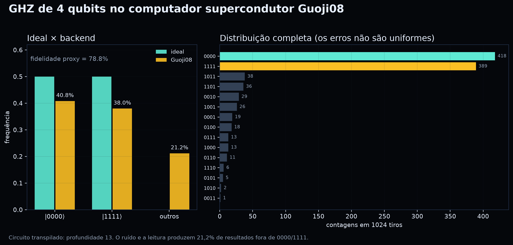{#fig-r1}

**O que o aluno deve ver:** o backend acerta a tendência (0000 e 1111 dominam),
mas erra 21,2% das vezes. A fidelidade proxy mede a população ideal, **não** prova
emaranhamento. O circuito foi transpilado para profundidade 13.

## VQC XOR de 2 qubits

Um classificador de 2 qubits foi treinado no simulador e **avaliado** no backend.
Quatro entradas, 1024 tiros cada.

| Entrada | Rótulo | Ideal P(1) | Backend P(1) | Acertou? |
|---|---|---:|---:|---|
| 00 | 0 | 0,000 | 0,041 | sim |
| 01 | 1 | 1,000 | 0,967 | sim |
| 10 | 1 | 1,000 | 0,952 | sim |
| 11 | 0 | 0,000 | 0,043 | sim |

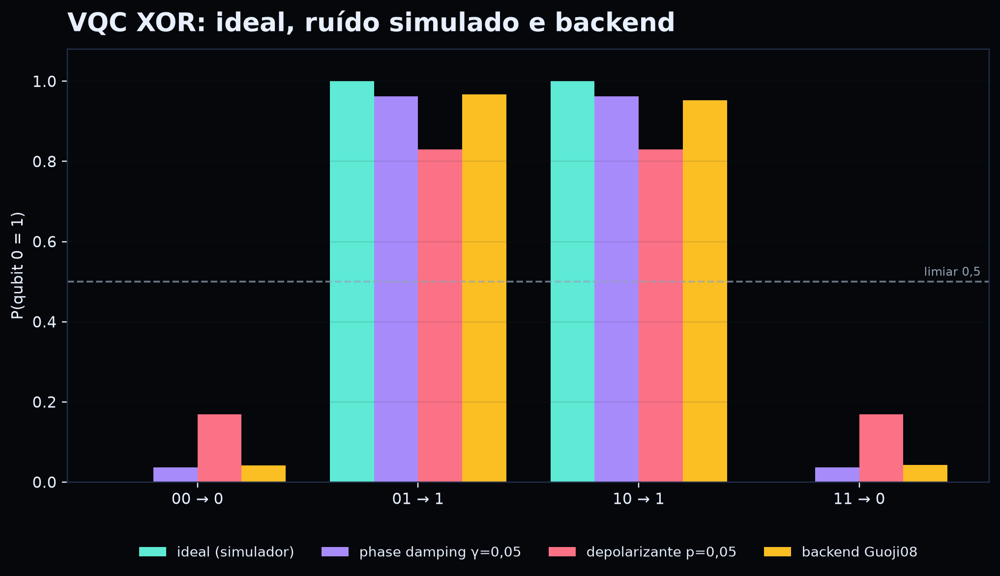{#fig-r2}

**O que o aluno deve ver:** 4/4 acertos **não** são “generalização”. O teste tem
quatro pontos e teto de 100%. O valor pedagógico está em comparar as condições:

| Condição | P(1) em 00 | P(1) em 11 | Leitura |
|---|---:|---:|---|
| ideal | 0,000 | 0,000 | separação perfeita |
| phase damping γ=0,05 | 0,037 | 0,037 | quase nenhuma mudança |
| depolarizing p=0,05 | 0,169 | 0,169 | margem menor |
| depolarizing p=0,20 | 0,422 | 0,422 | perto do limiar |

## CHSH: o teste que separa correlação clássica de quântica

O teste de CHSH mede quatro correlações entre duas escolhas de medição. Se um
modelo local de variáveis ocultas explicasse os resultados, o número S não
poderia passar de 2. A mecânica quântica permite até 2√2 ≈ 2,828.

| Configuração | E ideal | E medido no Guoji08 |
|---|---:|---:|
| E00 | +0,707 | **+0,574** |
| E01 | +0,707 | **+0,576** |
| E10 | +0,707 | **+0,566** |
| E11 | −0,707 | **−0,666** |

S = E00 + E01 + E10 − E11 = 2,383.

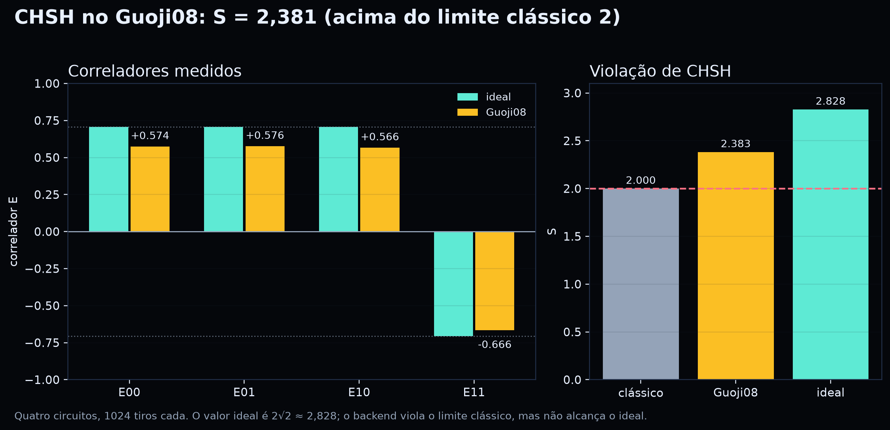{#fig-r3}

**O que o aluno deve ver:** o backend **viola** o limite clássico (2,383 > 2),
mas fica abaixo do ideal (2,828). Isso é uma violação observada em uma execução,
não uma prova metafísica de “ação à distância”. Com 1024 tiros por circuito, o
erro de S é da ordem de 0,06; uma única execução não basta para um artigo.

## Dois backends, o mesmo GHZ

O mesmo circuito GHZ de 4 qubits foi enviado ao **Guoji08** (20 qubits) e ao
**Baihua** (156 qubits). O circuito é idêntico; o que muda é o chip, a
calibração, o acoplamento e o mapeamento.

| Resultado | Guoji08 (20 q) | Baihua (156 q) |
|---|---:|---:|
| &#124;0000⟩ | 418 | 437 |
| &#124;1111⟩ | 389 | 230 |
| outros | 217 | 357 |
| fidelidade proxy | **78,8%** | **65,1%** |

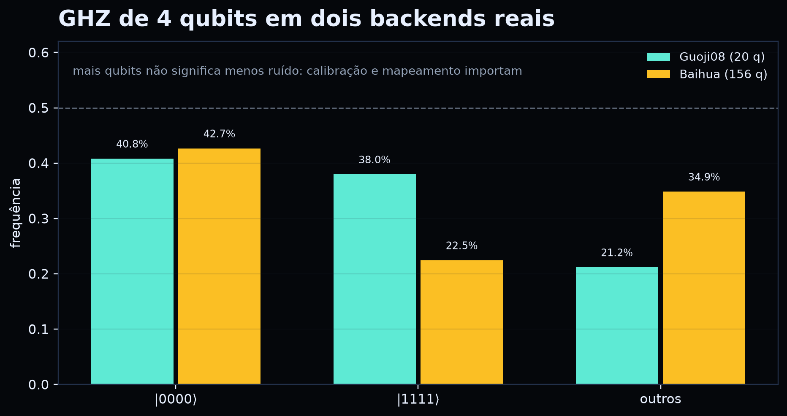{#fig-r4}

**O que o aluno deve ver:** o Baihua tem quase oito vezes mais qubits, mas
distribuiu mais resultados fora de 0000/1111. “Maior” não é sinônimo de “melhor”
para este circuito. A comparação é uma fotografia de uma execução; não é um
ranking permanente dos backends.

### Teste de hardware ao vivo (7 nov. 2026)

Para confirmar que o caminho não é só simulação, um estado de Bell (H + CNOT,
1024 tiros) foi enviado aos dois backends supercondutores. Ambos retornaram
`configuration().simulator = False`.

| Backend | `00` | `11` | `01` | `10` | fidelidade proxy | task ID |
|---|---:|---:|---:|---:|---:|---|
| Guoji08 (20 q) | 484 | 480 | 27 | 33 | **94,1%** | `bdc17e63…` |
| Baihua (156 q) | 492 | 444 | 37 | 51 | **91,4%** | `9db83ba8…` |

**Leitura:** os dois backends produzem a correlação 00/11 esperada, com erro de
leitura e de porta. O Guoji08 ficou ligeiramente melhor neste circuito. Uma
execução não é um ranking permanente: calibração, fila e mapeamento mudam.

> **O que isso prova:** há execução em hardware, com task IDs auditáveis.
> **O que não prova:** que o backend é perfeito, que o resultado é loophole-free
> ou que o circuito escala. Prova o caminho: circuito → transpilação → hardware
> → counts → análise.

Os dados completos estão em `dados_hardware/hardware_check_2026.json`.

## O que estes resultados ensinam

1. **Simulação ideal não é backend.** O simulador ideal é limpo; o backend tem
   ruído, leitura e calibração — ou, no rótulo do console, um modo de simulação.
2. **Ruído tem tipo.** Phase damping não muda populações Z; depolarização muda.
   “Ruído” não é um número único.
3. **Amostra pequena não generaliza.** 4 pontos e 1024 tiros são uma demonstração
   de pipeline, não um artigo.
4. **A hipótese de ruído benéfico não foi testada.** O repositório que inspirou
   este teste usa datasets maiores, treino e múltiplas seeds. Aqui, só avaliamos
   um modelo já treinado.
5. **Correlação não é mensagem.** O CHSH viola o limite clássico, mas não permite
   enviar informação mais rápido que a luz. A correlação aparece quando os dois
   lados comparam os cadernos.
6. **Backend não é ranking.** O Baihua tem mais qubits e fidelidade proxy menor
   neste circuito. Compare sempre o mesmo circuito, a mesma calibração e o mesmo
   número de tiros.

> **Para o professor:** use esta página como *âncora de honestidade*. Toda vez que
> a turma disser “funcionou no computador quântico”, pergunte: quantos pontos,
> quantos tiros, qual backend, qual ruído e o que não foi testado.

## Cem conceitos, dezoito circuitos

Cada um dos **100 conceitos** aponta para um dos **18 circuitos-base**. O mesmo
circuito pode servir a vários conceitos; o que muda é a leitura pedagógica. Todos
têm uma execução **simulada** e uma execução **no backend**, com a métrica
**sobreposição de distribuições** (0–100%). Ela mede o quanto os counts se
parecem; não é fidelidade de estado nem prova de emaranhamento.

| Experimento | Conceitos | O que mede |
|---|---:|---|
| E01 Base &#124;0⟩ | 1 | P(0) |
| E02 Base &#124;1⟩ e leitura | 7 | P(1) e erro de leitura |
| E03 Superposição H&#124;0⟩ | 7 | P(1) ≈ 0,5 |
| E04 Interferência H-Z-H | 4 | P(1) ≈ 1 |
| E05 Estado de Bell | 7 | P(00)+P(11) |
| E06 GHZ de 4 qubits | 5 | P(0000)+P(1111) |
| E07 CHSH | 5 | S |
| E08 Gerador quântico | 7 | equilíbrio dos bits |
| E09 Codificação de amplitude | 3 | P(1) |
| E10 Classificador XOR | 9 | acurácia |
| E11 Interferência de 2 qubits | 8 | P(00) |
| E12 QFT de 3 qubits | 2 | P(000) |
| E13 Produto tensorial | 1 | P(01) |
| E14 Ruído de fase | 9 | P(0) |
| E15 GHZ via QASM | 6 | P(0000)+P(1111) |
| E16 Esfera de Bloch | 10 | ⟨Z⟩ e ⟨X⟩ |
| E17 Interferência de 3 qubits | 3 | P(000) |
| E18 Amostragem binomial | 6 | P(1) |

O relatório completo, com os 100 conceitos e os valores de cada execução, está
no anexo **Relatório dos experimentos** e em
`dados_experimentos/RELATORIO_EXPERIMENTOS.md`.

```bash
.venv-quantum/bin/python educacao_quantica_bohm/scripts/experimentos_100.py --sim
export GJQ_API_KEY="sua-chave"
.venv-quantum/bin/python educacao_quantica_bohm/scripts/experimentos_100.py --real --backend Guoji08
.venv-quantum/bin/python educacao_quantica_bohm/scripts/experimentos_100.py --report
```

> **O que chamamos de “real”:** a execução no backend da plataforma, com task
> ID. O backend Guoji08 se declara hardware (`simulator=False`); o console exibe
> `(simulate)` como modo. O par de dados continua sendo **simulado × backend**,
> porque “hardware” não garante ausência de ruído nem qualidade.

> **Para o professor:** o mesmo circuito pode ser usado em várias aulas. A
> pergunta que muda é “o que este número quer dizer para o conceito de hoje?”.
> A sobreposição alta não prova que o estado é puro; prova apenas que a
> distribuição observada se parece com a simulada.

## Onde estão os resultados

| O que você quer ver | Onde está |
|---|---|
| GHZ, VQC, CHSH e dois backends | Caderno de resultados reais, neste início |
| 18 experimentos com código e cálculo | Oficina de scripts (`OFICINA_SCRIPTS.md`) |
| Esfera de Bloch em 6 circuitos | Apêndice `BLOCH_SUITE.md` |
| 100 conceitos com fonte e DOI | Fichas `F001–F100` |
| VQC com 2/4 qubits e ruído | Anexo: exercício (`ANEXO_QUALIS_A1.md`) |
| Ceará, Paraíba e GJQ | Capítulo `CAPITULO_CEARA_PARAIBA_GJQ.md` |
| SWAP test e calibração | Apêndice `PRATICA_SWAP_TEST.md` |

# Ferramentas da nuvem {#ferramentas}


## CIQuanta

O **CIQuanta** é o Centro Internacional de Computação e Tecnologias Quânticas do
Estado da Paraíba, em João Pessoa. Segundo o portal do centro, a sede reúne
laboratórios, auditórios e dois computadores (20 + 100 qubits), com uma réplica
aberta a visitas. A plataforma em nuvem é acessível por
`cloudciquanta.secties.pb.gov.br`.

> **Cuidado:** disponibilidade, cadastro e política de acesso podem mudar. Confirme
> no portal antes de planejar uma aula que dependa do backend.

## Tiangong / CETC-ICQ

A plataforma **Tiangong/Guoji** oferece simuladores e backends supercondutores.
O console de circuitos, consultado em novembro de 2026, listava **15 opções**.
A lista abaixo é uma fotografia do console; nomes, filas e disponibilidade podem
mudar.

| Backend no console | Qubits | Rótulo |
|---|---:|---|
| Baihua | 156 | supercondutor |
| **Guoji No.8 (simulate)** | **20** | **selecionado no console** |
| Qilv-Full Amplitude Simulator | 29 | simulador |
| Qilian-Noise Simulator | 29 | simulador de ruído |
| Qiyao-Single Amplitude Simulator | 29 | simulador |
| Qijing-Partial Amplitude Simulator | 29 | simulador |
| MPS Simulator | 997 | tensor network |
| Jiuxiao-Full Amplitude Simulator | 20 | simulador |
| Jiuyun-Noise Simulator | 20 | simulador de ruído |
| Jiuyuan-Single Amplitude Simulator | 200 | simulador |
| Jiuci-Partial Amplitude Simulator | 20 | simulador |
| Liangshi-Full Amplitude Simulator | 10 | simulador |
| Weina-Noise Simulator | 10 | simulador de ruído |
| Weichi-Single Amplitude Simulator | 10 | simulador |
| Weixin-Partial Amplitude Simulator | 10 | simulador |

> **Nome da API × nome do console.** O `gjq-client` usa o identificador
> `Guoji08`; o console exibe **`Guoji No.8 (simulate)`**. O guia oficial da
> Tiangong lista **Guoji No. 8 como quantum hardware** (20 qubits), e a
> verificação `configuration().simulator` retornou **`False`** em 7 nov. 2026.
> O rótulo `(simulate)` é um modo de execução, não o tipo do backend. Evidências:
> `dados_hardware/verificacao_guoji08.json` e
> <https://tiangongqs.com/docs/quantum/QuantumProgrammingFramework.html>.
> Ainda assim, “hardware” não é prova de qualidade: calibração, fila e leitura
> continuam importando.

### Calibração do backend (amostra do operador)

O arquivo `dados_hardware/calibracao_basica.csv` traz uma fotografia de
parâmetros de calibração. O CSV **não declara** o backend nem a data; as
unidades são inferidas (T1/T2 em µs, fidelidades em %, frequências em GHz).
Confirme no console antes de usar em uma aula.

| Parâmetro | Mínimo | Máximo | Média |
|---|---:|---:|---:|
| T1 (relaxação) | 4,44 µs | 177,43 µs | 73,07 µs |
| T2 (coerência) | 0,35 µs | 80,66 µs | 26,36 µs |
| Fidelidade 1 qubit | 95,00% | 99,90% | 99,74% |
| Fidelidade 2 qubits | 89,00% | 99,90% | 97,54% |
| Frequência do bit | 3,79 GHz | 4,61 GHz | 4,20 GHz |
| Frequência da cavidade | 6,55 GHz | 7,21 GHz | 6,88 GHz |

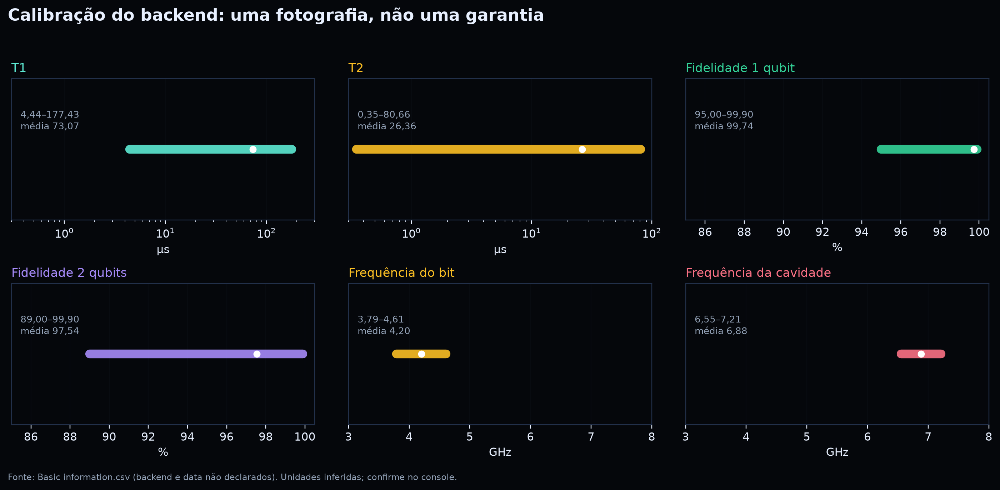{#fig-c1}

**Como ler:** T2 varia de 0,35 a 80,66 µs; a média de 26,36 µs não descreve
nenhum qubit específico. Fidelidade de 99,74% em 1 qubit não garante 99,74% em
um circuito de 4 qubits. A calibração é uma **fotografia**, não uma promessa.

O editor gráfico e o editor QASM ficam em
<https://tiangongqs.com/cloud/circuit>; o Jupyter, em
`tiangongqs.com/cloud/jupyter`. O guia de programação aceita **OpenQASM 2.0** e
traz exemplos de Bell e GHZ.

### Passo a passo no editor

| Passo | O que fazer |
|---:|---|
| 1 | Abra <https://tiangongqs.com/cloud/circuit>. |
| 2 | Entre na sua conta. |
| 3 | Escolha o modo **QASM**. |
| 4 | Cole o código de `circuitos_qasm/ghz4.qasm`. |
| 5 | Selecione `Guoji No.8 (simulate)` (API: `Guoji08`) ou um simulador. |
| 6 | Defina 1024 tiros. |
| 7 | Execute e compare os counts. |

### O que verificar

| Sinal | Esperado |
|---|---|
| Soma dos counts | 1024 |
| `0000` + `1111` | maioria dos tiros |
| `outros` | minoria; ruído e leitura |
| Backend | nome e calibração anotados |

> **Escopo:** o código é compatível com OpenQASM 2.0 e foi o mesmo usado no
> `gjq-client`. A execução no editor depende de conta, fila e backend; o livro
> não promete resultado idêntico ao de outra calibração.

## QASM 2.0 do GHZ de 4 qubits

```qasm
OPENQASM 2.0;
include "qelib1.inc";
qreg q[4];
creg c[4];
h q[0];
cx q[0], q[1];
cx q[0], q[2];
cx q[0], q[3];
measure q[0] -> c[0];
measure q[1] -> c[1];
measure q[2] -> c[2];
measure q[3] -> c[3];
```

Esse texto pode ser colado no editor da nuvem ou validado localmente com
`qiskit.qasm2.loads`. O circuito tem profundidade 5 antes da transpilação; no
Guoji08, foi para 13.

A pasta `educacao_quantica_bohm/circuitos_qasm/` reúne os arquivos prontos:
`bell.qasm`, `ghz4.qasm`, `chsh_e00.qasm` a `chsh_e11.qasm` e
`vqc_xor_00.qasm` a `vqc_xor_11.qasm`. O `README.md` da pasta explica cada um.
Para gerar de novo:

```bash
.venv-quantum/bin/python educacao_quantica_bohm/scripts/gerar_qasm.py
```

## `gjq-client`

O SDK Python permite listar backends, transpilar, submeter e ler resultados.

```python
import os
from qiskit import QuantumCircuit
from gjq_client import GJQRuntimeService, Sampler, generate_preset_pass_manager

service = GJQRuntimeService(api_key=os.environ["GJQ_API_KEY"])
backend = service.backend("Guoji08")

qc = QuantumCircuit(4, 4)
qc.h(0)
for alvo in (1, 2, 3):
    qc.cx(0, alvo)
qc.measure_all()

pm = generate_preset_pass_manager(backend=backend, optimization_level=2)
isa = pm.run(qc)
job = Sampler(backend=backend).run(isa, shots=1024)
print(job.result(timeout=600)["counts"])
```

## Script consolidado `executar_nuvem.py`

O script `educacao_quantica_bohm/scripts/executar_nuvem.py` reúne quatro
experimentos: **GHZ**, **QASM 2.0**, **VQC XOR** e **CHSH**. Ele lê a chave
apenas de `GJQ_API_KEY`, registra os task IDs e grava um JSON consolidado por
execução.

```bash
export GJQ_API_KEY="sua-chave"   # nunca grave a chave no projeto

# tudo no Guoji08
python educacao_quantica_bohm/scripts/executar_nuvem.py --backend Guoji08

# só o GHZ, para comparar backends
python educacao_quantica_bohm/scripts/executar_nuvem.py --backend Baihua --only ghz

# montar e transpilar os circuitos sem rede
python educacao_quantica_bohm/scripts/executar_nuvem.py --dry-run
```

Cada experimento salva um arquivo em `dados_hardware/`:
`ghz4_guoji08.json`, `ghz4_qasm_guoji08.json`, `vqc_xor_guoji08.json`,
`chsh_guoji08.json` e um consolidado `nuvem_guoji08_*.json`.

## Servidor MCP `gjq-runtime-mcp-server`

O servidor MCP envolve o `gjq-client` e expõe ferramentas para agentes:
`list_backends_tool`, `sample_tool`, `estimate_tool`, `get_task_status_tool`,
`get_task_result_tool`, entre outras. Ele aceita **OpenQASM 2.0** e recursos
prontos (`circuits://bell-state`, `circuits://ghz-state`).

```bash
git clone https://github.com/guoji-quantum/gjq-runtime-mcp-server.git
cd gjq-runtime-mcp-server
python -m venv .venv
source .venv/bin/activate
pip install -e .
cp .env.example .env   # coloque GJQ_API_KEY no .env
python -m gjq_runtime_mcp_server
```

> **Segurança:** a API key é armazenada em texto simples no cache local e no
> arquivo de configuração do cliente MCP. Trate-a como senha: não commit, não
> compartilhe, rotacione se vazar. O notebook desta edição **não** contém a chave.

# Figuras e scripts {#figuras}


Todas as **figuras científicas** desta edição são produzidas por scripts
executáveis. A arte pixel (capa, sprites, barras) é decorativa e também é gerada
por código; ela não substitui uma figura de dados.

| Figura | Script | Motor | O que mostra |
|---|---|---|---|
| R1 — GHZ real | `scripts/gerar_resultados_reais.py` | Qiskit + `gjq-client` | contagens reais no Guoji08 e fidelidade proxy |
| R2 — VQC XOR | `scripts/gerar_resultados_reais.py` | PennyLane + dados reais | ideal, phase damping, depolarização e backend |
| R3 — CHSH | `scripts/gerar_resultados_reais.py` | Qiskit + `gjq-client` | quatro correladores e o valor S no Guoji08 |
| R4 — dois backends | `scripts/gerar_resultados_reais.py` | Qiskit + `gjq-client` | GHZ no Guoji08 (20 q) e no Baihua (156 q) |
| 100 conceitos | `scripts/experimentos_100.py` | Qiskit + `gjq-client` | 18 circuitos-base, simulado × backend |
| N0 — bit/qubit/medição | `scripts/gerar_figuras_niveis.py` | Matplotlib | mapa mínimo sem matemática |
| N0b — onda piloto | `scripts/gerar_figuras_niveis.py` | Matplotlib | duas fendas e franjas (modelo) |
| N1 — Bell/CHSH | `scripts/gerar_figuras_niveis.py` | Matplotlib | correlação e S |
| N1b — circuito/matriz | `scripts/gerar_figuras_niveis.py` | Matplotlib | circuito e matriz densidade |
| N2 — ruído | `scripts/gerar_figuras_niveis.py` | Matplotlib | T1/T2 e Bloch |
| N2b — pipeline | `scripts/gerar_figuras_niveis.py` | Matplotlib | replicação e incerteza |
| 5 — PennyLane | `scripts/gerar_ilustracoes.py` | PennyLane | circuito de Bell |
| 6 — Cirq | `scripts/gerar_ilustracoes.py` | Cirq | diagrama textual do Bell |
| 7 — Qiskit | `scripts/gerar_ilustracoes.py` | Qiskit | circuito de Bell |
| 9 — probabilidades | `scripts/gerar_ilustracoes.py` | PennyLane/Cirq/Qiskit | mesmo estado, três motores |
| 10 — Bloch | `scripts/gerar_ilustracoes.py` | Qiskit | esfera de Bloch de H|0⟩ |
| 11 — correlações | `scripts/gerar_ilustracoes.py` | Qiskit | matriz do estado de Bell |
| 1 — onda piloto | `scripts/gerar_ilustracoes.py` | NumPy/Matplotlib | trajetórias guiadas por fase (modelo) |
| 2 — interferência | `scripts/gerar_ilustracoes.py` | NumPy/Matplotlib | curva de duas fendas |
| 3 — holograma | `scripts/gerar_ilustracoes.py` | NumPy/Matplotlib | reconstrução com 1,1% dos coeficientes |
| 4 — diálogo | `scripts/gerar_ilustracoes.py` | Matplotlib | roda de oito gestos |
| capa e sprites | `scripts/pixel_art.py` | PIL | arte pixel decorativa |

## Reproduzir

```bash
# simulações e figuras
.venv-quantum/bin/python educacao_quantica_bohm/scripts/gerar_ilustracoes.py
.venv-quantum/bin/python educacao_quantica_bohm/scripts/gerar_resultados_reais.py
.venv-quantum/bin/python educacao_quantica_bohm/livro_pixel/scripts/pixel_art.py

# dados reais (opcional; exige GJQ_API_KEY no ambiente)
.venv-quantum/bin/python educacao_quantica_bohm/scripts/experimentos_100.py --sim
.venv-quantum/bin/python educacao_quantica_bohm/scripts/experimentos_100.py --real --backend Guoji08
.venv-quantum/bin/python educacao_quantica_bohm/scripts/experimentos_100.py --report
.venv-quantum/bin/python educacao_quantica_bohm/scripts/executar_nuvem.py --backend Guoji08
```

Os dados reais ficam em `dados_hardware/` (GHZ, QASM, VQC e CHSH). O retrato
pixelado da página de rosto deriva de
`educacao_quantica/livro/figuras/CAPA/1.svg`; é um elemento editorial, não uma
figura científica.

> **Regra:** se uma figura não pode ser reproduzida por um script, ela não entra
> como evidência. Pode entrar como ilustração, mas o texto deve dizer o que ela é.

# Carta ao estudante {#carta-estudante}


Você não precisa ler 3000 páginas de uma vez. Este livro foi feito para ser
**habitado**: uma lauda por dia, sete minutos, uma pergunta.

Cada página tem uma ideia, uma imagem, uma prática e um checkpoint. Não é uma
corrida; é uma escada. Se você travar, não pule: escolha a lente “analogia” ou
“erro comum” do mesmo conceito. Se ainda travar, escreva a dúvida no diário e
volte amanhã.

Três regras:

1. **Preveja antes de testar.** A diferença entre a previsão e o resultado é o
   aprendizado.
2. **Declare o limite.** Toda analogia quebra em algum ponto; saber onde é parte
   do conceito.
3. **Não confunda simulação com hardware.** O computador limpo não é o chip com
   ruído.

> **Sua primeira lauda:** L0001 (Bit — ideia em 60s). Leia, faça o checkpoint e
> escreva uma frase no diário. Depois, escolha a lente “prática” do mesmo conceito.

# Carta ao professor {#carta-professor}


Este é um livro **nanoescalável**: 3000 laudas de uma página, organizadas em 100
conceitos × 10 lentes. Você pode usar uma lauda como aquecimento, cinco como
oficina de 50 minutos ou um conceito inteiro como aula de 100 minutos.

## Como não se perder

- Use o **mapa dos 100 conceitos** (próxima seção) para escolher o recorte.
- Use os **marcadores do PDF** para pular direto para uma lauda.
- Cada lauda tem uma caixa **RIGOR CIENTÍFICO** com a definição precisa e uma
  nota **PARA O PROFESSOR**. Ela é a âncora contra superficialidade.
- A página **Caderno de resultados reais** traz GHZ e VQC no Guoji08; use-a para
  discutir ruído, amostra e generalização.

## Tempos de leitura

| Tempo | Trilha |
|---|---|
| 15 min | 2 laudas: ideia + checkpoint de um conceito |
| 50 min | 5 laudas: ideia → analogia → prática → laboratório → checkpoint |
| 100 min | 10 laudas de um conceito + roda de diálogo |
| 7 dias | 1 conceito por dia, com diário de bordo |
| Pesquisa | 10 laudas + replicação com outra seed/backend |

## Rigor sem peso

A linguagem é leve de propósito; a precisão fica nas caixas de rigor. Não troque
a caixa de rigor por “resumo fácil”: ela é o que separa divulgação de
infodiversão. Quando a turma perguntar “isso é verdade?”, volte à lauda “erro
comum” e à lauda “para ir além” do mesmo conceito.

## Sobre a API key e o cache

A chave usada para os resultados reais **não está** no livro, no notebook ou nos
dados. O script `executar_nuvem.py` lê apenas `GJQ_API_KEY`; se a variável não
existir, ele para com uma mensagem clara.

### Primeira execução

```bash
export GJQ_API_KEY="sua-chave"   # Linux/macOS
# PowerShell: $env:GJQ_API_KEY = "sua-chave"
```

### Onde o SDK guarda o cache

O guia oficial do `gjq-client` informa que, após a primeira autenticação, o SDK
grava os parâmetros da conta em:

- **Linux/macOS:** `~/.gjq_client/gjq_client_account.json`
- **Windows:** `%USERPROFILE%\.gjq_client\gjq_client_account.json`

Esse arquivo contém a `api_key` e configurações de transporte (incluindo o
fingerprint PQC, quando usado). Trate-o como **senha**. Em Linux/macOS:

```bash
chmod 600 ~/.gjq_client/gjq_client_account.json
```

### Checklist de segurança

- [ ] A chave existe **somente** em variável de ambiente ou no cache protegido.
- [ ] O cache tem permissão `600` e não está em pasta sincronizada/publicada.
- [ ] `.env`, cache e configuração do MCP estão no `.gitignore`.
- [ ] A chave é **least privilege** (só o necessário) e é rotacionada.
- [ ] Ninguém cola a chave em print, issue, chat ou notebook.
- [ ] O servidor MCP usa `.env` local, não commitado.
- [ ] Tarefas antigas são auditadas se houver suspeita de vazamento.

### Se a chave vazar

1. **Revogue/rotacione** a chave no console da Tiangong.
2. Apague o cache local e o `.env` do MCP.
3. Verifique `list_tasks()` e os task IDs recentes.
4. Registre o incidente e o que foi acessado.

> **Referência oficial:** Tiangong, *Quantum Programming Framework User Guide*,
> seção “API Key and account cache”:
> <https://tiangongqs.com/docs/quantum/QuantumProgrammingFramework.html#_2-2-api-key-and-account-cache>.

# As 10 lentes {#lentes}


| Lente | O que faz | Evidência |
|---|---|---|
| **Ideia em 60s** | dá a definição mínima e uma pergunta | frase escrita |
| **Analogia + limite** | cria intuição e mostra onde ela quebra | desenho com “X” no limite |
| **Mão na massa** | coloca o corpo e o papel antes do código | registro da atividade |
| **Laboratório** | simula, mede ou compara | código, tabela ou figura |
| **Erro comum** | desmonta uma concepção errada | contraexemplo |
| **Para ir além** | traz a definição precisa e o detalhe científico | nota de rigor |
| **Roda de diálogo** | investiga suposições em grupo | pergunta nova |
| **Ética e sociedade** | pergunta quem ganha e quem perde | argumento com afetados |
| **Conexão com a vida** | liga o conceito ao cotidiano | exemplo local |
| **Checkpoint** | verifica e projeta o próximo passo | diário de bordo |

> **Regra de ouro:** nenhuma lente substitui as outras. A força do livro está na
> combinação: intuição, prática, rigor, diálogo e ética.