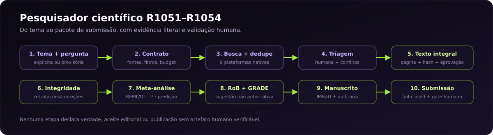

# Scientific Lab — pesquisador científico do Core



**Do tema ao pacote de submissão, com evidência literal, gate metacognitivo e
validação humana.**

A camada nativa v4.2 vive em `scientific_lab/native/` e não exige a supercamada
externa v4.1 para busca, revisão, Evidence Graph e o pipeline R1051–R1054. Os
módulos avançados ainda não migrados permanecem como fallback explícito.

[🏠 README principal](../README.md) ·
[🔬 Pipeline R1054](../docs/SCIENTIFIC_RESEARCH_PIPELINE_R1054.md) ·
[🧪 Benchmark BCG](../reports/r1054/real-meta-benchmark.json) ·
[📋 Spec R1054](../specs/SPEC-1054-automacao-assistida-validacao-real.md)

---

## Pipeline R1051–R1054

| Ciclo | Entrega | Evidência |
|---|---|---|
| R1051 | tema → contrato → busca → dedupe → triagem → evidência → gate → manuscrito | [R1051](../reports/r1051/README.md) |
| R1052 | texto integral, aprovação humana, triagem `review.screen`, integridade Crossref, `refresh` | [R1052](../reports/r1052/README.md) |
| R1053 | meta-análise, I²/Q/tau², predição, RoB, GRADE, LaTeX/DOCX/PDF | [R1053](../reports/r1053/README.md) |
| R1054 | extração assistida, PLOS ONE, submissão fail-closed, gate, BCG | [R1054](../reports/r1054/README.md) |

## Comandos

### Planejar sem rede

```bash
python -m marceloclaro.scientific_lab research project \
  --theme "saúde mental em estudantes universitários" \
  --out projects/demo-r1054 --dry-run
```

### Pesquisar e auditar

```bash
python -m marceloclaro.scientific_lab research project \
  --theme "saúde mental em estudantes universitários" \
  --question "Quais evidências descrevem o tema?" \
  --out projects/demo-r1054 \
  --sources openalex,crossref,europepmc \
  --check-integrity
```

### Texto integral e aprovação humana

```bash
python -m marceloclaro.scientific_lab research refresh \
  --out projects/demo-r1054 \
  --fulltext-dir /caminho/dos/pdfs \
  --fulltext-approval /caminho/aprovacao.json \
  --check-integrity
```

### Meta-análise, RoB e GRADE

```bash
python -m marceloclaro.scientific_lab research refresh \
  --out projects/demo-r1054 \
  --quantitative-data dados-de-efeito.json

python -m marceloclaro.scientific_lab research auto-rob-grade \
  --out projects/demo-r1054 \
  --data dados-de-efeito.json \
  --fulltext-dir /caminho/dos/pdfs \
  --reviewer "Nome" --confirm
```

### Benchmark real BCG

```bash
python -m marceloclaro.scientific_lab research benchmark-meta \
  --data reports/r1054/bcg.csv \
  --reference reports/r1054/reference.json
```

### Submissão e gate

```bash
python -m marceloclaro.scientific_lab research submission \
  --out projects/demo-r1054 --journal-profile plos-one

python -m marceloclaro.scientific_lab research publication-gate \
  --out projects/demo-r1054
```

## Estrutura do pacote

```text
00_contract/       intake, contrato de recuperação, protocolo
01_sources/        busca, registros normalizados, estudos, downloads
02_screening/      triagem assistida, resumo humano, PRISMA
03_evidence/       claims, gate, texto integral, integridade
04_analysis/       análise descritiva, meta-análise, extração, RoB/GRADE
05_audit/          auditoria determinística
06_manuscript/     manuscript.md, references.json
07_validation/     VALIDATION.md, aprovação de texto integral
07_artifacts/      Evidence Graph, PRISMA flow
08_manifest/       project-manifest.json com SHA-256
09_provenance/     annotations, validação externa, aceite, autorização
10_submission/     Markdown/LaTeX/DOCX/PDF, checklist, declarações
```

## Estados

| Estado | Significado |
|---|---|
| `planned` | dry-run ou corpus sem busca |
| `blocked` | busca falhou ou auditoria dura falhou |
| `partial` | pacote gerado sem claims/registros suficientes |
| `completed_pending_external_validation` | pacote interno completo; validação humana/externa pendente |

`truth_claim=false`, `external_validation=false` e
`human_review_required=true` são invariantes do pipeline.

## Limites

- A busca depende de rede, provedores e limites de API.
- A triagem automática é assistida; dois revisores humanos continuam necessários.
- Extração de efeitos, RoB e GRADE são assistivos, não autoritativos.
- Texto integral é validado contra o arquivo fornecido, não contra a versão publicada.
- Meta-análise usa apenas efeitos/erros declarados; não imputa dados.
- Submissão real exige backend/credenciais; sem isso, o gate bloqueia.
- Nada é publicado, aceito ou validado externamente sem artefato institucional.

## Camada nativa e fallback v4.1

```bash
python -m marceloclaro.scientific_lab native-status
python -m marceloclaro.scientific_lab research search "tema" --workspace .
python -m marceloclaro.scientific_lab review --help
python -m marceloclaro.scientific_lab evidence --help
```

`mesh`, `mission`, `living`, `synthesis`, `grade`, `causal`, `federation` e
`production` continuam como fallback v4.1; sua prontidão é distinta da camada
nativa.

A instalação completa v4.1 usa por padrão
`~/.local/share/pesquisador-universal/skill`. Também é possível definir
`PESQUISADOR_UNIVERSAL_HOME=/caminho/para/skill`. Use `status` para consultar
versão e identidade do manifesto; `installed_verified` não é garantia de
execução científica.

## Documentação

- [Documentação do Core](../docs/README.md)
- [Scientific Lab v4.2](../docs/SCIENTIFIC_LAB_V42.md)
- [Pipeline R1054](../docs/SCIENTIFIC_RESEARCH_PIPELINE_R1054.md)
- [Spec R1054](../specs/SPEC-1054-automacao-assistida-validacao-real.md)
- [Relatório R1054](../reports/r1054/README.md)
- [Manual](../MANUAL.md)
